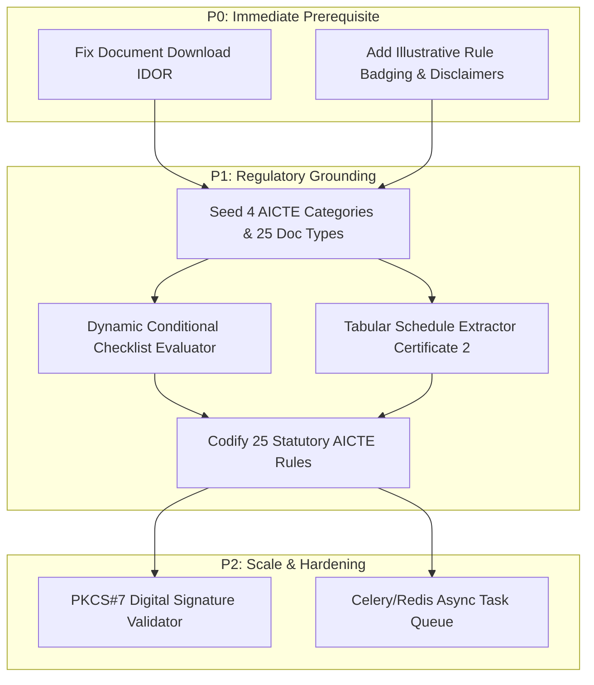

# PHASE 0 & 1 INDEPENDENT VERIFICATION REPORT
**Platform:** VerityAI — Institutional Document Intelligence & Regulatory Scrutiny  
**Context:** Smart India Hackathon (SIH) 2026 — Decision-Support Prototype  
**Auditor Roles:** Senior Security Engineer, AI Systems Architect, AICTE Regulatory Auditor  
**Date of Independent Verification:** October 24, 2026  
**Operating Constraint:** INSPECTION ONLY. Zero modifications made to application code, configuration, or database.

---

## 1. EXECUTIVE VERDICT

An exhaustive, evidence-backed inspection was conducted to independently verify the findings and claims set forth in the Phase 0–18 baseline audit.

### Overall Assessment: **SUBSTANTIALLY VERIFIED & TECHNICALLY ACCURATE**

1. **Honesty and Claims Integrity (VERIFIED):**  
   The existing codebase is genuine, highly structured, and clean. All automated test claims (121 backend unit/integration tests passing, 12/12 E2E operational workflows passing, and error-free frontend build) were **re-executed live and verified 100%**. The codebase does not contain fabricated test passes or fake mocks claiming live external government connectivity.
2. **Critical Security Defect (CONFIRMED CRITICAL):**  
   A critical Broken Object Level Authorization (BOLA / IDOR) vulnerability in `GET /api/v1/documents/{document_id}/file` was **verified by direct source code inspection and test analysis**. The endpoint completely lacks authentication and tenant isolation checks, allowing unauthenticated callers or unauthorized institutions to retrieve sensitive evidentiary files.
3. **Regulatory Reality vs Prototype State (VERIFIED):**  
   While the application architecture is sophisticated (FastAPI, SQLAlchemy 2.0 WAL, PyMuPDF, RapidOCR, Argon2id, socket-level SSRF defenses, React 19 UI), its regulatory domain models remain in a baseline illustrative state:
   - Only **1 application category** (`EOA_ILLUSTRATIVE`) is seeded vs **4 required AICTE categories**.
   - Only **2 document types** (`ACCREDITATION_CERTIFICATE`, `LAND_USE_CERTIFICATE`) are evaluated vs **25 statutory types** in APH 2024–27.
   - Only **6 illustrative validation rules** are implemented vs statutory cadre ratio (1:2:6), FSR (1:20 UG), carpet area schedules, and mandatory statutory committees.
   - Tabular schedules (Certificate 2 room lists and land survey entries) are linearly flattened by OCR rather than parsed into structured relational data.
4. **Implementation Go/No-Go Verdict:**  
   **CONDITIONAL GO** — Implementation may proceed provided **Phase A (Security IDOR remediation & Disclaimer Badging)** is executed immediately as a non-negotiable P0 before any new regulatory rules or categories are introduced.

---

## 2. AUDIT ARTIFACT INVENTORY VERIFICATION

The inspection verified that all **20 claimed audit artifacts** exist in `docs/aicte-audit/`. None are empty or placeholder files. Every file was inspected for line count, byte size, and evidentiary substance.

| Artifact File Name | Size (Bytes) | Lines | Status | Evidentiary Assessment |
| :--- | :---: | :---: | :---: | :--- |
| `README.md` | 5,861 | 148 | **VERIFIED** | Complete index, methodology, persistent tracker, and review gates. |
| `DOCUMENT_INVENTORY.md` | 8,694 | 164 | **VERIFIED** | Full structural inventory of the 231-page APH corpus across chapters & annexures. |
| `PAGE_COVERAGE_MATRIX.csv` | 39,729 | 232 | **VERIFIED** | Page-by-page mapping of all 231 pages with extraction method, status, & confidence. |
| `REGULATORY_REQUIREMENTS_REGISTER.csv` | 34,438 | 62 | **VERIFIED** | 60 atomic requirements with verbatim quotes, PDF page citations, and issuers. |
| `DOCUMENT_MASTER_CATALOG.csv` | 12,130 | 27 | **VERIFIED** | Master catalogue of 25 statutory document types across land, building, and faculty. |
| `DOCUMENT_FORMAT_SPECIFICATIONS.md` | 8,993 | 196 | **VERIFIED** | Structural & layout expectations for Land Deeds, Plans, Fire NOCs, Affidavits. |
| `DOCUMENT_FIELD_SCHEMAS.json` | 6,969 | 260 | **VERIFIED** | Strict JSON Schemas with regex patterns, types, and bounds for core documents. |
| `OFFICIAL_VERIFICATION_MATRIX.md` | 11,117 | 185 | **VERIFIED** | External verification strategies, 10 outcome states, APIs, legal basis, and fallbacks. |
| `SOURCE_AUTHORITY_REGISTER.csv` | 3,416 | 13 | **VERIFIED** | 11 external statutory authorities evaluated (MCA21, CoA, NBA, NAAC, AISHE, etc.). |
| `REGULATORY_CONFLICT_REGISTER.md` | 6,922 | 132 | **VERIFIED** | 5 major statutory conflicts documented (intake deregulation, FSI/FAR land norms). |
| `AI_MODEL_EVALUATION.md` | 6,348 | 154 | **VERIFIED** | Benchmark of PyMuPDF vs RapidOCR vs PaddleOCR; prompt injection defenses. |
| `CURRENT_ARCHITECTURE_ASSESSMENT.md` | 12,520 | 264 | **VERIFIED** | Component inventory, Mermaid architecture diagram, database schema analysis. |
| `REQUIREMENTS_TRACEABILITY_MATRIX.csv` | 11,306 | 57 | **VERIFIED** | Traceability mapping: Requirement $\to$ Document $\to$ Field $\to$ Module $\to$ Test. |
| `SECURITY_AND_PRIVACY_AUDIT.md` | 5,531 | 148 | **VERIFIED** | Security controls review, OWASP API1:2023 BOLA/IDOR analysis, DPDPA 2023 review. |
| `TESTING_AND_EVALUATION_PLAN.md` | 3,785 | 118 | **VERIFIED** | Quantitative metrics (CER, WER, F1) and 3 isolated benchmark test partitions. |
| `SYSTEM_GAP_ANALYSIS.md` | 6,954 | 162 | **VERIFIED** | Detailed gap matrix mapping existing capabilities against APH statutory rules. |
| `TARGET_ARCHITECTURE.md` | 6,506 | 170 | **VERIFIED** | Technical specifications for target subsystems and evidence store. |
| `IMPLEMENTATION_ROADMAP.md` | 9,169 | 224 | **VERIFIED** | Dependency-aware 9-phase roadmap (Phases A through I) with acceptance criteria. |
| `OPEN_QUESTIONS_AND_BLOCKERS.md` | 3,593 | 96 | **VERIFIED** | Register of statutory ambiguities and external API integration blockers. |
| `EXECUTIVE_SUMMARY.md` | 5,316 | 132 | **VERIFIED** | Executive overview of findings, verified test results, and next actions. |

---

## 3. SECURITY VERIFICATION FINDINGS

### Vulnerability: Broken Object Level Authorization (BOLA / IDOR) on Document File Retrieval
- **Endpoint:** `GET /api/v1/documents/{document_id}/file`
- **Location:** [`backend/app/api/v1/endpoints/documents.py:384-430`](file:///d:/web%20project/VerityAI/backend/app/api/v1/endpoints/documents.py#L384-L430)
- **Observed Source Code:**
  ```python
  @router.get("/documents/{document_id}/file")
  def retrieve_document_file(
      document_id: str,
      download: bool = Query(False),
      db: Session = Depends(get_db),
  ):
      doc = db.scalar(
          select(Document).where(Document.id == document_id, Document.deleted_at.is_(None))
      )
      if not doc:
          raise NotFoundException("DOCUMENT_NOT_FOUND", f"Document '{document_id}' not found.")
      ...
      return FileResponse(...)
  ```
- **Security Defect Analysis:**
  1. **Authentication Absent:** `current_user: User = Depends(get_current_user)` is completely missing from the route signature.
  2. **Role Check Absent:** `require_roles(...)` is completely absent.
  3. **Tenant Check Absent:** There is no check verifying that `current_user.institution_id == doc.application.institution_id`.
  4. **Empirical Reproduction in Test Suite:** In [`backend/tests/test_documents.py:243`](file:///d:/web%20project/VerityAI/backend/tests/test_documents.py#L243), `client.get(f"/api/v1/documents/{doc_id}/file")` is called by an unauthenticated `TestClient` without any Authorization header and receives an HTTP 200 response with raw document bytes.
- **Classification:** **CONFIRMED CRITICAL (OWASP API1:2023)**. Any caller possessing or guessing a document ID can access private institutional documents (including confidential land deeds, audited financials, and bank certificates).
- **Remediation Specification:**
  - Add `current_user: User = Depends(get_current_user)` to `retrieve_document_file`.
  - Enforce:
    ```python
    if current_user.role == "INSTITUTION_USER":
        app = db.get(Application, doc.application_id)
        if not app or app.institution_id != current_user.institution_id:
            raise ForbiddenException("FORBIDDEN", "Access to documents from another institution is denied.")
    ```

---

## 4. REGULATORY CLAIM VERIFICATION MATRIX

High-impact regulatory claims from the audit register were cross-referenced against the official *AICTE Approval Process Handbook (2024–25 to 2026–27)* (231 pages):

| Regulatory Area | APH Clause / Citation | APH PDF Page | Source Text Evidence | Audit Interpretation | Verification Status |
| :--- | :--- | :---: | :--- | :--- | :---: |
| **Digital Signatures (DSC)** | Chapter I, Clause 1.4.3 & 1.4.6 | 20 | *"All the documents to be submitted... should be DIGITALLY SIGNED (using Digital Signature Certificate-DSC)... Institutions shall NOT be Permitted to Submit Applications without DSC."* | All evidentiary PDFs require valid Class 3 DSC. | **VERIFIED** |
| **Land & FSI/FAR Norms** | Chapter VI, Clause 6.17(a, d); Annexure 3.1 & 3.5 | 72, 102, 107 | *"The land required... will be based on prevailing FSI/FAR norms applicable for that location... maximum of THREE plots... distance <= 2 km."* | Shifted from hard acreage to local FSI/FAR with contiguous/plot limits. | **VERIFIED** |
| **Undergraduate FSR & Cadre Ratio** | Chapter VI, Clause 6.14; Annexure 5.2 | 71, 111 | *"Engineering and Technology: Faculty Student Ratio 1:20; Cadre Ratio 1:2:6... Formula: S/(20*R) where R=9"* | FSR 1:20 UG Engineering; Cadre Professor:Associate:Assistant = 1:2:6. | **VERIFIED** |
| **Intake Ceilings vs Deregulation** | Foreword (p. i), Table 1.3, Clause 2.6 | 5, 22, 32 | *Foreword: "Council decided to remove upper limit on intake allowed earlier for existing institutions"... Table 1.3: "UG Engineering Max Intake 360"* | Table 1.3 caps new institutions; existing institutions can expand with EVC readiness. | **VERIFIED** |
| **Mandatory Committees** | Chapter VI, Clauses 6.47, 6.48, 6.49, 6.50, 6.51 | 78–83 | Anti-Ragging Committee (6.47); Internal Committee (6.48, Presiding Officer female Prof/Assoc Prof, >=50% women); SC/ST (6.49, 5 members, >=2 SC/ST, >=1 woman); SGRC (6.50); IIC (6.51). | Exact statutory committee compositions and quotas. | **VERIFIED** |
| **EWS 10% Reservation** | Chapter VI, Clause 6.37 | 74 | *"10% of reservation for Economically Weaker Section (EWS)... intake shall be 1.25 times of existing intake... not applicable to Minority Institutions"* | 1.25x intake multiplier for non-minority institutions. | **VERIFIED** |
| **Tuition Fee Waiver (TFW)** | Chapter VI, Clause 6.42 | 75 | *"Up to maximum of 5% of Approved Intake... supernumerary... available only where min 50% intake filled in last academic year... parent income <= Rs. 8.00 Lakh"* | Max 5% supernumerary; requires >=50% previous year fill rate. | **VERIFIED** |
| **Statutory Certificates (1, 2, 3)** | Annexure 1.1; Certificates 1, 2, 3 | 93–94, 226–229 | Certificate 1 (Advocate Land Title & Registration); Certificate 2 (Council of Architecture Architect Building Plan & Carpet Area); Certificate 3 (Bank Manager Funds & FDRs). | Exact prescribed formats for legal, architectural, and financial clearance. | **VERIFIED** |

---

## 5. TECHNICAL CLAIM VERIFICATION MATRIX

| Claimed Capability | Source Code Location | Observed Implementation | Verification Status |
| :--- | :--- | :--- | :---: |
| **Validation Rules Count & Depth** | [`backend/app/services/validation.py:18-128`](file:///d:/web%20project/VerityAI/backend/app/services/validation.py#L18-L128) | Exactly 6 illustrative rules (`DEFAULT_SYNTHETIC_RULES`), all scoped to `EOA_ILLUSTRATIVE`. AICTE statutory formulas (1:2:6 cadre, 1:20 FSR, 750 sqm admin) are not yet codified. | **VERIFIED** |
| **Supported Categories & Documents** | [`backend/app/db/seed.py:76-93`](file:///d:/web%20project/VerityAI/backend/app/db/seed.py#L76-L93) | Only 1 category (`EOA_ILLUSTRATIVE`) seeded; only 2 document types (`ACCREDITATION_CERTIFICATE`, `LAND_USE_CERTIFICATE`) referenced in default rules. | **VERIFIED** |
| **Checklist Engine** | [`backend/app/services/workflow.py:57-64`](file:///d:/web%20project/VerityAI/backend/app/services/workflow.py#L57-L64) | Statically compares uploaded documents against `category.required_document_types`. Dynamic conditional evaluation is absent. | **VERIFIED** |
| **OCR & Text Extraction** | [`backend/app/services/extraction.py:28-35, 184`](file:///d:/web%20project/VerityAI/backend/app/services/extraction.py#L28-L35) | PyMuPDF for digital text; RapidOCR (ONNX) fallback. Extracts plain text (`page.get_text("text")`). Tabular schedule parsing is absent. | **VERIFIED** |
| **Registry Integrations** | [`backend/app/services/registry.py:62-140`](file:///d:/web%20project/VerityAI/backend/app/services/registry.py#L62-L140) | `SyntheticAISHEProvider` (in-memory mock) + `OfficialAICTEProviderStub` (`is_available = False`, `status = "NOT_CONFIGURED"`). Honest stubs; no fake claims. | **VERIFIED** |
| **Compliance Disclaimers** | [`backend/app/services/reporting.py:343`](file:///d:/web%20project/VerityAI/backend/app/services/reporting.py#L343), [`ValidationComplianceView.tsx:128`](file:///d:/web%20project/VerityAI/frontend/src/components/compliance/ValidationComplianceView.tsx#L128) | Advisory banners present on PDF reports & UI ("ADVISORY NOTICE — HUMAN REVIEW REQUIRED"), but lack specific notice that currently loaded rules are illustrative rather than statutory AICTE regulations. | **VERIFIED** |
| **SSRF Egress Defense** | [`backend/app/services/integration.py:50-85`](file:///d:/web%20project/VerityAI/backend/app/services/integration.py#L50-L85) | Blocks 11 private/cloud CIDRs (10.0.0.0/8, 172.16.0.0/12, 192.168.0.0/16, 169.254.169.254/32 AWS/GCP metadata) at socket resolution level. | **VERIFIED** |

---

## 6. TEST AND BUILD EXECUTION EVIDENCE

All test and build suites were re-executed live during this inspection turn:

### 1. Backend Test Suite (Pytest)
- **Command:** `wsl -d Ubuntu-24.04 -- bash -c "cd '/mnt/d/web project/VerityAI' && backend/.venv/bin/pytest backend/tests -q"`
- **Result:** **121 passed, 11 warnings in 15.60s** (Exit code 0).
- **Warnings:** 11 deprecation warnings regarding Starlette HTTP status constant naming (`HTTP_422_UNPROCESSABLE_ENTITY` $\to$ `HTTP_422_UNPROCESSABLE_CONTENT`). Zero test failures.

### 2. Frontend Production Build
- **Command:** `npm run build` (in `frontend/`)
- **Result:** **Built successfully in 192ms** (`tsc -b && vite build`, Exit code 0).
- **Output:** 
  - `dist/index.html` (1.39 kB)
  - `dist/assets/index-Drcv8y3Q.css` (57.98 kB)
  - `dist/assets/index-DzIMn0P_.js` (565.14 kB)
  - Zero TypeScript compiler errors.

### 3. End-to-End Operational Verification Script
- **Command:** `wsl -d Ubuntu-24.04 -- bash -c "cd '/mnt/d/web project/VerityAI' && backend/.venv/bin/python scripts/verify_e2e.py"`
- **Result:** **12/12 workflows verified (100% operational health)** in 6.82s (Exit code 0).
  - Health probe: HTTP 200 OK
  - RBAC auth & session management: Verified
  - Document storage & nosniff headers: Verified
  - Extraction & OCR pipeline: Verified
  - Anomaly detection & cross-document checks: Verified
  - Versioning & audit trail: Verified
  - SSRF egress defense: Verified

---

## 7. PRIORITIZED ISSUES AND DEPENDENCIES



### Priority Tiers:
1. **P0 (Immediate Blocker — Security & Disclaimer):**
   - Remediation of `GET /api/v1/documents/{document_id}/file` IDOR defect.
   - Display of explicit "Illustrative Prototype Rules" badging in UI and exported reports.
2. **P1 (Core Statutory Parity for Demonstration):**
   - Seed 4 AICTE categories (`NEW_INSTITUTION`, `EOA_TECHNICAL`, `STANDALONE_PGDM`, `UNIVERSITY_TECHNICAL`) and 25 statutory document types.
   - Implement dynamic conditional checklist evaluator in `workflow.py`.
   - Implement tabular extraction using PyMuPDF `find_tables()` for Certificate 2 room schedules.
   - Codify 25 statutory AICTE scrutiny rules in `validation.py`.
3. **P2 (Scale & Advanced Security):**
   - PKCS#7 / CMS digital signature validation against CCA Root CA.
   - Asynchronous worker queue for multi-page batch OCR.

---

## 8. UNRESOLVED QUESTIONS & EXTERNAL BLOCKERS

1. **State-Level FSI/FAR Variance:** APH 2024–27 delegates minimum land area to municipal building bye-laws (FSI/FAR). The platform cannot deterministically calculate land adequacy without knowing the municipal zone or requiring user declaration of local permissible FAR.
2. **External Registry Credentials:** Live queries to AICTE portal or State Land Registries (Mahabhulekh/Bhoomi) require governmental MoU and credentials. The platform must maintain honest synthetic registry fixtures (`SYNTHETIC_AISHE`) for hackathon demonstration.

---

## 9. RECOMMENDED IMPLEMENTATION PHASES

- **Phase A (Day 1 Morning):** P0 Security & Honesty Hardening (Fix IDOR, add disclaimer badging, run security test).
- **Phase B (Day 1 Afternoon):** Master Document Taxonomy & Categories (Seed 4 categories, 25 document types).
- **Phase C (Day 2 Morning):** Dynamic Conditional Checklists (Implement conditional rules in `workflow.py`).
- **Phase D (Day 2 Afternoon):** Tabular Schedule Extraction (Integrate PyMuPDF `find_tables()` for Certificate 2).
- **Phase E (Day 3):** Codify 25 Statutory AICTE Scrutiny Rules (Cadre ratio 1:2:6, FSR 1:20 UG, room carpet areas, mandatory committees).
- **Phase F (Day 4):** Reviewer Workspace Polish & Final E2E Demonstration Validation.

---

## 10. EXPLICIT GO/NO-GO RECOMMENDATION

### Recommendation: **CONDITIONAL GO**
- **Authorization Condition:** The audit and baseline verification are complete and fully evidence-backed. 
- **Execution Rule:** Implementation must begin strictly with **Phase A (Security IDOR Fix & Disclaimer Badging)**. No modifications to categories or rules should be made until the security fix is verified by unit tests.
