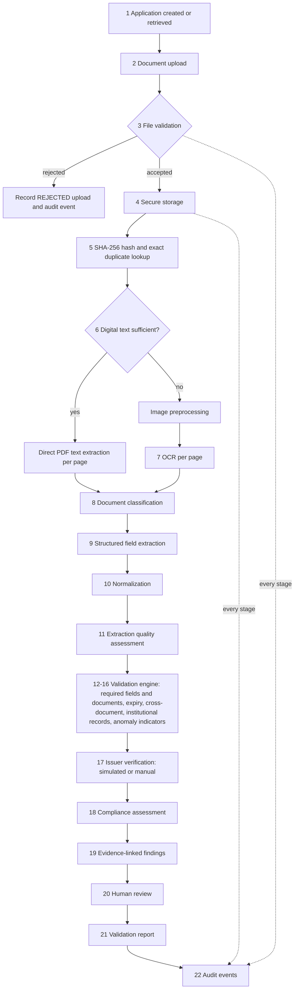
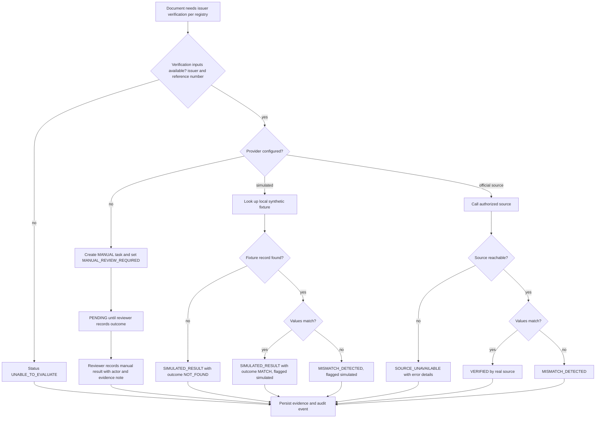
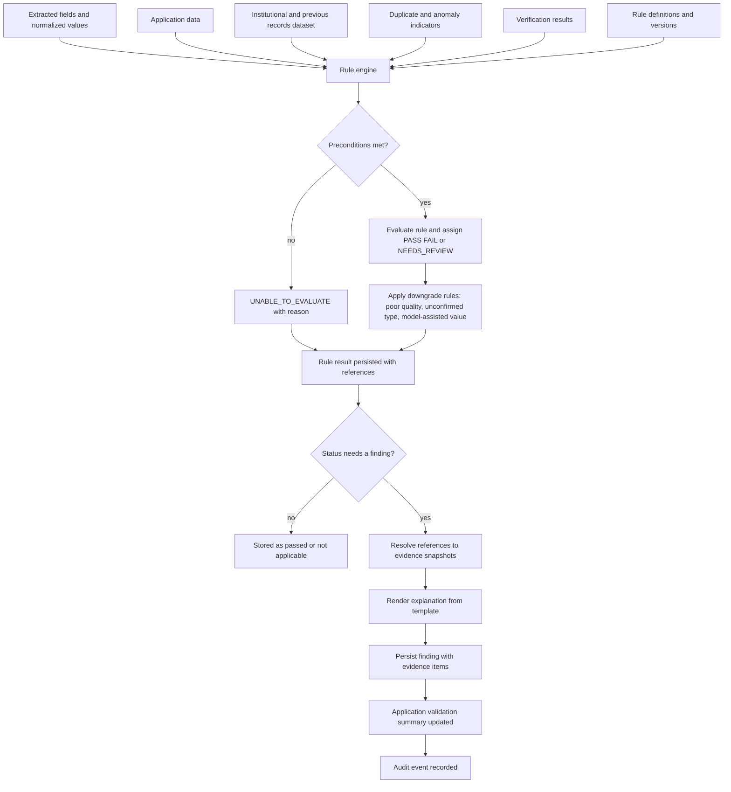
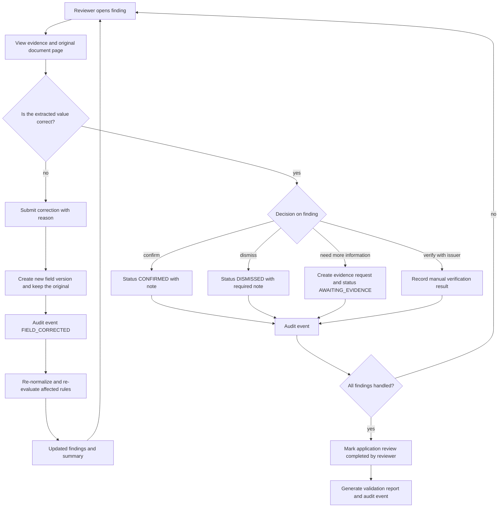

# VerityAI — AI Pipeline Specification

| Item | Value |
|---|---|
| Document | `docs/AI_PIPELINE.md` |
| Project | VerityAI |
| Problem Statement | SIH26261 — AI-Powered Application Validation, Document Authentication and Regulatory Compliance Verification |
| Organization | All India Council for Technical Education (AICTE), Ministry of Education, Government of India |
| Theme | Smart Automation |
| Document order | 4th of the documentation set (after `ARCHITECTURE.md`, `TECH_STACK.md`, `UI_UX_DESIGN.md`) |
| Status | Implementation-ready draft for a 3–4 day hackathon prototype |

---

## 1. Document Purpose

This document specifies the **document-intelligence pipeline** of VerityAI: how an uploaded file becomes a persisted, explainable, evidence-linked validation finding that a human official can review.

It is written so that an AI coding agent can implement the pipeline **without inventing its own processing model**. It defines stages, their inputs and outputs, status vocabularies, rule structures, evidence structures, failure handling, evaluation methodology and priorities. It deliberately contains **no application source code**. The exact database schema and API contracts belong to a separate document.

### 1.1 Assumptions about the other documents (read this first)

At the time of writing, `docs/ARCHITECTURE.md`, `docs/TECH_STACK.md` and `docs/UI_UX_DESIGN.md` were **not accessible** in the working environment. Following the instructions, this document proceeds from the project brief and documents its assumptions explicitly.

| # | Assumption | Why | If the real document differs |
|---|---|---|---|
| A1 | Backend is **Python (3.11+) with FastAPI**; the pipeline is an in-process Python package called by the API layer. | Brief says "Python backend", "deterministic Python rules". | Keep stage contracts; change only the invocation mechanism. |
| A2 | Persistence is a **relational database** (SQLite for the demo, PostgreSQL-compatible) accessed via an ORM. | "Persistent results" is P0. | Stage outputs are stored as rows/JSON columns; adapt names to the real schema. |
| A3 | Digital PDF text uses **PyMuPDF**; OCR uses **Tesseract** (via `pytesseract`) with **Pillow/OpenCV** preprocessing. | Common, local, free, installable in a day. | If TECH_STACK.md chose different libraries, **TECH_STACK.md wins**; the stage contracts below are library-independent. |
| A4 | Text comparison uses **RapidFuzz**; date parsing uses **python-dateutil/dateparser** *with explicit ambiguity handling* defined here. | Local, deterministic. | Any equivalent library is acceptable if it honours Section 11. |
| A5 | Processing runs **asynchronously within the same process** (e.g., a background task or a simple single worker queue), one document at a time per worker. | No distributed processing in P0. | If the architecture is synchronous, the stage contracts still hold. |
| A6 | Files are stored on **local disk** under a non-public directory; the database holds metadata and paths. | "No unrestricted public URLs". | Swap storage backend behind the same interface. |
| A7 | The UI shows documents, extracted fields, findings and evidence and supports reviewer actions as described in Section 19. | Brief Section 18. | Align status label text with UI_UX_DESIGN.md. |
| A8 | Reviewer identities and roles come from the application's authentication layer; the pipeline only receives an `actor_id`. | Out of pipeline scope. | — |

> **Rule for the coding agent:** if an existing project document contradicts a *technology choice* here, follow the existing document and keep the stage contracts. If it contradicts a *principle* (honest statuses, no false authentication claims, human oversight), raise the conflict rather than silently choosing.

---

## 2. Project Context

AICTE processes applications for Extension of Approval (EoA) and related approval changes. Each application carries institutional records, accreditation and certification documents, affidavits, NOCs, previous approvals, infrastructure evidence and other supporting documents. Manual scrutiny is slow, and problems such as missing documents, expired certificates, inconsistent dates or identifiers, duplicated files, metadata anomalies and unverifiable issuers are easy to miss.

**VerityAI is decision support, not a decision maker.** It performs *preliminary* validation, surfaces *evidence-linked findings* and routes uncertainty to authorized officials. It never approves or rejects an application, and an anomaly is never treated as conclusive proof of fraud.

**Demonstration constraints:**

- Synthetic, authorized or anonymized records only.
- Roughly three to four days of implementation by a beginner using an AI coding agent.
- Must be a **genuine working pipeline**: every displayed result is computed from the uploaded files and configured rules, never hard-coded.
- Core functionality must run **locally with no paid API** and no restricted government system.

---

## 3. Pipeline Overview

The pipeline has **22 logical stages**, grouped into five phases. The stages are *independent*: each records its own outcome so that, for example, OCR can succeed while a rule fails, or all local checks can pass while issuer verification remains pending.



**Key architectural idea — a stage-run ledger.** Every stage execution is stored as a *stage run* (document or application, stage name, status, start/end time, duration, summary, error). This ledger provides: (a) honest per-stage status, (b) latency measurements for benchmarking, (c) restart/retry points, (d) the audit trail.

---

## 4. Design Principles

| ID | Principle | Concrete consequence in this pipeline |
|---|---|---|
| P-A | **Hybrid intelligence** | Deterministic rules decide; OCR/PDF libraries read; an LLM is *optional* and only advisory (Section 10.6). |
| P-B | **Local-first** | Everything in P0 runs offline. External AI/verification is a plug-in that may be absent. |
| P-C | **Explainability** | Each finding states what was checked, rule, observed, expected, source, reason, review need. |
| P-D | **Honest status reporting** | Five distinct rule outcomes; failure to extract ≠ failure of a rule. |
| P-E | **No false authentication claims** | Text extraction, hashes, metadata and QR codes are never labelled "authentic". |
| P-F | **Human oversight** | Findings are "preliminary indicators". Officials decide. |
| P-G | **Synthetic data labelling** | Simulated records and verification results are visibly labelled. |
| P-H | **Time-boxed scope** | P0 is the smallest complete pipeline; P1/P2 are optional. |
| P-I | **Provenance everywhere** | Every value traces to document → page → method → timestamp. Never fabricate a value, a page or a record. |
| P-J | **Non-destructive correction** | Reviewer corrections are layered on top of originals. |

**Wording rules for all user-facing and report text** (the coding agent must follow these):

- Use: "extracted", "consistent with", "inconsistent with", "no mismatch detected by this check", "unverified", "needs review".
- Never use: "authentic", "genuine", "forged", "fraudulent", "verified" (unless a real supported source returned a match — see Section 16).
- Always show a "Preliminary — requires official review" label on findings and reports.

---

## 5. Processing Stages

### 5.1 Stage catalogue

| # | Stage ID | Responsibility | Primary technique | Uses AI? | Human review? |
|---|---|---|---|---|---|
| 1 | `APPLICATION_CONTEXT` | Load application, category, declared fields | DB read | No | Entry by user |
| 2 | `UPLOAD_RECEIVE` | Receive multipart upload, enforce size cap while streaming | API layer | No | No |
| 3 | `FILE_VALIDATION` | Extension, MIME, magic bytes, emptiness, openability | Deterministic | No | If rejected |
| 4 | `SECURE_STORE` | Generate IDs, safe path, write file | Deterministic | No | No |
| 5 | `HASH_DEDUP` | SHA-256, exact-duplicate lookup | Deterministic | No | Findings reviewed |
| 6 | `TEXT_EXTRACT` | Per-page digital text; decide OCR need | PyMuPDF | No | No |
| 7 | `OCR` | Render/preprocess pages, OCR, confidence | Tesseract | No (classical OCR) | If failed |
| 8 | `CLASSIFY` | Determine document type | Layered rules | Optional lightweight | If uncertain |
| 9 | `FIELD_EXTRACT` | Produce structured fields with provenance | Regex/labels | Optional advisory | If ambiguous |
| 10 | `NORMALIZE` | Canonical values for comparison | Deterministic | No | Ambiguous dates |
| 11 | `EXTRACTION_QA` | Per-document extraction quality summary | Deterministic | No | If poor |
| 12 | `RULES_REQUIRED` | Required fields / required documents | Rule engine | No | On findings |
| 13 | `RULES_EXPIRY` | Expiry and date sanity | Rule engine | No | On findings |
| 14 | `RULES_CROSSDOC` | Cross-document and application comparisons | Rule engine | No | On findings |
| 15 | `RULES_RECORDS` | Comparison with institutional/previous records dataset | Rule engine | No | On findings |
| 16 | `ANOMALY` | Preliminary indicators (duplicates, metadata, structure) | Deterministic (+ optional P1) | No (P0) | Always advisory |
| 17 | `ISSUER_VERIFY` | Provider-independent verification | Provider interface | No | Manual provider |
| 18 | `COMPLIANCE` | Checklist evaluation per category | Rule engine | No | On findings |
| 19 | `FINDINGS` | Build/persist evidence-linked findings | Deterministic | Optional wording help | Yes |
| 20 | `REVIEW` | Reviewer workflow | UI + API | No | Yes |
| 21 | `REPORT` | Validation report generation | Templates | No | Reviewer sign-off |
| 22 | `AUDIT` | Append audit events | Deterministic | No | No |

Stage 22 is **cross-cutting**: an audit event is written whenever a stage starts, ends, fails, or a human acts.

### 5.2 Scope levels: document stages vs application stages

- **Document-level stages (3–11, parts of 12/13/16):** run once per uploaded document, independently of other documents. A failure here affects only that document.
- **Application-level stages (12 required-documents, 14, 15, 18, 19, 21):** run when all current documents have finished their document-level stages (or are in a terminal state), and **re-run** whenever a document is added, removed, reclassified, or a field is corrected. Re-evaluation is idempotent: it produces a new *evaluation run* and supersedes unresolved machine findings from the previous run while **preserving reviewer decisions** (Section 19.5).

### 5.3 How stages communicate

Stages do **not** call each other directly. Each stage:

1. Reads its inputs from persisted records (files on disk and DB rows).
2. Writes its outputs to persisted records.
3. Records a stage run (status, timings, error).
4. Appends audit event(s).

A simple **orchestrator** function runs the document-level stages in order and then triggers the application-level evaluation. If a stage fails, the orchestrator records the failure and decides, via the table in Section 21, whether to continue with later stages that do not depend on the failed output.

**Dependency rules (what may be skipped, never faked):**

| Failed/skipped stage | Stages that still run | Stages marked `UNABLE_TO_EVALUATE` |
|---|---|---|
| `TEXT_EXTRACT` & `OCR` both fail | `HASH_DEDUP`, metadata anomaly checks | classification (→ manual), field extraction, all field-based rules |
| `CLASSIFY` uncertain | field extraction with *candidate* type only for display | rules that depend on a confirmed type |
| `FIELD_EXTRACT` partial | rules for fields that were extracted | rules for fields that weren't (→ `UNABLE_TO_EVALUATE` or `FAIL` for missing — see 13.4) |
| `ISSUER_VERIFY` source unavailable | everything else | only the verification outcome → `SOURCE_UNAVAILABLE` |

---

## 6. File Intake and Security

### 6.1 Upload vs processing — two different things

**Upload completion** means: the file was received, passed intake validation, was stored, and got a document ID. **Processing success** means the later stages ran and produced usable output. The UI and API must expose both separately:

- `upload_status`: `RECEIVED` → `ACCEPTED` or `REJECTED`
- `processing_status`: `QUEUED`, `PROCESSING`, `COMPLETED`, `COMPLETED_WITH_WARNINGS`, `PARTIAL`, `FAILED`, `MANUAL_REVIEW_REQUIRED` (Section 20)

A document can be `ACCEPTED` but `FAILED` in processing. This is a **processing failure, not a validation verdict**.

### 6.2 Intake rules (prototype defaults — configurable)

| Control | Default | Notes |
|---|---|---|
| Max file size | **20 MB** per file | Enforce while streaming; reject early. Configurable. |
| Max pages processed | **30 pages** per PDF | Pages beyond the cap are not processed; document flagged `PARTIAL` with reason `PAGE_LIMIT_EXCEEDED`. |
| Allowed types (P0) | PDF (`application/pdf`), JPEG, PNG | TIFF optional (P1). |
| Explicitly unsupported (P0) | DOCX, XLSX, ZIP, video | Rejected with a clear reason; videos only registered as *attachments requiring manual review* if the UI supports it (P1). |
| Empty file | Reject (`EMPTY_FILE`) | Size 0 bytes, or a PDF with zero pages. |
| Max files per application | 50 (configurable) | Prevents abuse of the demo. |

### 6.3 Validation sequence (Stage 3)

Never trust the filename extension alone. Perform all of the following; reject on any hard failure and record every check result:

1. **Size check** (0 < size ≤ limit).
2. **Extension allow-list check** (lower-cased, from the *sanitized* name).
3. **Declared MIME type check** (from the request) against allow-list.
4. **Magic-byte check** on the first bytes: PDF begins `%PDF-`; JPEG `FF D8 FF`; PNG `89 50 4E 47 0D 0A 1A 0A`. Detected type must agree with the extension and declared MIME; **detected type wins**. A disagreement is a *mismatch* → reject (`TYPE_MISMATCH`) in P0.
5. **Openability check:** PDF opens with the PDF library, has ≥1 page, is not password-protected (encrypted → reject with `ENCRYPTED_PDF`, offer manual handling); image opens with Pillow and has plausible dimensions (e.g., both sides ≥ 200 px, total pixels under a decompression-bomb limit).
6. **Malformed handling:** a parse exception → `MALFORMED_FILE`; the file may still be *stored and hashed* for audit but is flagged `REJECTED`, or kept as `ACCEPTED` with processing `FAILED` if the exception occurred only in later stages. Decision rule: **reject at intake only if the file cannot be opened at all**; anything openable is kept.

### 6.4 Safe filenames and storage

- Generate a **server-side unique document ID** (e.g., `DOC-` + UUID or a sequential ID). Never use the user's filename as a path component.
- Keep the **original filename** only as metadata, after sanitizing (strip path separators, control characters; limit length). Display it as text with output encoding; never interpolate it into shell commands.
- Storage path pattern (conceptual): `<storage_root>/<application_id>/<document_id>/original.<detected_ext>`. Derived artifacts (page images, OCR text) go in sibling folders `derived/`.
- `<storage_root>` is **outside** any static-file/public directory. Files are served only through an **authenticated, authorization-checked download endpoint** that streams the file; no guessable public URLs.
- Write to a temp name then atomically rename after hashing, so a crashed upload never leaves a half-written "valid" file.
- Set restrictive file permissions where the OS supports it.

### 6.5 Upload failure handling

| Situation | Behaviour |
|---|---|
| Connection dropped mid-upload | Discard temp file; no document record (or `REJECTED` with `UPLOAD_INTERRUPTED`); audit event. |
| Size exceeded | Abort stream; `REJECTED`, reason `FILE_TOO_LARGE`. |
| Disk write error | `REJECTED`/error `STORAGE_ERROR`; user told to retry; audit event. |
| DB error after file stored | Remove or quarantine the file; return error; never leave an orphan referenced as valid. |
| Unsupported format | `REJECTED`, reason `UNSUPPORTED_FORMAT`, message lists allowed formats; no processing attempted. |

Every accepted and rejected upload produces an **audit event** with: actor, application ID, original filename (sanitized), size, detected type, outcome, reason code, timestamp.

---

## 7. Duplicate Detection

### 7.1 Exact duplicates (P0)

1. Compute **SHA-256** of the stored bytes (streamed in chunks).
2. Look up the hash among documents in the **authorized dataset** (the prototype's database).
3. Classify matches by scope:

| Scope | Meaning | Severity (default) |
|---|---|---|
| `SAME_APPLICATION_SAME_SLOT` | Same file uploaded twice for the same requirement | Low — likely re-upload |
| `SAME_APPLICATION_DIFFERENT_TYPE` | Same bytes submitted as two different document types | Medium — needs review |
| `CROSS_APPLICATION` | Same bytes appear in another application | Medium — needs review (could be a legitimately shared document, e.g., a trust deed) |

4. Generate a finding (rule `RULE-DUP-001`) with status `NEEDS_REVIEW` (never `FAIL`), listing both document IDs, both upload timestamps, and the hash.

### 7.2 What a hash proves

SHA-256 equality proves **only** that two files are byte-for-byte identical. It does **not** prove that either is genuine, nor that duplication is improper. Re-submitting the same legitimate file is common. **Duplicates must never be classified automatically as fraudulent.**

### 7.3 Near-duplicate detection (P1, optional)

Exact hashing misses re-saved, re-scanned, re-compressed or slightly edited copies.

| Method | How | Cost | Limitation |
|---|---|---|---|
| Normalized-text similarity | Lowercase, collapse whitespace, strip digits optionally; compare with token-set/Jaccard or RapidFuzz ratio; flag ≥ configurable threshold (illustrative 0.95) | Low | Fails for scans where OCR text differs; templates (e.g., two genuine certificates from the same issuer) will be similar by design. |
| Perceptual image hash (pHash/dHash) of page 1 | Compare Hamming distance | Low-medium | Sensitive to crop/rotation; templates collide. |

Near-duplicate results are **similarity indicators** with a numeric similarity score *that is computed*, status `NEEDS_REVIEW`, and the false-positive risk "documents from the same issuer share templates" stated in the finding. Compare only within the application (and, optionally, same document type across applications) to limit cost. Defer entirely if time is short.

### 7.4 From duplicate result to finding

The duplicate stage emits an **indicator**; the findings stage converts it to a finding with evidence: both document IDs, hash value, upload times, application IDs, and the explanation text from the rule definition. See Sections 15 and 18.

---

## 8. PDF Extraction and OCR

### 8.1 Document kinds

| Kind | Detection | Strategy |
|---|---|---|
| **A. Digital PDF** | Page has ≥ `MIN_TEXT_CHARS` (illustrative 50) of extractable text characters after trimming | Use direct text extraction |
| **B. Scanned PDF** | Page has little/no text but contains a full-page image | Render page to image → preprocess → OCR |
| **C. Standalone image** | JPEG/PNG upload | Preprocess → OCR |
| **Mixed PDF** | Some pages digital, some scanned | Decide **per page** |

### 8.2 Per-page processing

Processing is **page-by-page** so that partial success is preserved and every extracted value can cite a page number (1-based).

For each page record: `page_number`, `source` (`DIGITAL_TEXT` | `OCR` | `NONE`), `text`, `char_count`, `ocr_mean_confidence` (nullable), `rotation_applied`, `status`, `error`, `duration_ms`.

**OCR fallback conditions** (any one triggers OCR for that page):

1. Extractable text length below `MIN_TEXT_CHARS`.
2. Extractable text is mostly non-printable/garbled (e.g., high ratio of replacement characters or private-use glyphs — an indicator of broken font encoding).
3. The page is dominated by a single image and has text only in headers/footers (optional heuristic).
4. The upload is an image.

If digital text exists **and** the page also contains large images, keep the digital text as primary; OCR of the image is a P1 enhancement.

### 8.3 Image preprocessing (for OCR pages)

Keep preprocessing simple and ordered; each step is optional via config and recorded:

1. Render PDF pages at **~300 DPI** (fall back to 200 DPI for speed if the page is large).
2. Convert to grayscale.
3. Optional **orientation correction**: Tesseract orientation/script detection (OSD) to correct 90/180/270° rotation; record `rotation_applied`. If OSD fails, proceed unrotated and note it.
4. Optional **deskew** for small skew angles (P1).
5. Contrast normalization / adaptive thresholding (binarization) — *only if* a first OCR attempt yields low confidence (a **two-attempt strategy**: raw grayscale first, then enhanced; keep the higher-confidence result, record which was used).
6. Downscale images that exceed a pixel cap to protect memory.

### 8.4 OCR execution and confidence

- Use Tesseract with the language(s) configured in TECH_STACK.md (default English; Hindi is a P1 addition requiring the language data pack).
- Use the word-level output that includes the engine-reported confidence. **Only values reported by the engine are stored.** Words with no valid confidence (engine uses a sentinel such as −1) are excluded from averages.
- Page `ocr_mean_confidence` = mean of reported word confidences on that page; document-level = mean across OCR pages weighted by word count. **Never invent a confidence** for digitally extracted text — store `null` and set `confidence_basis = "NOT_APPLICABLE_DIGITAL_TEXT"`.
- Confidence bands are *advisory thresholds* (illustrative, configurable): `≥ 80` good, `60–79` fair, `< 60` poor. Calibrate against the synthetic dataset before presenting them as meaningful.

### 8.5 Text normalization at extraction level

Store both: `raw_text` (exactly as extracted) and `clean_text` (Unicode NFKC normalization, collapsed repeated whitespace, de-hyphenation of line-break hyphens, preserved line breaks for label-based extraction). Field extraction uses `clean_text` but records offsets/pages so it can point back to the page.

### 8.6 Resource limits and timeouts

| Limit | Default | On breach |
|---|---|---|
| Per-page OCR timeout | 30 s | Mark page `FAILED` (`OCR_TIMEOUT`), continue with other pages |
| Per-document total time | 180 s | Stop; document → `PARTIAL` or `FAILED` with `DOCUMENT_TIMEOUT`; keep finished pages |
| Max pages | 30 | Remaining pages skipped, flagged |
| Max image pixels | ~40 MP | Downscale |
| Concurrency | 1–2 OCR workers | Prevents CPU/RAM exhaustion on a laptop |

### 8.7 Quality factors the pipeline must expect

| Problem | Effect | Handling |
|---|---|---|
| Poor-quality scan / noise | Garbled words; confidence low | Enhanced second attempt; flag low confidence; fields extracted from low-confidence regions get status `LOW_CONFIDENCE` |
| Rotated pages | Near-empty/garbage OCR | OSD rotation; if still poor → needs review |
| Low resolution (< ~150 DPI effective) | Character confusion (0/O, 1/l, 5/S) | Warn in extraction QA; digit-sensitive fields (IDs, dates) from OCR pages are flagged for confirmation |
| Unusual layouts / tables / stamps / handwriting | Fragmented or missing text; handwriting largely unreadable | No guessing; fields remain `NOT_FOUND`; manual review |
| Multi-column text | Reading order scrambled | Label-based extraction should tolerate; P1 layout analysis |

### 8.8 Outcomes and meaningful states

If OCR is unsuccessful, the document gets processing status `MANUAL_REVIEW_REQUIRED` with a reason (`NO_TEXT_EXTRACTED`, `OCR_LOW_CONFIDENCE`, `OCR_TIMEOUT`, …). **The system must not conclude the document is invalid.** All field-based rules for that document resolve to `UNABLE_TO_EVALUATE` (Section 13). The reviewer can view the original, and may **manually key in fields** (recorded as manual entries with provenance `MANUAL_ENTRY`, Section 19).

---

## 9. Document Classification

### 9.1 Layered approach

```text
Layer 1: User-declared category          (highest priority, but still sanity-checked)
Layer 2: Deterministic textual clues     (headings, keywords, field-label patterns)
Layer 3: Lightweight scoring/classifier  (keyword-weight scoring; optional TF-IDF + linear model in P1)
Layer 4: Manual correction by reviewer   (final authority)
```

No deep-learning model is trained from scratch.

### 9.2 Layer details

1. **User-declared category.** When a user uploads against a requirement slot (e.g., "Accreditation certificate"), `declared_type` is stored. It is a *claim*, not a fact.
2. **Deterministic clues.** Each document type in the registry (Section 10.2) lists `classification_clues`: weighted keyword/phrase patterns (e.g., headings such as "No Objection Certificate", "Affidavit", "Undertaking", "Accreditation"). Score = sum of matched weights, normalized to 0–1.
3. **Lightweight classification (P1).** Only if clue scoring is insufficient. Features: TF-IDF of first-page text; model: logistic regression / naive Bayes trained on the **synthetic dataset** (state this plainly in any report; it learns synthetic templates, not the real world).
4. **Manual correction.** Reviewer selects the correct type; stored as a reviewer override.

### 9.3 Representing uncertainty

Classification record fields: `declared_type`, `detected_type`, `detection_score` (computed), `runner_up_type`, `runner_up_score`, `classification_status`, `basis[]` (list of matched clues with page references).

| `classification_status` | Condition (illustrative thresholds, configurable) |
|---|---|
| `CONFIRMED_BY_USER_AND_TEXT` | declared == detected and score ≥ 0.5 |
| `DECLARED_ONLY` | declared type given; text evidence weak/unavailable (e.g., OCR failed) |
| `DETECTED_ONLY` | no declared type; score ≥ 0.6 and margin over runner-up ≥ 0.2 |
| `CONFLICT` | declared ≠ detected with detection score ≥ 0.6 |
| `UNCERTAIN` | scores low or margin small |
| `REVIEWER_SET` | reviewer override |

### 9.4 Impact rules (no silent high-impact guesses)

- `CONFLICT` and `UNCERTAIN` generate a finding `RULE-CLS-001` (`NEEDS_REVIEW`) and mark type-dependent rules for that document as `UNABLE_TO_EVALUATE` **until a human confirms the type** (for `CONFLICT`, the *declared* type is used for the extraction attempt, but dependent rule outcomes carry an "unconfirmed type" flag).
- `DETECTED_ONLY` with high score may drive field extraction but results display "type auto-detected".
- Only `CONFIRMED_BY_USER_AND_TEXT`, `DETECTED_ONLY` (high), or `REVIEWER_SET` allow type-dependent rules to produce `PASS`/`FAIL`; `DECLARED_ONLY` allows rules to run but any `FAIL` is downgraded to `NEEDS_REVIEW` with the note "type not corroborated by text".

### 9.5 Reviewer correction

Reviewer picks a new type → system stores override with actor/time/reason, keeps the original detection, re-runs field extraction (Stage 9 onward) and re-evaluates application-level rules, and records audit events. Previously reviewed findings that depended on the old type are marked `STALE_REVIEW_REQUIRED`.

---

## 10. Structured Field Extraction

### 10.1 Layered extraction strategy

For each expected field of the classified type, try strategies **in order** and stop at the first confident, unambiguous result; if several strategies return *different* values, keep all as candidates:

1. **Label-based extraction** — find a label (e.g., "Certificate No.", "Valid up to", "Name of the Institution") using tolerant matching; take the value on the same line after the separator, or on the next line.
2. **Pattern-based (regex) extraction** — field-specific patterns for identifiers, e.g., a configured pattern for institution/permanent IDs and certificate numbers. Patterns are in the registry, labelled *illustrative*.
3. **Date extraction** — find date expressions near date labels; parse with Section 11 rules.
4. **Context/section rules** — e.g., "issued by" phrases near signature/footer text; programme/intake lines inside tables (simple row parsing).
5. **Optional model-assisted extraction (P1/P2)** — see 10.6.

Never use a single giant prompt to extract everything.

### 10.2 Document-type registry (configurable)

The registry is a **data file** (JSON or YAML) loaded at startup, not code. Each entry:

| Attribute | Meaning |
|---|---|
| `type_id` | Stable identifier, e.g., `ACCREDITATION_CERTIFICATE` |
| `display_name` | UI name |
| `supported_formats` | e.g., `["pdf","jpg","png"]` |
| `classification_clues` | Weighted phrases/patterns |
| `expected_fields` | Fields we try to extract |
| `required_fields` | Subset that *illustratively* must be present |
| `extraction_strategy` | Per-field ordered strategy list (label → regex → context) |
| `applicable_rules` | Rule IDs evaluated for this type |
| `verification_options` | e.g., `["SIMULATED","MANUAL"]` |
| `manual_review_normally_required` | boolean + reason |
| `provenance_note` | `"ILLUSTRATIVE — not verified against official AICTE requirements"` |

**Illustrative P0 registry (all marked ILLUSTRATIVE):**

| `type_id` | Display name | Expected fields (examples) | Required (illustrative) | Manual review normally? |
|---|---|---|---|---|
| `ACCREDITATION_CERTIFICATE` | Accreditation certificate | institution_name, institution_id, certificate_number, issuing_authority, issue_date, expiry_date, programme_name | institution_name, certificate_number, issuing_authority, expiry_date | Yes (issuer unverifiable locally) |
| `NOC` | No Objection Certificate | institution_name, issuing_authority, reference_number, issue_date, expiry_date (if any) | institution_name, issuing_authority, issue_date | Yes |
| `AFFIDAVIT_UNDERTAKING` | Affidavit / undertaking | institution_name, date_of_execution, signatory_name, signature_indicator | institution_name, date_of_execution | Yes (signature/notarization needs a human) |
| `PREVIOUS_APPROVAL` | Previous approval document | institution_name, institution_id, approval_reference, programme_name, approved_intake, validity_period | institution_name, approval_reference | Yes |
| `INFRASTRUCTURE_CERTIFICATE` | Infrastructure certificate | institution_name, certificate_number, issuing_authority, issue_date, expiry_date | institution_name, issuing_authority | Yes |
| `OTHER_SUPPORTING` | Other supporting document | institution_name (optional) | none | Yes |

Do not add fields because they "sound official". Anything not in the registry is outside the prototype's claims. Documents of unsupported analytic types (photos, videos, floor plans) are registered as **attachments** with metadata only (Section 17.4).

### 10.3 Field provenance record

Every extracted field is persisted with: `field_id`, `document_id`, `field_key`, `raw_value`, `normalized_value`, `page_number` (nullable if unknown), `text_span` (optional offsets or bounding-box if available — only if actually produced), `extraction_method` (`LABEL`, `REGEX`, `CONTEXT_RULE`, `MODEL_ASSISTED`, `MANUAL_ENTRY`), `confidence` (nullable) with `confidence_basis`, `extraction_status`, `review_status`, `candidates[]` (alternatives), `created_at`, `rule_or_pattern_id`.

### 10.4 Extraction status vocabulary

| `extraction_status` | Meaning |
|---|---|
| `EXTRACTED` | Single value found by a rule, no conflicting candidate |
| `LOW_CONFIDENCE` | Found but from OCR below the confidence threshold or heavily ambiguous formatting |
| `AMBIGUOUS` | Multiple differing candidates, or an ambiguous date |
| `NOT_FOUND` | Document was readable but no value found (could be absent or unlabelled) |
| `NOT_ATTEMPTED` | Text unavailable (OCR failure, type unconfirmed) |
| `NOT_APPLICABLE` | Field doesn't apply to this type/category |
| `MANUALLY_ENTERED` / `MANUALLY_CORRECTED` | Reviewer-supplied |

`review_status`: `UNREVIEWED`, `CONFIRMED`, `CORRECTED`, `REJECTED`.

### 10.5 Missing, ambiguous and conflicting values

- **Never fabricate** a missing field; no defaults, no "likely" values, no copying from the application form into the document's extracted field.
- `NOT_FOUND` vs `NOT_ATTEMPTED` is a crucial distinction: the first can legitimately lead to a *missing field* finding; the second can only lead to `UNABLE_TO_EVALUATE`.
- **Multiple candidates:** persist all candidates with their pages; set status `AMBIGUOUS`; do not pick one silently. A rule that needs the field resolves to `NEEDS_REVIEW` (listing the candidates) unless all candidates agree after normalization (then the status is `EXTRACTED` and the others are noted as corroboration).
- **Same field on multiple pages with different values** is a conflict inside one document → finding `RULE-DOC-INT-001` (`NEEDS_REVIEW`).

### 10.6 Optional model-assisted extraction (P1/P2)

- Allowed uses: suggesting a value when rules return `NOT_FOUND`; helping parse unusual layouts.
- Constraints: runs only if configured; local small model or an external API **only with explicit configuration**; the suggestion is stored with `extraction_method = MODEL_ASSISTED`, status `LOW_CONFIDENCE` by default, `review_status = UNREVIEWED`, and **cannot by itself produce a `PASS`/`FAIL`** — rules consuming a model-assisted value yield `NEEDS_REVIEW` until a human confirms it.
- The suggestion must be **verifiable in the source text**: the proposed value (or its parts) must appear in `clean_text`; otherwise it is discarded (a basic anti-hallucination check).
- Never send documents to an external service without the project's data-handling approval; synthetic data only for the demo.

---

## 11. Data Normalization

### 11.1 Principle

Keep **both** raw and normalized values. Normalization only exists to make comparison possible; display the raw value as well wherever a finding is shown.

### 11.2 Rules by data kind

| Kind | Normalization | Notes |
|---|---|---|
| Whitespace | Trim; collapse runs of whitespace/newlines to single space; Unicode NFKC | |
| Text case | Case-folded for comparison only | Original case preserved for display |
| Institution names | Lowercase; remove punctuation; collapse spaces; expand/standardize a small, configurable list of abbreviations (e.g., "&"→"and", "inst."→"institute", "engg."→"engineering", "tech."→"technology"); remove leading "the"; remove common noise tokens only if configured | Keep the list short and visible in config; do not drop distinguishing words (city names, trust names) |
| Institution identifiers | Uppercase; remove spaces, hyphens, slashes **for the comparison key only**; apply OCR-confusion handling **only as a flagged fuzzy tier** (e.g., O↔0, I↔1), never silently | |
| Certificate/reference numbers | Same as identifiers; keep separators in the display value | A number differing only by separators is a *formatting difference*, not a mismatch |
| Numbers (intake) | Parse integer; strip thousands separators; reject non-numeric | "60 (sixty)" → 60 if consistent; conflicting words/digits → `AMBIGUOUS` |
| Empty values | Treated as `null` / missing; empty string, "-", "N/A", "NA", "NIL" map to `null` with a note | "N/A" ≠ a value |
| Unparseable values | `normalized_value = null`, `normalization_status = UNPARSEABLE`, raw preserved | Never coerce |

### 11.3 Dates — internal representation

- **Internal format:** ISO 8601 calendar date `YYYY-MM-DD` (no time zone, no time component), stored as a string/date. Display to humans as an unambiguous form such as `31 March 2026`.
- **Parsing outcomes** (`date_parse_status`):
  - `UNAMBIGUOUS` — month given as a name ("31 March 2026", "March 31, 2026"), or numeric form where day > 12 or month > 12 proves the interpretation, or four-digit-year ISO form.
  - `AMBIGUOUS` — numeric `dd/mm/yyyy` vs `mm/dd/yyyy` where both day and month ≤ 12 (e.g., `04/05/2026`).
  - `PARTIAL` — month/year only, or year only.
  - `UNPARSEABLE`.
- **Handling ambiguous dates (decision):**
  1. Do **not** pick an interpretation silently.
  2. Store `candidate_dates` (both ISO values), `date_parse_status = AMBIGUOUS`, `normalized_value = null`.
  3. A configurable *document-level* convention (e.g., "this issuer uses day-first") may be recorded, but if used the field is flagged `CONVENTION_ASSUMED` and downstream rules resolve to `NEEDS_REVIEW` rather than `PASS`/`FAIL` for date comparisons that would otherwise hinge on the assumption.
  4. Where *other unambiguous dates in the same document* establish the convention (e.g., a second date "27/04/2026" proves day-first), the system may infer the convention, record `basis = INFERRED_FROM_SAME_DOCUMENT` and still mark it as inferred.
- **Two-digit years:** treated as `AMBIGUOUS` unless a configured window is documented; default is to flag.
- **Dates in OCR output:** digit confusion risk; dates from low-confidence OCR are `LOW_CONFIDENCE` and need confirmation before they can drive a `FAIL`.
- **Date sanity:** future issue dates, expiry before issue, and absurd years generate `RULE-DATE-001` indicators (Section 13).
- **"Today" for expiry checks:** the evaluation uses a single, stored `evaluation_date` per validation run (so results are reproducible); the demo may allow overriding it for test scenarios, and the override is shown in the report.

### 11.4 Normalization output

Each normalized value stores: `normalized_value`, `normalization_method`, `normalization_status` (`OK`, `AMBIGUOUS`, `UNPARSEABLE`, `EMPTY`), `notes[]`.

---

## 12. Extraction Quality Assessment

Per document, after Stage 10, compute a **transparent quality summary** (no hidden score):

| Metric | Computation |
|---|---|
| `pages_total`, `pages_processed`, `pages_failed` | Counts from page records |
| `text_source_mix` | counts of DIGITAL_TEXT / OCR / NONE pages |
| `ocr_mean_confidence` | as in 8.4 (nullable) |
| `expected_fields_count`, `fields_extracted`, `fields_not_found`, `fields_not_attempted`, `fields_ambiguous`, `fields_low_confidence` | from field records |
| `required_fields_missing` | required fields with `NOT_FOUND` |
| `extraction_quality_band` | derived: `GOOD`, `FAIR`, `POOR`, `UNUSABLE` with the **rule shown**: e.g., UNUSABLE if no text on any page; POOR if OCR mean < 60 or > 50 % required fields not found/low-confidence; FAIR if some ambiguity/low-confidence; else GOOD (thresholds illustrative) |

**Use of the quality band:**

- `UNUSABLE` → processing status `MANUAL_REVIEW_REQUIRED`; rules on this document → `UNABLE_TO_EVALUATE`.
- `POOR` → rules may run but any `FAIL` caused by `NOT_FOUND` is downgraded to `NEEDS_REVIEW` with the note "document extraction quality is poor; the field may be present but unread".
- The band is displayed in the UI beside the document so a reviewer instantly knows whether a "missing field" is trustworthy.

---

## 13. Deterministic Validation Engine

### 13.1 Role

Central component. A **configurable rule engine** evaluates rule definitions (data) against extracted fields, application data and available records, and emits **rule results**. The rule *logic* is implemented as a small library of **rule types** (parameterized functions), so most rules are configuration, not new code.

### 13.2 Rule types (implement these; combine via configuration)

| Rule type | Purpose | Parameters (examples) |
|---|---|---|
| `REQUIRED_DOCUMENT` | A document of type X must be present for the application category | `doc_type`, `category`, `min_count` |
| `REQUIRED_FIELD` | Field must be extracted for a document type | `doc_type`, `field_key` |
| `EXPIRY_CHECK` | Date must not be before evaluation date | `doc_type`, `field_key`, `grace_days` (default 0) |
| `DATE_SANITY` | Expiry ≥ issue; issue not in the future; plausible year | `issue_field`, `expiry_field` |
| `FIELD_EQUALS_APPLICATION` | Document field vs application field | `doc_type`, `field_key`, `app_field`, `comparator` |
| `FIELD_EQUALS_ACROSS_DOCS` | Same field across document types | `field_key`, `doc_types[]`, `comparator` |
| `FIELD_EQUALS_RECORD` | Field vs an institutional/previous record | `field_key`, `record_source`, `record_field`, `comparator` |
| `UNIQUENESS` | Duplicate file indicator consumed from Stage 5 | `scope` |
| `VERIFICATION_REQUIRED` | Document types that require issuer verification have an acceptable outcome | `doc_type`, `accepted_outcomes[]` |
| `COMPOSITE_CHECKLIST` | Compliance requirement aggregating other rule results | `requirement_id`, `sub_rules[]` |

### 13.3 Rule definition structure (stored/configured)

`rule_id` (stable, e.g., `RULE-EXP-001`), `name`, `version` (e.g., `1.0`), `rule_type`, `description`, `applies_to` (doc types / application categories), `parameters`, `severity` (`LOW`, `MEDIUM`, `HIGH`), `on_fail_status` (default `FAIL`, or `NEEDS_REVIEW` for judgement-heavy rules), `requires_review_on` (list of statuses), `provenance` (`ILLUSTRATIVE` | `VERIFIED_AGAINST: <source>`), `enabled`.

**Severity** expresses reviewer *priority*, not legal consequence. Severity labels: `LOW` (informational), `MEDIUM` (needs attention), `HIGH` (priority attention). Do not use "critical"/"fatal" wording that implies automatic rejection.

### 13.4 Result statuses

| Status | Meaning | Typical cause | Counts as success? |
|---|---|---|---|
| `PASS` | Check evaluated; the observed value satisfied the expectation | Values equal after normalization; date in the future | Yes |
| `FAIL` | Check evaluated with reliable inputs; the expectation was not met | Required field confirmed absent in good-quality text; date clearly expired; substantive mismatch | No |
| `NEEDS_REVIEW` | Inputs exist but the outcome depends on human judgement or inputs are uncertain | Ambiguous date; low-confidence value; minor fuzzy name variation; duplicate indicator; mismatched documents | No |
| `NOT_APPLICABLE` | Rule does not apply to this application category/document type/context | Category doesn't require this document | Neutral |
| `UNABLE_TO_EVALUATE` | Inputs were unavailable so no judgement is possible | OCR failed, field `NOT_ATTEMPTED`, no comparison record, type unconfirmed, verification unavailable | No (unresolved) |

**Hard rules for the engine:**

1. A missing field is **never** `PASS`.
2. A check that cannot be evaluated is **never** automatically `FAIL`.
3. `FAIL` requires reliable inputs. A `REQUIRED_FIELD` rule yields `FAIL` only when the document was readable (`extraction_quality_band` ∈ GOOD/FAIR) and the field is `NOT_FOUND`; if the band is `POOR` it yields `NEEDS_REVIEW`; if `UNUSABLE` or `NOT_ATTEMPTED`, `UNABLE_TO_EVALUATE`.
4. A `FAIL` never rejects an application. Application status is never set by the engine to a rejection; it only summarizes counts and sets "attention level" (Section 22).
5. Every result carries an explanation, even `PASS`.

### 13.5 Rule result structure

`result_id`, `evaluation_run_id`, `rule_id`, `rule_name`, `rule_version`, `status`, `severity`, `explanation`, `expected_value`, `observed_value`, `document_ids[]`, `field_ids[]`, `page_references[]` (only pages actually known), `record_references[]`, `evaluated_at`, `evaluation_date_used`, `human_review_required`, `inputs_status` (e.g., `ALL_AVAILABLE`, `PARTIAL`, `UNAVAILABLE`), `notes[]`.

### 13.6 Evaluation algorithm (per rule)

1. **Select targets** — documents/fields in scope per `applies_to`.
2. **Check preconditions** — document type confirmed? text available? field status? If not → `UNABLE_TO_EVALUATE` (or `NEEDS_REVIEW` if only low-confidence).
3. **Compare/evaluate** using the rule type and comparator (13.7 below, Section 14 for matching tiers).
4. **Assign status** per the table above, including downgrade rules (poor quality, unconfirmed type, model-assisted value).
5. **Build explanation and evidence references** (Section 18).
6. **Persist** the result; a **finding** is generated for every result whose status is not `PASS`/`NOT_APPLICABLE` (and optionally "informational" findings for PASS in the report).

### 13.7 Illustrative P0 rule set (all `ILLUSTRATIVE`)

| Rule ID | Name | Type | Default non-pass outcome |
|---|---|---|---|
| `RULE-REQ-DOC-001` | Required documents present for category | REQUIRED_DOCUMENT | FAIL (document not uploaded); `NEEDS_REVIEW` if an `OTHER_SUPPORTING` or unconfirmed-type document might satisfy it |
| `RULE-REQ-FLD-001` | Required fields present | REQUIRED_FIELD | See hard rule 3 |
| `RULE-EXP-001` | Certificate not expired at evaluation date | EXPIRY_CHECK | FAIL if unambiguous and past; `NEEDS_REVIEW` if ambiguous/low-confidence |
| `RULE-DATE-001` | Date sanity (expiry ≥ issue, issue not in the future) | DATE_SANITY | `NEEDS_REVIEW` |
| `RULE-APP-NAME-001` | Institution name matches application | FIELD_EQUALS_APPLICATION | `NEEDS_REVIEW` (minor), `FAIL` (substantive) |
| `RULE-APP-ID-001` | Institution identifier matches application | FIELD_EQUALS_APPLICATION | FAIL on substantive mismatch |
| `RULE-XDOC-NAME-001` | Institution name consistent across documents | FIELD_EQUALS_ACROSS_DOCS | as above |
| `RULE-XDOC-ID-001` | Institution identifier consistent across documents | FIELD_EQUALS_ACROSS_DOCS | FAIL / NEEDS_REVIEW |
| `RULE-XDOC-CERT-001` | Certificate number consistent where cited in several documents | FIELD_EQUALS_ACROSS_DOCS | NEEDS_REVIEW |
| `RULE-XDOC-EXP-001` | Application's stated expiry matches certificate expiry | FIELD_EQUALS_APPLICATION | NEEDS_REVIEW |
| `RULE-REC-PROG-001` | Programme / approved intake vs institutional record | FIELD_EQUALS_RECORD | NEEDS_REVIEW; `UNABLE_TO_EVALUATE` if no record |
| `RULE-DUP-001` | Exact duplicate file detected | UNIQUENESS | NEEDS_REVIEW |
| `RULE-CLS-001` | Document type confirmed | (system) | NEEDS_REVIEW |
| `RULE-DOC-INT-001` | Internal consistency of repeated fields within a document | (system) | NEEDS_REVIEW |
| `RULE-VER-001` | Issuer verification status acceptable | VERIFICATION_REQUIRED | `UNABLE_TO_EVALUATE` / `NEEDS_REVIEW` |

Why `FAIL` is sometimes `NEEDS_REVIEW`: a mismatch might be caused by extraction error, a legitimate rename, or a different valid certificate. Use `FAIL` only for clear, high-quality, substantive evidence (e.g., two clean digital documents carry different identifiers).

### 13.8 Rule configuration and versioning

- Rule definitions live in configuration files (e.g., `rules/*.json`), loaded at startup and **snapshotted into each evaluation run** (rule IDs + versions + parameters hash) so old results remain interpretable.
- Changing a threshold produces a new rule `version`.
- The application category selects which rules are enabled (Section 17).

---

## 14. Cross-Document Consistency

### 14.1 Comparison sources

| Source | Examples |
|---|---|
| Application form fields | Declared institution name, ID, programme, intake, expected expiry |
| Supporting documents | Extracted fields from each document |
| Same-application documents (pairwise) | Certificate vs NOC vs affidavit |
| Institutional record dataset | A synthetic/authorized table of known institutions, programmes, intake, previous approvals |
| Previous application records | Earlier synthetic approvals in the dataset |

Only data **actually present in the dataset** is used. If an institution is not in the dataset, comparisons against records are `UNABLE_TO_EVALUATE` (reason `NO_COMPARISON_RECORD`). **Do not generate or assume records.**

### 14.2 Tiered matching (identical for all text/identifier comparisons)

Each comparison returns a **match tier**, then the rule maps tier → status.

| Tier | Definition | Examples | Typical outcome |
|---|---|---|---|
| `EXACT` | Raw values identical | "ABC Institute" vs "ABC Institute" | PASS |
| `NORMALIZED_EQUAL` | Equal after normalization (case, whitespace, punctuation, abbreviations, separators) — a **harmless formatting difference** | "A.B.C. Institute of Tech." vs "ABC Institute of Technology" | PASS with note "formatting difference only" (show both raw values) |
| `FUZZY_CLOSE` | Not equal, but similarity ≥ high threshold (illustrative: token-sort ratio ≥ 90) | one-word variation, minor typo, possible OCR error | NEEDS_REVIEW |
| `MISMATCH` | Similarity below threshold or key tokens differ | different institution names; different ID digits | FAIL (if inputs reliable) else NEEDS_REVIEW |
| `UNAVAILABLE` | One side missing/unevaluable | | UNABLE_TO_EVALUATE |

Thresholds are **configuration**, to be tuned on the synthetic test set. State in the report which thresholds were used.

### 14.3 Special handling

- **Identifiers:** `NORMALIZED_EQUAL` ignores spaces, hyphens, slashes, case. A single-character difference between otherwise equal identifiers is **never** treated as harmless — it is `FUZZY_CLOSE` → `NEEDS_REVIEW` (possible OCR error *or* a different identifier), shown with the differing position.
- **Names:** Compare after normalization; for institution names, also compare *distinctive tokens* (e.g., a differing city/trust name) — token difference in a distinctive token pushes toward `MISMATCH`.
- **Dates:** Compare ISO values; ambiguous dates compare as sets of candidates → if exactly one candidate equals the other side's date, tier is `NEEDS_REVIEW` ("could match under one interpretation"), not `PASS`.
- **Numbers (intake):** exact integer comparison; any difference is a mismatch; word/digit conflicts → `AMBIGUOUS`.
- **Programme names:** normalize and match against a configured programme alias list; unknown programmes → `NEEDS_REVIEW`, not `FAIL`.
- **Multiple documents:** compare each document against the application field and against each other; to avoid combinatorial noise, report one finding per *distinct disagreement group* listing all participating documents.
- **Which side is "expected"?** Define per rule: application field or institutional record is the *expected* value; the document is the *observed* value. For document-vs-document, designate the primary document type (e.g., the accreditation certificate) as expected and say so in the explanation.

### 14.4 Missing comparison data

When no comparison record or application value exists → `UNABLE_TO_EVALUATE` with explanation "No comparison record available in the prototype dataset." Never generate a pass.

---

## 15. Anomaly Detection

### 15.1 Philosophy

Anomaly detection is **preliminary indicator generation**. Indicators are `NEEDS_REVIEW` items with explicit limitations. **They are not proof of fraud or forgery.** Advanced forensics is out of scope for P0.

### 15.2 Indicator catalogue

| ID | Indicator | Tier | Detection method | Evidence generated | Limitations / false-positive risks | Recommended review action |
|---|---|---|---|---|---|---|
| `ANM-001` | Exact duplicate file | P0 deterministic | SHA-256 match | Both document IDs, hash, upload times, application IDs | Legitimate re-upload or shared document | Check whether duplication is expected; compare submission context |
| `ANM-002` | Conflicting identifiers | P0 deterministic | Cross-document ID comparison (Section 14) | Field values, documents, pages | OCR error; typo in one document | Inspect originals |
| `ANM-003` | Irregular dates | P0 deterministic | Expiry < issue; issue in the future; implausible year; date after upload date | Dates, fields, pages | Misread digits; ambiguous format | Inspect the original date |
| `ANM-004` | Conflicting values across related documents | P0 deterministic | Rules `RULE-XDOC-*` | As above | Documents may legitimately differ (e.g., renewal) | Request clarification |
| `ANM-005` | PDF metadata inconsistencies | P0 simple | Read PDF info: creator/producer, creation and modification dates; flag: modification date later than creation by a notable margin, creation date after the claimed issue date, creation date in the future, producer is a known image/PDF editor or an online converter (small configurable list), metadata missing entirely | Metadata values as read, the comparison made | Very high false-positive risk: scanning software, print-to-PDF, re-saves, e-mail gateways all alter metadata. **Metadata is weak evidence** | Treat as context only; look at the document itself |
| `ANM-006` | Unexpected structure | P0 simple | Expected pages/labels/sections of the type missing (e.g., affidavit lacks any "solemnly"-type clause per registry clue); page count outside configured range; classification `CONFLICT` | Missing clues, page counts | Real documents vary | Manual review |
| `ANM-007` | Image-only PDF where digital text is typical | P0 simple | Type configured as normally digital but pages are image-only | Page sources | Scans are normal | Informational |
| `ANM-008` | Near-duplicate content | P1 | Text/image similarity (7.3) | Similarity score, both documents | Template similarity | Compare side-by-side |
| `ANM-009` | Mixed text sources / hidden layers | P1 | Digital text present *and* differs materially from OCR of the rendered page | Both texts, diff summary | Fonts/encodings cause differences | Inspect the page |
| `ANM-010` | Image-editing indicators (e.g., error-level analysis, copy-move detection, font inconsistency) | P2 | Image forensics | Heatmaps, scores | High false-positive rate; needs evaluation data | Advisory only; defer |

### 15.3 Output of the anomaly stage

Each indicator is stored as an **indicator record** (`indicator_id`, `document_ids`, `detail`, `values_observed`, `method`, `limitations_text`) and converted into a finding by the findings stage with status `NEEDS_REVIEW` (never `FAIL`), `severity` usually `LOW`/`MEDIUM`, and the wording "preliminary indicator — not evidence of forgery".

### 15.4 What the document must not claim

Basic metadata analysis, text extraction, hashing or visual inspection **cannot conclusively detect forgery**. If an advanced capability is added (P2), it must have a documented evaluation on labelled data and be presented as advisory.

---

## 16. Issuing-Authority Verification

### 16.1 Provider-independent design

Verification is a **plug-in interface** so real integrations can be added later without changing the pipeline. A provider is described by configuration and implements one operation conceptually: *"given a document's verification inputs, return a verification result"*.

| Provider kind | P0? | Description |
|---|---|---|
| `SIMULATED` | **Yes** | Looks up a local fixture file of synthetic issuer records and returns results labelled simulated. |
| `MANUAL` | **Yes** | Creates a pending task; a reviewer records the outcome after contacting/inspecting the issuer's portal. |
| `OFFICIAL_API` | No (stub only) | Future; requires authorized access. Not assumed. |
| `OFFICIAL_PORTAL` | No | Future/manual guidance. |
| `QR_CODE` | P1 (decode only) | Decode QR content; **a QR code is not proof** — validation requires a trusted mechanism (e.g., an official endpoint or signature). Without that, report "QR decoded; not validated". |
| `DIGITAL_SIGNATURE` | P2 | PDF signature validation against a trusted chain. Not assumed. |

No production AICTE or issuer system is assumed to be reachable.

### 16.2 Status vocabulary

| Status | Meaning |
|---|---|
| `VERIFIED` | **A real, supported, trusted source** confirmed the record matching the document's values. **Never produced by a simulated provider.** (Not reachable in the offline demo unless a genuine, authorized source is integrated or a reviewer *manually* records a real confirmation, in which case the result is labelled `MANUAL` provenance.) |
| `SIMULATED_RESULT` | The simulated provider returned an outcome; **display "SIMULATED — not an official confirmation"**; carries `simulated_outcome` (`MATCH` / `NO_MATCH` / `NOT_FOUND`) for demonstration |
| `MISMATCH_DETECTED` | A source (real or simulated — `is_simulated` shown) returned a record that conflicts with the document values |
| `PENDING` | Request/task created; awaiting a result |
| `SOURCE_UNAVAILABLE` | Source could not be reached/does not exist/no record held; error details stored |
| `MANUAL_REVIEW_REQUIRED` | Cannot be automated; a human must verify |
| `UNABLE_TO_EVALUATE` | Verification inputs missing (e.g., no certificate number extracted) |

`is_simulated` is an explicit boolean on every verification record, and UI/report components must render a visible "SIMULATED" badge whenever `true`. A simulated result may satisfy `RULE-VER-001` only as "demonstration-satisfied", which the report must flag; a **real** `VERIFIED` is required for the rule to show an unqualified pass.

### 16.3 Evidence preserved per verification attempt

`verification_id`, `document_id`, `application_id`, `provider_id`, `provider_kind`, `source_identity` (name of the source/fixture file and version), `verification_method`, `requested_at`, `completed_at`, `reference_number` (the document's number used), `request_values` (what was sent/compared), `returned_result` (as returned), `comparison_values` (document vs source per field), `status`, `is_simulated`, `error_details`, `performed_by` (actor for manual), `notes`.

### 16.4 Flow



### 16.5 Simulated provider rules

- Fixture records are **synthetic**, stored in a clearly named file (e.g., `synthetic_issuer_registry`), with a header stating they are not real.
- Its responses must be derived by comparing the document's extracted values against a fixture; they must not be random or hard-coded to always succeed.
- Include fixture entries designed to produce each outcome (match, mismatch, not found) so that tests are meaningful.
- The text in the UI/report: "Simulated verification against synthetic test data. This is not an official confirmation."

---

## 17. Regulatory Compliance Assessment

### 17.1 Principle

Compliance assessment evaluates **category-specific checklists** composed of requirements, each mapped to rules and evidence. **No official regulatory rule is invented.** All P0 requirements are labelled `ILLUSTRATIVE` until verified against the applicable AICTE Approval Process Handbook, regulations and authorized instructions. The checklist structure is the deliverable; the contents are configuration that officials can replace.

### 17.2 Requirement structure

`requirement_id`, `description`, `application_category`, `required_evidence` (document types/fields/verification), `validation_logic` (list of rule IDs and how to combine), `rule_versions`, `result_status`, `supporting_evidence_refs`, `explanation`, `human_review_required`, `provenance` (`ILLUSTRATIVE` | verified source reference).

### 17.3 Aggregation logic (deterministic)

For a requirement with sub-rules:

| Sub-rule results | Requirement status |
|---|---|
| All `PASS` | `PASS` |
| Any `FAIL` | `FAIL` |
| No `FAIL`, any `NEEDS_REVIEW` | `NEEDS_REVIEW` |
| No `FAIL`/`NEEDS_REVIEW`, any `UNABLE_TO_EVALUATE` | `UNABLE_TO_EVALUATE` |
| All `NOT_APPLICABLE` | `NOT_APPLICABLE` |

Requirements that inherently need a person (e.g., physical inspection) are created with `human_review_required = true` and status `NEEDS_REVIEW` plus note `REQUIRES_PHYSICAL_INSPECTION`, regardless of documentary results.

### 17.4 Application categories

Categories (e.g., "Extension of Approval", "Approval-related change") are configuration entries mapping to the enabled requirement list and required document types. The prototype ships with a small number of **illustrative categories** and displays "illustrative checklist — not an official requirement set" in the UI and report.

### 17.5 Infrastructure evidence

- **P0:** photographs, videos, floor plans and similar evidence are registered as **attachments**: hash, size, type, EXIF/metadata read if present (advisory), upload time; requirement status `NEEDS_REVIEW` with note that visual/physical verification by an official is required.
- **Future (P2):** computer-vision extensions (e.g., room-count estimation from floor plans, object detection in photos) must be **advisory only**, evaluated on labelled data, and never replace inspection.
- Any case requiring physical inspection is flagged for authorized human review.

---

## 18. Evidence Generation

### 18.1 What is a finding?

A **finding** is a persisted, human-readable item derived from one rule result or indicator that is not a plain `PASS` (plus optional informational items). It has a lifecycle (review status) separate from the rule result status.

### 18.2 Evidence structure

A finding references **one or more evidence items**. An evidence item has an `evidence_type` and only the references that actually exist:

| `evidence_type` | Referenced data |
|---|---|
| `DOCUMENT_FIELD` | `document_id`, `field_id`, `page_number`, `raw_value`, `normalized_value`, `extraction_method` |
| `APPLICATION_FIELD` | application field key, value |
| `RECORD_COMPARISON` | `record_source`, `record_id`, `record_field`, `record_value` |
| `RULE_APPLICATION` | `rule_id`, `rule_version`, parameters used |
| `VERIFICATION_RESPONSE` | `verification_id`, status, `is_simulated` |
| `FILE_HASH` | `document_id`, `sha256` |
| `METADATA` | metadata key/values as read |
| `PAGE_REFERENCE` | `document_id`, `page_number` (and a rendered page image path if generated) |
| `EXTRACTION_STATE` | quality band, OCR confidence, reason for unavailability |

Each evidence item also has `captured_at`.

### 18.3 Generation procedure

1. The rule engine returns a result containing **references**, not prose: field IDs, document IDs, page numbers *as stored on the field records*, record IDs.
2. The findings stage **resolves** each reference to a snapshot (value, page, method) so that later corrections do not rewrite history; snapshot includes the field's version.
3. The explanation is rendered from a **template per rule** with placeholders (rule name, expected, observed, document names). No LLM is needed. (Optional: an LLM may *rephrase* wording, but the structured fields are the truth; and it must not add facts.)
4. The finding is persisted with `finding_id`, `rule_id`, `status`, `severity`, `title`, `explanation`, `expected_value`, `observed_value`, `recommended_action`, `human_review_required`, `evidence[]`, `evaluation_run_id`, `created_at`.
5. **Never invent:** a page number when the field has none (store `null` and display "page not determined"), a comparison record that doesn't exist, or a verification result that wasn't produced. If a template placeholder has no data, the template must degrade gracefully ("not available") rather than substitute guesses.

### 18.4 Example finding (illustrative values)

- **Title:** Application and certificate expiry dates do not match.
- **Rule:** `RULE-XDOC-EXP-001` v1.0 — The expiry date stated in the application should match the date extracted from the supporting certificate.
- **Expected:** 31 March 2027 (application field).
- **Observed:** 31 March 2026 (certificate, page 2).
- **Evidence:** certificate field record + application field record + rule application.
- **Status:** `NEEDS_REVIEW`.
- **Recommended action:** Inspect the original certificate and resolve the discrepancy.

### 18.5 Persistence and traceability

Findings, evidence items, rule results and evaluation-run snapshots are stored together so that a report can be regenerated from stored data. Each evaluation run stores the `evaluation_date`, rule version snapshot and the list of document and field versions it used.

### 18.6 Validation and evidence flow



---

## 19. Human Review and Corrections

### 19.1 Reviewer capabilities

| Capability | Behaviour |
|---|---|
| Inspect original document | View stored file via authorized endpoint; page viewer; jump to evidence page |
| View extracted fields | Raw, normalized, method, status, candidates, page |
| Correct extraction errors | Create a **correction record**; the original extraction is preserved |
| Manually enter a missing field | Provenance `MANUAL_ENTRY`, actor, time, note |
| Reclassify a document | See 9.5 |
| Confirm / reject a finding | Decision recorded with note |
| Record observations | Free-text note linked to finding/document |
| Request additional evidence | Creates a `EVIDENCE_REQUESTED` item (what, why, due note); finding status `AWAITING_EVIDENCE` |
| Mark reviewed / resolve | Status transitions below |
| Record manual verification | Verification record with provider `MANUAL`, `is_simulated = false`, actor, evidence note, outcome |

Permissions are enforced by the application's authorization layer (assumption A8): e.g., only authorized reviewer roles may correct fields or record manual verification.

### 19.2 Finding review status model (separate from rule status)

`OPEN` → `IN_REVIEW` → one of: `CONFIRMED` (reviewer agrees the issue is real), `DISMISSED` (reviewer determines it is not an issue — requires a note), `AWAITING_EVIDENCE`, `RESOLVED` (issue addressed), and `STALE_REVIEW_REQUIRED` (underlying data changed after review).

### 19.3 Correction rules

1. The original extracted record is **immutable**.
2. A correction creates a new **field version** linked to the original (`supersedes_field_id`), storing `old_value`, `new_value`, `reason`, `actor_id`, `timestamp`.
3. After a correction: re-normalize, then **re-run affected rules** (application-level re-evaluation), keeping prior reviewer decisions attached to previous versions.
4. UI shows both "extracted" and "corrected" values.
5. Corrections to values that drive a `PASS` outcome are highlighted in the report ("value corrected by reviewer") so that automated and human-derived results are distinguishable.

### 19.4 Audit events (non-exhaustive)

`FILE_UPLOADED`, `FILE_REJECTED`, `STAGE_STARTED`, `STAGE_COMPLETED`, `STAGE_FAILED`, `DOCUMENT_CLASSIFIED`, `CLASSIFICATION_OVERRIDDEN`, `FIELD_EXTRACTED`, `FIELD_CORRECTED`, `FIELD_MANUALLY_ENTERED`, `VALIDATION_RUN_COMPLETED`, `FINDING_CREATED`, `FINDING_CONFIRMED`, `FINDING_DISMISSED`, `EVIDENCE_REQUESTED`, `VERIFICATION_REQUESTED`, `VERIFICATION_RECORDED`, `REPORT_GENERATED`, `DOCUMENT_VIEWED`/`DOWNLOADED`. Each: `event_id`, `event_type`, `actor_id` (or `SYSTEM`), `application_id`, `document_id` (nullable), `object_ref`, `timestamp`, `details` (small JSON, no secrets). The audit log is **append-only**.

### 19.5 Preserving decisions across re-evaluation

When a re-run produces a finding equivalent to an earlier one (same rule, same targets, same observed/expected values), link it to the earlier finding and **carry over the review status**. If observed/expected values changed, mark `STALE_REVIEW_REQUIRED`. Matching key: `rule_id + sorted(document_ids) + sorted(field_keys)`.

### 19.6 Review and correction flow



---

## 20. Processing Status Model

The pipeline uses **separate status axes**. Never merge them into one status.

| Axis | Values | Meaning |
|---|---|---|
| `upload_status` | `RECEIVED`, `ACCEPTED`, `REJECTED` | Intake outcome |
| `processing_status` (document) | `QUEUED`, `PROCESSING`, `COMPLETED`, `COMPLETED_WITH_WARNINGS`, `PARTIAL`, `FAILED`, `MANUAL_REVIEW_REQUIRED` | Technical processing outcome |
| `stage_status` (per stage run) | `PENDING`, `RUNNING`, `SUCCEEDED`, `SUCCEEDED_WITH_WARNINGS`, `FAILED`, `SKIPPED` (with reason), `TIMED_OUT` | Each stage |
| `classification_status` | See 9.3 | Type certainty |
| `extraction_status` (field) | See 10.4 | Field outcome |
| `extraction_quality_band` | `GOOD`, `FAIR`, `POOR`, `UNUSABLE` | Reliability of extraction |
| `rule_status` | `PASS`, `FAIL`, `NEEDS_REVIEW`, `NOT_APPLICABLE`, `UNABLE_TO_EVALUATE` | Validation result |
| `verification_status` | See 16.2 | Issuer verification |
| `finding_review_status` | See 19.2 | Human review |
| `application_review_status` | `NOT_STARTED`, `PROCESSING`, `READY_FOR_REVIEW`, `IN_REVIEW`, `REVIEW_COMPLETED` | Workflow position (reviewer-driven; never "approved/rejected" by the pipeline) |

**Definitions of `processing_status`:**

- `COMPLETED` — all stages succeeded.
- `COMPLETED_WITH_WARNINGS` — finished, with notes (e.g., low OCR confidence, page limit).
- `PARTIAL` — some pages/stages failed but useful results are saved.
- `FAILED` — no usable output (e.g., malformed file, exception before text extraction).
- `MANUAL_REVIEW_REQUIRED` — pipeline completed what it could but needs a human to supply data (e.g., unreadable scan, uncertain type).

**Illustrative combination:** a scanned certificate may be `processing_status = COMPLETED_WITH_WARNINGS`, `extraction_quality_band = POOR`, `RULE-REQ-FLD-001 = NEEDS_REVIEW`, `RULE-EXP-001 = UNABLE_TO_EVALUATE`, `verification_status = SIMULATED_RESULT (MATCH)`. Each axis tells a different truth.

**Application-level summary** counts rule statuses and findings and sets an `attention_level` (`LOW`/`MEDIUM`/`HIGH`) by transparent rules (e.g., HIGH if any HIGH-severity finding is non-pass; MEDIUM if any `NEEDS_REVIEW`/`UNABLE_TO_EVALUATE`; LOW otherwise). It is **not** a fraud score or approval likelihood, and there is **no composite "authenticity score"**.

---

## 21. Error Handling and Recovery

### 21.1 Failure taxonomy

| Category | Meaning | Example | Representation |
|---|---|---|---|
| **Processing failure** | The software could not do its job | OCR crash, timeout, corrupt PDF | `stage_status = FAILED`, `processing_status = FAILED/PARTIAL`, error code |
| **Failed validation rule** | The software worked; the data didn't satisfy the rule | Certificate expired | `rule_status = FAIL` |
| **Unresolved finding** | Needs a human decision | Ambiguous date | `NEEDS_REVIEW` / `OPEN` |
| **Unavailable verification source** | External source unreachable or absent | No provider | `SOURCE_UNAVAILABLE` |
| **Not applicable requirement** | Doesn't apply to the category | — | `NOT_APPLICABLE` |

### 21.2 Handling table

| Situation | Behaviour | Result states |
|---|---|---|
| Unsupported file | Reject at intake | `REJECTED` / `UNSUPPORTED_FORMAT` |
| Malformed PDF | Try fallback: render with a second method if available; else mark failed; keep file + hash | `processing FAILED` (`MALFORMED_FILE`), manual review; no rule `FAIL` |
| Encrypted PDF | Reject or hold for manual handling | `ENCRYPTED_PDF` |
| Empty document / no text on any page | Run OCR; if still nothing | `MANUAL_REVIEW_REQUIRED` (`NO_TEXT_EXTRACTED`) |
| OCR failure/timeout | Page-level failure recorded; continue other pages | `PARTIAL` or `MANUAL_REVIEW_REQUIRED`; dependent rules `UNABLE_TO_EVALUATE` |
| Partial extraction | Keep extracted fields | Missing ones `NOT_FOUND` (readable) or `NOT_ATTEMPTED` (unreadable) |
| Missing required field | Finding per hard rule 3 | `FAIL` / `NEEDS_REVIEW` / `UNABLE_TO_EVALUATE` by quality |
| Invalid/unparseable date | `UNPARSEABLE` normalization | rules → `NEEDS_REVIEW` (readable but odd) |
| Conflicting values | Candidates retained | `NEEDS_REVIEW` |
| Database error | Roll back the stage's transaction; retry up to N (e.g., 2) with backoff; if persistent → stage `FAILED`, surface error; never report partial writes as complete | Stage run records error; user sees "processing error, retry available" |
| Verification source unavailable | Record attempt with error | `SOURCE_UNAVAILABLE`; rule `UNABLE_TO_EVALUATE`; manual option offered |
| Timeout | Stop stage safely | `TIMED_OUT`; partial results preserved |
| Report generation failure | Keep validation data; mark report job failed; allow retry | Data unaffected; `REPORT_FAILED` audit event |
| Process interrupted (crash/restart) | On startup, find stage runs in `RUNNING` and documents in `PROCESSING` older than a timeout; mark `FAILED (INTERRUPTED)`; allow "Reprocess" | Idempotent reprocessing |

### 21.3 Idempotency and retries

- Each stage can be re-run for a document; re-running **replaces derived outputs of that stage** (pages' text, fields from automatic methods) but never deletes reviewer corrections or audit events.
- Retries are manual (button) in P0 plus an automatic single retry for transient errors (DB lock, file IO).
- Error records store: `error_code`, `message` (safe, no stack trace to end users), `technical_detail` (internal log), `stage`, `timestamp`.

### 21.4 Preserve partial results

When safe, keep results from stages that completed; display what is known and clearly mark what is not. Example: if OCR failed, still show the hash/duplicate result and the original file.

---

## 22. Data Structures and JSON Examples

These are **conceptual** and **mutually consistent** (one application, two documents). Exact schemas and API contracts are in other documents. All values are synthetic. Timestamps are ISO 8601 UTC. `evaluation_date` is `2026-10-21`.

### 22.1 Document-processing result

```json
{
  "document_id": "DOC-0001",
  "application_id": "APP-2026-0001",
  "original_filename": "accreditation_certificate_synthetic.pdf",
  "upload_status": "ACCEPTED",
  "processing_status": "COMPLETED_WITH_WARNINGS",
  "detected_file_type": "application/pdf",
  "size_bytes": 482113,
  "sha256": "9f2c1d0a7b6e4c3a8d5f1e0b2a4c6d8e0f1a3b5c7d9e1f2a4b6c8d0e2f4a6b8c",
  "duplicate_of": [],
  "page_count": 2,
  "pages": [
    { "page_number": 1, "text_source": "DIGITAL_TEXT", "char_count": 912, "ocr_mean_confidence": null, "status": "SUCCEEDED" },
    { "page_number": 2, "text_source": "OCR", "char_count": 640, "ocr_mean_confidence": 71.4, "status": "SUCCEEDED_WITH_WARNINGS" }
  ],
  "classification": {
    "declared_type": "ACCREDITATION_CERTIFICATE",
    "detected_type": "ACCREDITATION_CERTIFICATE",
    "detection_score": 0.82,
    "classification_status": "CONFIRMED_BY_USER_AND_TEXT"
  },
  "extraction_quality": {
    "band": "FAIR",
    "fields_extracted": 5,
    "fields_not_found": 1,
    "fields_ambiguous": 0,
    "fields_low_confidence": 1
  },
  "stage_runs": [
    { "stage": "FILE_VALIDATION", "status": "SUCCEEDED", "duration_ms": 14 },
    { "stage": "OCR", "status": "SUCCEEDED_WITH_WARNINGS", "duration_ms": 6120 }
  ],
  "warnings": ["PAGE_2_OCR_CONFIDENCE_FAIR"],
  "errors": []
}
```

### 22.2 Extracted field

```json
{
  "field_id": "FLD-0007",
  "document_id": "DOC-0001",
  "field_key": "expiry_date",
  "raw_value": "31 March 2026",
  "normalized_value": "2026-03-31",
  "normalization_status": "OK",
  "date_parse_status": "UNAMBIGUOUS",
  "page_number": 2,
  "extraction_method": "LABEL",
  "rule_or_pattern_id": "LBL-EXPIRY-01",
  "confidence": 71.4,
  "confidence_basis": "OCR_PAGE_MEAN",
  "extraction_status": "EXTRACTED",
  "review_status": "UNREVIEWED",
  "candidates": [],
  "version": 1,
  "supersedes_field_id": null,
  "created_at": "2026-10-21T09:15:42Z"
}
```

### 22.3 Validation rule (definition)

```json
{
  "rule_id": "RULE-XDOC-EXP-001",
  "name": "Application expiry date matches certificate expiry date",
  "version": "1.0",
  "rule_type": "FIELD_EQUALS_APPLICATION",
  "description": "The expiry date stated in the application should match the date extracted from the supporting certificate.",
  "applies_to": { "document_types": ["ACCREDITATION_CERTIFICATE"], "application_categories": ["EOA_ILLUSTRATIVE"] },
  "parameters": { "field_key": "expiry_date", "app_field": "certificate_expiry_date", "comparator": "DATE_ISO_EQUAL" },
  "severity": "MEDIUM",
  "on_fail_status": "NEEDS_REVIEW",
  "provenance": "ILLUSTRATIVE",
  "enabled": true
}
```

### 22.4 Validation finding

```json
{
  "finding_id": "FND-0003",
  "application_id": "APP-2026-0001",
  "evaluation_run_id": "RUN-0001",
  "rule_id": "RULE-XDOC-EXP-001",
  "rule_version": "1.0",
  "status": "NEEDS_REVIEW",
  "severity": "MEDIUM",
  "title": "Application and certificate expiry dates do not match.",
  "explanation": "The application states the certificate expiry as 2027-03-31, but the date extracted from the certificate is 2026-03-31. The mismatch may reflect an extraction error, a data-entry error or a different certificate.",
  "expected_value": "2027-03-31",
  "observed_value": "2026-03-31",
  "recommended_action": "Inspect the original certificate and resolve the discrepancy.",
  "human_review_required": true,
  "evidence": [
    { "evidence_type": "DOCUMENT_FIELD", "document_id": "DOC-0001", "field_id": "FLD-0007", "page_number": 2, "raw_value": "31 March 2026", "normalized_value": "2026-03-31", "extraction_method": "LABEL" },
    { "evidence_type": "APPLICATION_FIELD", "field_key": "certificate_expiry_date", "value": "2027-03-31" },
    { "evidence_type": "RULE_APPLICATION", "rule_id": "RULE-XDOC-EXP-001", "rule_version": "1.0" }
  ],
  "review_status": "OPEN",
  "created_at": "2026-10-21T09:16:10Z"
}
```

### 22.5 Issuer-verification result

```json
{
  "verification_id": "VER-0001",
  "document_id": "DOC-0001",
  "application_id": "APP-2026-0001",
  "provider_id": "synthetic-issuer-registry-v1",
  "provider_kind": "SIMULATED",
  "is_simulated": true,
  "status": "SIMULATED_RESULT",
  "simulated_outcome": "MISMATCH",
  "source_identity": "Local synthetic fixture file (not an official source)",
  "verification_method": "FIXTURE_LOOKUP_BY_CERTIFICATE_NUMBER",
  "reference_number": "CERT-SYN-000123",
  "requested_at": "2026-10-21T09:15:55Z",
  "completed_at": "2026-10-21T09:15:55Z",
  "comparison_values": [
    { "field_key": "institution_name", "document_value": "Sample Institute of Technology", "source_value": "Sample Institute of Technology", "match": true },
    { "field_key": "expiry_date", "document_value": "2026-03-31", "source_value": "2027-03-31", "match": false }
  ],
  "display_label": "SIMULATED — not an official confirmation",
  "error_details": null
}
```

### 22.6 Compliance assessment

```json
{
  "assessment_id": "CMP-0001",
  "application_id": "APP-2026-0001",
  "application_category": "EOA_ILLUSTRATIVE",
  "requirement_id": "REQ-ACCR-001",
  "description": "A current accreditation certificate consistent with the application is provided.",
  "provenance": "ILLUSTRATIVE — not verified against official AICTE requirements",
  "required_evidence": ["ACCREDITATION_CERTIFICATE"],
  "validation_logic": { "combine": "WORST_STATUS", "rule_ids": ["RULE-REQ-DOC-001", "RULE-REQ-FLD-001", "RULE-EXP-001", "RULE-XDOC-EXP-001", "RULE-VER-001"] },
  "rule_versions": { "RULE-XDOC-EXP-001": "1.0" },
  "result_status": "NEEDS_REVIEW",
  "supporting_finding_ids": ["FND-0003"],
  "explanation": "One sub-rule needs review: expiry dates differ between application and certificate. Issuer verification is simulated only.",
  "human_review_required": true
}
```

### 22.7 Human-review action

```json
{
  "review_action_id": "REV-0001",
  "action_type": "FIELD_CORRECTION",
  "application_id": "APP-2026-0001",
  "document_id": "DOC-0001",
  "target": { "field_id": "FLD-0007", "new_field_id": "FLD-0021" },
  "old_value": "2026-03-31",
  "new_value": "2027-03-31",
  "reason": "Page 2 viewed; year read as 2026 by OCR but original shows 2027.",
  "actor_id": "USR-REVIEWER-01",
  "actor_role": "REVIEWER",
  "timestamp": "2026-10-21T09:30:02Z",
  "audit_event_id": "AUD-0045",
  "triggers_reevaluation": true
}
```

### 22.8 Overall application validation summary

```json
{
  "application_id": "APP-2026-0001",
  "application_category": "EOA_ILLUSTRATIVE",
  "evaluation_run_id": "RUN-0001",
  "evaluation_date": "2026-10-21",
  "generated_at": "2026-10-21T09:16:12Z",
  "label": "Preliminary — requires official review. Not a regulatory decision.",
  "documents": { "total": 2, "processing_completed": 1, "completed_with_warnings": 1, "failed": 0, "manual_review_required": 0 },
  "rule_status_counts": { "PASS": 8, "FAIL": 1, "NEEDS_REVIEW": 2, "NOT_APPLICABLE": 1, "UNABLE_TO_EVALUATE": 1 },
  "findings": { "total": 4, "open": 4, "confirmed": 0, "dismissed": 0, "awaiting_evidence": 0 },
  "verification": { "verified_by_real_source": 0, "simulated_results": 1, "pending": 0, "source_unavailable": 0, "manual_required": 1 },
  "compliance": { "requirements_total": 5, "pass": 2, "fail": 1, "needs_review": 1, "unable_to_evaluate": 1, "not_applicable": 0 },
  "attention_level": "HIGH",
  "attention_level_basis": "At least one finding with severity HIGH is not PASS.",
  "top_findings": ["FND-0001", "FND-0003"],
  "review_status": "READY_FOR_REVIEW"
}
```

> Consistency note: the summary reflects the state *before* review action `REV-0001`; after the correction, re-evaluation would produce a new evaluation run, with `FND-0003` re-assessed (expected to become `PASS`, with the report noting the reviewer-corrected value).

---

## 23. Testing and Evaluation

### 23.1 Why a synthetic labelled dataset

Real AICTE data is not assumed to be available. The dataset is **synthetic and generated by the team** (templates rendered to PDF/image, then degraded), with **ground truth stored in a labels file**. It lets us measure the pipeline reproducibly.

### 23.2 Dataset design (minimum viable, P0)

| Component | Suggested size | Content |
|---|---|---|
| Base documents | ~6 per document type × 4–5 types ≈ 25–30 | Varied templates, fonts, layouts |
| Variants | digital PDF; scanned-PDF (rasterized with noise/rotation/blur at several levels); standalone image | Exercises OCR |
| Applications | ~10–15 | Each a bundle with application data + documents |
| Seeded issues | Each issue type in ≥ 3 cases | missing field, missing document, expired certificate, ambiguous date, name mismatch (minor and substantive), ID mismatch, expiry mismatch, exact duplicate (same and cross-application), modified metadata, unreadable scan, wrong declared type |
| Clean controls | ≥ 5 applications with no seeded issue | Measures false positives |
| Synthetic institutional records and issuer fixture | Matches the above | Includes institutions deliberately absent to test `UNABLE_TO_EVALUATE` |

Every file has a **ground-truth entry**: document type, field values (raw and normalized), page of each field, expected rule results per rule ID, expected indicators, and `is_seeded_issue` flags. Include a generation seed so the dataset is reproducible. The dataset is stored separately from the production data and clearly labelled synthetic.

### 23.3 Test levels

1. **Unit tests** — normalization (especially date ambiguity cases), comparators (tier boundaries), rule types, status downgrade logic, hash/duplicate logic, file validation (magic byte mismatch, empty file, truncated PDF).
2. **Stage tests** — each stage with fixed input files and expected outputs.
3. **Pipeline (integration) tests** — upload → processing → findings for the dataset's applications.
4. **Honesty tests (must-pass):**
   - OCR-failed document produces `UNABLE_TO_EVALUATE`, **not** `FAIL`.
   - Missing field never yields `PASS`.
   - Simulated verification always has `is_simulated = true` and the visible label.
   - Absent comparison record yields `UNABLE_TO_EVALUATE`.
   - Ambiguous date never yields confident `PASS`/`FAIL`.
   - Duplicate yields `NEEDS_REVIEW`, never `FAIL`.
   - Corrections preserve the original value.
5. **Manual UI walkthrough** against acceptance criteria (Section 28).

### 23.4 Metrics

**A. Extraction accuracy.** For each (document, field) pair with ground truth:
- *Exact match rate* on normalized value.
- *Field recall* = correctly extracted / fields present in ground truth.
- *Field precision* = correctly extracted / fields the system extracted.
- *Not-found correctness*: for fields absent in ground truth, fraction correctly reported `NOT_FOUND` (rather than hallucinated).
- Report separately by text source (digital vs OCR) and by degradation level.

**B. Validation accuracy.** For each (application, rule) with expected status: *agreement rate* and a **confusion matrix** over the five statuses. Report separately for rules where expected status is `UNABLE_TO_EVALUATE`. Critical error classes to count explicitly: (i) expected `FAIL`/`NEEDS_REVIEW` but got `PASS` (missed issue), (ii) expected `PASS` but got `FAIL` (false alarm), (iii) `FAIL` produced where `UNABLE_TO_EVALUATE` expected (dishonest status).

**C. Anomaly detection.** Treat each seeded indicator as the positive class: TP, FP, FN, TN counts; precision = TP/(TP+FP), recall = TP/(TP+FN). Report per indicator type; **report counts, not just percentages**, and mark any indicator with fewer than ~10 examples as "indicative only".

**D. Latency.** From the stage-run ledger: per-stage time, per-document total, per-application total.

**E. Throughput.** Documents processed per minute on a stated machine, with a stated mix (digital vs scanned), single worker and (if applicable) two workers.

**F. Manual-review reduction.** Define a baseline **before** measuring:

- *Routine checks* = the set of check types the pipeline automates (required-field presence, expiry, cross-field consistency, exact-duplicate check, document-type presence).
- *Baseline* = number of such checks a reviewer would perform manually per application, counted from the checklist (checks per document × documents). Optionally time a person on a few synthetic applications with a stopwatch protocol (and state the number of participants — likely one or two).
- *Automation coverage* = routine checks with a definitive automated status (`PASS`/`FAIL`) ÷ routine checks total; separately report the share requiring review (`NEEDS_REVIEW`, `UNABLE_TO_EVALUATE`).
- Do **not** claim "time saved" unless measured by timing; coverage is a count, not a time saving.

### 23.5 Honest reporting of results

State the dataset size, how it was generated, which parts were tuned on the same data (avoid tuning on the evaluation set: **hold out** ~30 % of cases never examined while writing patterns/thresholds), the software versions, and the evaluation date. Include the sentence: "A small synthetic dataset cannot establish real-world accuracy; templates, noise and layouts of real submissions will differ, and scores here should be read as regression and capability indicators, not as performance guarantees." **Do not state any figure that was not produced by the evaluation harness.**

### 23.6 Reproducibility

Provide a single evaluation command/script (conceptually "run evaluation") that: loads the synthetic dataset, runs the pipeline, compares to ground truth, and writes a timestamped results file (JSON + Markdown summary) with configuration snapshot (rule versions, thresholds). The coding agent builds this harness in P1 (a minimal version in P0 covering extraction + validation agreement).

---

## 24. Performance Benchmarking

### 24.1 Method

1. Fix hardware description (CPU model, cores, RAM, OS), software versions, OCR language and DPI.
2. Warm-up run (excluded) to load libraries.
3. Run each benchmark set **N times** (e.g., 5) and report **median and range** (and p95 if N is large enough); never a single best run.
4. Use the stage-run ledger timestamps as the primary source, plus total wall-clock time.
5. Separate benchmark sets: (a) digital PDFs, (b) scanned PDFs, (c) images, (d) mixed application bundle.
6. Measure with and without the optional enhanced-preprocessing attempt.

### 24.2 Reported measurements (to be **filled in by the harness**, not by hand)

| Measurement | Definition |
|---|---|
| Intake latency | Receive → stored and hashed |
| Text extraction latency | Per page and per document, by source |
| OCR latency | Per page at configured DPI |
| Classification + extraction + normalization latency | Per document |
| Rule evaluation latency | Per application |
| Findings and report generation latency | Per application |
| End-to-end latency | Upload completion → findings available |
| Throughput | Documents/minute at the stated mix and worker count |
| Peak memory (optional) | Sampled during OCR of a large page |

Template (empty until measured):

| Set | Documents | Median end-to-end | Min–Max | Throughput |
|---|---|---|---|---|
| Digital PDFs | — | — | — | — |
| Scanned PDFs | — | — | — | — |
| Images | — | — | — | — |

### 24.3 Optimization options if too slow (only if measurements justify)

Lower DPI for clean scans; skip enhanced-preprocessing unless first pass confidence is low; cache rendered pages; process pages concurrently with a bounded pool; limit pages; precompile regexes. Do not add distributed infrastructure (P2).

---

## 25. P0, P1, and P2 Priorities

(Adjust to ARCHITECTURE.md/TECH_STACK.md if they specify different scope; the *ordering and dependencies* here should be kept.)

### 25.1 P0 — essential for a complete working prototype

| # | Capability | Notes / dependency |
|---|---|---|
| 1 | Safe upload with size/type/magic-byte/openability checks, safe storage, SHA-256, audit events | Section 6 |
| 2 | Exact duplicate detection with finding | Section 7 |
| 3 | PDF text extraction per page with page references | Section 8 |
| 4 | OCR fallback for scanned PDFs/images with engine-reported confidence | Section 8 |
| 5 | Basic classification (declared type + keyword clues + manual override) | Section 9 |
| 6 | Registry-driven extraction (label + regex + date) for ~4–5 document types | Section 10 |
| 7 | Normalization incl. ambiguity-aware dates | Section 11 |
| 8 | Extraction quality summary | Section 12 |
| 9 | Rule engine with five statuses; rule types: required document/field, expiry, date sanity, application/cross-document comparisons, uniqueness | Section 13–14 |
| 10 | Evidence-linked findings persisted with snapshots | Section 18 |
| 11 | Simulated verification (clearly labelled) + manual verification recording | Section 16 |
| 12 | Illustrative compliance checklist with aggregation | Section 17 |
| 13 | Human review: view evidence, correct fields (versioned), confirm/dismiss/request evidence, audit events | Section 19 |
| 14 | Status model with separate axes | Section 20 |
| 15 | Application validation summary + simple report | Section 22 |
| 16 | Minimal evaluation harness (extraction and validation agreement on synthetic data) | Section 23 |
| 17 | Metadata checks `ANM-005` to `ANM-007` (simple) | Section 15 |

### 25.2 P1 — important enhancements

Improved multi-layout extraction; near-duplicate detection; richer anomaly indicators (`ANM-008/009`); finer field-level confidence handling; expanded compliance rules; full benchmarking script (Section 24); extended reviewer correction flows (reclassification re-run, evidence request tracking); QR decoding (decode only); lightweight TF-IDF classifier; Hindi OCR pack; optional LLM-assisted extraction/wording with strict controls.

### 25.3 P2 — deferred unless time permits

Advanced forensic ML (`ANM-010`); custom deep-learning training; computer vision for infrastructure photos/floor plans; production integrations with restricted systems; distributed asynchronous processing; large-scale similarity search; PDF digital-signature chain validation.

### 25.4 Suggested 3–4 day build order

| Day | Focus | Outputs |
|---|---|---|
| 1 | Intake, storage, hashing, text extraction, OCR, stage-run ledger, page records | Upload a PDF → see per-page text and statuses |
| 2 | Registry, classification, field extraction, normalization, quality summary; synthetic dataset generator (start) | Fields persisted with provenance |
| 3 | Rule engine, findings/evidence, duplicates, simulated verification, compliance aggregation, application summary | Findings with evidence in the UI |
| 4 | Review/corrections/audit, report, evaluation harness, polish, demo rehearsal | Complete walkthrough + measured metrics |

Cut line if behind schedule: keep the P0 items in the order above; drop items 16–17 and compliance polish before dropping honesty behaviours (status separation, evidence, simulated labelling).

---

## 26. Security and Privacy

| Area | Requirement |
|---|---|
| File storage | Non-public directory; access only via authenticated download endpoint with authorization check per application |
| Uploads | Size limits, type verification, safe names, decompression-bomb/pixel limits, no execution of uploaded content; PDF JavaScript/embedded files are **never executed**; embedded attachments are ignored (and may be flagged) |
| Parsing safety | Use maintained libraries; run OCR as a subprocess/library call with timeouts; do not shell-interpolate filenames |
| Data | Synthetic/authorized/anonymized only; no real personal data in repositories, prompts, logs or examples |
| Logging | Logs avoid document content and personal data; log IDs and error codes |
| Audit | Append-only; includes document views/downloads by reviewers |
| External services | Disabled by default; any LLM/API integration requires explicit configuration and must not receive documents unless approved; no API keys committed |
| Secrets | Via environment variables; not in code |
| Access control | Role-based per assumption A8: uploader vs reviewer permissions enforced server-side, not only in the UI |
| Retention | Document deletion policy to be defined; for the demo provide a "reset demo data" function that clears synthetic data |
| Rendering safety | Escape extracted text and filenames in the UI to prevent injection; render PDFs through a safe viewer |
| Prompt injection (if an LLM is used) | Document text is *data*; model outputs are validated, can only suggest field values that exist in the text, and never trigger actions |
| Labelling | Demo UI and reports show "Synthetic test data / Prototype" banners where relevant |

---

## 27. Implementation Guidance for the Coding Agent

### 27.1 Ground rules

1. Follow this document's stage contracts and status vocabularies **exactly**. Do not merge status axes.
2. Build the pipeline as a **Python package with pure, testable functions per stage**, with an orchestrator that loads inputs from the database/storage, calls the stage, persists outputs and a stage run, and emits audit events.
3. **Configuration over code**: document-type registry, rules, compliance checklists, thresholds, abbreviation lists and issuer fixtures live in data files; rule *types* are code.
4. Never fabricate: no default values for missing fields, no invented pages, records or verification results, no hard-coded demo findings.
5. Prefer simple data structures (typed models) and explicit result objects containing: status, outputs, warnings, error code.
6. Each stage must be runnable **independently on stored data** (for tests, reprocessing and benchmarking).
7. Keep user-facing wording consistent with Section 4's wording rules.
8. No paid API is required anywhere in P0. Optional integrations are behind interfaces and off by default.

### 27.2 Stage contracts (inputs → outputs → failure signal)

| Stage | Input | Output (persisted) | Failure representation |
|---|---|---|---|
| `FILE_VALIDATION` | temp file, declared name/MIME | detected type, checks list, accept/reject | `REJECTED` + reason code |
| `SECURE_STORE` | accepted temp file | `document_id`, storage path | error `STORAGE_ERROR`; no document record |
| `HASH_DEDUP` | stored file | `sha256`, duplicate matches list | error → stage `FAILED`; document continues without duplicate result (flag) |
| `TEXT_EXTRACT` | stored file | page records with text and counts, `needs_ocr` per page | per-page error; page marked failed |
| `OCR` | page images for flagged pages | page text, confidences, rotation, attempts | page `FAILED` / `TIMED_OUT` |
| `CLASSIFY` | page text, declared type, registry | classification record | `UNCERTAIN`/`UNAVAILABLE` (not an error) |
| `FIELD_EXTRACT` | text, type, registry | field records with status | `NOT_ATTEMPTED` when text missing |
| `NORMALIZE` | field records | normalized values and statuses | `UNPARSEABLE` per value |
| `EXTRACTION_QA` | pages, fields | quality summary | — |
| `RULES_*` (single evaluation function) | documents, fields, application data, records, verifications, rule configs, `evaluation_date` | rule results | `UNABLE_TO_EVALUATE` per rule; engine exception → run `FAILED` with error |
| `ANOMALY` | hashes, metadata, fields, rule results | indicator records | stage-level failure only affects indicators |
| `ISSUER_VERIFY` | document, fields, provider config | verification record | `SOURCE_UNAVAILABLE`/`UNABLE_TO_EVALUATE` |
| `COMPLIANCE` | rule results, checklist config | assessments | per-requirement status |
| `FINDINGS` | rule results, indicators, assessments | findings + evidence | run fails visibly; data unchanged |
| `REPORT` | stored run | report artifact (HTML/PDF/JSON) | `REPORT_FAILED` audit; data unchanged |

### 27.3 Component sketch (conceptual, no code)

- `intake` — validation, storage, hashing, duplicate lookup.
- `extraction` — PDF text, rendering, OCR, text cleaning.
- `classification` — clue scoring using the registry.
- `fields` — strategies per field: label, regex, date, context.
- `normalization` — text, identifier, number, date normalizers with ambiguity handling.
- `quality` — extraction-quality computation.
- `rules` — rule type implementations, comparators, status downgrade logic, evaluation-run manager.
- `anomaly` — indicator functions.
- `verification` — provider interface, simulated provider, manual provider.
- `compliance` — checklist loader and aggregator.
- `evidence` — reference resolver, explanation templates, finding builder.
- `review` — correction, decision, evidence-request services (with audit).
- `reporting` — summary/report builders.
- `evaluation` — dataset loader, metric calculators, benchmark runner.
- `audit` — append-only event writer.

### 27.4 Where AI is (and is not) used

| Task | Technique | AI/LLM? |
|---|---|---|
| File validation, hashing, duplicates | Deterministic | No |
| Digital text extraction | PDF library | No |
| OCR | Tesseract (classical engine) | No LLM |
| Classification | Keyword/pattern scoring (+ optional classical model on synthetic data) | Not required |
| Field extraction | Regex/labels/dates | Optional advisory model-assisted (P1/P2) |
| Normalization, rule evaluation, comparison | Deterministic | No |
| Anomaly indicators (P0) | Deterministic | No |
| Verification | Simulated/manual | No |
| Explanations | Templates | Optional rewording only |
| Review decisions | Human | — |

### 27.5 Things the coding agent must NOT do

- Do not display hard-coded or randomly generated "AI results".
- Do not mark a document invalid because OCR/extraction failed.
- Do not use the word "authentic/forged/fraud" in system output.
- Do not treat user-declared type as proven.
- Do not overwrite original extracted values on correction.
- Do not make network calls in the core pipeline.
- Do not auto-approve or auto-reject an application.
- Do not invent AICTE rules; label every rule with its provenance.

---

## 28. Acceptance Criteria

A P0 implementation is acceptable when **all** of the following are observable. Each should be demonstrable with the synthetic dataset.

| # | Criterion | How to check |
|---|---|---|
| AC-01 | A supported PDF (digital and scanned) can be uploaded and processed; unsupported/empty/mismatched files are rejected with a clear reason | Upload test files; view upload status and reason |
| AC-02 | Upload status and processing status are displayed separately | UI/API inspection |
| AC-03 | Digital PDF text is extracted per page when available | Page records show `DIGITAL_TEXT` |
| AC-04 | OCR is attempted for scanned/image pages and engine-reported confidence is stored (null for digital text) | Page records |
| AC-05 | Extracted fields persist with raw value, normalized value, page, method, status, review status | DB/API inspection after restart |
| AC-06 | Missing required fields produce explainable findings, with status reflecting extraction quality (`FAIL` vs `NEEDS_REVIEW` vs `UNABLE_TO_EVALUATE`) | Seeded missing-field cases |
| AC-07 | Expired dates produce `RULE-EXP-001` findings when the date is available and unambiguous; ambiguous dates produce `NEEDS_REVIEW`, never a confident result | Seeded expired and ambiguous cases |
| AC-08 | Cross-document and application inconsistencies produce evidence-linked findings; harmless formatting differences do not produce failures | Seeded mismatch and formatting-variant cases |
| AC-09 | Exact duplicate files are identified, produce `NEEDS_REVIEW` findings referencing both documents and the hash, and are not called fraud | Upload the same file twice |
| AC-10 | A failed OCR/extraction results in `UNABLE_TO_EVALUATE`/manual review, not rule `FAIL` | Unreadable-scan case |
| AC-11 | Absent comparison records give `UNABLE_TO_EVALUATE` | Institution not in dataset |
| AC-12 | Unavailable verification sources are shown as `SOURCE_UNAVAILABLE`/`MANUAL_REVIEW_REQUIRED` | Disable provider |
| AC-13 | Simulated verification always shows the "SIMULATED" label and `is_simulated = true`; no simulated result displays as `VERIFIED` | UI + DB inspection |
| AC-14 | A reviewer can open a finding and see rule, expected/observed values, source document/page, extracted fields and original file | UI walkthrough |
| AC-15 | Reviewer corrections create a new field version, keep the original, record actor/reason, and trigger re-evaluation | Correct a field and re-check findings |
| AC-16 | Review actions (confirm, dismiss, request evidence, manual verification) are recorded and generate audit events | Audit log inspection |
| AC-17 | A structured application validation summary is generated with status counts, attention level (with its basis), verification summary and the "preliminary" label | Summary view/report |
| AC-18 | The pipeline runs fully offline without a paid LLM API | Disconnect network; run demo |
| AC-19 | Processing continues for other documents when one fails; interrupted jobs are recoverable | Kill and restart; reprocess |
| AC-20 | The evaluation harness runs on the labelled dataset and outputs extraction and validation agreement and per-stage timings; no unmeasured claim appears in docs/demo | Run harness; compare statements |
| AC-21 | Rule definitions and versions are stored per evaluation run | Inspect run snapshot |
| AC-22 | Files are not accessible via public URLs; downloads need authorization | Attempt direct path access |

---

## 29. Assumptions and Limitations

### 29.1 Assumptions

- A1–A8 in Section 1.1.
- Tesseract and the chosen PDF library are installable in the demo environment.
- The synthetic dataset can be produced in the available time; if not, a smaller set with at least one example per seeded issue type is the minimum.
- Application data (declared institution name, ID, expiry etc.) is available from the application record or form.
- The institutional-records dataset is synthetic/authorized and small.

### 29.2 Limitations

1. **Extraction is not authentication.** Reading text from a document says nothing about whether it is genuine.
2. **Hashing detects only identical files.** Re-saved or edited files require near-duplicate methods (P1) and still prove nothing about authenticity.
3. **Metadata checks are weak signals** with high false-positive rates.
4. **Simulated verification is not real verification.** No real issuer or AICTE system is queried.
5. **Rules and checklists are illustrative.** They are not official AICTE requirements until verified against the applicable handbook, regulations and instructions.
6. **OCR accuracy varies** with scan quality, language, handwriting, stamps and layouts; digits (IDs, dates) are especially error-prone.
7. **Layout generality is limited.** The registry-driven approach handles the configured templates, not arbitrary documents; unseen layouts produce `NOT_FOUND`/review rather than guesses.
8. **Synthetic evaluation limits.** Scores do not generalize to real-world submissions.
9. **Date ambiguity** cannot always be resolved automatically; it is escalated by design.
10. **No physical inspection** and no assessment of infrastructure quality is performed; photos/videos are registered as attachments for human review.
11. **Single-node processing.** The prototype is not designed for high throughput or concurrency at scale.
12. **Language coverage.** P0 assumes English-language documents; multilingual support is a P1 item.
13. The system gives **decision support only**; accountability remains with authorized officials.

---

## 30. Future Extensions

- Integration with authorized AICTE/issuer verification APIs, official portals and digital repositories (subject to approval, security review and legal constraints), including signed responses and certificate-chain checks.
- Digital-signature validation of signed PDFs and trusted QR payload verification.
- Layout-aware extraction (table detection, key-value models) and trained field extractors evaluated on labelled data.
- Multilingual OCR and extraction (e.g., Hindi and regional languages).
- Near-duplicate and cross-application similarity search at scale (vector or locality-sensitive hashing).
- Image-forensics research (error-level analysis, copy-move detection, font/paste inconsistency) with documented evaluation and advisory-only use.
- Computer vision for infrastructure photographs, videos and floor plans to *assist* inspection planning.
- Validation of official checklists once verified rules are supplied, with a rule-authoring interface for officials and rule-version governance.
- Active learning: use reviewer corrections (with authorization) to improve extraction patterns and classification.
- Asynchronous, queue-based distributed processing for larger volumes.
- Richer analytics (reviewer workload, common findings), and calibration of confidence measures against real reviewed data.
- Formal security assessment, data-retention policy and compliance review before any non-demo use.

---

## Appendix A — Quick Reference: Status Vocabularies

| Axis | Values |
|---|---|
| Upload | `RECEIVED`, `ACCEPTED`, `REJECTED` |
| Document processing | `QUEUED`, `PROCESSING`, `COMPLETED`, `COMPLETED_WITH_WARNINGS`, `PARTIAL`, `FAILED`, `MANUAL_REVIEW_REQUIRED` |
| Stage | `PENDING`, `RUNNING`, `SUCCEEDED`, `SUCCEEDED_WITH_WARNINGS`, `FAILED`, `SKIPPED`, `TIMED_OUT` |
| Field extraction | `EXTRACTED`, `LOW_CONFIDENCE`, `AMBIGUOUS`, `NOT_FOUND`, `NOT_ATTEMPTED`, `NOT_APPLICABLE`, `MANUALLY_ENTERED`, `MANUALLY_CORRECTED` |
| Rule | `PASS`, `FAIL`, `NEEDS_REVIEW`, `NOT_APPLICABLE`, `UNABLE_TO_EVALUATE` |
| Verification | `VERIFIED`, `SIMULATED_RESULT`, `MISMATCH_DETECTED`, `PENDING`, `SOURCE_UNAVAILABLE`, `MANUAL_REVIEW_REQUIRED`, `UNABLE_TO_EVALUATE` |
| Finding review | `OPEN`, `IN_REVIEW`, `CONFIRMED`, `DISMISSED`, `AWAITING_EVIDENCE`, `RESOLVED`, `STALE_REVIEW_REQUIRED` |

## Appendix B — Final Quality Checklist (for the implementer)

- [ ] Existing documents reconciled with Section 1.1 assumptions.
- [ ] Deterministic validation used wherever possible; LLM optional and off by default.
- [ ] OCR/extraction failures yield `UNABLE_TO_EVALUATE` or manual review, never a regulatory `FAIL`.
- [ ] No output claims authenticity or fraud; indicators are labelled preliminary.
- [ ] Simulated verification always labelled; never `VERIFIED`.
- [ ] Every finding has traceable evidence; no invented pages/records/results.
- [ ] Reviewer corrections are versioned and audited.
- [ ] Metrics come only from the evaluation harness; limitations stated.
- [ ] No restricted systems or paid APIs required.
- [ ] JSON examples and Mermaid diagrams validated before commit.