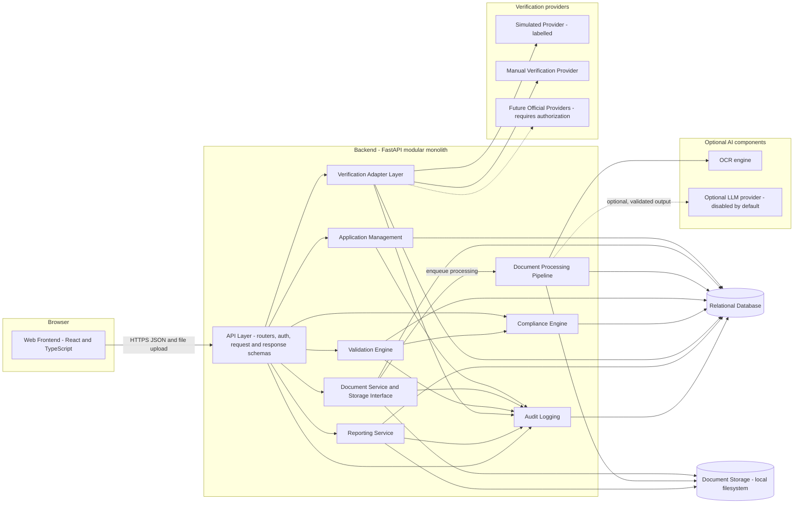
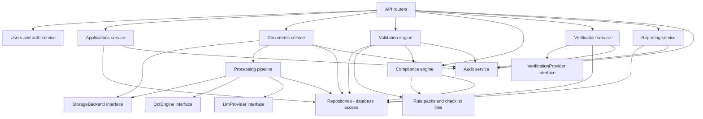
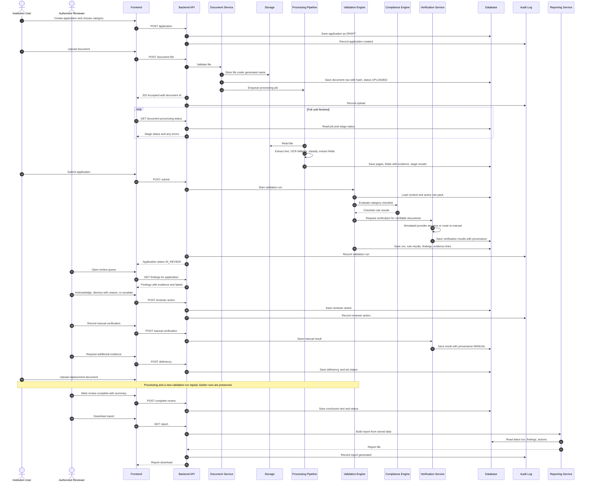
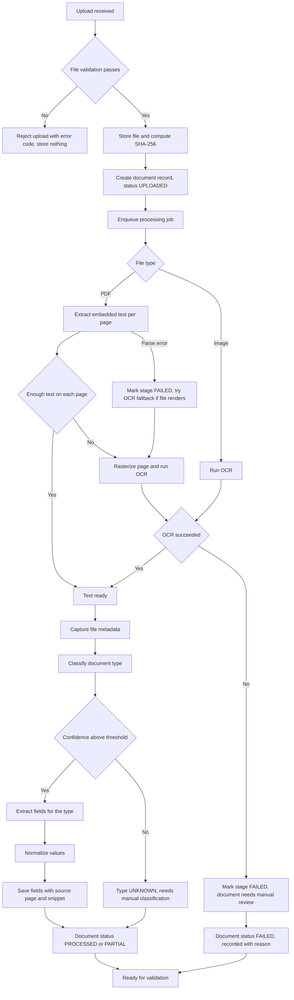
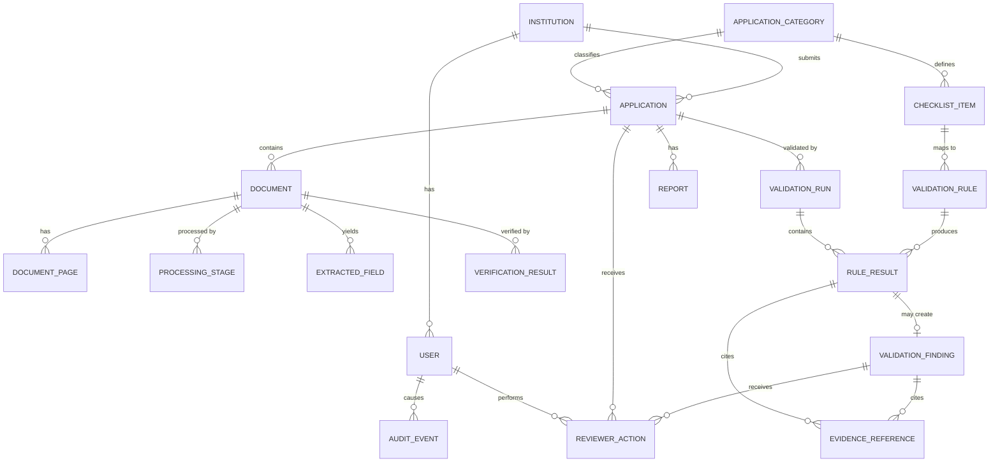

# VerityAI — System Architecture

| | |
|---|---|
| **Project** | VerityAI |
| **Problem Statement ID** | SIH26261 |
| **Problem Statement** | AI-Powered Application Validation, Document Authentication and Regulatory Compliance Verification |
| **Organization** | All India Council for Technical Education (AICTE), Ministry of Education, Government of India |
| **Theme** | Smart Automation |
| **Document status** | Initial architecture baseline v0.1 (hackathon prototype) |
| **Audience** | The developer and any AI coding agent implementing the system |
| **Related documents (not yet written)** | `DATA_MODEL.md`, `API_CONTRACT.md`, `UI_UX_DESIGN.md`, `TEST_PLAN.md` |

> **Read this first.** VerityAI is a **prototype for decision support**. It does not make final regulatory decisions, does not conclusively detect fraud, is **not** integrated with any real AICTE or issuing-authority system, and is **not production-ready**. All demonstration data is synthetic or authorized and anonymized. Every rule shipped with the prototype is **illustrative** unless it has been explicitly verified against the official AICTE Approval Process Handbook.

---

## Table of Contents

1. [Executive Summary](#1-executive-summary)
2. [Problem Definition](#2-problem-definition)
3. [Scope and Non-Goals](#3-scope-and-non-goals)
4. [Users and Roles](#4-users-and-roles)
5. [Functional Requirements](#5-functional-requirements)
6. [Non-Functional Requirements](#6-non-functional-requirements)
7. [High-Level Architecture](#7-high-level-architecture)
8. [Component-Level Architecture](#8-component-level-architecture)
9. [End-to-End Data Flow](#9-end-to-end-data-flow)
10. [Document-Processing Pipeline](#10-document-processing-pipeline)
11. [Validation Engine](#11-validation-engine)
12. [AI and Machine-Learning Boundaries](#12-ai-and-machine-learning-boundaries)
13. [Issuing-Authority Verification Architecture](#13-issuing-authority-verification-architecture)
14. [Compliance Module](#14-compliance-module)
15. [Data Architecture](#15-data-architecture)
16. [API Boundaries](#16-api-boundaries)
17. [Frontend Architecture](#17-frontend-architecture)
18. [Security Architecture](#18-security-architecture)
19. [Error Handling and Resilience](#19-error-handling-and-resilience)
20. [Observability and Auditability](#20-observability-and-auditability)
21. [Deployment Architecture](#21-deployment-architecture)
22. [Performance and Optimization Strategy](#22-performance-and-optimization-strategy)
23. [Testing Strategy](#23-testing-strategy)
24. [Implementation Priorities](#24-implementation-priorities)
25. [Architecture Decisions](#25-architecture-decisions)
26. [Risks and Mitigations](#26-risks-and-mitigations)
27. [Future Extensions](#27-future-extensions)

---

## 1. Executive Summary

### 1.1 What VerityAI is

Institutions apply to AICTE for approvals such as Extension of Approval (EoA). Each application arrives with many supporting documents. Officials must check that the documents are present, current, consistent with the application and with each other, and compliant with the applicable requirements.

VerityAI is a web application that performs a **first-pass, evidence-linked check** of an application and presents the result to an authorized human reviewer. It:

1. Lets an institution create an application and upload documents.
2. Reads each document (text extraction, with OCR as a fallback), classifies it, and pulls out key fields.
3. Runs configurable **rules** (deterministic checks) against the application and extracted data.
4. Runs **anomaly signals** that highlight suspicious inconsistencies for a human to look at.
5. Records **verification** results through a provider-independent adapter (simulated or manual in the prototype).
6. Applies a **category-specific compliance checklist**.
7. Shows reviewers a consolidated list of findings, each linked to the document page, field, rule, or verification record that produced it.
8. Lets reviewers record observations and actions, and generates a downloadable validation report.
9. Records every important action in an audit trail.

### 1.2 What VerityAI is not

- It does not approve or reject institutions.
- It does not label a document "fraudulent". It reports *signals* and *inconsistencies* with explanations and evidence, and asks a human to decide.
- It does not claim OCR accuracy equals document authenticity. OCR measures how well text was read, not whether a document is genuine.
- It does not claim access to real AICTE databases or issuing-authority services.

### 1.3 Architecture in one paragraph

A **React + TypeScript** single-page frontend talks to a **FastAPI modular monolith**. Inside the monolith, separate modules handle applications, documents, a staged **document-processing pipeline**, a **validation engine**, a **compliance engine**, a **verification adapter layer**, **reporting**, and **audit logging**. Data lives in a **relational database** (SQLite for the quickest start, PostgreSQL-compatible by design). Uploaded files live behind a **storage interface** (local filesystem in the prototype). Everything that can be decided by code (dates, required fields, exact identifier matches) is decided by **deterministic rules**. AI is optional and used only where it adds value (classification fallback, interpreting unstructured text), and its output is validated before it is used. The application works fully with **no paid LLM and no external service**.

### 1.4 Guiding idea: a complete vertical slice first

The first working version must handle one full path end to end: **create application → upload documents → extract → validate → review findings → generate report**. Optional features are added only after that path works reliably.

---

## 2. Problem Definition

### 2.1 Administrative problems

| # | Problem | Why it matters |
|---|---|---|
| P1 | Missing or incomplete documents | Reviewers discover gaps late and request resubmissions |
| P2 | Expired certificates | Validity dates must be checked against the processing date |
| P3 | Inconsistent information between the application and documents (names, addresses, identifiers, dates) | Manual cross-reading is slow and error-prone |
| P4 | Duplicate documents or reused content | Hard to spot across large files |
| P5 | Potential document alterations | Subtle; usually needs expert attention |
| P6 | Difficulty verifying documents against issuing-authority records | Requires access and authorization that may not exist |
| P7 | Regulatory compliance gaps | Requirements differ by application category |
| P8 | Infrastructure evidence requiring further review | Often needs additional evidence or inspection |
| P9 | No consolidated, evidence-linked view of findings | Reviewers piece together information from many files |
| P10 | Repetitive administrative work | Time spent on mechanical checks rather than judgement |

### 2.2 How the proposed system addresses them

| Problem | VerityAI response |
|---|---|
| P1 | Required-document rule per application category; missing items listed as findings |
| P2 | Deterministic expiry check using extracted validity dates and the processing date |
| P3 | Deterministic field comparison with documented normalization; fuzzy match produces "needs review", not "fail" |
| P4 | SHA-256 for exact duplicates; text-similarity comparison for near-duplicates |
| P5 | Metadata and consistency *signals* only, always advisory, always with evidence |
| P6 | Verification adapter with simulated provider and manual workflow; real providers pluggable later |
| P7 | Category-specific configurable checklists; every check tied to a rule and its provenance |
| P8 | Infrastructure analysis marked advisory; findings flag "additional evidence or inspection" |
| P9 | A single findings view; each finding links to its evidence |
| P10 | Automated first-pass checks; reviewers focus on exceptions |

---

## 3. Scope and Non-Goals

### 3.1 Assumptions

These are the assumptions the architecture rests on. If one proves false, the affected sections are noted.

| ID | Assumption | Affected sections |
|---|---|---|
| A-01 | No access to real AICTE databases, APIs, or issuing-authority services will be available during the hackathon. | 13 |
| A-02 | The exact list of required documents, fields, and thresholds per application category has **not** been verified against the official AICTE Approval Process Handbook. Prototype rules are illustrative. | 11, 14 |
| A-03 | All demo documents are synthetic, or authorized and anonymized. | 18, 23 |
| A-04 | Documents are mostly English; some may be bilingual or scanned. Multilingual OCR is a stretch goal. | 10 |
| A-05 | The demonstration runs on one developer machine or a single small hosted instance. | 21 |
| A-06 | Expected volume is a handful of applications with tens of documents. Scale has not been measured. | 6, 22 |
| A-07 | The developer is a beginner using an AI coding agent. Simplicity and clarity outrank sophistication. | all |
| A-08 | No paid LLM key is guaranteed. An optional local or hosted LLM may exist but must never be required. | 12 |
| A-09 | Users authenticate with locally managed accounts. Integration with government identity providers is out of scope. | 18 |
| A-10 | Authorized reviewer accounts are created by an administrator; there is no self-registration for reviewers. | 4, 18 |
| A-11 | Document type names used in this document (for example "fire safety certificate") are **illustrative placeholders**, not an official list. | 14 |

### 3.2 Included in the prototype (P0 scope)

- Role-based login (institution user, reviewer, administrator).
- Institutions and applications with categories and statuses.
- Document upload with type, size, and content validation.
- PDF text extraction; OCR for scanned PDFs and images.
- Document classification (rules and keywords first).
- Field extraction for a small set of illustrative document types.
- Deterministic validation rules (required documents, required fields, expiry, application-vs-document match, cross-document match, exact duplicates).
- Illustrative compliance checklists per category.
- Simulated verification provider and manual verification workflow, always clearly labelled.
- Findings view with evidence links.
- Reviewer observations and actions.
- Dashboard derived from real database data.
- Downloadable validation report.
- Audit trail.

### 3.3 Optional (P1/P2 scope)

- Near-duplicate text similarity.
- Metadata-based anomaly signals (PDF creation vs. modification dates, producer software, and so on).
- Image-level checks (for example, error-level analysis) as low-confidence signals.
- Optional LLM-assisted classification and extraction (behind a feature flag).
- Bounding-box highlights on the document viewer.
- Rule and checklist editor UI for administrators.
- Reviewer-side comparison view (side-by-side documents).
- Tamper-evident audit chain.

### 3.4 Deferred beyond the hackathon

- Real integrations with external verification sources.
- Multilingual OCR and handwriting recognition.
- Background job infrastructure (Celery, Redis, or similar).
- Malware scanning service, encryption at rest managed by the application, secret vault.
- Formal accessibility audit, load testing, penetration testing.
- Government identity or single-sign-on integration.
- Trained classification models with large labelled datasets.

### 3.5 Capabilities that require external authorization or integration

| Capability | Requirement | Prototype behaviour |
|---|---|---|
| Verification against AICTE records | Authorization and API or data-sharing agreement | Simulated provider (clearly labelled) and manual workflow |
| Verification against universities, accreditation bodies, fire or building authorities | Authorized API, portal terms, or officially supported mechanism | Same as above |
| QR-code verification against a live portal | Official portal terms | QR decoding may be done locally; the *lookup* is simulated or manual |
| Digital-signature validation against trusted roots | Trust-store configuration and legal basis | Optional local signature-presence check only; no trust claim |
| Real applicant data | Data-protection approvals | Not used |

### 3.6 Non-goals

- Final approval or rejection decisions.
- Automatic labelling of institutions or documents as fraudulent.
- Reimplementing the AICTE approval portal.
- Payments, notifications by SMS or email, or public-facing features.
- Microservices, Kubernetes, or event-streaming platforms.

---

## 4. Users and Roles

### 4.1 Roles

| Role | Who | Responsibilities | Access boundaries |
|---|---|---|---|
| **Institution user** | Staff of an applicant institution | Create and edit own institution's applications while in draft; upload documents; view processing results and deficiencies for **own** applications; respond to deficiencies by uploading replacement documents | Own institution only. Cannot see other institutions. Cannot see reviewer-internal notes. Cannot change verification results or findings. |
| **Authorized reviewer** | AICTE official or delegated evaluator (simulated in prototype) | View all submitted applications; inspect documents, extracted fields, findings; record observations; acknowledge or dismiss findings with a reason; perform manual verification; request additional evidence; mark review complete; generate reports | Cannot manage users or rules. Cannot delete audit events. Cannot alter extracted data silently: corrections create a *new* reviewer-corrected value and preserve the original. |
| **Administrator** | System operator | Manage users and roles; manage institutions; manage rule packs and checklists (P1 UI, P0 via seed files); view audit log; view system health | Cannot silently edit findings or reviewer actions. Administrator actions are audited. |

### 4.2 Permission matrix (summary)

| Capability | Institution user | Reviewer | Admin |
|---|:---:|:---:|:---:|
| Create / edit own application (draft) | Yes | No | Yes |
| Upload / replace documents (own, before review completes) | Yes | No | Yes |
| View own application and its findings | Yes (deficiency view) | Yes | Yes |
| View all applications | No | Yes | Yes |
| View reviewer-internal observations | No | Yes | Yes |
| Record observations / actions | No | Yes | No |
| Perform manual verification | No | Yes | No |
| Trigger re-run of validation | Yes (own) | Yes | Yes |
| Download validation report | Own (limited version) | Yes | Yes |
| Manage users, rules, checklists | No | No | Yes |
| View audit log | No | Limited (per application) | Yes |

### 4.3 Design note

Authorization is enforced **in the backend** on every request (role check plus ownership check). The frontend hides controls only for convenience; hiding a button is never treated as security.

---

## 5. Functional Requirements

Priority: **P0** essential, **P1** important, **P2** optional.

### 5.1 Authentication and Users

| ID | Requirement | Pri |
|---|---|---|
| FR-001 | The system shall authenticate users with credentials and issue short-lived access tokens. | P0 |
| FR-002 | The system shall enforce role-based authorization (institution user, reviewer, administrator) on every API request. | P0 |
| FR-003 | Administrators shall be able to create users and assign roles. | P0 |
| FR-004 | Institution users shall be linked to exactly one institution in the prototype. | P0 |

### 5.2 Application Management

| ID | Requirement | Pri |
|---|---|---|
| FR-010 | The system shall allow creation of institutions with basic profile data. | P0 |
| FR-011 | The system shall allow creation of an application associated with an institution and an application category. | P0 |
| FR-012 | The system shall display application status using a defined status set (Section 15.3). | P0 |
| FR-013 | The system shall list the documents uploaded for each application together with their processing state. | P0 |
| FR-014 | The system shall maintain a processing and review history per application. | P0 |
| FR-015 | The system shall support configurable application categories linked to checklists. | P0 |

### 5.3 Document Management

| ID | Requirement | Pri |
|---|---|---|
| FR-020 | The system shall accept PDF, PNG, and JPEG uploads (plus TIFF as P1). | P0 |
| FR-021 | The system shall validate extension, declared content type, actual file signature, and size before storing. | P0 |
| FR-022 | The system shall store files under system-generated names behind a storage abstraction. | P0 |
| FR-023 | The system shall compute and store a SHA-256 hash for every file. | P0 |
| FR-024 | The system shall extract embedded text from digital PDFs where available. | P0 |
| FR-025 | The system shall fall back to OCR for scanned PDFs and images, or for pages with insufficient embedded text. | P0 |
| FR-026 | The system shall classify each document into a document type, with a confidence value and method. | P0 |
| FR-027 | The system shall extract defined fields per document type into structured records. | P0 |
| FR-028 | Each extracted field shall retain its source document and page, and where feasible a text snippet and bounding box. | P0 (page + snippet) / P1 (bounding box) |
| FR-029 | Authorized users shall be able to download or view a document only through an authorized endpoint. | P0 |
| FR-030 | Reviewers shall be able to correct an extracted field; the original value shall be preserved. | P1 |

### 5.4 Validation

| ID | Requirement | Pri |
|---|---|---|
| FR-040 | The system shall identify missing required documents for the application category. | P0 |
| FR-041 | The system shall identify missing required fields for each document type. | P0 |
| FR-042 | The system shall identify expired documents using extracted validity dates. | P0 |
| FR-043 | The system shall compare application fields to extracted document fields. | P0 |
| FR-044 | The system shall compare designated fields across documents. | P0 |
| FR-045 | The system shall detect exact duplicate files by hash. | P0 |
| FR-046 | The system shall detect potential near-duplicate content by text similarity. | P1 |
| FR-047 | Validation rules shall be configurable without code changes (rule packs). | P0 |
| FR-048 | Every validation outcome shall be a structured result with a status, explanation, rule reference, and evidence references. | P0 |
| FR-049 | The system shall distinguish **passed**, **failed**, **unresolved**, and **could-not-be-performed** checks. | P0 |
| FR-050 | Re-running validation shall create a new validation run and preserve earlier runs. | P0 |

### 5.5 Anomaly Signals

| ID | Requirement | Pri |
|---|---|---|
| FR-060 | The system shall generate anomaly signals for mismatched identifiers and irregular dates (for example, issue date after expiry date, or a future issue date). | P0 |
| FR-061 | The system shall generate metadata-based signals (for example, a modification date later than the stated issue date, or an unexpected producer application). | P1 |
| FR-062 | Image-level alteration signals (for example, error-level analysis) shall be low-confidence and optional. | P2 |
| FR-063 | Every anomaly signal shall carry an explanation, a confidence or severity level, and evidence references. | P0 |
| FR-064 | No anomaly signal shall automatically reject an application or label a document fraudulent. | P0 |

### 5.6 Verification

| ID | Requirement | Pri |
|---|---|---|
| FR-070 | The system shall define a provider-independent verification interface. | P0 |
| FR-071 | The system shall include a simulated provider whose results are always labelled "Simulated". | P0 |
| FR-072 | The system shall support a manual verification workflow in which a reviewer records the outcome and the evidence source. | P0 |
| FR-073 | The system shall support the statuses: Verified, Mismatch detected, Expired, Pending, Source unavailable, Manual review required. | P0 |
| FR-074 | Every verification result shall record its **provenance** (simulated, manual, or official provider) and the provider identity. | P0 |
| FR-075 | A simulated result shall never be displayed or reported as a real external verification. | P0 |

### 5.7 Compliance

| ID | Requirement | Pri |
|---|---|---|
| FR-080 | The system shall support configurable checklists keyed by application category. | P0 |
| FR-081 | The system shall display each check as satisfied, unsatisfied, or unresolved (and "not evaluated" when it could not be performed). | P0 |
| FR-082 | Each check shall reference the rule that produced it. | P0 |
| FR-083 | Each rule pack and rule shall declare provenance: *illustrative* or *officially verified* with a source reference. | P0 |
| FR-084 | Infrastructure-related checks shall be marked advisory and may flag "additional evidence or inspection required". | P0 |
| FR-085 | Reviewers shall be able to record observations against any check or finding. | P0 |

### 5.8 Review Workflow

| ID | Requirement | Pri |
|---|---|---|
| FR-090 | Reviewers shall be able to acknowledge a finding, dismiss it with a mandatory reason, or escalate it. | P0 |
| FR-091 | Reviewers shall be able to request additional evidence; this shall create a visible deficiency for the institution. | P0 |
| FR-092 | Reviewers shall be able to mark a review as complete with a free-text summary. This records the reviewer's conclusion; it is **not** a system-generated decision. | P0 |
| FR-093 | Institution users shall be able to upload replacement documents in response to deficiencies; this triggers re-processing. | P0 |

### 5.9 Dashboard and Reporting

| ID | Requirement | Pri |
|---|---|---|
| FR-100 | The dashboard shall display application counts by status, derived from the database. | P0 |
| FR-101 | The dashboard shall display document-processing results (success, partial, failed). | P0 |
| FR-102 | The dashboard shall display outstanding deficiencies, verification outcomes (split by provenance), and the human-review queue. | P0 |
| FR-103 | Analytics (for example, most frequent failing rules, average processing duration) shall be computed from real data. | P1 |
| FR-104 | The system shall generate a downloadable validation report per application. | P0 |
| FR-105 | The report shall include disclaimers, rule-pack provenance, verification provenance, findings with evidence references, and reviewer observations. | P0 |

### 5.10 Audit and Security

| ID | Requirement | Pri |
|---|---|---|
| FR-110 | The system shall record audit events for authentication, uploads, document access, validation runs, verification, reviewer actions, configuration changes, and report generation. | P0 |
| FR-111 | Audit events shall be append-only through the application. | P0 |
| FR-112 | Administrators shall be able to view and filter the audit log. | P1 |
| FR-113 | The system shall log document access (view and download). | P0 |

---

## 6. Non-Functional Requirements

| Area | Requirement | Notes |
|---|---|---|
| **NFR-001 Reliability** | A failure in one document or one rule shall not abort the entire application's processing. Failures are recorded and shown. | See Section 19. |
| **NFR-002 Reliability** | The application shall remain useful with no LLM, no network access to external AI, and no verification source. | Core principle. |
| **NFR-003 Reliability** | Processing steps shall be idempotent and re-runnable. | Enables retry. |
| **NFR-010 Maintainability** | Modules shall have explicit boundaries; business logic shall not live in API routers or UI components. | Section 8. |
| **NFR-011 Maintainability** | Rules, checklists, and document-type definitions shall be data (YAML or JSON seed files stored in the DB), not code branches. | Section 11. |
| **NFR-020 Performance** | Upload endpoints shall return quickly; heavy work runs asynchronously with status polling. | Targets are **measured, not promised** (Section 22). |
| **NFR-021 Performance** | Dashboard queries shall use database aggregation, not loading all rows in application memory. | |
| **NFR-030 Security** | Role and ownership checks on every request; safe file handling; no hardcoded secrets; minimal exposure of personal data. | Section 18. |
| **NFR-040 Explainability** | Every finding shall state *what* was checked, *what* was found, *why* it matters, and *which* evidence supports it. | |
| **NFR-041 Explainability** | AI-derived values shall record method, model identifier, and confidence. | |
| **NFR-050 Usability** | Meaningful loading, success, failure, empty, and pending states in the UI. | |
| **NFR-051 Usability** | Simulated and advisory content shall be visibly labelled. | |
| **NFR-060 Testability** | Engines shall be pure or near-pure functions on structured inputs so they can be unit-tested without HTTP, files, or AI. | |
| **NFR-061 Testability** | A fixed synthetic dataset with known expected findings shall exist (Section 23). | |
| **NFR-070 Deployment simplicity** | One command (or two) shall start the whole system locally. | Section 21. |
| **NFR-071 Data handling** | Only synthetic or authorized anonymized data is used. | |

---

## 7. High-Level Architecture

### 7.1 Architecture diagram



### 7.2 Component responsibilities (summary)

| Component | Responsibility |
|---|---|
| **Frontend** | Presentation, forms, navigation, polling of processing status, role-appropriate views. Contains no validation business rules. |
| **API Layer** | HTTP routing, authentication, authorization, request validation, response shaping. Delegates to services. |
| **Application Management** | Institutions, applications, categories, status transitions, history. |
| **Document Service** | Upload validation, storage via interface, hashing, document records, authorized access. |
| **Document Processing Pipeline** | Staged extraction: text, OCR, classification, field extraction, normalization, metadata capture. Produces structured data with evidence. |
| **Validation Engine** | Executes rules over structured data and produces findings with evidence references. |
| **Compliance Engine** | Evaluates category-specific checklists (as rules) and tracks satisfied, unsatisfied, unresolved, not-evaluated. |
| **Verification Adapter Layer** | Provider-independent interface; routes verification requests to providers; stores results with provenance. |
| **Reporting Service** | Builds the validation report from stored data. |
| **Audit Logging** | Append-only record of significant events. |
| **Database** | System of record for all structured data. |
| **Document Storage** | Binary files only; replaceable implementation. |

---

## 8. Component-Level Architecture

### 8.1 Backend package layout (conceptual)

This is a *structure guide*, not code. It shows where responsibilities live so an AI coding agent does not mix them.

```
backend/
  app/
    api/            # routers, dependencies (auth, role checks), HTTP schemas
    core/           # config, security helpers, logging setup, error types
    domain/         # plain data types (enums, dataclasses) shared by engines
    modules/
      applications/ # service + repository
      documents/    # service + repository + storage interface + local storage
      processing/   # pipeline runner, stages, extractors, classifiers
      validation/   # rule loader, rule handlers, runner, finding builder
      compliance/   # checklist loader, checklist evaluation
      verification/ # provider interface, registry, simulated, manual
      reporting/    # report builder and templates
      audit/        # audit service
      users/        # users, auth
    db/             # models, session, migrations
  rules/            # rule packs and checklists (YAML/JSON), document-type definitions
  tests/
```

### 8.2 Module dependency diagram



**Dependency rules (must be followed):**

1. Routers call services. Routers never access the database or files directly.
2. Services call repositories and interfaces. Services never import from routers.
3. The validation and compliance engines depend on **data and rules**, not on HTTP, files, or AI.
4. Processing depends on interfaces (`StorageBackend`, `OcrEngine`, `LlmProvider`), never on a concrete vendor class.
5. Verification providers depend on nothing in the engines.
6. No module imports from the frontend. The frontend only knows the API.

### 8.3 Who calls whom, and why

| Caller | Callee | Why |
|---|---|---|
| Router → Documents service | Handle uploads and document access | Keeps HTTP out of business logic |
| Documents service → Storage interface | Save and read bytes | Allows swapping local disk for object storage later |
| Documents service → Processing pipeline | Enqueue processing for a stored document | Decouples slow work from upload response |
| Processing pipeline → OCR / LLM interfaces | Extract text and optionally interpret | Vendor-independent, optional AI |
| Router → Validation engine | Trigger validation run and read findings | Single entry point for checks |
| Validation engine → Compliance engine | Evaluate checklist rules as part of a run | Compliance rules use the same rule mechanism |
| Router → Verification service → Provider | Request or record verification | Provenance is stamped centrally |
| Router → Reporting service | Build report | Report reads stored results only; it never re-runs checks |
| All services → Audit service | Record events | Central audit |

### 8.4 Internal responsibilities of major components

**Applications service.** Creates applications; validates category; owns status transitions (Section 15.3); records history entries; refuses illegal transitions (for example, editing an application whose review is complete).

**Documents service.** Validates uploads (Section 10.1); writes through storage interface; creates the document record with SHA-256; applies authorization on reads; records access events; supports replacing a document (new version, old preserved).

**Processing pipeline.** Runs ordered stages per document; each stage records status, duration, and error; stages are individually retryable; writes extracted text per page and extracted fields with evidence.

**Validation engine.** Loads the active rule pack for the application's category; builds a **validation context** (application data, documents, extracted fields, verification results); runs each rule handler in isolation; produces rule results and findings; stores everything under a **validation run**.

**Compliance engine.** Treats checklist items as rules with additional presentation metadata (section, label, advisory flag, provenance); aggregates results into satisfied, unsatisfied, unresolved, not-evaluated counts.

**Verification service.** Accepts a request (document, claimed issuer, identifiers); selects provider(s) by configuration; stores result with provenance; offers a manual-recording endpoint.

**Reporting service.** Reads the latest validation run and related data; renders HTML; converts to PDF where supported; stores the report file and an audit event.

**Audit service.** Writes events; never updates or deletes them; accepts actor, action, target, and a small JSON detail payload that never contains raw personal data.

---

## 9. End-to-End Data Flow

### 9.1 Narrative

1. An institution user logs in and creates an **application** for an institution and category (status `DRAFT`).
2. The user uploads documents. For each: the backend validates the file, stores it, records a hash, creates a `Document` row with status `UPLOADED`, and enqueues processing. The API returns immediately.
3. A background worker runs the **processing pipeline**: text extraction → OCR fallback → classification → field extraction → normalization → metadata capture. Each stage records its result.
4. When the user submits the application (status `SUBMITTED`), or when processing finishes, a **validation run** starts. The validation engine evaluates rules, the compliance engine evaluates the checklist, and findings are created.
5. Verification requests are made for documents that have verifiable issuers. The simulated provider answers (clearly labelled) or the item is routed to **manual verification**.
6. The application moves to `IN_REVIEW`. Reviewers see the consolidated findings with evidence.
7. Reviewers acknowledge, dismiss (with reason), escalate, add observations, perform manual verification, or request additional evidence (creating deficiencies).
8. The institution user sees deficiencies, uploads replacements, and processing and validation run again (a new run; history preserved).
9. The reviewer marks the review complete with a summary. A **report** is generated on demand.
10. Every step produces **audit events**.

### 9.2 Sequence diagram: processing, validation, and human review



---

## 10. Document-Processing Pipeline

### 10.1 Pipeline flow



### 10.2 Stages

| # | Stage | What it does | Output | Failure behaviour |
|---|---|---|---|---|
| 1 | **Upload validation** | Checks extension allowlist, declared MIME type, **magic bytes** (real file signature), size limit, page-count limit for PDFs, filename sanitization, rejects encrypted or unparseable PDFs with a clear message | Accept or reject with an error code | Reject; nothing stored; user sees reason |
| 2 | **File storage** | Writes bytes via `StorageBackend` with a random identifier; computes SHA-256 | Storage key, hash | Failure → upload fails cleanly; no orphan DB row |
| 3 | **PDF text extraction** | Extracts embedded text per page using a PDF library | Page text records | Parse error → stage `FAILED`, OCR fallback attempted |
| 4 | **OCR fallback** | For images, and for PDF pages with little or no embedded text, rasterizes and runs OCR | Page text with per-page OCR confidence | OCR failure → stage `FAILED`; document marked for manual review |
| 5 | **Metadata capture** | Records PDF metadata (creator, producer, creation and modification dates), image EXIF where present, page count | Metadata record | Missing metadata is normal and not an error |
| 6 | **Classification** | Assigns a document type with confidence and method | Type, confidence, method (`KEYWORD_RULES`, `ML_MODEL`, `LLM`, `MANUAL`) | Low confidence → type `UNKNOWN`, flagged for manual classification |
| 7 | **Field extraction** | Per document type, extracts defined fields using patterns, label-proximity logic, and optionally validated LLM output | Extracted fields with raw value, source page, snippet, method, confidence | Missing field → recorded as **not found** (distinct from empty) |
| 8 | **Normalization** | Normalizes dates, names, identifiers, addresses, numbers (Section 10.3) | Normalized value stored beside raw value | Unparseable value → keep raw, mark `NORMALIZATION_FAILED` |
| 9 | **Validation hand-off** | Marks document ready; the validation run consumes the data | Document status | — |
| 10 | **Evidence generation** | Persists page text, field snippets, and optional bounding boxes so findings can point at them | Evidence-ready records | Missing bounding box is acceptable; page and snippet are the minimum |

### 10.3 Normalization rules (examples)

| Value type | Normalization |
|---|---|
| Dates | Parse common Indian formats (for example DD/MM/YYYY, DD-MM-YYYY, "12 March 2024") to ISO 8601; ambiguous formats are flagged rather than guessed |
| Names (institution, person) | Case-fold, remove punctuation and extra spaces, standardize common abbreviations ("Inst." / "Institute"); retain original |
| Identifiers | Uppercase, strip spaces and separators; format validation by pattern where a pattern is defined |
| Numbers / areas | Convert units where stated (for example sq. m vs sq. ft); retain the unit |
| Addresses | Light normalization only; comparison produces a similarity score and, below a threshold, "needs review" |

### 10.4 Representing processing failures

Each document has a **processing job** with per-stage records.

| Field | Meaning |
|---|---|
| `stage` | Name of stage |
| `status` | `PENDING`, `RUNNING`, `SUCCEEDED`, `FAILED`, `SKIPPED` |
| `error_code` | Stable code such as `PDF_PARSE_ERROR`, `OCR_FAILED`, `OCR_LOW_CONFIDENCE`, `CLASSIFICATION_LOW_CONFIDENCE`, `FIELD_NOT_FOUND`, `NORMALIZATION_FAILED` |
| `error_message` | Short human-readable explanation (no stack traces, no personal data) |
| `started_at`, `finished_at` | For duration metrics |
| `attempt` | Retry count |

Document-level `processing_status`: `UPLOADED`, `PROCESSING`, `PROCESSED`, `PARTIAL` (some stages or fields failed), `FAILED`, `NEEDS_MANUAL_REVIEW`.

A failed or partial document **still participates** in validation; rules that depend on missing data yield **could-not-be-performed** results (Section 11.4), never silent passes.

### 10.5 Execution model

- The upload request returns `202 Accepted` after storage and enqueueing.
- A simple **in-process worker** (thread or `BackgroundTasks`) runs jobs. Job state is stored in the database so the UI can poll and so stale jobs can be re-queued on startup.
- No Celery, Redis, or message broker for the prototype. The `ProcessingQueue` boundary allows adding one later.

### 10.6 OCR accuracy is not authenticity

Per-page OCR confidence measures *how reliably text was read*. It is stored and displayed for transparency (low confidence results in "verify manually" prompts), but it is **never** used as an indicator that a document is genuine or forged.

---

## 11. Validation Engine

### 11.1 Concepts

| Concept | Definition |
|---|---|
| **Rule** | A declarative check with an id, version, type, parameters, severity, applicability, and provenance |
| **Rule pack** | A versioned collection of rules for one or more application categories |
| **Rule handler** | Code implementing one rule *type* (for example `field_not_expired`). Handlers are generic and reusable. |
| **Validation context** | Read-only snapshot of application data, document records, extracted fields, metadata, and verification results used by a run |
| **Validation run** | One execution of a rule pack over a context; stores all rule results |
| **Rule result** | Outcome of one rule evaluation |
| **Finding** | A reviewer-facing record created from a rule result that needs attention (failed, unresolved, or could-not-be-performed) or from an anomaly signal |

### 11.2 How rules are stored

Rules live as **YAML or JSON files** in `rules/` and are **loaded into the database** at startup (or by an admin action), keyed by `pack_id` + `rule_id` + `version`. Storing them in the database lets a validation run record *exactly which rule versions* produced its results.

Illustrative rule definition (configuration, not application code):

```yaml
rule_id: ILL-DOC-001
version: 1
name: Required document present - fire safety certificate
type: required_document
applies_to_categories: [ILLUSTRATIVE_EOA_GENERAL]
parameters:
  document_type: FIRE_SAFETY_CERTIFICATE
severity: HIGH
provenance: ILLUSTRATIVE          # ILLUSTRATIVE | OFFICIALLY_VERIFIED
source_reference: null            # required when OFFICIALLY_VERIFIED
advisory: false
message_template: "A document of type {document_type} is required but was not found."
```

### 11.3 Built-in rule types (prototype)

| Rule type | Purpose | Deterministic |
|---|---|---|
| `required_document` | A document of a given type exists | Yes |
| `required_field` | A field is present on documents of a type | Yes |
| `field_not_expired` | Validity end date is on or after the reference date | Yes |
| `date_order` | One date precedes another (issue before expiry) | Yes |
| `application_field_match` | Application field equals a document field (after normalization) | Yes (exact), similarity band → unresolved |
| `cross_document_match` | Designated field is consistent across documents | Yes |
| `identifier_format` | Identifier matches a defined pattern | Yes |
| `duplicate_file` | Same hash used by multiple documents | Yes |
| `numeric_threshold` | Numeric field meets a configured minimum or maximum (used for **advisory** infrastructure checks) | Yes |
| `verification_status` | A verification result of an acceptable status exists | Yes |
| `near_duplicate_text` (P1) | Text similarity above threshold | Heuristic |
| `metadata_consistency` (P1) | Metadata dates and producers consistent with content | Heuristic |

### 11.4 Rule-result structure

Every rule evaluation returns one structured result with these fields:

| Field | Description |
|---|---|
| `result_id` | Unique ID |
| `run_id` | Parent validation run |
| `rule_id`, `rule_version`, `pack_id` | Exactly which rule produced it |
| `rule_provenance` | `ILLUSTRATIVE` or `OFFICIALLY_VERIFIED` (copied at run time) |
| `status` | **`PASSED`**, **`FAILED`**, **`UNRESOLVED`**, **`NOT_PERFORMED`** (or `NOT_APPLICABLE`) |
| `severity` | `INFO`, `LOW`, `MEDIUM`, `HIGH` (meaningful for non-passed results) |
| `advisory` | True if this result is advice only (for example infrastructure) |
| `summary` | Plain-language explanation |
| `inputs` | The values compared (raw and normalized) so the check is reproducible |
| `reason_code` | Stable code, for example `FIELD_MISMATCH`, `DOCUMENT_EXPIRED`, `DOCUMENT_MISSING`, `FIELD_NOT_FOUND`, `OCR_LOW_CONFIDENCE`, `SOURCE_UNAVAILABLE`, `RULE_INPUT_INVALID`, `RULE_HANDLER_ERROR` |
| `evidence` | List of evidence references (Section 11.6) |
| `evaluated_at`, `duration_ms` | For audit and performance |

### 11.5 Meaning of each status

| Status | Meaning | Example | Shown to reviewer as |
|---|---|---|---|
| **PASSED** | The check ran and the condition was satisfied | Certificate expiry date is after the reference date | Green, satisfied |
| **FAILED** | The check ran with trustworthy inputs and the condition was **not** satisfied | Certificate expiry date has passed | Red, unsatisfied |
| **UNRESOLVED** | The check ran but the outcome is ambiguous and needs human judgement | Institution name similarity is 0.82 (between "match" and "mismatch" thresholds); OCR confidence low on the compared field; verification pending | Amber, needs review |
| **NOT_PERFORMED** | The check **could not be completed** because inputs were missing or invalid, or the handler raised an error | Expiry date field could not be extracted; rule input malformed | Grey, could not be performed, with the reason |
| **NOT_APPLICABLE** | The rule does not apply to this application | Rule for a different category | Hidden by default |

**Key principle:** `FAILED` means *"we checked and the condition is false."* `NOT_PERFORMED` means *"we could not check."* The two must never be merged. A check that could not be performed is **not** a pass and **not** a failure; it is surfaced explicitly so a reviewer can resolve it.

### 11.6 Evidence linking

Each rule result and finding has zero or more **evidence references**:

| Evidence type | Points to | Example |
|---|---|---|
| `EXTRACTED_FIELD` | Extracted field id → document, page, snippet, optional bounding box | "Valid until 12/03/2024" on page 1 |
| `DOCUMENT_PAGE` | Document id + page number | The page where a required stamp should appear |
| `DOCUMENT_METADATA` | Document id + metadata key | PDF `ModDate` later than stated issue date |
| `APPLICATION_FIELD` | Application id + field name | Institution name in application |
| `VERIFICATION_RESULT` | Verification result id | Simulated "Mismatch detected" |
| `DOCUMENT_HASH` | Two document ids | Exact duplicates |
| `RULE_INPUT` | A named input value recorded in the result | Reference date used for expiry check |

If a finding can only cite an application-level fact (for example "required document missing"), the evidence list contains the rule and the application checklist context, and the UI displays "no document evidence because none was provided."

### 11.7 Findings

A **finding** is created from a non-passed rule result or anomaly signal.

| Field | Description |
|---|---|
| `finding_id`, `run_id`, `application_id` | Identity |
| `fingerprint` | Stable hash of (rule_id, targets, reason_code) so reviewer actions can carry across re-runs |
| `category` | `MISSING_DOCUMENT`, `MISSING_FIELD`, `EXPIRED`, `MISMATCH`, `DUPLICATE`, `ANOMALY_SIGNAL`, `VERIFICATION`, `COMPLIANCE`, `INFRASTRUCTURE_ADVISORY`, `PROCESSING_ISSUE` |
| `status_from_rule` | The rule-result status that produced it |
| `severity`, `advisory` | As above |
| `explanation` | What was checked, what was found, why it matters |
| `recommended_human_action` | For example "Request an updated certificate" |
| `evidence` | References |
| `review_state` | `OPEN`, `ACKNOWLEDGED`, `DISMISSED`, `ESCALATED`, `RESOLVED` |

Wording rules for findings: use "inconsistency", "signal", "could not confirm", "requires review". Never use "fraud", "forged", "fake" as a conclusion.

### 11.8 Execution algorithm (plain language)

1. Resolve the application's category and the active rule pack(s).
2. Build the **validation context** (read-only).
3. For each applicable rule, call the matching handler **inside its own try/except**.
4. Handler returns a rule result. If it raises or receives invalid input, the engine records `NOT_PERFORMED` with `RULE_HANDLER_ERROR` or `RULE_INPUT_INVALID`; the run continues.
5. Persist all rule results under the run.
6. Convert non-passed results and anomaly signals into findings.
7. Carry over reviewer decisions for findings with the same fingerprint (marked "carried from earlier run"; a reviewer can reopen).
8. Update application status and write an audit event.

### 11.9 Reference date

Expiry checks use an explicit **reference date** stored on the run (default: the processing date; optionally the submission date). The date is recorded in `inputs` so a result is reproducible.

---

## 12. AI and Machine-Learning Boundaries

### 12.1 Principle

**Deterministic code decides anything that can be expressed as a rule. AI may help interpret messy content. AI never decides a pass/fail outcome on its own, and no single large prompt runs the system.**

### 12.2 Task-by-task boundary

| Task | Approach | AI involvement | Notes |
|---|---|---|---|
| Upload validation | Deterministic | None | Magic bytes, size, type |
| PDF text extraction | Deterministic library | None | |
| OCR | OCR engine (Tesseract by default) | OCR is machine perception; no LLM | Confidence recorded |
| Document classification | **Layered**: (1) keyword/pattern rules, (2) optional small classical model (for example TF-IDF + logistic regression on synthetic examples), (3) optional LLM fallback | Optional | Confidence threshold; below it → `UNKNOWN` |
| Field extraction | **Layered**: (1) regex and label-proximity patterns per document type, (2) optional LLM for unstructured fields | Optional | Every LLM-extracted value is grounded (below) |
| Normalization | Deterministic | None | |
| Required docs / fields | Deterministic | None | |
| Date and expiry checks | Deterministic | None | |
| Exact identifier matching | Deterministic | None | |
| Fuzzy name or address matching | Deterministic similarity metric with thresholds | None | Middle band → `UNRESOLVED` |
| Exact duplicate detection | Hash | None | |
| Near-duplicate detection (P1) | Text shingles / MinHash or TF-IDF cosine | Classical, not generative | |
| Metadata anomaly signals (P1) | Deterministic heuristics | None | |
| Image alteration signals (P2) | Image-analysis heuristics | Optional | Low confidence, advisory |
| Narrative explanation of a finding | **Template-based** by default | Optional LLM paraphrase | Facts come from structured data; LLM only rephrases and cannot add claims |
| Infrastructure analysis | Deterministic comparison of extracted figures to configured thresholds | Optional extraction help | Always advisory |
| Compliance evaluation | Deterministic rules | None | |
| Final outcomes | Human reviewer | None | |

### 12.3 How AI outputs are validated before use

Every AI-produced value passes these gates before entering the database as a usable value:

1. **Schema validation.** Output must parse into the expected structure (for example with Pydantic). Free text that does not parse is discarded.
2. **Allowed-values check.** Document types must be from the known list; unknown labels are rejected.
3. **Grounding check.** An extracted value must be **found in the source text** of the cited page (exact or normalized match). Values that cannot be located are discarded or marked `UNGROUNDED` and not used by rules.
4. **Format validation.** Dates, identifiers, and numbers must satisfy the same format and normalization as deterministic extraction.
5. **Confidence threshold.** Below the threshold, the value is marked `NEEDS_REVIEW` and rules treat the field as `UNRESOLVED` or `NOT_PERFORMED`, not as trusted.
6. **Provenance tagging.** Method, model identifier, and prompt-template version are stored with the value.
7. **No authority.** AI-derived anomaly flags are stored as `ANOMALY_SIGNAL` with a limited severity ceiling and always require human review.

### 12.4 Small, scoped AI calls

When an LLM is enabled, each call has one narrow purpose (for example "classify this page's text into one of N types" or "extract these four fields from this text"), a small input (relevant page text, not the whole application), a fixed output schema, a timeout, and result caching by content hash. There is **no** "analyze the entire application" prompt.

### 12.5 Availability and privacy

- The `LlmProvider` interface has a default **`NullLlmProvider`**, so the application runs fully without an LLM.
- A local model (for example via Ollama) is the preferred optional LLM for privacy. A hosted model, if used at all, must receive **only synthetic or anonymized demo data** (assumption A-03).
- If the LLM is unavailable or returns invalid output, the pipeline falls back to deterministic output and records `AI_UNAVAILABLE` on the stage (not an application error).

### 12.6 Honest labelling

Anything produced by AI is labelled in the UI ("AI-assisted"), shows its confidence, and is never described as verified fact.

---

## 13. Issuing-Authority Verification Architecture

### 13.1 Goals

- Provide a clean place to plug in **real** verification later.
- Make the prototype demonstrable **without** pretending real verification exists.
- Make it impossible, by data model and UI, to confuse a simulated result with a real one.

### 13.2 Provider-independent interface (conceptual)

A `VerificationProvider` defines:

| Member | Description |
|---|---|
| `provider_id` | Stable identifier (for example `simulated`, `manual`) |
| `provider_kind` | `SIMULATED`, `MANUAL`, `OFFICIAL_INTEGRATION` |
| `supported_document_types` | Which document types it can handle |
| `supported_mechanisms` | `API`, `PORTAL`, `QR_CODE`, `DIGITAL_SIGNATURE`, `DIGITAL_REPOSITORY`, `OTHER_OFFICIAL` |
| `verify(request)` | Accepts a `VerificationRequest` and returns a `VerificationOutcome` |
| `health()` | Reports availability |

**VerificationRequest** carries: document id, document type, claimed issuer, identifiers extracted from the document (for example certificate number), claimed validity dates, and the mechanism requested.

**VerificationOutcome** carries: `status`, `provenance`, `provider_id`, `reference` (an identifier, URL, or receipt ID where applicable), `observed_values` (what the source reported), `compared_values`, `message`, `checked_at`, and `raw_response_ref` (stored for audit, if any).

### 13.3 Statuses and provenance

**Status** (what the check concluded):

| Status | Meaning |
|---|---|
| `VERIFIED` | Source confirms the claimed details |
| `MISMATCH_DETECTED` | Source reports different details |
| `EXPIRED` | Source reports the credential is no longer valid |
| `PENDING` | Request made or manual check assigned, not yet answered |
| `SOURCE_UNAVAILABLE` | Provider could not be reached or has no coverage |
| `MANUAL_REVIEW_REQUIRED` | Automated path cannot conclude; a human must decide |

**Provenance** (who or what produced the answer): `SIMULATED`, `MANUAL`, `OFFICIAL_INTEGRATION`.

The UI and report show **status and provenance together**, for example:

- "Verified — **SIMULATED** (not an external verification)"
- "Verified — **MANUAL** (recorded by reviewer, source: official portal, reference ID ...)"
- "Verified — **OFFICIAL INTEGRATION** (provider: ...)" *(not available in the prototype)*

### 13.4 Distinguishing similar situations

| Situation | Status | Provenance | Display |
|---|---|---|---|
| Real official source confirms | `VERIFIED` | `OFFICIAL_INTEGRATION` | Real verification (future only) |
| Simulated provider says verified | `VERIFIED` | `SIMULATED` | Prominent "SIMULATED" badge; excluded from any "externally verified" count |
| Source cannot be reached | `SOURCE_UNAVAILABLE` | Provider's kind | "Could not check"; creates `UNRESOLVED` or `NOT_PERFORMED` result, never a pass |
| Manual check assigned | `PENDING` | `MANUAL` | In reviewer queue |
| Reviewer completed manual check | `VERIFIED` / `MISMATCH_DETECTED` / `EXPIRED` | `MANUAL` | Shows reviewer, date, evidence source note |

### 13.5 Simulated provider

- Deterministic and **seeded from the synthetic test data** so demos are reproducible. For example, certificate numbers in a small `simulated_registry` fixture yield `VERIFIED`, a mismatched issue date yields `MISMATCH_DETECTED`, a past expiry yields `EXPIRED`, a special marker yields `SOURCE_UNAVAILABLE`.
- Every result is stamped `provenance = SIMULATED`, `provider_id = simulated`, and the message begins with "SIMULATED RESULT — not obtained from any external authority."
- A visible banner on screens and a statement in the report appear whenever any simulated result is present.
- Counts of "verified" on the dashboard are **split by provenance**; simulated results are never merged into a single "verified" figure.

### 13.6 Manual verification workflow

1. A document needing verification gets a `PENDING` result with provenance `MANUAL` and appears in the reviewer queue.
2. The reviewer checks the official source outside the system (for example a public portal, subject to its terms).
3. The reviewer records: outcome status, source description, reference or screenshot ID (optional upload), and notes.
4. The system stores the result, links it as evidence to related findings, and writes an audit event.

### 13.7 Adding a real provider later

1. Implement `VerificationProvider` for the specific authorized mechanism.
2. Register it in provider configuration with its supported document types.
3. Set `provider_kind = OFFICIAL_INTEGRATION`, which requires configuration evidence (authorization reference) before the provider is allowed to emit that provenance.
4. Add contract tests against the provider's sandbox.
5. No changes are needed in the validation engine, UI, or report because they consume `status` and `provenance`.

### 13.8 Resilience

Each call has a timeout. Failures map to `SOURCE_UNAVAILABLE` with a short reason. A provider outage never blocks processing or review.

---

## 14. Compliance Module

### 14.1 Role

Helps reviewers see, per application category, which requirements appear **satisfied**, **unsatisfied**, or **unresolved**, with the rule and evidence behind each.

### 14.2 Category-specific checklists

- An **application category** links to one **checklist** (a named, versioned list of checklist items).
- Each checklist item maps to one or more **rules** (same rule mechanism as Section 11) plus presentation metadata: `section`, `label`, `advisory`, `requires_inspection`, `provenance`, `source_reference`.
- Categories in the prototype are **illustrative** (for example `ILLUSTRATIVE_EOA_GENERAL`, `ILLUSTRATIVE_INTAKE_CHANGE`). Official category names are applied only after verification against the handbook.

### 14.3 Checklist item statuses

| Display | Underlying rule status |
|---|---|
| Satisfied | `PASSED` |
| Unsatisfied | `FAILED` |
| Unresolved | `UNRESOLVED` |
| Not evaluated (could not be performed) | `NOT_PERFORMED` |
| Not applicable | `NOT_APPLICABLE` |

A checklist-level summary shows counts of each status and a list of items requiring additional evidence or inspection.

### 14.4 Infrastructure analysis is advisory

Infrastructure-related checks (for example reported built-up area, number of laboratories) are:

- Based on figures extracted from documents or entered in the application.
- Compared to **configurable illustrative thresholds**.
- Always marked `advisory = true`.
- Capable of producing "additional evidence or physical inspection may be required" rather than "fail".

The system never claims it has verified physical infrastructure.

### 14.5 Updating rules without rewriting the application

| Change | How |
|---|---|
| Add or change a rule's parameters | Edit the YAML/JSON rule file; reload (or admin UI in P1); new **version** is created |
| Add a checklist item | Add item referencing an existing rule type |
| Add a new category | Add category and checklist definition |
| Add a new document type | Add a document-type definition (keywords, fields, patterns) |
| Add a new kind of check | Add one new rule handler (code) and reference it from rules |

Rule versions are immutable once used by a run; edits produce a new version. Validation runs record the versions used, so earlier reports remain explainable.

### 14.6 Illustrative vs. officially verified rules

| Attribute | Illustrative | Officially verified |
|---|---|---|
| `provenance` | `ILLUSTRATIVE` | `OFFICIALLY_VERIFIED` |
| `source_reference` | Optional note | **Mandatory**: handbook name, edition or year, section/clause |
| `verified_by`, `verified_on` | Empty | Mandatory |
| UI | "Illustrative rule" badge on every check | Shows source reference |
| Report | Banner: "This report uses illustrative rules and is not an official compliance determination" | Lists source references |
| Promotion | A rule may only move to `OFFICIALLY_VERIFIED` through an administrator action recording who verified it and against which source | |

In the hackathon prototype **all rules are `ILLUSTRATIVE`**. Nothing in the repository, UI, or report may claim otherwise.

---

## 15. Data Architecture

### 15.1 Entity overview

| Entity | Purpose |
|---|---|
| **User** | Account, role, institution link |
| **Institution** | Applicant organization (synthetic in demo) |
| **Application** | An approval request by an institution for a category |
| **Application category / checklist** | Defines applicable rules |
| **Document** | An uploaded file (versioned) |
| **Document page** | Extracted text per page with OCR confidence |
| **Processing job / stage** | Pipeline execution records |
| **Extracted field** | Structured value with source page, snippet, method, confidence |
| **Validation rule (and pack)** | Rule definitions and versions |
| **Validation run** | One execution over an application |
| **Rule result** | Outcome of each rule |
| **Validation finding** | Reviewer-facing issue |
| **Evidence reference** | Links findings/results to evidence items |
| **Verification result** | Outcome with provenance |
| **Compliance check** | Checklist item result (a view over rule results plus checklist metadata) |
| **Reviewer action** | Acknowledge, dismiss, escalate, observation, deficiency, correction |
| **Report** | Generated report file record |
| **Audit event** | Append-only event |

### 15.2 Entity-relationship diagram



### 15.3 Application status set

| Status | Meaning |
|---|---|
| `DRAFT` | Being prepared by the institution |
| `SUBMITTED` | Submitted; processing and validation pending or running |
| `IN_REVIEW` | Validation complete; awaiting or undergoing human review |
| `ADDITIONAL_EVIDENCE_REQUESTED` | Reviewer raised deficiencies |
| `RESUBMITTED` | Institution responded; re-processing |
| `REVIEW_COMPLETED` | Reviewer recorded a conclusion |

These describe **workflow state**. They do not represent an official approval or rejection. Any final decision is outside the system.

### 15.4 Key design points

- **Soft history over overwriting.** Documents are versioned; extracted-field corrections keep the original; validation runs are preserved.
- **Evidence references are polymorphic** (type + target id) so findings can cite fields, pages, metadata, verification results, or hashes uniformly.
- **Provenance everywhere.** Rule provenance, extraction method, and verification provenance are stored values, not inferred in the UI.
- **Personal data minimization.** Store only fields needed by rules; do not log field values.
- Table and column definitions belong in `DATA_MODEL.md`.

### 15.5 Database choice

A **relational database** through an ORM (SQLAlchemy) with migrations (Alembic). SQLite is acceptable for local development and the demonstration; PostgreSQL is the target for any shared or hosted environment. Avoid database-specific features in the prototype so either works. JSON columns are used only for flexible payloads (rule parameters, evidence details).

---

## 16. API Boundaries

### 16.1 Responsibilities of the backend API

- Authenticate and authorize every request.
- Validate all input with typed request schemas.
- Call services; return typed response schemas.
- Translate domain errors into consistent HTTP error responses with stable error codes.
- Stream document files only after an authorization check.
- Never contain validation or compliance logic.

### 16.2 Resource groups (not an endpoint list)

| Group | Purpose |
|---|---|
| Auth | Login, current user |
| Users and institutions | Administrator management |
| Applications | Create, read, update, submit, history |
| Documents | Upload, list, status, authorized download, replace |
| Extraction | Read extracted fields and pages; reviewer correction (P1) |
| Validation | Trigger run, read runs, results, findings |
| Compliance | Read checklist results |
| Verification | Request, read results, record manual result |
| Review | Actions, observations, deficiencies, complete review |
| Dashboard | Aggregated statistics |
| Reports | Generate and download |
| Audit | Read audit events (admin, limited per-application for reviewers) |
| Rules (admin) | Read rule packs; manage in P1 |
| Health | Liveness and readiness |

The detailed contract belongs in `API_CONTRACT.md`.

### 16.3 Communication conventions

- **JSON over HTTPS**; multipart for uploads; standard API base prefix `/api/v1/`.
- **Authentication**: signed JWT in an HttpOnly, SameSite=Lax cookie (`Secure` in production) with a required custom CSRF request header on state-changing requests.
- **Asynchronous work**: upload and "run validation" return `202 Accepted`; the frontend polls status endpoints at a modest interval. No WebSockets in the prototype.
- **Errors**: a consistent body with `error_code`, `message`, and optionally `details` (never stack traces).
- **Pagination and filtering** on list endpoints.
- **API documentation** is auto-generated by FastAPI (OpenAPI). The frontend should generate or hand-maintain TypeScript types from the OpenAPI schema so request and response shapes do not drift.

---

## 17. Frontend Architecture

### 17.1 Technology choice (provisional)

**React + TypeScript with a Vite single-page app**, **React Router**, **TanStack Query** for server state, a component library such as shadcn/ui or similar. Next.js is compatible but offers no benefit here: there is no server-side rendering requirement and the extra concepts cost a beginner time. This is provisional (Section 25).

### 17.2 Principles

- Components render data; **rules and decisions live in the backend**.
- The UI labels **simulated**, **advisory**, **illustrative**, and **AI-assisted** content wherever it appears.
- Every data-driven view has loading, empty, error, and success states.
- Role-based navigation, with the backend as the actual authority.

### 17.3 Pages and their backend relationships

| Page | Roles | Purpose | Main backend use |
|---|---|---|---|
| **Login** | All | Authenticate | Auth |
| **Dashboard** | All (role-specific content) | Counts, statuses, review queue, deficiencies, verification outcomes, analytics | Dashboard aggregates |
| **Applications list** | All | Search and filter | Applications |
| **New / edit application** | Institution, Admin | Create application, choose category | Applications |
| **Application detail** | All | Tabs: Overview, Documents, Findings, Verification, Compliance, History, Report | Applications, documents, validation, verification, compliance, audit |
| **Document viewer** | Reviewer, owner | View document pages next to extracted fields and highlighted evidence | Documents, extraction |
| **Findings view** | Reviewer (full), Institution (deficiency view) | Filter by severity, status, category; open evidence | Validation, review |
| **Verification panel** | Reviewer | See provenance-labelled results; record manual verification | Verification |
| **Review queue** | Reviewer | Applications awaiting review, unresolved items, pending manual verification | Dashboard, review |
| **Report page** | Reviewer, Institution (limited) | Generate and download | Reports |
| **Admin: users and institutions** | Admin | Manage accounts | Users |
| **Admin: rules and checklists** | Admin | View (P0) and edit (P1) rule packs | Rules |
| **Admin: audit log** | Admin | Filter events | Audit |

Detailed styling and layouts are defined in `UI_UX_DESIGN.md`.

---

## 18. Security Architecture

### 18.1 Authentication

- Password-based login with passwords hashed using a modern algorithm (argon2 or bcrypt); never stored or logged in plain text.
- Short-lived signed access tokens (JWT) with an expiry; refresh handling is optional (P1).
- Account lockout or rate limiting on login attempts (simple rate limit in P1).
- Demo accounts are created by a **seed script** that reads passwords from environment configuration; no passwords in source control.

### 18.2 Authorization

- **Role check** (what you may do) and **ownership check** (which records you may touch) on every endpoint, implemented as reusable dependencies so no endpoint can forget them.
- Institution users can only access applications and documents of their own institution.
- Reviewer-internal notes carry a visibility flag and are excluded from institution responses by the service layer.
- Administrators manage users and rules but cannot alter reviewer actions or audit events.

### 18.3 File validation and safe handling

| Control | Detail |
|---|---|
| Allowlist | Only PDF, PNG, JPEG (TIFF in P1) |
| Content sniffing | Verify **magic bytes**, not only the extension or declared MIME type |
| Size and page limits | Configurable maximums (initial values are provisional and should be tuned by testing) |
| Filename handling | The original filename is stored only as display metadata after sanitization; storage uses a random identifier; no user-controlled paths |
| Storage location | Outside any web-served directory; no direct static serving |
| Document content | Never executed or interpreted as markup; PDF active content (JavaScript, embedded files, launch actions) is detected and flagged; the viewer renders pages as images or through a hardened viewer |
| Parser safety | Processing runs with timeouts and resource limits to reduce risk from malformed files (decompression bombs, excessive pages) |
| Malware scanning | Deferred (optional ClamAV integration) |
| Encrypted PDFs | Rejected with a clear message in the prototype |

### 18.4 Document access protection

- Documents are retrieved only through an **authorized API endpoint** that checks role and ownership, then streams bytes.
- No public or guessable URLs; storage keys are never exposed to clients.
- Each view or download writes an **access log** audit event (who, which document, when).

### 18.5 Input validation

- All request bodies validated by typed schemas with length and format constraints.
- ORM parameterized queries only; no string-built SQL.
- Output encoding in the UI (React escapes by default); no rendering of raw HTML from extracted text.
- Rule files validated against a schema when loaded.

### 18.6 Sensitive data handling

- Use synthetic or authorized anonymized data only.
- Logs and audit payloads contain **identifiers and event types, not field values or document text**.
- UI shows only what the role needs (for example mask long identifiers for lower-privilege views where practical).
- Data retention and deletion policies are deferred; the architecture notes the need.
- Encryption in transit via HTTPS in any hosted demo; encryption at rest relies on host disk encryption (application-level encryption deferred).

### 18.7 Secret management

- Secrets (token signing key, database URL, optional LLM key) come from **environment variables**, loaded by a settings object.
- A `.env.example` lists variable **names only**.
- `.env` is git-ignored. No secrets in code, rule files, or test fixtures.
- The application **refuses to start in non-development mode** with a default or empty signing key.

### 18.8 Web security basics

- CORS restricted to the known frontend origin.
- Security headers set by the backend or hosting layer.
- Error messages avoid revealing internal details.
- Dependencies pinned and scanned (for example `pip-audit`, `npm audit`) before the demo.

### 18.9 Audit logging

See Section 20. Security-relevant events (login success/failure, access denied, document access, role changes) are always recorded.

---

## 19. Error Handling and Resilience

### 19.1 Guiding rules

1. **Never convert "we could not check" into "passed".**
2. **Never convert "we could not check" into "failed" either**; use `NOT_PERFORMED` with a reason.
3. One failure never aborts the whole application's processing.
4. Failures are visible to users in plain language and recorded for operators.
5. Retry is safe because stages are idempotent.

### 19.2 Scenario table

| Scenario | System behaviour | Record | What the user sees |
|---|---|---|---|
| **File cannot be parsed** | Stage `FAILED` with `PDF_PARSE_ERROR`; attempt OCR on rendered pages if the file can be rasterized; otherwise document status `FAILED` | Stage record, audit event | "We couldn't read this file. Try re-uploading a clean copy." Reviewer sees `PROCESSING_ISSUE` finding |
| **OCR fails or is low confidence** | Stage `FAILED` or marked low confidence; extracted fields tagged low confidence; rules depending on them yield `UNRESOLVED` or `NOT_PERFORMED` | OCR confidence per page | "Text could not be read reliably. Manual check recommended." |
| **Required field cannot be extracted** | Field recorded as `NOT_FOUND`; `required_field` rule yields `FAILED` **only if** the text was read reliably and the field is truly absent; otherwise `UNRESOLVED` (low-confidence text) | Field record, rule result | "Field not found" vs. "Could not be read reliably" shown differently |
| **Dependent rules when a field is missing** | Rules needing that field yield `NOT_PERFORMED` with `FIELD_NOT_FOUND` | Rule results | Grey "could not be performed" items |
| **Verification source unavailable** | Provider returns `SOURCE_UNAVAILABLE` after timeout; related rule → `UNRESOLVED`; manual workflow offered | Verification result | "Source unavailable. Verify manually." |
| **Validation rule encounters invalid input** | Handler catches and returns `NOT_PERFORMED` with `RULE_INPUT_INVALID`; the run continues | Rule result with reason | "This check could not be performed: <reason>." Flag for admin if the cause is a bad rule definition |
| **Rule handler raises unexpected exception** | Caught by engine; `NOT_PERFORMED` with `RULE_HANDLER_ERROR`; error logged with correlation ID | Rule result, error log | Same as above, plus internal ID for support |
| **Database operation fails** | Transaction rolled back; request returns a 5xx with a correlation ID; no partial state is committed; for background jobs, the job is marked `FAILED` and can be retried | Error log | "Something went wrong. Please try again." |
| **File stored but DB write fails (or vice versa)** | Upload performs DB insert and file write in a safe order with compensating cleanup; a periodic cleanup finds orphans | Log | Upload fails cleanly |
| **LLM unavailable or returns invalid output** | Fall back to deterministic result; stage notes `AI_UNAVAILABLE` | Stage record | Often invisible; "AI-assisted features unavailable" indicator |
| **Worker restart mid-job** | On startup, jobs left `RUNNING` are re-queued | Job record | Status continues to show `PROCESSING`, then completes |
| **Report generation fails** | Return error; offer printable HTML fallback | Log, audit | "Report could not be generated" |

### 19.3 Distinguishing failed vs. could-not-be-completed (summary)

| Outcome | Indicates | Typical cause | Reviewer action |
|---|---|---|---|
| `FAILED` | The check ran on trustworthy inputs; condition false | Expired certificate | Raise deficiency or note |
| `UNRESOLVED` | The check ran but evidence is ambiguous | Similar but not equal names | Judge |
| `NOT_PERFORMED` | The check could not run | Missing field, invalid input, handler error | Resolve cause, re-run, or manual check |

---

## 20. Observability and Auditability

### 20.1 Logging

- **Structured logs** (JSON lines) with: timestamp, level, module, request ID or correlation ID, user ID (not name), event type.
- Logs never contain document text, extracted values, passwords, tokens, or other personal data.
- Log levels configurable by environment.

### 20.2 Processing status

- Per-document and per-stage status stored in the database (Section 10.4), surfaced in the UI.
- Application-level processing summary: counts of documents by status.

### 20.3 Audit events

Append-only table. Each event: `event_id`, `timestamp`, `actor_user_id`, `actor_role`, `action`, `target_type`, `target_id`, `application_id` (if any), `outcome`, small JSON `details`, `request_id`.

**Events to record (minimum):** login success/failure, user or role changes, institution and application creation and status change, document upload/replace/view/download, processing completion or failure, validation run started/completed, verification requested/recorded (with provenance), reviewer action, deficiency raised, review completed, report generated, rule pack loaded or changed, configuration changes, access denied.

**Immutability:** the application exposes no update or delete operations for audit events. A tamper-evident hash chain (each event includes the hash of the previous) is a P2 enhancement.

### 20.4 Error tracking

Prototype: error logs with correlation IDs and an admin-visible list of recent failed jobs. Optional: Sentry (free tier) after the vertical slice works.

### 20.5 Performance measurement

Instrument durations (Section 22): request duration middleware, stage duration (`started_at`/`finished_at`), rule duration (`duration_ms`), run duration. A simple `GET /api/v1/health` endpoint reports liveness, database connectivity, OCR availability, and optional LLM availability.

---

## 21. Deployment Architecture

### 21.1 Recommended setup for three to four days

**Run everything locally on one machine**, optionally packaged with Docker Compose for repeatability.

| Component | Local | Notes |
|---|---|---|
| Frontend | Vite dev server (or static build served by a simple web server) | Port 5173 in dev |
| Backend | `uvicorn` running FastAPI | One process; background worker in-process |
| Database | **SQLite file** for fastest start (or PostgreSQL via Docker) | Same SQLAlchemy code; Alembic migrations |
| File storage | Local directory outside the web root, via `StorageBackend` | Mounted volume if using Docker |
| OCR | Tesseract installed locally (or in the backend container) | Required for P0 scanned-document demo |
| LLM | Not required. Optional local model (for example Ollama) | Disabled by default via feature flag |
| Verification | Simulated provider and manual workflow | No external network needed |

### 21.2 Optional hosted pieces

| Piece | When | Constraint |
|---|---|---|
| Frontend static hosting | To share a demo link | Static build only |
| Backend hosting (any simple container or PaaS host) | To share a demo link | Must include Tesseract; persistent disk for files |
| Managed PostgreSQL | If the hosted demo needs durability | Optional |
| Hosted LLM | Only if explicitly chosen | Synthetic data only |

**Prefer a local-machine demo as the primary plan**; treat hosting as a bonus so that venue network problems cannot break the presentation.

### 21.3 Configuration

- Environment variables for secrets and environment-specific values (Section 18.7).
- A single settings object read at startup.
- Feature flags: `LLM_ENABLED`, `OCR_ENABLED`, `SIMULATED_VERIFICATION_ENABLED`, `NEAR_DUPLICATE_ENABLED`.
- Seed scripts: demo users, institutions, rule packs, and synthetic documents.

### 21.4 Demo readiness

- One documented command sequence to start, migrate, seed, and run.
- A **reset script** to return to a known demo state.
- Pre-prepared synthetic applications covering: clean, incomplete, expired, mismatched, duplicate, scanned, and unreadable cases.
- A fallback plan if OCR or an optional service fails (pre-processed demo application).

### 21.5 What is explicitly not used

Kubernetes, service meshes, message brokers, separate microservices, serverless orchestration, and multi-region setups. There is no compelling need at this scale (Section 25).

---

## 22. Performance and Optimization Strategy

No performance numbers are promised in this document. The strategy is to **measure first**, then optimize what the measurements show.

### 22.1 What to measure and how

| Metric | Definition | How measured |
|---|---|---|
| **API latency** | Time from request receipt to response, per endpoint (p50 and p95 once enough samples exist) | Request-timing middleware, logs |
| **Document-processing duration** | Total and per-stage time per document, split by digital PDF vs. scanned vs. image | `started_at`/`finished_at` in stage records |
| **Validation run duration** | Time per run and per rule | `duration_ms` in run and rule results |
| **Throughput** | Documents processed per minute on the demo machine; concurrent uploads tolerated | Simple script uploading the synthetic set repeatedly |
| **Extraction accuracy** | Per-field precision and recall versus a labelled ground truth, per document type, separately for digital and scanned documents | Evaluation script comparing extracted fields to a ground-truth file for the synthetic dataset |
| **Classification accuracy** | Confusion matrix on the labelled set | Same script |
| **OCR quality** | Character or word error rate on scanned samples where ground truth text exists | Evaluation script |
| **Validation accuracy** | For each seeded defect, whether the expected finding appears (recall) and whether findings appear that do not correspond to a seeded defect (precision) | Test dataset with known expected findings |
| **False-positive rate** | Findings dismissed by reviewers as not an issue, divided by total findings; plus false alarms on clean synthetic applications | Reviewer actions data; clean-set run |
| **False-negative rate** | Seeded defects not detected | Test dataset |

The caveat to state in any presentation: results are on a **small synthetic dataset**; they do not generalize to real submissions.

### 22.2 Potential optimizations (apply only if measurement justifies)

| Observation | Possible optimization | Claim allowed |
|---|---|---|
| OCR dominates processing time | Only OCR pages lacking embedded text; adjust rendering resolution; process pages in parallel; cache by file hash | State measured before/after |
| Slow dashboard | Add database indexes; aggregate in SQL; cache short-lived results | State measured before/after |
| Repeated identical documents | Reuse extraction results keyed by SHA-256 | State measured before/after |
| LLM latency | Smaller inputs, caching by content hash, local small model | State measured before/after |
| Large uploads | Streaming writes; enforce limits early | |
| Many findings | Pagination and lazy-loading evidence | |

---

## 23. Testing Strategy

Detailed test cases will be in `TEST_PLAN.md`. This section defines the approach.

### 23.1 Test levels

| Level | Scope | Tools (suggested) | Priority |
|---|---|---|---|
| **Unit** | Rule handlers, normalization, date logic, similarity thresholds, classification rules, field extractors, finding builder, verification simulated provider | `pytest` | P0 |
| **Integration** | Pipeline stages with sample files; validation run over a database fixture; storage interface; verification service with providers; report generation | `pytest` with a temporary database and storage directory | P0 |
| **API** | Endpoint behaviour, authentication, role and ownership checks, error responses, upload validation | FastAPI `TestClient` | P0 |
| **End-to-end** | Full flow in the browser: login → create → upload → processed → findings → review → report | Playwright (one or two scenarios) | P1 |
| **Frontend component** | Key components render states correctly | Vitest + Testing Library | P1/P2 |
| **Security checks** | Unauthorized access attempts, file spoofing (wrong extension), oversized files, path-traversal filenames | `pytest` API tests | P0 |
| **AI evaluation** | Extraction, classification accuracy on labelled data (Section 22) | Evaluation script | P1 |

### 23.2 Test data requirements

A **synthetic dataset** created for the demo:

- Fictional institutions and people; fictional certificate numbers; no real identifiers.
- Documents generated from templates (digital PDF), plus **scanned-style** versions (rasterized with noise) and photos.
- A **manifest** (ground truth) listing for each document: type, expected fields, and which defects are seeded.
- Seeded scenarios: complete clean application; missing required document; expired certificate; name mismatch; identifier mismatch; date-order irregularity; exact duplicate; near duplicate; low-quality scan; corrupted file; unsupported file type; simulated verification of each status.
- No real documents unless explicitly authorized and anonymized.

### 23.3 Testability design rules

- Engines accept plain data and return plain data (no HTTP, no file access).
- Time is injected (reference date) so expiry tests are deterministic.
- Providers and storage are interfaces so test doubles can be used.
- Every rule type has at least tests for passed, failed, unresolved, and not-performed outcomes.

---

## 24. Implementation Priorities

### 24.1 Priority definitions

- **P0** — Essential for a working end-to-end prototype.
- **P1** — Important improvements once P0 works.
- **P2** — Optional enhancements.

### 24.2 P0: Working vertical slice

| Area | Items |
|---|---|
| Foundation | Project structure; settings and environment handling; database models and migrations; seed script (users, institutions, categories, rules, synthetic data) |
| Auth and roles | Login; role and ownership dependencies |
| Applications | Create, list, detail, submit, status history |
| Documents | Upload with validation; hashing; storage interface; authorized download |
| Processing | PDF text extraction; OCR for images and scanned PDFs; keyword classification; pattern-based extraction for **3–5 document types**; normalization; stage and job status; failure handling |
| Validation | Rule loader; handlers for required document, required field, not expired, date order, application-field match, cross-document match, duplicate file; rule results and findings with evidence references |
| Compliance | Illustrative checklist for one or two categories; status summary |
| Verification | Provider interface; simulated provider with labelling; manual verification recording |
| Review | Acknowledge, dismiss with reason, observation, request additional evidence, complete review |
| Dashboard | Real aggregated counts and queues |
| Report | Downloadable report with disclaimers, provenance labels, findings and evidence references |
| Audit | Audit events for the minimum list |
| Quality | Unit tests for rule handlers and normalization; a few API and security tests; demo script and reset |

### 24.3 P1: Important improvements

- Near-duplicate text detection.
- Metadata-based anomaly signals.
- Reviewer correction of extracted fields (original preserved).
- Side-by-side document viewer with field highlighting (page and snippet minimum, then bounding boxes).
- Administrator UI for rule packs and checklists.
- Dashboard analytics (frequent failing rules, processing time).
- Login rate limiting and refresh tokens.
- Playwright end-to-end test; AI evaluation script.
- More document types; TIFF support.
- Audit-log viewer.

### 24.4 P2: Optional enhancements

- LLM-assisted classification, extraction, and explanation rephrasing (feature-flagged).
- Image-level alteration signals.
- Digital-signature presence check; QR decoding.
- Tamper-evident audit chain.
- Multilingual OCR.
- Error tracking service integration.
- Malware scanning.

### 24.5 Suggested sequencing for a 3–4 day window (guidance, not a promise)

| Day | Focus | Exit criterion |
|---|---|---|
| 1 | Foundation, auth, applications, document upload and storage, seed data | A user can log in, create an application, upload a file, and see it listed |
| 2 | Processing pipeline, classification, extraction, normalization; first rules | A digital PDF and a scanned image produce extracted fields with sources; first findings appear |
| 3 | Remaining rules, compliance checklist, verification, review actions, dashboard | Reviewer can walk an application through review end to end |
| 4 | Report, audit events, polish of states and labels, tests, demo data, rehearsal; P1 items only if the slice is stable | Full demo runs from reset state without intervention |

If time runs short, cut P1 and P2 first; never cut honest labelling, evidence links, or the failed-vs-could-not-perform distinction.

---

## 25. Architecture Decisions

| ID | Decision | Reason | Alternatives considered | Trade-offs | Provisional? |
|---|---|---|---|---|---|
| AD-01 | **Modular monolith** (single FastAPI app with clear modules) | Simplest to build, run, debug, and demo in days | Microservices; serverless functions | Less independent scaling; module boundaries rely on discipline | No (for the prototype) |
| AD-02 | **FastAPI (Python) backend** | Matches the stated constraint; strong ecosystem for PDF, OCR, ML; automatic OpenAPI docs; typed schemas | Django; Node/Express | Less built-in admin than Django | No |
| AD-03 | **React + TypeScript + Vite SPA** | Fastest path to a polished UI; no SSR needed; simpler mental model for a beginner | Next.js | No server-side rendering or built-in routing conventions; revisit if SSR becomes necessary | **Yes** |
| AD-04 | **Relational DB with SQLAlchemy + Alembic; SQLite for dev/demo, PostgreSQL-compatible** | Structured, relational data with strong integrity; zero-setup SQLite | PostgreSQL from day one; document DB | SQLite has weaker concurrency; avoid DB-specific features to preserve portability | **Yes** |
| AD-05 | **Storage behind a `StorageBackend` interface; local filesystem implementation** | Requirement to separate storage from business logic; trivial locally | S3-compatible storage; database BLOBs | Local disk is not durable or shared; swap later | No (interface) / Yes (implementation) |
| AD-06 | **In-process background worker with DB-tracked jobs** | Avoids broker infrastructure; persistent job status; simple retry | Celery + Redis; RQ; synchronous processing | Jobs share the app process; limited scale; startup recovery needed | **Yes** |
| AD-07 | **Deterministic rules engine with declarative rule packs** | Reliable, explainable, testable, configurable | Hardcoded checks; LLM-judged compliance | Requires up-front rule-type design; new check kinds need a handler | No |
| AD-08 | **Four-state check outcome (passed / failed / unresolved / not performed)** | Prevents silent passes and false failures; supports honest reporting | Pass/fail boolean | More states for UI and tests to handle | No |
| AD-09 | **AI optional, narrow, and validated; no paid LLM dependency** | Requirement that the system works without paid services; reduces hallucination risk | LLM-centric pipeline | Lower extraction flexibility for unusual layouts | No |
| AD-10 | **Layered extraction: patterns first, optional AI second** | Predictable, fast, explainable; AI fills gaps | AI-only extraction | Patterns need per-type authoring effort | **Yes** |
| AD-11 | **Tesseract OCR with PDF text layer preferred** | Free, local, widely documented | Cloud OCR services; PaddleOCR; EasyOCR | Lower accuracy on poor scans; system dependency to install | **Yes** |
| AD-12 | **Verification provider abstraction with provenance on every result** | Prevents confusing simulated and real results; allows future integration | Hardcoded mock responses; omitting verification | Slight extra modelling effort | No |
| AD-13 | **Simulated provider seeded from synthetic registry; always labelled** | Demonstrable without authorization; honest | Fake "verified" responses in the UI | Demo shows simulated only; must be explained transparently | No |
| AD-14 | **All rules labelled illustrative until verified against official source** | Avoids inventing regulatory requirements | Presenting guessed rules as official | Demo rules may look "less official" | No |
| AD-15 | **JWT in HttpOnly, SameSite=Lax cookie with CSRF header protection** | Secure browser session management against XSS; SameSite prevents cross-origin request forgery | Bearer tokens in localStorage (vulnerable to XSS); external SSO | Session cookies require same-origin or reverse-proxy alignment in development | **No** |
| AD-16 | **Polling for status, not WebSockets** | Simple; adequate for small scale | WebSockets; server-sent events | Slight latency and extra requests | **Yes** |
| AD-17 | **Report as HTML rendered by templates and converted to PDF where supported** | Easy styling and full control of disclaimers | Word documents; client-side PDF | PDF conversion libraries may need system dependencies; fallback to printable HTML | **Yes** |
| AD-18 | **Evidence references as a polymorphic link table** | One mechanism for all finding types | Separate tables per evidence type | Needs careful integrity checks in code | No |
| AD-19 | **Validation runs are immutable; reruns create new runs; findings carry fingerprints** | Auditable history; reviewer decisions can persist across runs | Overwrite results in place | More storage; logic to carry decisions | No |
| AD-20 | **Audit events append-only at the application level** | Accountability | Mutable logs | True tamper-evidence requires extra work (P2) | No |

---

## 26. Risks and Mitigations

| ID | Category | Risk | Likelihood / Impact (qualitative) | Mitigation |
|---|---|---|---|---|
| R-01 | Deadline | Scope too large for 3–4 days | High / High | Strict P0 vertical slice; cut P1/P2 first; daily exit criteria (Section 24.5) |
| R-02 | Deadline | Beginner relies on AI agent that produces inconsistent code across modules | Medium / High | This document as reference; module boundaries; small tasks per prompt; tests on rule handlers; commit often |
| R-03 | Technical | OCR quality is poor on real-world scans | Medium / Medium | Use embedded text first; display OCR confidence; route low-confidence to `UNRESOLVED`; use clean synthetic scans in demo |
| R-04 | Technical | Tesseract or PDF libraries are hard to install on the demo machine | Medium / High | Docker image or documented install; test the demo environment early; pre-processed fallback application |
| R-05 | Technical | Field extraction patterns are brittle | High / Medium | Limit to a few document types with templated synthetic documents; record `NOT_FOUND` honestly; optional AI assist behind validation |
| R-06 | Technical | In-process background jobs lost on restart | Medium / Low | DB-tracked jobs; re-queue on startup |
| R-07 | Technical | SQLite concurrency issues under simultaneous demo use | Low / Medium | Single-user demo path; PostgreSQL option |
| R-08 | Data access | No real AICTE data or documents available | Certain / Medium | Synthetic, authorized, anonymized data; state clearly in the demo |
| R-09 | Data access | Handbook rules are unknown or unverified | High / High | All rules `ILLUSTRATIVE`; provenance fields and banners; admin promotion path requires a source reference |
| R-10 | AI accuracy | LLM hallucinates fields or explanations | Medium / High | LLM optional, off by default; schema, grounding, and confidence checks; never decides outcomes |
| R-11 | AI accuracy | Anomaly signals produce false positives | High / Medium | Advisory severity ceiling; evidence-based explanations; human review; measure false-positive rate on clean set |
| R-12 | AI accuracy | Audience interprets OCR confidence or AI flag as proof of forgery | Medium / High | Wording rules; no "fraud" label; explicit disclaimers in UI and report |
| R-13 | Integration | Verification integration unavailable | Certain / Medium | Adapter plus simulated/manual; honest labelling |
| R-14 | Integration | Simulated results mistaken for real verification | Medium / High | Provenance on data model; badge and banner; excluded from "externally verified" counts; disclaimer in report |
| R-15 | Security | Unauthorized document access | Low / High | Role and ownership checks in dependencies; API tests for cross-institution access; no public file URLs |
| R-16 | Security | Malicious or malformed file upload | Medium / Medium | Magic-byte check, size and page limits, parser timeouts; encrypted PDF rejection; optional scanning later |
| R-17 | Security | Secrets leaked in repository | Medium / High | Environment variables; `.env` ignored; `.env.example` with names only; secret scanning before sharing |
| R-18 | Security | Personal data in logs or screenshots | Medium / Medium | Structured logging that excludes values; synthetic data only |
| R-19 | Data | Inconsistent state after partial failure | Medium / Medium | Transactions; idempotent stages; compensating cleanup of orphaned files |
| R-20 | Presentation | Live demo failure (network, OCR, environment) | Medium / High | Local-first demo; reset script; pre-processed fallback application; recorded backup walkthrough |
| R-21 | Scope | Claims exceeding what is built ("production-ready", "official integration", "detects fraud") | Medium / High | Review all text against Section 1.2 and the "Read this first" note before the demo |

---

## 27. Future Extensions

Realistic improvements after the hackathon, contingent on authorization, data, and resources.

| Area | Extension | Dependency |
|---|---|---|
| **Official verification** | Real providers for authorized sources (APIs, portals, QR, digital signatures, repositories) via the existing adapter | Authorization, agreements, sandbox access |
| **Regulatory rules** | Replace illustrative rules with rules verified against the official AICTE Approval Process Handbook; version rule packs per academic year; record source clauses | Access to the authoritative handbook and domain-expert review |
| **Digital signature validation** | Validate signatures against configured trust roots and report signer, time, and integrity | Trust-store policy and legal basis |
| **Better extraction** | Train classifiers and layout-aware extractors on authorized, annotated document sets; evaluate per type | Authorized labelled data |
| **Advanced anomaly analysis** | Stronger image-forensics and layout analysis, calibrated on real data, with measured false-positive rates | Authorized data; expert review |
| **Multilingual and handwriting** | Additional OCR languages and handwriting models | Data, evaluation |
| **Scalable processing** | Real job queue (broker-backed workers), horizontal scaling of processing | Measured need |
| **Storage and security hardening** | Object storage, application-level encryption, malware scanning, secret vault, key rotation | Infrastructure decisions |
| **Identity** | Integration with government identity or SSO; multi-factor authentication | Authorization |
| **Governance** | Data-retention policies, privacy impact assessment, formal audit, penetration testing, accessibility audit | Organizational process |
| **Workflow** | Assignment and routing among reviewers, service-level indicators, notifications | Process definition |
| **Analytics** | Trend analysis across cycles, institution-level history of previous approvals | Real historical data |
| **Inspection support** | Structured inspection checklists, geotagged evidence capture | Process definition |
| **Production readiness** | Load testing, monitoring and alerting, backup and disaster recovery, compliance review | Operational ownership |

None of these are implemented in the prototype, and none may be claimed as existing.

---

## Appendix A. Glossary

| Term | Meaning in this document |
|---|---|
| **EoA** | Extension of Approval |
| **Rule pack** | A versioned collection of rules |
| **Finding** | A reviewer-facing issue linked to evidence |
| **Evidence reference** | A pointer to the data that supports a finding |
| **Provenance** | Where a result or rule came from (simulated, manual, official; illustrative or verified) |
| **Not performed** | A check that could not be completed, distinct from a failed check |
| **Advisory** | Guidance that does not constitute a pass or fail determination |
| **Simulated** | Produced by the prototype's mock provider, not obtained from any real authority |

## Appendix B. Statement of Limitations (to be reused in the UI and report)

> VerityAI provides preliminary, automated decision support for authorized officials. Its outputs are advisory and do not constitute a regulatory determination, an approval or rejection, or a finding of document fraud. Checks marked "illustrative" are not official AICTE requirements. Results marked "simulated" were not obtained from any external authority. OCR confidence indicates text-reading quality only and is not evidence of authenticity. A qualified human reviewer is responsible for all final decisions.