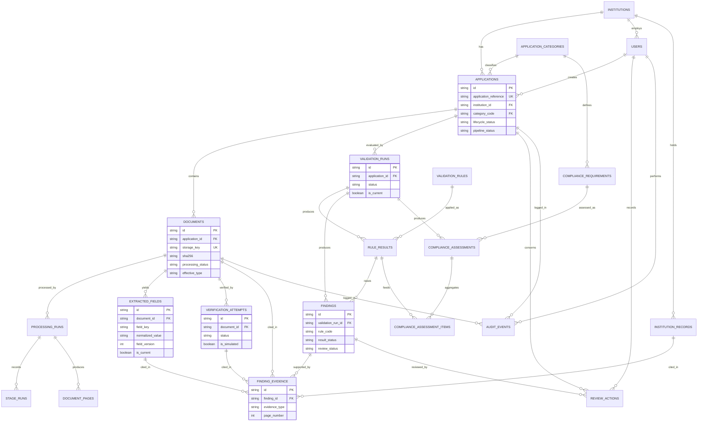
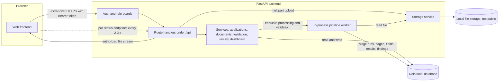
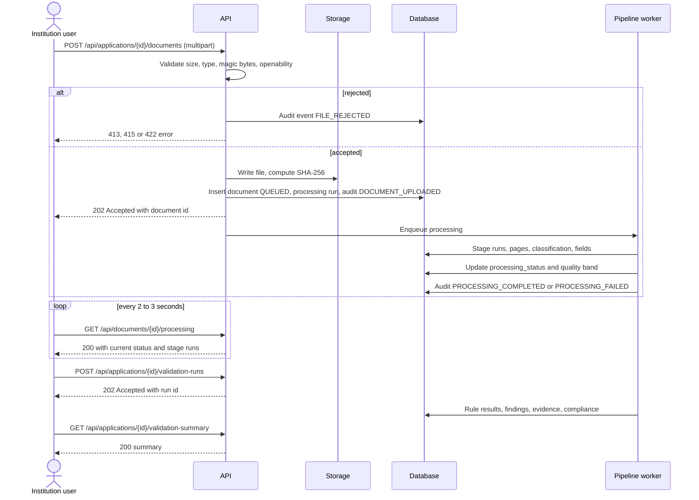
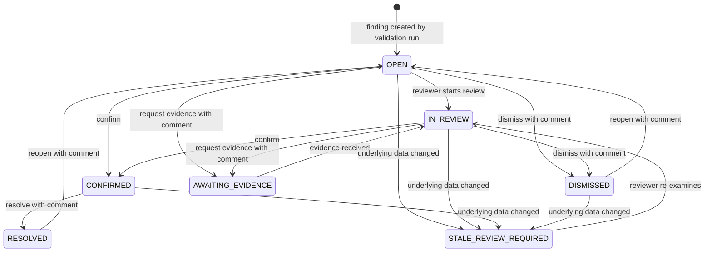

# VerityAI — Data Model and API Specification

| Item | Value |
|---|---|
| Document | `docs/DATA_MODEL_AND_API.md` |
| Project | VerityAI |
| Problem Statement | SIH26261 — AI-Powered Application Validation, Document Authentication and Regulatory Compliance Verification |
| Organization | All India Council for Technical Education (AICTE), Ministry of Education, Government of India |
| Theme | Smart Automation |
| Document order | 5th of the documentation set |
| Status | Implementation-ready draft for a 3–4 day hackathon prototype |

---

## 1. Document Purpose

This document defines the **relational data model** and the **REST API contract** of VerityAI. It tells a coding agent which tables to create, how they relate, which status values exist, which endpoints to build, who may call them, and what the JSON looks like.

It deliberately contains **no application source code, no SQL migration files and no Python modules**. Table and column definitions are given as tables so they can be translated into whatever ORM models `TECH_STACK.md` selected.

The document is written for a beginner developer working with an AI coding agent: decisions are explicit, the P0 scope is small, and trade-offs are explained in plain language.

---

## 2. Project Context

AICTE processes institutional applications (for example Extension of Approval). Officials need help with the repetitive, preliminary checks: missing documents, expired certificates, conflicting identifiers, duplicate files and unverifiable issuers. VerityAI automates those preliminary checks and presents **evidence-linked findings** to authorized human reviewers.

Non-negotiable behaviours carried from `AI_PIPELINE.md` into the data model and API:

- The system **never approves or rejects** an application. There is no `APPROVED` or `REJECTED` status anywhere.
- A processing failure, a failed validation rule, an unresolved finding and an unavailable verification source are **different things** and are stored in different columns.
- Simulated verification is stored with an explicit `is_simulated = true` flag and is never `VERIFIED`.
- Every finding keeps its evidence; nothing (page numbers, records, verification results) is invented.
- Original extracted values are never overwritten; corrections create new versions.
- Demo data is synthetic and labelled as such.

---

## 3. Alignment With Existing Documentation

### 3.1 What was available

When this document was written, only `docs/AI_PIPELINE.md` was available in the working environment (it was produced earlier in the same project). `docs/ARCHITECTURE.md`, `docs/TECH_STACK.md` and `docs/UI_UX_DESIGN.md` were **not accessible**. Their content is therefore replaced by the provisional assumptions below. **Before implementation, compare this table to the real documents.** Where a real document disagrees about a *technology choice*, it wins; this document's table and endpoint structure stays valid.

| # | Assumption | Source / reason | If the real document differs |
|---|---|---|---|
| D1 | Backend: **Python 3.11+ with FastAPI**; request/response models validated with Pydantic. | Prompt allows FastAPI; AI_PIPELINE.md A1. | Keep paths and JSON; swap framework mechanics. |
| D2 | Database: **SQLite for the demo**, schema kept **PostgreSQL-compatible**; accessed through **SQLAlchemy 2.x**. | AI_PIPELINE.md A2. | Change column types only; avoid SQLite-only features in the model. |
| D3 | Authentication: **email + password login setting a signed JWT in an HttpOnly, SameSite=Lax cookie** with CSRF header protection. | Standard, XSS-safe browser session architecture. | Matches `TECH_STACK.md` and `UI_UX_DESIGN.md`. All browser endpoints authenticate via session cookie. |
| D4 | Roles: `INSTITUTION_USER`, `REVIEWER`, `ADMIN`. | Prompt Section 17. | Rename roles consistently. |
| D5 | Document processing runs **asynchronously in the same process** (background task or single in-process worker); clients **poll** status endpoints. No WebSockets. | AI_PIPELINE.md A5; prompt Section 13. | Contracts unchanged if processing is synchronous (status simply returns `COMPLETED` at once). |
| D6 | File storage: **local disk** behind a small storage interface; DB stores a **relative storage key**. | AI_PIPELINE.md A6. | Replace storage backend; the key semantic is unchanged. |
| D7 | The UI includes: login, dashboard, application list/detail, document upload and viewer, extracted-field table, findings list/detail with evidence, verification panel, compliance checklist, review actions, audit timeline and report view. | Inferred from the workflow. | Add or remove UI-specific endpoints in the catalog. |
| D8 | Time zone: all timestamps stored and returned in **UTC (ISO 8601)**. Dates (no time) are `YYYY-MM-DD`. | AI_PIPELINE.md Section 11. | — |

### 3.2 Reconciliation of status lists

The task prompt proposed some status names that differ from `AI_PIPELINE.md`. **`AI_PIPELINE.md` is the source of truth for processing, validation and evidence**, so:

| Prompt proposal | Decision | Reason |
|---|---|---|
| Verification status `EXPIRED` | **Not a verification status.** Certificate expiry is a *rule result* (`RULE-EXP-001`). | Expiry of a certificate and the outcome of asking an issuer are different questions. |
| Review status `ADDITIONAL_EVIDENCE_REQUESTED` | Stored as **`AWAITING_EVIDENCE`** | Matches AI_PIPELINE.md 19.2. |
| Review status `NOT_REVIEWED` | Stored as **`OPEN`** | Matches AI_PIPELINE.md 19.2. |
| Review status `ESCALATED` | **Deferred (P2)** | Not in the pipeline model. |
| Extraction status (document level) `PENDING/COMPLETED/PARTIAL/FAILED/NEEDS_MANUAL_REVIEW` | Replaced by document `processing_status` plus `extraction_quality_band` (`GOOD/FAIR/POOR/UNUSABLE`); field-level statuses follow AI_PIPELINE.md 10.4 | One processing status plus a quality band is more honest than a second overlapping status. |
| Application status `COMPLETED/CLOSED` | `lifecycle_status` uses `REVIEW_COMPLETED` (human review done). `CLOSED` deferred (P2). | "Completed" must never imply approval. |

---

## 4. Data-Model Design Principles

1. **One concept, one status column.** Never reuse a generic `status`. Every status column has its own vocabulary (Section 8).
2. **Relational for things we query, JSON for flexible detail.** Anything we filter, count, join or must keep integrity for gets columns and foreign keys. JSON is used only for small, structured detail that is read as a whole (for example `declared_data`, `comparison_values`, rule parameters). Each JSON column is justified in Section 6.
3. **History is kept, not overwritten.** Extracted fields, validation runs, findings, verification attempts, review actions and audit events are append-only or versioned.
4. **Evidence snapshots.** Findings copy the values they relied on at the time of evaluation, so later corrections never rewrite history.
5. **No cascading deletes on important data.** Foreign keys that point at audit history, evidence, findings or reviewer actions use `RESTRICT`. Only clearly derived, disposable data may be removed by a controlled reset.
6. **Opaque identifiers.** Primary keys are **UUID strings**. Human-friendly references (`application_reference`) are separate columns.
7. **Small is better.** Fourteen core P0 tables plus a few small configuration tables; no table for concepts that can be a column.
8. **Honest nulls.** `NULL` means "not available / not determined" (never a default guess): no fabricated confidence, page numbers or values.
9. **Synthetic labelling.** Tables that hold demo data carry `data_origin`.

---

## 5. Entity Overview

| # | Table | Purpose | Priority |
|---|---|---|---|
| 1 | `users` | Accounts, roles, institution binding | P0 |
| 2 | `institutions` | Institutional identity | P0 |
| 3 | `institution_records` | Synthetic/authorized comparison data (programmes, intake, previous approvals) | P0 |
| 4 | `application_categories` | Configurable application categories | P0 |
| 5 | `applications` | Application header and declared data | P0 |
| 6 | `documents` | Uploaded file metadata, classification, status | P0 |
| 7 | `document_pages` | Per-page text source, OCR confidence and extracted text | P0 |
| 8 | `processing_runs` | One row per processing attempt of a document | P0 |
| 9 | `stage_runs` | Per-stage ledger (status, timing) for a processing run | P0 |
| 10 | `extracted_fields` | Versioned structured field values with provenance | P0 |
| 11 | `validation_rules` | Configurable rule definitions (versioned) | P0 |
| 12 | `validation_runs` | One execution of the validation engine for an application | P0 |
| 13 | `rule_results` | Result of each rule in a run (including PASS) | P0 |
| 14 | `findings` | Reviewer-facing items derived from non-pass results/indicators | P0 |
| 15 | `finding_evidence` | Evidence items for a finding | P0 |
| 16 | `verification_attempts` | Issuer verification attempts (simulated, manual, official) | P0 |
| 17 | `compliance_requirements` | Configurable checklist requirements | P0 |
| 18 | `compliance_assessments` | Per-run requirement results | P0 |
| 19 | `compliance_assessment_items` | Link: assessment ↔ supporting rule results | P0 |
| 20 | `review_actions` | Reviewer decisions, corrections, notes | P0 |
| 21 | `audit_events` | Append-only audit log | P0 |
| 22 | `reports` | Persisted report metadata/snapshots | **P1** (P0 generates on demand) |

**Not tables (on purpose):**

- *Document types* and *classification clues*: a **configuration file** (the registry in AI_PIPELINE.md 10.2), because they change rarely and are read at startup.
- *Issuer fixture records* for the simulated provider: a **clearly named synthetic data file**, not a table.
- *Evidence requests*: a `review_actions` row with `action_type = EVIDENCE_REQUEST` (no extra table in P0).
- *Dashboard metrics*: computed with queries; nothing is stored.

---

## 6. Detailed Entity Definitions

**Conventions.** `PK` = primary key, `FK` = foreign key, `NN` = not null, `UQ` = unique. All `id` columns are UUID strings. `created_at`/`updated_at` are UTC timestamps (NN, default now; `updated_at` refreshed on change). Enumerations are stored as strings and validated by the application and a `CHECK` constraint where the database supports it.

### 6.1 `users`

| Column | Type | Rules |
|---|---|---|
| `id` | UUID | PK |
| `email` | text | NN, UQ (stored lowercase); used as the username |
| `display_name` | text | NN |
| `password_hash` | text | NN; salted hash from a standard password-hashing library; **never** plaintext; never returned by the API |
| `role` | text | NN; `INSTITUTION_USER` \| `REVIEWER` \| `ADMIN` |
| `institution_id` | UUID | FK → `institutions.id`; **required when role = INSTITUTION_USER**, NULL otherwise |
| `is_active` | boolean | NN, default true (deactivate instead of delete) |
| `last_login_at` | timestamp | nullable |
| `data_origin` | text | NN, default `SYNTHETIC_DEMO` for seeded users |
| `created_at`, `updated_at` | timestamp | NN |

*Design note:* a single `role` column is enough for three fixed roles. A separate roles table adds joins without benefit in a 3–4 day prototype.

### 6.2 `institutions`

| Column | Type | Rules |
|---|---|---|
| `id` | UUID | PK |
| `institution_name` | text | NN |
| `institution_identifier` | text | nullable, UQ when present; **synthetic in demo** (e.g., `SYN-INST-0001`); never a real AICTE identifier |
| `institution_type` | text | nullable (e.g., `ENGINEERING_COLLEGE`, free text label allowed) |
| `state`, `city` | text | nullable |
| `status` | text | NN; `ACTIVE` \| `INACTIVE` |
| `data_origin` | text | NN |
| `created_at`, `updated_at` | timestamp | NN |

### 6.3 `institution_records` (comparison dataset)

Holds authorized/synthetic records used by `FIELD_EQUALS_RECORD` rules. If no row exists, rules report `UNABLE_TO_EVALUATE` — rows are never invented.

| Column | Type | Rules |
|---|---|---|
| `id` | UUID | PK |
| `institution_id` | UUID | NN, FK → `institutions.id` |
| `record_type` | text | NN; `PROGRAMME_INTAKE` \| `PREVIOUS_APPROVAL` \| `CERTIFICATE_REGISTRY` |
| `programme_name` | text | nullable |
| `approved_intake` | integer | nullable, ≥ 0 |
| `reference_number` | text | nullable (approval/certificate reference) |
| `valid_from`, `valid_to` | date | nullable |
| `source_label` | text | NN (e.g., `SYNTHETIC_DATASET_V1`) |
| `data_origin` | text | NN |
| `created_at` | timestamp | NN |

### 6.4 `application_categories`

| Column | Type | Rules |
|---|---|---|
| `code` | text | PK (e.g., `EOA_ILLUSTRATIVE`) |
| `name` | text | NN |
| `description` | text | nullable |
| `required_document_types` | JSON array | NN default `[]` (document type IDs from the registry). *JSON justified:* small list read as a whole, edited as configuration. |
| `required_declared_fields` | JSON array | NN default `[]` (keys required in `applications.declared_data` at submit) |
| `provenance` | text | NN; `ILLUSTRATIVE` \| `VERIFIED` |
| `enabled` | boolean | NN default true |

### 6.5 `applications`

| Column | Type | Rules |
|---|---|---|
| `id` | UUID | PK |
| `application_reference` | text | NN, UQ; generated, human-friendly (e.g., `VAI-2026-0001`) |
| `institution_id` | UUID | NN, FK → `institutions.id` |
| `category_code` | text | NN, FK → `application_categories.code` |
| `academic_year` | text | nullable (e.g., `2026-27`) |
| `lifecycle_status` | text | NN, default `DRAFT` (Section 8.1) |
| `pipeline_status` | text | NN, default `NOT_STARTED` (Section 8.2) |
| `declared_data` | JSON object | NN default `{}`; the application's own declared fields (e.g., `institution_name`, `institution_identifier`, `certificate_number`, `certificate_expiry_date`, `programme_name`, `approved_intake`). *JSON justified:* small, flexible per category, compared field-by-field by rules; the evidence snapshot records the compared value, so history is preserved. |
| `submitted_at` | timestamp | nullable |
| `assigned_reviewer_id` | UUID | nullable, FK → `users.id` (**used from P1**; column exists now at no cost) |
| `created_by` | UUID | NN, FK → `users.id` |
| `data_origin` | text | NN |
| `created_at`, `updated_at` | timestamp | NN |

**Required at creation (draft):** `institution_id`, `category_code`. Everything else may be incomplete. **Required at submit:** every key listed in the category's `required_declared_fields` present and non-empty, and at least one document uploaded. Missing items are reported as a `422` with the missing keys; submission is never blocked by *validation findings*.

### 6.6 `documents`

| Column | Type | Rules |
|---|---|---|
| `id` | UUID | PK |
| `application_id` | UUID | NN, FK → `applications.id` |
| `original_filename` | text | NN; sanitized display name only, **never used as a path** |
| `storage_key` | text | NN, UQ; relative key like `<application_id>/<document_id>/original.pdf` |
| `storage_backend` | text | NN default `LOCAL` |
| `file_state` | text | NN default `PRESENT`; `PRESENT` \| `MISSING` \| `DELETED` |
| `media_type` | text | NN; **detected** type (`application/pdf`, `image/jpeg`, `image/png`) |
| `declared_media_type` | text | nullable; what the client claimed |
| `file_size_bytes` | integer | NN, > 0 |
| `sha256` | text | NN, 64 hex characters |
| `page_count` | integer | nullable until opened |
| `declared_type` | text | nullable; user-chosen document type ID |
| `detected_type` | text | nullable |
| `detection_score` | real | nullable; computed score 0–1, never invented |
| `classification_status` | text | nullable until classified (AI_PIPELINE.md 9.3) |
| `classification_basis` | JSON | nullable; matched clues with pages. *JSON justified:* read-only explanation list. |
| `effective_type` | text | nullable; the type used by rules (reviewer override > confirmed type) — see 9.4 of the pipeline |
| `upload_status` | text | NN default `ACCEPTED`; `RECEIVED` \| `ACCEPTED` \| `REJECTED` (P0 persists only `ACCEPTED`; rejected uploads are audited but not stored) |
| `processing_status` | text | NN default `QUEUED` (Section 8.3) |
| `extraction_quality_band` | text | nullable; `GOOD` \| `FAIR` \| `POOR` \| `UNUSABLE` |
| `latest_verification_status` | text | nullable cached copy of the newest `verification_attempts.status` |
| `uploaded_by` | UUID | NN, FK → `users.id` |
| `deleted_at` | timestamp | nullable (soft delete) |
| `created_at`, `updated_at` | timestamp | NN |

*Design note:* no file bytes live in the database. `latest_verification_status` and `processing_status` are **cached for fast lists**; the source of truth is `verification_attempts` and `processing_runs`.

### 6.7 `document_pages`

| Column | Type | Rules |
|---|---|---|
| `id` | UUID | PK |
| `document_id` | UUID | NN, FK → `documents.id` |
| `processing_run_id` | UUID | NN, FK → `processing_runs.id` |
| `page_number` | integer | NN, ≥ 1 |
| `text_source` | text | NN; `DIGITAL_TEXT` \| `OCR` \| `NONE` |
| `raw_text`, `clean_text` | text | nullable |
| `char_count` | integer | NN default 0 |
| `ocr_mean_confidence` | real | nullable; **only the engine-reported value**; NULL for digital text |
| `rotation_applied` | integer | nullable (degrees) |
| `status` | text | NN; `SUCCEEDED` \| `SUCCEEDED_WITH_WARNINGS` \| `FAILED` \| `TIMED_OUT` \| `SKIPPED` |
| `error_code` | text | nullable |
| `duration_ms` | integer | nullable |
| UQ | (`processing_run_id`, `page_number`) | |

*Privacy note:* page text is stored for evidence viewing and re-extraction. It is synthetic in the demo. Never copy it into audit metadata or logs.

### 6.8 `processing_runs` (necessary in P0)

One row per attempt to process a document (initial upload, retry, reprocess). **Necessary in P0** because the pipeline must distinguish "processing failed" from "validation failed", must support retry without losing history, and the benchmark needs timings.

| Column | Type | Rules |
|---|---|---|
| `id` | UUID | PK |
| `document_id` | UUID | NN, FK → `documents.id` |
| `trigger` | text | NN; `UPLOAD` \| `RETRY` \| `REPROCESS` \| `CLASSIFICATION_OVERRIDE` |
| `status` | text | NN; `QUEUED` \| `PROCESSING` \| `COMPLETED` \| `COMPLETED_WITH_WARNINGS` \| `PARTIAL` \| `FAILED` \| `MANUAL_REVIEW_REQUIRED` |
| `pipeline_version` | text | NN (e.g., `0.1.0`) |
| `warnings` | JSON array | nullable; short codes (e.g., `PAGE_2_OCR_CONFIDENCE_FAIR`) |
| `error_code` | text | nullable |
| `safe_error_summary` | text | nullable; **no stack trace, no file contents** |
| `quality_summary` | JSON | nullable; AI_PIPELINE.md 12 summary. *JSON justified:* computed snapshot read as a whole. |
| `started_at`, `completed_at` | timestamp | started NN; completed nullable |
| `duration_ms` | integer | nullable |
| `requested_by` | UUID | nullable, FK → `users.id` (NULL = system) |

### 6.9 `stage_runs`

| Column | Type | Rules |
|---|---|---|
| `id` | UUID | PK |
| `processing_run_id` | UUID | NN, FK → `processing_runs.id` |
| `stage` | text | NN; `FILE_VALIDATION`, `SECURE_STORE`, `HASH_DEDUP`, `TEXT_EXTRACT`, `OCR`, `CLASSIFY`, `FIELD_EXTRACT`, `NORMALIZE`, `EXTRACTION_QA`, `ANOMALY`, … (AI_PIPELINE.md 5.1) |
| `status` | text | NN; `PENDING` \| `RUNNING` \| `SUCCEEDED` \| `SUCCEEDED_WITH_WARNINGS` \| `FAILED` \| `SKIPPED` \| `TIMED_OUT` |
| `started_at`, `ended_at` | timestamp | nullable |
| `duration_ms` | integer | nullable |
| `summary` | JSON | nullable (short counts/notes) |
| `error_code` | text | nullable |
| `safe_error_summary` | text | nullable |

Application-level stages (rule evaluation, findings) are tracked by `validation_runs`, not `stage_runs`.

### 6.10 `extracted_fields` (versioned)

| Column | Type | Rules |
|---|---|---|
| `id` | UUID | PK |
| `document_id` | UUID | NN, FK → `documents.id` |
| `processing_run_id` | UUID | nullable, FK → `processing_runs.id` (NULL for manual entries) |
| `field_key` | text | NN (e.g., `expiry_date`) |
| `raw_value` | text | nullable (**original extracted value; never edited**) |
| `normalized_value` | text | nullable (ISO date, normalized identifier…) |
| `normalization_status` | text | nullable; `OK` \| `AMBIGUOUS` \| `UNPARSEABLE` \| `EMPTY` |
| `date_parse_status` | text | nullable; `UNAMBIGUOUS` \| `AMBIGUOUS` \| `PARTIAL` \| `UNPARSEABLE` (date fields only) |
| `candidate_values` | JSON array | nullable; alternative candidates or both ambiguous-date readings. *JSON justified:* small list shown together with the field. |
| `page_number` | integer | nullable (NULL = page not determined) |
| `extraction_method` | text | NN; `LABEL` \| `REGEX` \| `CONTEXT_RULE` \| `MODEL_ASSISTED` \| `MANUAL_ENTRY` |
| `rule_or_pattern_id` | text | nullable |
| `confidence` | real | nullable; **never fabricated** |
| `confidence_basis` | text | nullable; e.g., `OCR_PAGE_MEAN`, `NOT_APPLICABLE_DIGITAL_TEXT` |
| `extraction_status` | text | NN; `EXTRACTED` \| `LOW_CONFIDENCE` \| `AMBIGUOUS` \| `NOT_FOUND` \| `NOT_ATTEMPTED` \| `NOT_APPLICABLE` \| `MANUALLY_ENTERED` \| `MANUALLY_CORRECTED` |
| `review_status` | text | NN default `UNREVIEWED`; `UNREVIEWED` \| `CONFIRMED` \| `CORRECTED` \| `REJECTED` |
| `field_version` | integer | NN default 1 |
| `supersedes_field_id` | UUID | nullable, FK → `extracted_fields.id` |
| `is_current` | boolean | NN default true |
| `created_by` | UUID | nullable, FK → `users.id` (NULL = pipeline) |
| `change_reason` | text | nullable (required for corrections) |
| `created_at` | timestamp | NN |

**Versioning rule (preserves originals):** a correction **inserts a new row** (`field_version + 1`, `supersedes_field_id` = old row, `is_current = true`) and sets the old row's `is_current = false`. Only `is_current` and `review_status` of old rows are ever updated; value columns are immutable. **Reprocessing never replaces a field whose current version is `MANUALLY_CORRECTED` or `MANUALLY_ENTERED`**; the stage summary notes the skip.

*NOT_FOUND vs NOT_ATTEMPTED:* the pipeline writes a row for every expected field so that "readable but absent" and "unreadable" are distinguishable (AI_PIPELINE.md 10.4–10.5).

### 6.11 `validation_rules`

| Column | Type | Rules |
|---|---|---|
| `id` | UUID | PK |
| `rule_code` | text | NN (e.g., `RULE-EXP-001`) |
| `rule_version` | text | NN (e.g., `1.0`) |
| UQ | (`rule_code`, `rule_version`) | |
| `rule_name` | text | NN |
| `description` | text | NN |
| `rule_type` | text | NN (`REQUIRED_DOCUMENT`, `REQUIRED_FIELD`, `EXPIRY_CHECK`, `DATE_SANITY`, `FIELD_EQUALS_APPLICATION`, `FIELD_EQUALS_ACROSS_DOCS`, `FIELD_EQUALS_RECORD`, `UNIQUENESS`, `VERIFICATION_REQUIRED`, `COMPOSITE_CHECKLIST`, `SYSTEM`) |
| `category` | text | NN; used for dashboards: `REQUIRED_DOCUMENT` \| `REQUIRED_FIELD` \| `EXPIRY` \| `CONSISTENCY` \| `DUPLICATE` \| `ANOMALY` \| `VERIFICATION` \| `CLASSIFICATION` |
| `applies_to` | JSON | NN; document types and application categories. *JSON justified:* configuration read as a whole. |
| `parameters` | JSON | NN default `{}`; rule-type parameters |
| `severity` | text | NN; `LOW` \| `MEDIUM` \| `HIGH` |
| `on_fail_status` | text | NN default `FAIL`; `FAIL` or `NEEDS_REVIEW` |
| `provenance` | text | NN; `ILLUSTRATIVE` \| `VERIFIED` |
| `enabled` | boolean | NN default true |
| `created_at`, `updated_at` | timestamp | NN |

Rules are **data**; one generic engine evaluates them. There is no endpoint per rule.

### 6.12 `validation_runs`

| Column | Type | Rules |
|---|---|---|
| `id` | UUID | PK |
| `application_id` | UUID | NN, FK → `applications.id` |
| `status` | text | NN; `QUEUED` \| `RUNNING` \| `COMPLETED` \| `FAILED` |
| `trigger` | text | NN; `MANUAL` \| `DOCUMENT_ADDED` \| `FIELD_CORRECTED` \| `CLASSIFICATION_OVERRIDDEN` \| `VERIFICATION_RECORDED` |
| `evaluation_date` | date | NN (the "today" used for expiry checks; shown in reports) |
| `pipeline_version` | text | NN |
| `rule_snapshot` | JSON | NN; list of `{rule_code, rule_version, parameters_hash}` used. *JSON justified:* immutable snapshot for reproducibility. |
| `summary` | JSON | nullable; counts snapshot written at completion (AI_PIPELINE.md 22.8 shape). It is a **cache**; endpoints may recompute from `rule_results`. |
| `is_current` | boolean | NN default false; exactly one `true` per application after a run completes |
| `error_code`, `safe_error_summary` | text | nullable |
| `triggered_by` | UUID | nullable, FK → `users.id` (NULL = system) |
| `started_at`, `completed_at` | timestamp | started NN; completed nullable |

**How runs relate to findings:** each run produces its own `rule_results`, `findings`, `compliance_assessments`. Older runs and their findings are **kept** (history). Only the run with `is_current = true` feeds the UI lists and the dashboard. When a new run completes it becomes current in one transaction, and **reviewer decisions are carried over** (Section 8.7).

### 6.13 `rule_results`

| Column | Type | Rules |
|---|---|---|
| `id` | UUID | PK |
| `validation_run_id` | UUID | NN, FK → `validation_runs.id` |
| `application_id` | UUID | NN, FK → `applications.id` (denormalized for filtering) |
| `rule_code`, `rule_version` | text | NN (matches `validation_rules`) |
| `target_key` | text | NN; deterministic key for what was evaluated (e.g., `app` or `doc:<id>`) |
| UQ | (`validation_run_id`, `rule_code`, `target_key`) | |
| `status` | text | NN; `PASS` \| `FAIL` \| `NEEDS_REVIEW` \| `NOT_APPLICABLE` \| `UNABLE_TO_EVALUATE` |
| `severity` | text | NN |
| `explanation` | text | NN (every result has one, even PASS) |
| `expected_value`, `observed_value` | text | nullable |
| `inputs_status` | text | NN; `ALL_AVAILABLE` \| `PARTIAL` \| `UNAVAILABLE` |
| `human_review_required` | boolean | NN |
| `evaluation_date_used` | date | NN |
| `evaluated_at` | timestamp | NN |
| `notes` | JSON array | nullable |

Why store PASS results? The summary counts (`rule_status_counts`), the compliance aggregation and the report's "checks performed" list all need them.

### 6.14 `findings`

| Column | Type | Rules |
|---|---|---|
| `id` | UUID | PK |
| `application_id` | UUID | NN, FK |
| `document_id` | UUID | nullable, FK → `documents.id` (primary document, if any; all related documents are in evidence) |
| `validation_run_id` | UUID | NN, FK |
| `rule_result_id` | UUID | nullable, FK → `rule_results.id` (NULL for pure indicators) |
| `rule_code`, `rule_version` | text | NN |
| `finding_type` | text | NN; `RULE_RESULT` \| `INDICATOR` (anomaly/duplicate) |
| `category` | text | NN (same vocabulary as `validation_rules.category`) |
| `indicator_id` | text | nullable (e.g., `ANM-001`) |
| `finding_key` | text | NN; `rule_code + sorted(document ids) + sorted(field keys)` — used for carry-over |
| UQ | (`validation_run_id`, `finding_key`) | |
| `result_status` | text | NN; `FAIL` \| `NEEDS_REVIEW` \| `UNABLE_TO_EVALUATE` (PASS/NOT_APPLICABLE produce no finding) |
| `severity` | text | NN |
| `title` | text | NN |
| `explanation` | text | NN |
| `expected_value`, `observed_value` | text | nullable |
| `recommended_action` | text | NN |
| `requires_human_review` | boolean | NN |
| `evidence_note` | text | nullable; explains why evidence is limited (e.g., "page not determined") |
| `review_status` | text | NN default `OPEN` (Section 8.7) |
| `carried_over_from_finding_id` | UUID | nullable, FK → `findings.id` |
| `is_current` | boolean | NN (mirrors the run's currency; indexed for dashboard) |
| `created_at`, `updated_at` | timestamp | NN |

`result_status` (what the engine concluded) and `review_status` (what the human did) are **separate columns** by design. The API example in the prompt used a single `status`; the contract here exposes both.

### 6.15 `finding_evidence`

| Column | Type | Rules |
|---|---|---|
| `id` | UUID | PK |
| `finding_id` | UUID | NN, FK → `findings.id` |
| `sort_order` | integer | NN |
| `evidence_type` | text | NN; `DOCUMENT_FIELD` \| `APPLICATION_FIELD` \| `RECORD_COMPARISON` \| `RULE_APPLICATION` \| `VERIFICATION_RESPONSE` \| `FILE_HASH` \| `METADATA` \| `PAGE_REFERENCE` \| `EXTRACTION_STATE` |
| `label` | text | NN (short human label) |
| `document_id` | UUID | nullable, FK |
| `field_id` | UUID | nullable, FK → `extracted_fields.id` |
| `page_number` | integer | nullable (NULL = not determined) |
| `verification_attempt_id` | UUID | nullable, FK |
| `institution_record_id` | UUID | nullable, FK → `institution_records.id` |
| `rule_code`, `rule_version` | text | nullable |
| `raw_value`, `normalized_value` | text | nullable |
| `snapshot` | JSON | NN default `{}`; copy of the values relied upon (field key, method, application field key/value, hash, metadata…) |
| `captured_at` | timestamp | NN |

Details in Section 9.

### 6.16 `verification_attempts`

| Column | Type | Rules |
|---|---|---|
| `id` | UUID | PK |
| `document_id` | UUID | NN, FK |
| `application_id` | UUID | NN, FK (denormalized) |
| `provider_id` | text | NN (e.g., `synthetic-issuer-registry-v1`, `manual`) |
| `provider_kind` | text | NN; `SIMULATED` \| `MANUAL` \| `OFFICIAL_API` \| `OFFICIAL_PORTAL` \| `QR_CODE` \| `DIGITAL_SIGNATURE` (P0 uses the first two) |
| `is_simulated` | boolean | NN; **must be true iff `provider_kind = SIMULATED`** |
| `status` | text | NN (Section 8.5) |
| `simulated_outcome` | text | nullable; `MATCH` \| `MISMATCH` \| `NOT_FOUND` (only when simulated) |
| `source_identity` | text | NN (e.g., "Local synthetic fixture file (not an official source)") |
| `verification_method` | text | NN |
| `reference_number` | text | nullable |
| `request_values`, `returned_result`, `comparison_values` | JSON | nullable. *JSON justified:* provider-dependent structured payload preserved as returned (no secrets). |
| `source_timestamp` | timestamp | nullable (when the source reports one) |
| `requested_at`, `completed_at` | timestamp | requested NN |
| `performed_by` | UUID | nullable, FK → `users.id` (manual) |
| `notes` | text | nullable |
| `error_details` | text | nullable; safe text only |
| `created_at` | timestamp | NN |

**Integrity constraints:** `is_simulated = true` ⇒ `status ≠ VERIFIED` and `provider_kind = SIMULATED`. `status = VERIFIED` ⇒ `provider_kind ∈ {OFFICIAL_API, OFFICIAL_PORTAL, MANUAL}` and `source_identity` not empty (a manual confirmation must name what the reviewer consulted).

### 6.17 `compliance_requirements`

| Column | Type | Rules |
|---|---|---|
| `requirement_code` | text | PK (e.g., `REQ-ACCR-001`) |
| `category_code` | text | NN, FK → `application_categories.code` |
| `description` | text | NN |
| `required_evidence` | JSON | NN; document types/fields/verification |
| `rule_codes` | JSON array | NN; rules aggregated by this requirement. *JSON justified:* configuration list; the actual links per run are relational (6.19). |
| `combine_logic` | text | NN default `WORST_STATUS` |
| `requires_physical_inspection` | boolean | NN default false |
| `version` | text | NN |
| `provenance` | text | NN; `ILLUSTRATIVE` \| `VERIFIED` |
| `enabled` | boolean | NN default true |

### 6.18 `compliance_assessments`

Compliance results are **separate** from findings because they aggregate several rule results into one checklist line. Duplication is avoided: assessments store **no copy of evidence**; they link to rule results (6.19) and, for display, to the related findings through those results.

| Column | Type | Rules |
|---|---|---|
| `id` | UUID | PK |
| `validation_run_id` | UUID | NN, FK |
| `application_id` | UUID | NN, FK |
| `requirement_code` | text | NN, FK |
| UQ | (`validation_run_id`, `requirement_code`) | |
| `requirement_version` | text | NN |
| `result_status` | text | NN; same five values as rule results |
| `explanation` | text | NN |
| `requires_review` | boolean | NN |
| `review_note` | text | nullable (latest reviewer observation, copied from a review action for convenience) |
| `evaluated_at` | timestamp | NN |

### 6.19 `compliance_assessment_items`

| Column | Type | Rules |
|---|---|---|
| `assessment_id` | UUID | NN, FK → `compliance_assessments.id` |
| `rule_result_id` | UUID | NN, FK → `rule_results.id` |
| PK | (`assessment_id`, `rule_result_id`) | |

### 6.20 `review_actions`

| Column | Type | Rules |
|---|---|---|
| `id` | UUID | PK |
| `application_id` | UUID | NN, FK |
| `finding_id` | UUID | nullable, FK |
| `document_id` | UUID | nullable, FK |
| `field_id` | UUID | nullable, FK → `extracted_fields.id` |
| `compliance_assessment_id` | UUID | nullable, FK |
| `actor_id` | UUID | NN, FK → `users.id` |
| `action_type` | text | NN; `START_REVIEW` \| `CONFIRM_FINDING` \| `DISMISS_FINDING` \| `REQUEST_EVIDENCE` \| `RESOLVE_FINDING` \| `REOPEN_FINDING` \| `FIELD_CORRECTION` \| `FIELD_MANUAL_ENTRY` \| `CLASSIFICATION_OVERRIDE` \| `MANUAL_VERIFICATION` \| `NOTE` \| `COMPLETE_REVIEW` |
| `comment` | text | nullable; **required** for dismiss, correction, reopen, evidence request, manual verification |
| `previous_status`, `new_status` | text | nullable (the finding/application status transition, when applicable) |
| `details` | JSON | nullable (e.g., `{ "old_value": "...", "new_value": "...", "new_field_id": "..." }`) |
| `created_at` | timestamp | NN |

Append-only: no update or delete endpoint exists.

### 6.21 `audit_events`

| Column | Type | Rules |
|---|---|---|
| `id` | UUID | PK |
| `event_type` | text | NN (Section 22) |
| `actor_id` | UUID | nullable, FK → `users.id` (NULL for system) |
| `actor_type` | text | NN; `USER` \| `SYSTEM` |
| `application_id` | UUID | nullable, FK |
| `document_id` | UUID | nullable, FK |
| `entity_type`, `entity_id` | text | nullable |
| `occurred_at` | timestamp | NN |
| `request_id` | text | nullable |
| `metadata` | JSON | nullable; small structured detail; **never** passwords, tokens, document text or full file paths |

Append-only. Foreign keys use `RESTRICT`; entities referenced by audit events are soft-deleted, never hard-deleted.

### 6.22 `reports` (P1)

P0 generates the report **on demand** from persisted tables and records only an audit event (`REPORT_GENERATED`). P1 adds `reports` (`id`, `application_id`, `validation_run_id`, `format`, `generated_by`, `generated_at`, `content_hash`, `storage_key` or `snapshot` JSON). Rationale in Section 22.

---

## 7. Relationships and Constraints

### 7.1 Relationship summary

| Relationship | Cardinality | FK location | On delete |
|---|---|---|---|
| Institution → Applications | 1 : N | `applications.institution_id` | RESTRICT |
| Institution → Users (institution users) | 1 : N | `users.institution_id` | RESTRICT |
| Institution → Institution records | 1 : N | `institution_records.institution_id` | RESTRICT |
| Category → Applications | 1 : N | `applications.category_code` | RESTRICT |
| Application → Documents | 1 : N | `documents.application_id` | RESTRICT |
| Document → Processing runs | 1 : N | `processing_runs.document_id` | RESTRICT |
| Processing run → Stage runs | 1 : N | `stage_runs.processing_run_id` | RESTRICT |
| Processing run → Pages | 1 : N | `document_pages.processing_run_id` | RESTRICT |
| Document → Extracted fields (versions) | 1 : N | `extracted_fields.document_id` | RESTRICT |
| Application → Validation runs | 1 : N | `validation_runs.application_id` | RESTRICT |
| Validation run → Rule results | 1 : N | `rule_results.validation_run_id` | RESTRICT |
| Validation run → Findings | 1 : N | `findings.validation_run_id` | RESTRICT |
| Finding → Evidence items | 1 : N | `finding_evidence.finding_id` | RESTRICT |
| Document → Verification attempts | 1 : N | `verification_attempts.document_id` | RESTRICT |
| Application → Compliance assessments (per run) | 1 : N | `compliance_assessments.application_id` | RESTRICT |
| Assessment ↔ Rule results | N : M | `compliance_assessment_items` | RESTRICT |
| User → Review actions | 1 : N | `review_actions.actor_id` | RESTRICT |
| Anything important → Audit events | 1 : N | `audit_events.*_id` | RESTRICT |

**Why RESTRICT everywhere:** nothing in the application deletes these rows. Documents and users are *deactivated or soft-deleted*. This protects audit history and evidence. The only delete path is the guarded demo-reset command (Section 24.4), which clears the whole synthetic dataset in dependency order.

### 7.2 Constraints that protect integrity

| Constraint | Protects |
|---|---|
| `users.email` unique | One account per identity |
| `users`: role = `INSTITUTION_USER` ⇒ `institution_id` NOT NULL | Tenant isolation is always decidable |
| `applications.application_reference` unique | Stable human reference |
| `documents.storage_key` unique | One file per record; no key collisions |
| `documents.sha256` length 64 | Valid hash |
| Index (not unique) on `documents.sha256` | Duplicates **must be allowed** to exist (they become findings) |
| Partial unique index on `extracted_fields (document_id, field_key)` where `is_current = true` | Exactly one current value per field |
| Unique (`validation_rules.rule_code`, `rule_version`) | Rule versions are unambiguous |
| Unique (`rule_results.validation_run_id`, `rule_code`, `target_key`) | No double-evaluation inside a run |
| Unique (`findings.validation_run_id`, `finding_key`) | No duplicated findings inside a run |
| Partial unique index on `validation_runs (application_id)` where `is_current = true` | One current run per application |
| CHECK on verification (simulated ⇒ not VERIFIED) | A simulated result can never read as real |
| CHECK on `severity`, status vocabularies | No invalid status values |
| Application-level check: a `FIELD_CORRECTION` review action requires `comment` | Corrections are always explained |
| NOT NULL on `explanation`, `title`, `recommended_action` for findings | Every finding is explainable |

### 7.3 Identifiers, timestamps, soft deletion

- **IDs:** UUID v4 strings generated by the application. Seed data uses deterministic UUIDs (Section 24.2) for reproducibility.
- **Timestamps:** UTC, timezone-aware, ISO 8601 in API responses. Never store local time. `evaluation_date` and certificate dates are `DATE`.
- **Soft deletion:** only `documents.deleted_at` (and `users.is_active` / `institutions.status` for deactivation). A soft-deleted document is excluded from lists, validation and dashboard counts but retained for audit and evidence. Findings that reference it keep working; the evidence shows "document removed".
- **JSON columns summary:** `applications.declared_data`, `application_categories.*`, `documents.classification_basis`, `processing_runs.warnings/quality_summary`, `stage_runs.summary`, `extracted_fields.candidate_values`, `validation_rules.applies_to/parameters`, `validation_runs.rule_snapshot/summary`, `finding_evidence.snapshot`, `verification_attempts.*payloads`, `review_actions.details`, `audit_events.metadata`. All are small, structured, read whole, and never used as a join/filter key.

**Trade-off:** more tables than the minimum (rule results, evidence, assessment items) cost a little more to implement but make counts, evidence viewing and honest status reporting simple SQL instead of JSON parsing.

---

## 8. Status Models and Transitions

All values are stored as upper-case strings. Each table below is an independent vocabulary.

### 8.1 Application `lifecycle_status`

| Value | Meaning |
|---|---|
| `DRAFT` | Being prepared; may be incomplete; documents may be uploaded and validation may be run for preview |
| `SUBMITTED` | Submitted by the institution user; declared data locked (except by reviewer/admin) |
| `UNDER_REVIEW` | A reviewer has started review |
| `REVIEW_COMPLETED` | A reviewer marked the preliminary review as complete. **This is not an approval or rejection.** |

Transitions: `DRAFT → SUBMITTED → UNDER_REVIEW → REVIEW_COMPLETED`. A reviewer/admin may reopen `REVIEW_COMPLETED → UNDER_REVIEW` (audited, comment required). `SUBMITTED → DRAFT` is not allowed in P0.

### 8.2 Application `pipeline_status`

`NOT_STARTED` → `PROCESSING` (any document processing or validation run active) → `READY_FOR_REVIEW` (all documents terminal and the current validation run `COMPLETED`). Returns to `PROCESSING` when new work starts. Mapping to AI_PIPELINE.md's `application_review_status`: `UNDER_REVIEW → IN_REVIEW`, `REVIEW_COMPLETED → REVIEW_COMPLETED`, otherwise `pipeline_status`.

### 8.3 Document statuses

| Column | Values |
|---|---|
| `upload_status` | `RECEIVED`, `ACCEPTED`, `REJECTED` (P0 stores only `ACCEPTED`) |
| `processing_status` | `QUEUED`, `PROCESSING`, `COMPLETED`, `COMPLETED_WITH_WARNINGS`, `PARTIAL`, `FAILED`, `MANUAL_REVIEW_REQUIRED` |
| `extraction_quality_band` | `GOOD`, `FAIR`, `POOR`, `UNUSABLE` |
| `file_state` | `PRESENT`, `MISSING`, `DELETED` |

Transitions for `processing_status`: `QUEUED → PROCESSING → (COMPLETED | COMPLETED_WITH_WARNINGS | PARTIAL | FAILED | MANUAL_REVIEW_REQUIRED)`. Any terminal status → `QUEUED` through retry/reprocess (creates a new `processing_run`). **A processing status never says anything about whether the document is valid.**

### 8.4 Rule / validation result status

`PASS`, `FAIL`, `NEEDS_REVIEW`, `NOT_APPLICABLE`, `UNABLE_TO_EVALUATE` — definitions exactly as AI_PIPELINE.md 13.4. Compliance assessments reuse the same five values.

### 8.5 Verification status

| Value | Meaning | `is_simulated` |
|---|---|---|
| `VERIFIED` | A real, supported, trusted source (or a reviewer's recorded manual confirmation with named source) confirmed the record | always false |
| `SIMULATED_RESULT` | Simulated provider produced an outcome (`simulated_outcome` carries MATCH/MISMATCH/NOT_FOUND) | always true |
| `MISMATCH_DETECTED` | Source returned a conflicting record (the `is_simulated` flag says whether the source was simulated) | either |
| `PENDING` | Requested/awaiting result (manual task) | either |
| `SOURCE_UNAVAILABLE` | Source unreachable or absent | either |
| `MANUAL_REVIEW_REQUIRED` | A human must verify | false |
| `UNABLE_TO_EVALUATE` | Inputs missing (e.g., no reference number extracted) | false |

Transitions: `PENDING → (VERIFIED \| MISMATCH_DETECTED \| SOURCE_UNAVAILABLE)` when a manual result is recorded; other statuses are terminal for an attempt (a new attempt is a new row).

### 8.6 Validation run status

`QUEUED → RUNNING → COMPLETED` or `FAILED`. Only one run per application may be `QUEUED`/`RUNNING` at a time (second request → `409`).

### 8.7 Finding review status and transitions

| From | To | Who | Comment required |
|---|---|---|---|
| `OPEN` | `IN_REVIEW` | Reviewer | no |
| `OPEN`, `IN_REVIEW` | `CONFIRMED` | Reviewer | recommended |
| `OPEN`, `IN_REVIEW` | `DISMISSED` | Reviewer | **yes** |
| `OPEN`, `IN_REVIEW` | `AWAITING_EVIDENCE` | Reviewer | **yes** (becomes the evidence request) |
| `AWAITING_EVIDENCE` | `IN_REVIEW` | Reviewer | no |
| `CONFIRMED` | `RESOLVED` | Reviewer | **yes** |
| `DISMISSED`, `RESOLVED` | `OPEN` (reopen) | Reviewer | **yes** |
| any | `STALE_REVIEW_REQUIRED` | System | — (set when a re-run changes the underlying values) |
| `STALE_REVIEW_REQUIRED` | `IN_REVIEW` | Reviewer | no |

*Carry-over:* when a new validation run completes, each new finding is matched to the previous run's finding by `finding_key`. Same observed/expected values ⇒ copy `review_status` and set `carried_over_from_finding_id`. Changed values ⇒ `STALE_REVIEW_REQUIRED` (if it had been reviewed) or `OPEN`. Old findings remain with `is_current = false`.

**Separation reminder:** `result_status` = the engine's conclusion; `review_status` = the human workflow; `processing_status` = technical success; `verification_status` = issuer verification. Four different questions, four columns.

---

## 9. Evidence Representation

### 9.1 Decision: relational rows plus a snapshot

Evidence is stored as **dedicated `finding_evidence` rows** (one per evidence item) with typed, nullable foreign keys and a small `snapshot` JSON.

| Option | Pros | Cons | Verdict |
|---|---|---|---|
| Only JSON on the finding | Easiest | Cannot query "all findings referencing this document/field"; no FK integrity | Rejected |
| Fully normalized per evidence type | Strict | Many tables, slow to build | Rejected |
| **Rows with typed refs + snapshot JSON** | Queryable, FK-checked, history-safe, consistent API shape, extendable by adding an `evidence_type` | A few nullable columns | **Chosen** |

### 9.2 Rules

1. Evidence is built **by the findings stage** from references returned by the rule engine (field IDs, document IDs, record IDs) — not from free text.
2. Each item stores the **snapshot** of values at evaluation time (raw/normalized value, extraction method, application field key/value, hash, metadata keys). Later corrections do not change old evidence; the UI can additionally show the *current* field value via `field_id`.
3. `page_number` is copied from the field record; if the field has none it is `NULL` and the API returns `"page_number": null` with `page_label: "Page not determined"`. **Pages are never guessed.**
4. `institution_record_id` is only set if a real row was used. No record ⇒ no `RECORD_COMPARISON` item; the finding is `UNABLE_TO_EVALUATE` with an `EXTRACTION_STATE` or `RULE_APPLICATION` item explaining why.
5. A verification-response evidence item copies `status`, `is_simulated` and `source_identity` so a simulated origin can never be lost.

### 9.3 When evidence is unavailable

- A finding always has at least one `RULE_APPLICATION` item (what was checked, with parameters).
- If a document could not be read, the evidence contains an `EXTRACTION_STATE` item (quality band, reason code) and `findings.evidence_note` says so.
- The API returns an empty list only for findings with truly no referenced data; the UI shows "No supporting document evidence available — see rule description".
- If a referenced document is soft-deleted or its file is missing, the evidence item still returns its snapshot with `document_available: false`.

---

## 10. Document Storage References

- The database stores **metadata and a relative `storage_key`**, never bytes, never absolute paths.
- Key pattern: `<application_id>/<document_id>/original.<detected_ext>`. The extension comes from the **detected** type. Client-supplied filenames are used only as `original_filename` text.
- A storage service resolves `storage_key` to a real location under a configured **storage root outside any public/static directory**, rejecting keys containing `..`, absolute paths or separators other than the expected pattern.
- **No internal path appears in any API response.** Clients receive `document.id` and use `GET /api/documents/{id}/file`, which authorizes the caller and streams the bytes.
- Derived artifacts (rendered page images) live next to the original under `derived/` and are served only through authorized endpoints (P1: page image endpoint).

| Situation | Behaviour |
|---|---|
| Missing file (DB row, no file) | `file_state = MISSING`; file endpoint → `404 FILE_NOT_FOUND`; processing → `FAILED` with `error_code = FILE_MISSING`; audit event; metadata and findings remain viewable |
| Deleted document | Soft delete: `deleted_at` set, `file_state = DELETED`; excluded from lists and counts; file removal optional/after retention; `404` on direct access |
| Failed upload | No row created (or row removed in the same transaction); temp file deleted; `4xx/5xx` with `error.code`; audit event `FILE_REJECTED` or `UPLOAD_FAILED` |
| Duplicate file | Accepted and stored; duplicate indicator → finding `NEEDS_REVIEW` (never rejected, never "fraud"); cross-application details visible to reviewers only |
| Unsupported type | `415 UNSUPPORTED_MEDIA_TYPE`; nothing stored |
| Oversized file | `413 FILE_TOO_LARGE`; stream aborted |
| Access denied | `403 FORBIDDEN` (or `404` for another institution's resource — see Section 13.3) |

---

## 11. Database Indexing

| Table | Index | Purpose |
|---|---|---|
| `users` | UQ(`email`) | Login |
| `applications` | (`institution_id`, `created_at` desc); (`lifecycle_status`); (`pipeline_status`); (`category_code`); UQ(`application_reference`) | Lists, filters, dashboard |
| `documents` | (`application_id`, `deleted_at`); (`sha256`); (`processing_status`); UQ(`storage_key`) | Document lists, duplicate lookup, dashboard |
| `document_pages` | UQ(`processing_run_id`, `page_number`); (`document_id`) | Page viewer |
| `processing_runs` | (`document_id`, `started_at` desc) | Latest run |
| `stage_runs` | (`processing_run_id`); (`stage`, `status`) | Benchmarks |
| `extracted_fields` | partial UQ(`document_id`, `field_key`) where current; (`document_id`, `is_current`); (`field_key`) | Field tables, cross-doc rules |
| `validation_rules` | UQ(`rule_code`, `rule_version`); (`enabled`) | Rule loading |
| `validation_runs` | (`application_id`, `started_at` desc); partial UQ(`application_id`) where current | Latest summary |
| `rule_results` | (`validation_run_id`, `status`); (`application_id`, `rule_code`) | Summary counts |
| `findings` | (`application_id`, `is_current`, `review_status`); (`validation_run_id`); (`severity`); (`category`); (`document_id`); (`finding_key`) | Review queue, dashboard, carry-over |
| `finding_evidence` | (`finding_id`, `sort_order`); (`document_id`); (`field_id`) | Evidence retrieval |
| `verification_attempts` | (`document_id`, `created_at` desc); (`status`) | History, pending counts |
| `compliance_assessments` | UQ(`validation_run_id`, `requirement_code`); (`application_id`) | Checklist |
| `review_actions` | (`finding_id`, `created_at`); (`application_id`, `created_at`); (`actor_id`) | History |
| `audit_events` | (`application_id`, `occurred_at` desc); (`document_id`, `occurred_at`); (`event_type`); (`actor_id`) | Audit timeline |

Do not add indexes beyond this list in P0; SQLite handles demo volumes easily.

---

## 12. API Design Principles

1. **Base path** `/api/v1`; JSON everywhere except file upload (multipart) and file download (binary).
2. **Resource-oriented paths**, plural nouns, nesting only one level (`/applications/{id}/documents`).
3. **Methods:** `GET` read, `POST` create/commands, `PATCH` partial update, `DELETE` only for soft-deleting drafts (P1). No `PUT`.
4. **Authentication required** for every endpoint except `POST /api/v1/auth/login` and `GET /api/v1/health`.
5. **Server-side authorization** on every request (Section 13). The UI hiding a button is not security.
6. **Long-running work is asynchronous** (document processing, validation runs): the request returns `202 Accepted` with a resource to poll. Everything else is synchronous.
7. **Consistent envelope** (Section 16) for success and errors.
8. **Validate input** with schema models; reject unknown enum values; trim strings; limit lengths.
9. **Pagination** on all list endpoints that can grow: `page` (default 1), `page_size` (default 20, max 100); sorting via `sort=-created_at`.
10. **No stack traces, file paths, SQL or secrets** in any response; a `request_id` links an error to server logs.
11. **No GraphQL, no WebSockets.** Polling every 2–3 seconds is sufficient for the demo.
12. **Idempotency where cheap:** starting a validation run while one is active returns `409` with the active run's ID.
13. **Wording** in responses follows AI_PIPELINE.md Section 4: findings are "preliminary indicators"; no "authentic/forged/fraud".

---

## 13. API Authentication and Authorization

### 13.1 Authentication

- `POST /api/v1/auth/login` with email and password sets an **HttpOnly, SameSite=Lax cookie** carrying the signed JWT session (short-lived, e.g., 60 minutes; `Secure` enabled outside local development) and returns the user profile.
- Subsequent browser requests automatically include the session cookie.
- **CSRF Mitigation:** State-changing requests (`POST`, `PATCH`, `DELETE`) require a custom request header (e.g. `X-Requested-With: VerityAI`) set by the frontend API wrapper.
- `POST /api/v1/auth/logout` is a **P0 endpoint** that clears the session cookie (`Set-Cookie: access_token=; Max-Age=0; Path=/; HttpOnly; SameSite=Lax`) and writes an audit event.
- Passwords are verified against `users.password_hash`; failed logins return the same generic `401` message for unknown email and wrong password; basic rate limiting on login is P1.
- Tokens, passwords and sensitive headers are **never logged**.
- Inactive users (`is_active = false`) cannot log in and existing sessions are rejected.

### 13.2 Role permission matrix (P0)

`Own` = only resources of the caller's institution. `—` = forbidden.

| Capability | INSTITUTION_USER | REVIEWER | ADMIN |
|---|---|---|---|
| Log in, view own profile | ✔ | ✔ | ✔ |
| List/view institutions | Own institution only | All | All |
| Create/update institutions | — | — | ✔ |
| View institution records (comparison data) | — | ✔ (read) | ✔ |
| Create application | ✔ (own institution) | — | ✔ |
| Edit draft application | ✔ (own, `DRAFT` only) | — | ✔ |
| Submit application | ✔ (own) | — | ✔ |
| List/view applications | Own | All | All |
| Upload documents | ✔ (own application, while `DRAFT` or `SUBMITTED`) | ✔ (additional evidence, audited) | ✔ |
| View document metadata and processing status | Own | All | All |
| View/download document file | Own | All | All |
| View extracted fields | Own (read-only) | All | All |
| Correct/enter fields, override classification | — | ✔ | ✔ |
| Retry/reprocess document | Own (retry on `FAILED` only) | ✔ | ✔ |
| Start validation run | Own (preview while `DRAFT`) | ✔ | ✔ |
| View validation summary, rule results, findings, compliance | — (P0; applicant-facing messages are P1) | ✔ | ✔ |
| Start verification attempt / record manual result | — | ✔ | ✔ |
| Record review actions, resolve findings | — | ✔ | ✔ |
| View review queue | — | ✔ | ✔ |
| View/configure validation rules | — | View | View + enable/disable (P1) |
| View application audit history | — | ✔ | ✔ |
| View global audit log | — | — | ✔ (P1) |
| Dashboard | Own-institution counts only (P1; P0 hides it) | ✔ | ✔ |
| Generate report | — | ✔ | ✔ |
| Manage users | — | — | ✔ (seed script in P0) |

*Rationale for hiding findings from institution users in P0:* findings are internal, preliminary indicators for officials; showing them to applicants could be misread as decisions. If `UI_UX_DESIGN.md` specifies an applicant-visible deficiency list, add a read-only `GET /api/applications/{id}/applicant-notes` in P1 backed by `REQUEST_EVIDENCE` actions.

### 13.3 Tenant isolation rules

- Every query for an `INSTITUTION_USER` is filtered by the caller's `institution_id`, derived from the **token's user record, never from a client parameter**.
- Accessing another institution's resource returns **`404 NOT_FOUND`** (not `403`), so existence is not disclosed.
- Duplicate detection across applications: reviewers see the other application/document IDs; an institution user only ever sees a boolean "possible duplicate" on their own document **without** cross-institution details.
- Role checks are implemented as reusable dependencies/guards, one per role set, applied at route level.

---

## 14. API Endpoint Catalog

Priority: **P0** build now, **P1** if time permits. "Async" = returns `202` and is polled. Roles: **I** institution user, **R** reviewer, **A** admin.

| # | Method | Path | Purpose | Roles | Mode | Pri |
|---|---|---|---|---|---|---|
| 1 | GET | `/api/v1/health` | Liveness (no auth) | none | sync | P0 |
| 2 | POST | `/api/v1/auth/login` | Obtain session cookie | none | sync | P0 |
| 3 | GET | `/api/v1/auth/me` | Current user | all | sync | P0 |
| 4 | POST | `/api/v1/auth/logout` | Clear session cookie & audit | all | sync | P0 |
| 5 | GET | `/api/v1/institutions` | List institutions | I(own), R, A | sync | P0 |
| 6 | GET | `/api/v1/institutions/{id}` | Institution detail | I(own), R, A | sync | P0 |
| 7 | POST | `/api/v1/institutions` | Create institution | A | sync | P1 |
| 8 | PATCH | `/api/v1/institutions/{id}` | Update institution | A | sync | P1 |
| 9 | GET | `/api/v1/application-categories` | List categories (+ required docs) | all | sync | P0 |
| 10 | POST | `/api/v1/applications` | Create draft application | I, A | sync | P0 |
| 11 | GET | `/api/v1/applications` | List (filters, pagination) | I(own), R, A | sync | P0 |
| 12 | GET | `/api/v1/applications/{id}` | Application detail | I(own), R, A | sync | P0 |
| 13 | PATCH | `/api/v1/applications/{id}` | Update draft fields / declared data | I(own, DRAFT), A | sync | P0 |
| 14 | POST | `/api/v1/applications/{id}/submit` | Submit | I(own), A | sync | P0 |
| 15 | GET | `/api/v1/applications/{id}/status` | Aggregated processing/validation status (polling) | I(own), R, A | sync | P0 |
| 16 | POST | `/api/v1/applications/{id}/documents` | Upload (multipart) | I(own), R, A | **async** | P0 |
| 17 | GET | `/api/v1/applications/{id}/documents` | List documents | I(own), R, A | sync | P0 |
| 18 | GET | `/api/v1/documents/{id}` | Document metadata | I(own), R, A | sync | P0 |
| 19 | GET | `/api/v1/documents/{id}/processing` | Processing status + stage runs | I(own), R, A | sync | P0 |
| 20 | GET | `/api/v1/documents/{id}/fields` | Current extracted fields (`?include_history=true`) | I(own,read), R, A | sync | P0 |
| 21 | GET | `/api/v1/documents/{id}/pages` | Page records (text source, confidence) | R, A | sync | P0 |
| 22 | GET | `/api/v1/documents/{id}/file` | Authorized preview/download | I(own), R, A | sync | P0 |
| 23 | POST | `/api/v1/documents/{id}/reprocess` | Retry/reprocess | I(own, FAILED), R, A | **async** | P0 |
| 24 | PATCH | `/api/v1/documents/{id}/classification` | Reviewer override of type | R, A | sync (+ async reprocess) | P0 |
| 25 | POST | `/api/v1/documents/{id}/fields` | Manual field entry | R, A | sync | P1 |
| 26 | POST | `/api/v1/fields/{id}/corrections` | Correct a field (new version) | R, A | sync (+ async revalidation) | P0 |
| 27 | DELETE | `/api/v1/documents/{id}` | Soft-delete (draft only) | I(own), A | sync | P1 |
| 28 | POST | `/api/v1/applications/{id}/validation-runs` | Start validation | I(own preview), R, A | **async** | P0 |
| 29 | GET | `/api/v1/validation-runs/{id}` | Run status/summary | R, A (I own preview status only) | sync | P0 |
| 30 | GET | `/api/v1/applications/{id}/validation-runs` | Run history | R, A | sync | P1 |
| 31 | GET | `/api/v1/applications/{id}/validation-summary` | Latest summary | R, A | sync | P0 |
| 32 | GET | `/api/v1/applications/{id}/rule-results` | Results of current run | R, A | sync | P0 |
| 33 | GET | `/api/v1/applications/{id}/findings` | Findings (filters) | R, A | sync | P0 |
| 34 | GET | `/api/v1/findings/{id}` | Finding with evidence | R, A | sync | P0 |
| 35 | GET | `/api/v1/validation-rules` | List rules | R, A | sync | P0 |
| 36 | PATCH | `/api/v1/validation-rules/{rule_code}` | Enable/disable, severity | A | sync | P1 |
| 37 | POST | `/api/v1/documents/{id}/verification-attempts` | Start verification | R, A | sync (simulated) / creates PENDING (manual) | P0 |
| 38 | GET | `/api/v1/documents/{id}/verification-attempts` | Verification history | R, A | sync | P0 |
| 39 | POST | `/api/v1/verification-attempts/{id}/manual-result` | Record manual outcome | R, A | sync | P0 |
| 40 | GET | `/api/v1/applications/{id}/compliance` | Checklist results (current run) | R, A | sync | P0 |
| 41 | GET | `/api/v1/compliance-requirements` | Requirement definitions | R, A | sync | P1 |
| 42 | GET | `/api/v1/review-queue` | Findings/applications needing review | R, A | sync | P0 |
| 43 | POST | `/api/v1/applications/{id}/review/start` | Move to `UNDER_REVIEW` | R, A | sync | P0 |
| 44 | POST | `/api/v1/applications/{id}/review/complete` | Mark review complete | R, A | sync | P0 |
| 45 | POST | `/api/v1/findings/{id}/review-actions` | Confirm/dismiss/request evidence/resolve/reopen/note | R, A | sync | P0 |
| 46 | GET | `/api/v1/findings/{id}/review-actions` | Action history | R, A | sync | P0 |
| 47 | POST | `/api/v1/applications/{id}/observations` | Note on application/compliance item | R, A | sync | P1 |
| 48 | PATCH | `/api/v1/applications/{id}/assignment` | Assign reviewer | A | sync | P1 |
| 49 | GET | `/api/v1/dashboard/summary` | Summary metrics | R, A | sync | P0 |
| 50 | GET | `/api/v1/dashboard/finding-categories` | Counts by category/severity | R, A | sync | P1 |
| 51 | GET | `/api/v1/dashboard/processing-stats` | Latency/throughput stats | R, A | sync | P1 |
| 52 | GET | `/api/v1/applications/{id}/audit-events` | Application audit timeline | R, A | sync | P0 |
| 53 | GET | `/api/v1/audit-events` | Global audit log | A | sync | P1 |
| 54 | POST | `/api/v1/applications/{id}/reports` | Generate report on demand | R, A | sync | P0 |
| 55 | GET | `/api/v1/applications/{id}/reports` | List persisted reports | R, A | sync | P1 |

---

## 15. Detailed P0 API Contracts

All examples use readable placeholder IDs matching `AI_PIPELINE.md` (`APP-2026-0001`, `DOC-0001`, `FLD-0007`, `FND-0003`, `RUN-0001`, `VER-0001`). **Real IDs are UUID strings.** All values are synthetic. Responses are shown without the `request_id` header for brevity.

### 15.1 `POST /api/v1/auth/login`

Role: none. Sync.

Request:

```json
{ "email": "reviewer1@demo.verityai.invalid", "password": "<demo password from seed documentation>" }
```

Response `200` (Sets response header `Set-Cookie: access_token=<signed JWT>; HttpOnly; SameSite=Lax; Path=/`):

```json
{
  "data": {
    "user": {
      "id": "USR-REVIEWER-01",
      "email": "reviewer1@demo.verityai.invalid",
      "display_name": "Demo Reviewer One",
      "role": "REVIEWER",
      "institution_id": null
    }
  }
}
```

Errors: `401 INVALID_CREDENTIALS` (generic message), `422 VALIDATION_ERROR` (missing fields), `403 ACCOUNT_INACTIVE`.

### 15.2 `GET /api/v1/auth/me`

Response `200`: the `user` object above. Errors: `401 UNAUTHENTICATED`.

### 15.3 `POST /api/applications`

Role: I (own institution), A. Sync.

Request:

```json
{
  "institution_id": "INS-0001",
  "category_code": "EOA_ILLUSTRATIVE",
  "academic_year": "2026-27",
  "declared_data": {
    "institution_name": "Sample Institute of Technology",
    "institution_identifier": "SYN-INST-0001",
    "certificate_number": "CERT-SYN-000123",
    "certificate_expiry_date": "2027-03-31"
  }
}
```

Rules: `institution_id` and `category_code` required; institution users' `institution_id` must equal their own (otherwise `403`); `declared_data` keys are free but dates must be `YYYY-MM-DD` if present (`422` otherwise). Draft may be incomplete.

Response `201`:

```json
{
  "data": {
    "id": "APP-2026-0001",
    "application_reference": "VAI-2026-0001",
    "institution_id": "INS-0001",
    "category_code": "EOA_ILLUSTRATIVE",
    "academic_year": "2026-27",
    "lifecycle_status": "DRAFT",
    "pipeline_status": "NOT_STARTED",
    "declared_data": {
      "institution_name": "Sample Institute of Technology",
      "institution_identifier": "SYN-INST-0001",
      "certificate_number": "CERT-SYN-000123",
      "certificate_expiry_date": "2027-03-31"
    },
    "submitted_at": null,
    "created_by": "USR-INST-01",
    "created_at": "2026-10-21T09:00:00Z",
    "updated_at": "2026-10-21T09:00:00Z",
    "data_origin": "SYNTHETIC_DEMO"
  }
}
```

Audit: `APPLICATION_CREATED`. Errors: `401`, `403 FORBIDDEN`, `404 CATEGORY_NOT_FOUND`/`INSTITUTION_NOT_FOUND`, `422 VALIDATION_ERROR`.

### 15.4 `GET /api/applications`

Query: `page`, `page_size`, `lifecycle_status`, `pipeline_status`, `category_code`, `institution_id` (reviewer/admin only), `has_open_findings` (reviewer/admin; `true|false`), `q` (reference substring), `sort` (`-created_at` default; allowed: `created_at`, `updated_at`, `application_reference`).

Response `200`:

```json
{
  "data": [
    {
      "id": "APP-2026-0001",
      "application_reference": "VAI-2026-0001",
      "institution": { "id": "INS-0001", "institution_name": "Sample Institute of Technology" },
      "category_code": "EOA_ILLUSTRATIVE",
      "lifecycle_status": "SUBMITTED",
      "pipeline_status": "READY_FOR_REVIEW",
      "document_count": 2,
      "open_findings_count": 4,
      "updated_at": "2026-10-21T09:16:12Z"
    }
  ],
  "meta": { "page": 1, "page_size": 20, "total": 1 }
}
```

`open_findings_count` and `document_count` are computed from the current run and non-deleted documents; institution users receive `null` for `open_findings_count` (findings hidden in P0).

### 15.5 `GET /api/applications/{id}` and `PATCH /api/applications/{id}`

`GET` returns the object from 15.3 plus `institution`, `documents_summary` (`total`, counts by `processing_status`) and `current_validation_run_id`. `PATCH` accepts any subset of `academic_year`, `declared_data` (merged key-by-key), only when `lifecycle_status = DRAFT` for institution users. Otherwise `409 APPLICATION_LOCKED`. Audit: `APPLICATION_UPDATED` with the *keys* changed (not values).

### 15.6 `POST /api/applications/{id}/submit`

Sync. Preconditions: category's `required_declared_fields` present; at least one non-deleted `ACCEPTED` document. Does **not** require validation to pass.

Response `200`: application object with `lifecycle_status: "SUBMITTED"`, `submitted_at`. Errors: `409 INVALID_STATE_TRANSITION`, `422 APPLICATION_INCOMPLETE` with details:

```json
{
  "error": {
    "code": "APPLICATION_INCOMPLETE",
    "message": "The application cannot be submitted yet.",
    "details": [
      { "field": "declared_data.certificate_expiry_date", "issue": "required_for_category" },
      { "field": "documents", "issue": "at_least_one_document_required" }
    ],
    "request_id": "req-5e2a"
  }
}
```

Audit: `APPLICATION_SUBMITTED`. After submit, the server automatically starts a validation run (`trigger = MANUAL`, `triggered_by = caller`) if all documents are terminal; otherwise the run starts when the last document finishes.

### 15.7 `GET /api/applications/{id}/status` (polling endpoint)

Response `200`:

```json
{
  "data": {
    "application_id": "APP-2026-0001",
    "lifecycle_status": "SUBMITTED",
    "pipeline_status": "PROCESSING",
    "documents": [
      { "id": "DOC-0001", "processing_status": "COMPLETED_WITH_WARNINGS", "extraction_quality_band": "FAIR" },
      { "id": "DOC-0002", "processing_status": "PROCESSING", "extraction_quality_band": null }
    ],
    "current_validation_run": { "id": "RUN-0001", "status": "COMPLETED", "completed_at": "2026-10-21T09:16:12Z" },
    "active_validation_run": null,
    "all_documents_terminal": false
  }
}
```

Poll every 2–3 seconds until `pipeline_status = READY_FOR_REVIEW` (or a document is `FAILED`/`MANUAL_REVIEW_REQUIRED`, which is also terminal).

### 15.8 `POST /api/applications/{id}/documents` — upload

See Section 18 for the full contract (multipart, validation, polling).

### 15.9 `GET /api/documents/{id}`

Response `200`:

```json
{
  "data": {
    "id": "DOC-0001",
    "application_id": "APP-2026-0001",
    "original_filename": "accreditation_certificate_synthetic.pdf",
    "media_type": "application/pdf",
    "file_size_bytes": 482113,
    "sha256": "9f2c1d0a7b6e4c3a8d5f1e0b2a4c6d8e0f1a3b5c7d9e1f2a4b6c8d0e2f4a6b8c",
    "page_count": 2,
    "file_state": "PRESENT",
    "upload_status": "ACCEPTED",
    "processing_status": "COMPLETED_WITH_WARNINGS",
    "extraction_quality_band": "FAIR",
    "classification": {
      "declared_type": "ACCREDITATION_CERTIFICATE",
      "detected_type": "ACCREDITATION_CERTIFICATE",
      "detection_score": 0.82,
      "classification_status": "CONFIRMED_BY_USER_AND_TEXT",
      "effective_type": "ACCREDITATION_CERTIFICATE"
    },
    "latest_verification_status": "SIMULATED_RESULT",
    "possible_duplicate": false,
    "uploaded_by": "USR-INST-01",
    "created_at": "2026-10-21T09:15:30Z"
  }
}
```

No `storage_key`, no filesystem path. For reviewers/admins only, `duplicates` lists `{document_id, application_id, scope}`; institution users receive only `possible_duplicate`.

### 15.10 `GET /api/documents/{id}/processing`

Response `200`:

```json
{
  "data": {
    "document_id": "DOC-0001",
    "processing_status": "COMPLETED_WITH_WARNINGS",
    "extraction_quality_band": "FAIR",
    "current_run": {
      "id": "PRN-0001",
      "trigger": "UPLOAD",
      "status": "COMPLETED_WITH_WARNINGS",
      "pipeline_version": "0.1.0",
      "started_at": "2026-10-21T09:15:31Z",
      "completed_at": "2026-10-21T09:15:46Z",
      "duration_ms": 15200,
      "warnings": ["PAGE_2_OCR_CONFIDENCE_FAIR"],
      "error_code": null,
      "safe_error_summary": null
    },
    "stage_runs": [
      { "stage": "FILE_VALIDATION", "status": "SUCCEEDED", "duration_ms": 14 },
      { "stage": "TEXT_EXTRACT", "status": "SUCCEEDED", "duration_ms": 120 },
      { "stage": "OCR", "status": "SUCCEEDED_WITH_WARNINGS", "duration_ms": 6120 },
      { "stage": "CLASSIFY", "status": "SUCCEEDED", "duration_ms": 8 },
      { "stage": "FIELD_EXTRACT", "status": "SUCCEEDED", "duration_ms": 31 }
    ]
  }
}
```

### 15.11 `GET /api/documents/{id}/fields`

Query: `include_history` (default false), `status`. Response `200`:

```json
{
  "data": [
    {
      "id": "FLD-0007",
      "document_id": "DOC-0001",
      "field_key": "expiry_date",
      "raw_value": "31 March 2026",
      "normalized_value": "2026-03-31",
      "normalization_status": "OK",
      "date_parse_status": "UNAMBIGUOUS",
      "candidate_values": [],
      "page_number": 2,
      "extraction_method": "LABEL",
      "confidence": 71.4,
      "confidence_basis": "OCR_PAGE_MEAN",
      "extraction_status": "EXTRACTED",
      "review_status": "UNREVIEWED",
      "field_version": 1,
      "supersedes_field_id": null,
      "is_current": true,
      "created_at": "2026-10-21T09:15:42Z"
    }
  ],
  "meta": { "page": 1, "page_size": 100, "total": 1 }
}
```

Fields with `extraction_status` `NOT_FOUND` / `NOT_ATTEMPTED` are returned too (with `raw_value: null`) so the UI can show *why* a value is missing.

### 15.12 `POST /api/fields/{id}/corrections`

Role: R, A. Sync for the correction; re-evaluation is async.

Request:

```json
{
  "new_value": "2027-03-31",
  "reason": "Page 2 viewed; year read as 2026 by OCR but original shows 2027."
}
```

Rules: `reason` required (min length); `{id}` must be a current field (`409 FIELD_NOT_CURRENT` otherwise); `new_value` is normalized by the same normalizer, and an ambiguous/unparseable date is rejected with `422 UNPARSEABLE_VALUE` (the reviewer must provide an unambiguous value).

Response `201`:

```json
{
  "data": {
    "field": {
      "id": "FLD-0021",
      "document_id": "DOC-0001",
      "field_key": "expiry_date",
      "raw_value": "2027-03-31",
      "normalized_value": "2027-03-31",
      "extraction_method": "MANUAL_ENTRY",
      "extraction_status": "MANUALLY_CORRECTED",
      "review_status": "CORRECTED",
      "field_version": 2,
      "supersedes_field_id": "FLD-0007",
      "is_current": true,
      "change_reason": "Page 2 viewed; year read as 2026 by OCR but original shows 2027."
    },
    "superseded_field_id": "FLD-0007",
    "review_action_id": "REV-0001",
    "revalidation": { "validation_run_id": "RUN-0002", "status": "QUEUED" }
  }
}
```

Audit: `FIELD_CORRECTED`. The original `FLD-0007` remains readable via `include_history=true`.

### 15.13 `PATCH /api/documents/{id}/classification`

Role: R, A. Request: `{ "document_type": "NOC", "reason": "Heading indicates a No Objection Certificate." }`. Validates `document_type` against the registry (`422` if unknown). Sets `effective_type`, `classification_status = REVIEWER_SET`, writes a `CLASSIFICATION_OVERRIDE` review action, starts a reprocess (from classification onward) and revalidation, marks dependent reviewed findings `STALE_REVIEW_REQUIRED`. Response `200` with the document object plus `reprocess: { processing_run_id, status: "QUEUED" }`. Audit: `CLASSIFICATION_OVERRIDDEN`.

### 15.14 `POST /api/applications/{id}/validation-runs`

Role: I (preview), R, A. Async.

Request (all optional):

```json
{ "evaluation_date": "2026-10-21", "trigger": "MANUAL" }
```

Only `evaluation_date` is accepted from clients (default: server's current UTC date; an override is stored and displayed in reports). Preconditions: at least one document; no active run (`409 VALIDATION_RUN_ACTIVE` with the active run ID); documents still `QUEUED`/`PROCESSING` do not block — the engine marks dependent rules `UNABLE_TO_EVALUATE` with reason `DOCUMENT_NOT_YET_PROCESSED`, but the UI should wait for terminal documents first.

Response `202`:

```json
{
  "data": {
    "id": "RUN-0001",
    "application_id": "APP-2026-0001",
    "status": "QUEUED",
    "trigger": "MANUAL",
    "evaluation_date": "2026-10-21",
    "pipeline_version": "0.1.0",
    "started_at": "2026-10-21T09:16:00Z",
    "completed_at": null,
    "poll_url": "/api/validation-runs/RUN-0001"
  }
}
```

Audit: `VALIDATION_RUN_STARTED`, later `VALIDATION_RUN_COMPLETED` or `VALIDATION_RUN_FAILED`.

### 15.15 `GET /api/validation-runs/{id}` and `GET /api/applications/{id}/validation-summary`

`GET /api/applications/{id}/validation-summary` returns the summary of the **current** run (or `404 NO_VALIDATION_RUN` if none):

```json
{
  "data": {
    "application_id": "APP-2026-0001",
    "validation_run_id": "RUN-0001",
    "status": "COMPLETED",
    "evaluation_date": "2026-10-21",
    "generated_at": "2026-10-21T09:16:12Z",
    "label": "Preliminary — requires official review. Not a regulatory decision.",
    "documents": { "total": 2, "processing_completed": 1, "completed_with_warnings": 1, "failed": 0, "manual_review_required": 0 },
    "rule_status_counts": { "PASS": 8, "FAIL": 1, "NEEDS_REVIEW": 2, "NOT_APPLICABLE": 1, "UNABLE_TO_EVALUATE": 1 },
    "findings": { "total": 4, "open": 4, "confirmed": 0, "dismissed": 0, "awaiting_evidence": 0 },
    "verification": { "verified_by_real_source": 0, "simulated_results": 1, "pending": 0, "source_unavailable": 0, "manual_required": 1 },
    "compliance": { "requirements_total": 5, "pass": 2, "fail": 1, "needs_review": 1, "unable_to_evaluate": 1, "not_applicable": 0 },
    "attention_level": "HIGH",
    "attention_level_basis": "At least one finding with severity HIGH is not PASS.",
    "top_findings": ["FND-0001", "FND-0003"],
    "review_status": "READY_FOR_REVIEW"
  }
}
```

This is the AI_PIPELINE.md 22.8 object, **computed from the tables** at request time (the stored `validation_runs.summary` is only a snapshot used for reports). `attention_level` is a transparent derivation, never a fraud score or approval likelihood. `GET /api/validation-runs/{id}` returns the run object (status, trigger, counts, `error_code`).

### 15.16 `GET /api/applications/{id}/findings`

Query: `page`, `page_size`, `result_status`, `review_status`, `severity`, `category`, `document_id`, `rule_code`, `requires_human_review`, `run` (`current` default | a run ID — P1), `sort` (default `-severity,-created_at`; severity order HIGH>MEDIUM>LOW).

Response `200` (list view — evidence omitted, counts only):

```json
{
  "data": [
    {
      "id": "FND-0003",
      "application_id": "APP-2026-0001",
      "document_id": "DOC-0001",
      "validation_run_id": "RUN-0001",
      "rule_code": "RULE-XDOC-EXP-001",
      "rule_version": "1.0",
      "finding_type": "RULE_RESULT",
      "category": "CONSISTENCY",
      "title": "Application and certificate expiry dates do not match.",
      "result_status": "NEEDS_REVIEW",
      "severity": "MEDIUM",
      "requires_human_review": true,
      "review_status": "OPEN",
      "evidence_count": 3,
      "created_at": "2026-10-21T09:16:10Z"
    }
  ],
  "meta": { "page": 1, "page_size": 20, "total": 4 }
}
```

### 15.17 `GET /api/findings/{id}`

See Section 17 for the full contract.

### 15.18 Verification — `POST /api/documents/{id}/verification-attempts`

Role: R, A.

Request (simulated):

```json
{ "provider_kind": "SIMULATED" }
```

Request (manual task):

```json
{ "provider_kind": "MANUAL", "notes": "Contact issuer portal; certificate number CERT-SYN-000123." }
```

Rules: document must have an `effective_type` whose registry entry lists the provider in `verification_options`; inputs (issuer, reference number) come from the document's **current extracted fields** — the client cannot supply comparison values. Missing inputs ⇒ the attempt is recorded with `status = UNABLE_TO_EVALUATE` (`201`, not an error). Simulated provider completes synchronously.

Response `201` (simulated; see Section 19 for the manual flow):

```json
{
  "data": {
    "id": "VER-0001",
    "document_id": "DOC-0001",
    "provider_id": "synthetic-issuer-registry-v1",
    "provider_kind": "SIMULATED",
    "is_simulated": true,
    "status": "SIMULATED_RESULT",
    "simulated_outcome": "MISMATCH",
    "source_identity": "Local synthetic fixture file (not an official source)",
    "verification_method": "FIXTURE_LOOKUP_BY_CERTIFICATE_NUMBER",
    "reference_number": "CERT-SYN-000123",
    "comparison_values": [
      { "field_key": "institution_name", "document_value": "Sample Institute of Technology", "source_value": "Sample Institute of Technology", "match": true },
      { "field_key": "expiry_date", "document_value": "2026-03-31", "source_value": "2027-03-31", "match": false }
    ],
    "display_label": "SIMULATED — not an official confirmation",
    "requested_at": "2026-10-21T09:15:55Z",
    "completed_at": "2026-10-21T09:15:55Z",
    "error_details": null
  }
}
```

Audit: `VERIFICATION_REQUESTED` then `VERIFICATION_COMPLETED`. The server updates `documents.latest_verification_status` and triggers a validation run (`VERIFICATION_RECORDED`) so `RULE-VER-001` reflects the result.

### 15.19 Compliance — `GET /api/applications/{id}/compliance`

See Section 19.

### 15.20 Review — `POST /api/findings/{id}/review-actions`

See Section 20.

### 15.21 `GET /api/dashboard/summary`

See Section 21.

### 15.22 `GET /api/applications/{id}/audit-events` and `POST /api/applications/{id}/reports`

See Section 22.

---

## 16. Request and Response Conventions

### 16.1 Chosen envelope

**Success:** `{ "data": <object or array>, "meta": { ... } }` — `meta` only on lists (pagination) or when extra context is needed.

**Error:** `{ "error": { "code": "STRING_CODE", "message": "Human-readable safe text", "details": <null | array>, "request_id": "req-xxxx" } }`

One convention everywhere; no endpoint returns a bare array or a bare object.

### 16.2 General conventions

| Topic | Convention |
|---|---|
| Field names | `snake_case` |
| Timestamps | ISO 8601 UTC with `Z` (e.g., `2026-10-21T09:16:12Z`) |
| Dates | `YYYY-MM-DD` |
| Enumerations | Upper-case strings; unknown values are rejected on input |
| Null vs missing | A value that is unknown/unavailable is `null`, never an empty string or a default |
| Pagination | `page` (≥1), `page_size` (1–100); `meta`: `page`, `page_size`, `total` |
| Sorting | `sort=field` ascending, `sort=-field` descending; comma-separated; whitelist of fields per endpoint |
| Filtering | Query parameters named after the field; invalid value → `422` |
| Request IDs | Server generates `request_id` (also returned as `X-Request-ID` header) |
| Content types | `application/json` for bodies; `multipart/form-data` for upload |
| IDs in paths | Opaque; invalid format → `404` (not `500`) |
| Text safety | Responses never include raw stack traces, SQL, filesystem paths or secrets |

### 16.3 Validation error vs server error

| Kind | HTTP | `error.code` | `details` | Meaning |
|---|---|---|---|---|
| Malformed JSON | 400 | `BAD_REQUEST` | null | Body cannot be parsed |
| Invalid field values | 422 | `VALIDATION_ERROR` | `[{ "field": "...", "issue": "...", "message": "..." }]` | Client can fix and retry |
| Business rule | 409/422 | specific (e.g., `APPLICATION_LOCKED`) | optional | Valid request, but not allowed in current state |
| Unexpected failure | 500 | `INTERNAL_ERROR` | null | Server bug/infrastructure; generic message; full details only in server logs keyed by `request_id` |

---

## 17. Validation Findings Contract

### 17.1 `GET /api/findings/{id}` — full finding

Role: R, A.

Response `200`:

```json
{
  "data": {
    "id": "FND-0003",
    "application_id": "APP-2026-0001",
    "document_id": "DOC-0001",
    "validation_run_id": "RUN-0001",
    "rule_code": "RULE-XDOC-EXP-001",
    "rule_version": "1.0",
    "rule_name": "Application expiry date matches certificate expiry date",
    "rule_provenance": "ILLUSTRATIVE",
    "finding_type": "RULE_RESULT",
    "category": "CONSISTENCY",
    "indicator_id": null,
    "title": "Application and certificate expiry dates do not match.",
    "explanation": "The application states the certificate expiry as 2027-03-31, but the date extracted from the certificate is 2026-03-31. The mismatch may reflect an extraction error, a data-entry error or a different certificate.",
    "result_status": "NEEDS_REVIEW",
    "severity": "MEDIUM",
    "expected_value": "2027-03-31",
    "observed_value": "2026-03-31",
    "recommended_action": "Inspect the original certificate and resolve the discrepancy.",
    "requires_human_review": true,
    "review_status": "OPEN",
    "evidence_note": null,
    "is_current": true,
    "carried_over_from_finding_id": null,
    "evidence": [
      {
        "id": "EVD-0001",
        "evidence_type": "DOCUMENT_FIELD",
        "label": "Certificate expiry date (extracted)",
        "document_id": "DOC-0001",
        "document_available": true,
        "field_id": "FLD-0007",
        "page_number": 2,
        "page_label": "Page 2",
        "raw_value": "31 March 2026",
        "normalized_value": "2026-03-31",
        "snapshot": { "field_key": "expiry_date", "extraction_method": "LABEL", "extraction_status": "EXTRACTED", "confidence": 71.4, "confidence_basis": "OCR_PAGE_MEAN" },
        "captured_at": "2026-10-21T09:16:10Z"
      },
      {
        "id": "EVD-0002",
        "evidence_type": "APPLICATION_FIELD",
        "label": "Certificate expiry date (declared in application)",
        "document_id": null,
        "field_id": null,
        "page_number": null,
        "page_label": null,
        "raw_value": "2027-03-31",
        "normalized_value": "2027-03-31",
        "snapshot": { "application_field_key": "certificate_expiry_date" },
        "captured_at": "2026-10-21T09:16:10Z"
      },
      {
        "id": "EVD-0003",
        "evidence_type": "RULE_APPLICATION",
        "label": "Rule applied",
        "rule_code": "RULE-XDOC-EXP-001",
        "rule_version": "1.0",
        "snapshot": { "comparator": "DATE_ISO_EQUAL", "evaluation_date": "2026-10-21" },
        "captured_at": "2026-10-21T09:16:10Z"
      }
    ],
    "latest_review_action": null,
    "created_at": "2026-10-21T09:16:10Z",
    "updated_at": "2026-10-21T09:16:10Z"
  }
}
```

(Fields not applicable to an evidence type are `null` or omitted; the UI renders by `evidence_type`.)

### 17.2 Contract rules

- `result_status` ∈ {`FAIL`, `NEEDS_REVIEW`, `UNABLE_TO_EVALUATE`}; `review_status` per Section 8.7.
- `page_number` is `null` when not determined; `page_label` then reads "Page not determined" (never a guess).
- Duplicate findings include a `FILE_HASH` evidence item and a text stating that duplication is **not** evidence of fraud.
- Verification-related findings include the evidence item's `is_simulated` in its `snapshot`.
- Wording stays within AI_PIPELINE.md Section 4.

---

## 18. Document Upload and Processing Contract

### 18.1 `POST /api/applications/{id}/documents`

**Content-Type:** `multipart/form-data`

| Part | Required | Description |
|---|---|---|
| `file` | yes | The file (one per request) |
| `declared_type` | no | A document type ID from the registry (e.g., `NOC`); unknown value → `422` |

**Server-side checks (in order, per AI_PIPELINE.md 6.3):** application exists and caller may access it; application state allows upload; size ≤ limit (20 MB default, enforced while streaming); extension on allow-list; declared MIME on allow-list; **magic bytes** match; detected type agrees with extension/MIME; file opens (not encrypted, ≥1 page / valid image); document count limit. The client never sends paths, storage keys or hashes.

**Flow:** accept → write to storage → compute SHA-256 → insert `documents` row (`ACCEPTED`, `processing_status = QUEUED`) and a `processing_runs` row → audit `DOCUMENT_UPLOADED` → return `202`; the background worker runs the pipeline stages.

Response `202`:

```json
{
  "data": {
    "id": "DOC-0001",
    "application_id": "APP-2026-0001",
    "original_filename": "accreditation_certificate_synthetic.pdf",
    "media_type": "application/pdf",
    "file_size_bytes": 482113,
    "sha256": "9f2c1d0a7b6e4c3a8d5f1e0b2a4c6d8e0f1a3b5c7d9e1f2a4b6c8d0e2f4a6b8c",
    "upload_status": "ACCEPTED",
    "processing_status": "QUEUED",
    "possible_duplicate": false,
    "processing_url": "/api/documents/DOC-0001/processing",
    "created_at": "2026-10-21T09:15:30Z"
  }
}
```

**Upload errors**

| Condition | HTTP | `error.code` | Stored? |
|---|---|---|---|
| Missing `file` part | 422 | `VALIDATION_ERROR` | no |
| Unsupported extension/type | 415 | `UNSUPPORTED_MEDIA_TYPE` | no |
| Extension/MIME/magic-byte mismatch | 415 | `FILE_TYPE_MISMATCH` | no |
| Empty file | 422 | `EMPTY_FILE` | no |
| Too large | 413 | `FILE_TOO_LARGE` | no |
| Encrypted/corrupt/unopenable | 422 | `ENCRYPTED_PDF` / `MALFORMED_FILE` | no |
| Application locked or too many documents | 409 | `APPLICATION_LOCKED` / `DOCUMENT_LIMIT_REACHED` | no |
| Storage/database failure | 500 | `STORAGE_ERROR` / `INTERNAL_ERROR` | rolled back, temp file removed |

Every rejection writes a `FILE_REJECTED` audit event (reason code, size, detected type, sanitized filename; no content).

### 18.2 Upload is not processing

`202` means "received and queued". Clients obtain updated state by **polling `GET /api/documents/{id}/processing`** (or `GET /api/applications/{id}/status` for the whole application) every 2–3 seconds until `processing_status` is terminal: `COMPLETED`, `COMPLETED_WITH_WARNINGS`, `PARTIAL`, `FAILED` or `MANUAL_REVIEW_REQUIRED`. Interrupted jobs (server restart) are found at startup, marked `FAILED (INTERRUPTED)` and can be retried.

### 18.3 `POST /api/documents/{id}/reprocess`

Request body optional: `{ "from_stage": "TEXT_EXTRACT" }` (default start). Creates a new `processing_runs` row (`trigger = RETRY` or `REPROCESS`), returns `202` with the same shape as the processing endpoint. `409 PROCESSING_ACTIVE` if one is already running. Existing manual field corrections are preserved (Section 6.10). Institution users may retry only when `processing_status = FAILED`.

### 18.4 `GET /api/documents/{id}/file`

Authorizes (role + tenant), checks `file_state`, streams the bytes with the stored detected `Content-Type`, `Content-Disposition: inline; filename="<sanitized original name>"` (or `?download=true` → `attachment`), `X-Content-Type-Options: nosniff` and `Cache-Control: no-store`. Audit: `DOCUMENT_VIEWED` (inline) or `DOCUMENT_DOWNLOADED`. Errors: `404 FILE_NOT_FOUND` (missing/deleted/other tenant), `401`.

### 18.5 Processing-failure representation

| Situation | Document `processing_status` | Visible as | Validation effect |
|---|---|---|---|
| OCR fails on all pages | `MANUAL_REVIEW_REQUIRED` (`NO_TEXT_EXTRACTED`) | Processing panel + banner | Dependent rules `UNABLE_TO_EVALUATE`; **never `FAIL`** |
| Some pages fail | `PARTIAL` | Warning + per-page status | Rules on missing fields downgrade per AI_PIPELINE.md 13.4 |
| Malformed after intake | `FAILED` (`MALFORMED_FILE`) | Error summary, retry | `UNABLE_TO_EVALUATE` |
| Timeout | `PARTIAL` or `FAILED` (`DOCUMENT_TIMEOUT`) | Warning | As above |

None of these produce an HTTP error on the polling endpoint (`200` with the status). They are **inspectable states, not request failures**.

---

## 19. Verification and Compliance Contracts

### 19.1 Verification endpoints

| Endpoint | Behaviour |
|---|---|
| `POST /api/documents/{id}/verification-attempts` | `SIMULATED`: sync result as 15.18. `MANUAL`: creates a `PENDING` attempt (`201`), `status: "PENDING"`, `is_simulated: false`, `source_identity: "Manual verification task"`. Unsupported/absent provider → `201` with `SOURCE_UNAVAILABLE` or `MANUAL_REVIEW_REQUIRED` (**not** a 5xx). |
| `GET /api/documents/{id}/verification-attempts` | Newest first; each item includes `is_simulated` and `display_label` (set for simulated: "SIMULATED — not an official confirmation"). |
| `POST /api/verification-attempts/{id}/manual-result` | Records a reviewer's outcome for a `PENDING` attempt. |

Manual result request:

```json
{
  "outcome": "VERIFIED",
  "source_identity": "Issuer's public verification portal consulted by reviewer",
  "reference_number": "CERT-SYN-000123",
  "comparison_values": [
    { "field_key": "expiry_date", "document_value": "2027-03-31", "source_value": "2027-03-31", "match": true }
  ],
  "notes": "Synthetic demonstration entry — no real portal consulted."
}
```

`outcome` ∈ {`VERIFIED`, `MISMATCH_DETECTED`, `SOURCE_UNAVAILABLE`}. `source_identity` required for `VERIFIED` (`422` otherwise). The response `200` shows the updated attempt with `provider_kind: "MANUAL"`, `is_simulated: false`, `performed_by`, and `display_label: "Manually recorded by reviewer"`. Audit: `VERIFICATION_RECORDED`; a `MANUAL_VERIFICATION` review action; revalidation triggered. Errors: `404`, `409 VERIFICATION_NOT_PENDING`.

*Demo note:* in the offline demo, a manual `VERIFIED` is only honest if a reviewer actually consulted a source; the seeded demonstration entry must be labelled synthetic in `notes`, as above.

### 19.2 `GET /api/applications/{id}/compliance`

Role: R, A. Returns assessments for the current run.

```json
{
  "data": {
    "application_id": "APP-2026-0001",
    "validation_run_id": "RUN-0001",
    "category_code": "EOA_ILLUSTRATIVE",
    "provenance_notice": "Illustrative checklist — not an official requirement set.",
    "summary": { "requirements_total": 5, "pass": 2, "fail": 1, "needs_review": 1, "unable_to_evaluate": 1, "not_applicable": 0 },
    "items": [
      {
        "id": "CMP-0001",
        "requirement_code": "REQ-ACCR-001",
        "requirement_version": "1.0",
        "description": "A current accreditation certificate consistent with the application is provided.",
        "provenance": "ILLUSTRATIVE",
        "result_status": "NEEDS_REVIEW",
        "explanation": "One sub-rule needs review: expiry dates differ between application and certificate. Issuer verification is simulated only.",
        "requires_review": true,
        "requires_physical_inspection": false,
        "rule_results": [
          { "rule_result_id": "RR-0011", "rule_code": "RULE-XDOC-EXP-001", "status": "NEEDS_REVIEW" },
          { "rule_result_id": "RR-0014", "rule_code": "RULE-VER-001", "status": "NEEDS_REVIEW" }
        ],
        "finding_ids": ["FND-0003"],
        "review_note": null,
        "evaluated_at": "2026-10-21T09:16:11Z"
      }
    ]
  }
}
```

Compliance **reuses** rule results and findings (via `compliance_assessment_items`); it stores no duplicate evidence. Aggregation logic: AI_PIPELINE.md 17.3. Requirements needing physical inspection (e.g., infrastructure) always return `NEEDS_REVIEW` with `requires_physical_inspection: true`. Reviewer observations are recorded through P1 `POST /api/applications/{id}/observations` (or, in P0, as a finding note via 20.1).

---

## 20. Review Workflow Contracts

### 20.1 `POST /api/findings/{id}/review-actions`

Role: R, A. Sync.

Request:

```json
{
  "action_type": "CONFIRM_FINDING",
  "comment": "Original certificate page 2 shows 31 March 2026; application declaration appears incorrect."
}
```

`action_type` ∈ `START_REVIEW` (→ `IN_REVIEW`), `CONFIRM_FINDING`, `DISMISS_FINDING` (comment required), `REQUEST_EVIDENCE` (comment required; → `AWAITING_EVIDENCE`), `RESOLVE_FINDING` (comment required; only from `CONFIRMED`), `REOPEN_FINDING` (comment required), `NOTE` (comment required; no status change). Transition rules: Section 8.7; invalid transitions → `409 INVALID_STATE_TRANSITION` with the allowed actions in `details`.

Response `201`:

```json
{
  "data": {
    "id": "REV-0002",
    "application_id": "APP-2026-0001",
    "finding_id": "FND-0003",
    "actor": { "id": "USR-REVIEWER-01", "display_name": "Demo Reviewer One" },
    "action_type": "CONFIRM_FINDING",
    "comment": "Original certificate page 2 shows 31 March 2026; application declaration appears incorrect.",
    "previous_status": "OPEN",
    "new_status": "CONFIRMED",
    "created_at": "2026-10-21T09:40:00Z",
    "finding": { "id": "FND-0003", "review_status": "CONFIRMED" }
  }
}
```

The status change and the review action are written **in one transaction**, followed by the audit event (`FINDING_CONFIRMED`, `FINDING_DISMISSED`, `EVIDENCE_REQUESTED`, `FINDING_RESOLVED`, `FINDING_REOPENED`, `NOTE_ADDED`).

### 20.2 `GET /api/findings/{id}/review-actions`

Chronological list of actions with actor name and role; `200`.

### 20.3 `GET /api/review-queue`

Role: R, A. Lists **applications needing attention**, ordered by priority.

Query: `page`, `page_size`, `lifecycle_status` (default `SUBMITTED,UNDER_REVIEW`), `category_code`, `min_severity`, `assigned_to` (`me` | user ID — P1), `sort` (default: `-highest_severity,submitted_at`).

Response `200`:

```json
{
  "data": [
    {
      "application_id": "APP-2026-0001",
      "application_reference": "VAI-2026-0001",
      "institution_name": "Sample Institute of Technology",
      "lifecycle_status": "SUBMITTED",
      "attention_level": "HIGH",
      "open_findings": 4,
      "awaiting_evidence": 0,
      "highest_severity": "HIGH",
      "oldest_open_finding_at": "2026-10-21T09:16:10Z",
      "assigned_reviewer_id": null
    }
  ],
  "meta": { "page": 1, "page_size": 20, "total": 1 }
}
```

`open_findings` counts current-run findings with `review_status ∈ {OPEN, IN_REVIEW, STALE_REVIEW_REQUIRED, AWAITING_EVIDENCE}`.

### 20.4 Application review control

- `POST /api/applications/{id}/review/start`: `SUBMITTED → UNDER_REVIEW` (or reopen from `REVIEW_COMPLETED` with comment). Writes `START_REVIEW` action + audit `REVIEW_STARTED`.
- `POST /api/applications/{id}/review/complete`: allowed only if no finding is `OPEN`, `IN_REVIEW`, `STALE_REVIEW_REQUIRED` (those must be handled; `AWAITING_EVIDENCE`, `CONFIRMED`, `DISMISSED`, `RESOLVED` are allowed). Otherwise `409 UNHANDLED_FINDINGS` listing counts. Sets `REVIEW_COMPLETED`. Body `{ "comment": "..." }` required. This records that preliminary review is complete; it **does not** set any approval/rejection state.
- Reviewer assignment (`PATCH /api/applications/{id}/assignment`) is P1.

---

## 21. Dashboard and Analytics Contracts

### 21.1 `GET /api/dashboard/summary` (P0)

Role: R, A.

Query (all optional): `from`, `to` (dates; filter on `applications.created_at`), `category_code`.

Response `200`:

```json
{
  "data": {
    "generated_at": "2026-10-21T10:00:00Z",
    "filters": { "from": null, "to": null, "category_code": null },
    "applications": {
      "total": 7,
      "by_lifecycle_status": { "DRAFT": 0, "SUBMITTED": 6, "UNDER_REVIEW": 1, "REVIEW_COMPLETED": 0 },
      "awaiting_review": 6,
      "with_open_findings": 6
    },
    "documents": {
      "total": 13,
      "processed": 12,
      "by_processing_status": { "QUEUED": 0, "PROCESSING": 0, "COMPLETED": 8, "COMPLETED_WITH_WARNINGS": 3, "PARTIAL": 0, "FAILED": 0, "MANUAL_REVIEW_REQUIRED": 2 }
    },
    "verification": {
      "pending_attempts": 1,
      "simulated_results": 4,
      "verified_by_real_source": 0
    },
    "findings": {
      "unresolved": 15,
      "by_severity": { "HIGH": 3, "MEDIUM": 8, "LOW": 4 },
      "by_result_status": { "FAIL": 4, "NEEDS_REVIEW": 9, "UNABLE_TO_EVALUATE": 2 }
    },
    "processing_time": {
      "documents_measured": 12,
      "median_document_processing_ms": 4300,
      "p95_document_processing_ms": 14800,
      "median_validation_run_ms": 900
    }
  }
}
```

(The numbers are illustrative placeholders for the shape; the real response is computed.)

### 21.2 Definitions (so counts never double-count)

| Metric | Definition (all from persisted tables) |
|---|---|
| `applications.total` | `COUNT(DISTINCT applications.id)` matching filters |
| `awaiting_review` | applications with `lifecycle_status = SUBMITTED` and `pipeline_status = READY_FOR_REVIEW` |
| `with_open_findings` | distinct applications having ≥1 **current-run** finding with unresolved `review_status` (`OPEN`, `IN_REVIEW`, `AWAITING_EVIDENCE`, `STALE_REVIEW_REQUIRED`) |
| `documents.total` | non-deleted documents (`deleted_at IS NULL`), one row per document regardless of processing runs |
| `documents.processed` | documents whose `processing_status` is terminal (`COMPLETED`, `COMPLETED_WITH_WARNINGS`, `PARTIAL`, `MANUAL_REVIEW_REQUIRED`) — `FAILED` is reported separately in `by_processing_status` |
| `verification.pending_attempts` | `verification_attempts` with `status = PENDING`, only the **latest attempt per document** |
| `verification.simulated_results` | latest attempt per document with `is_simulated = true` |
| `verification.verified_by_real_source` | latest attempt per document with `status = VERIFIED` and `is_simulated = false` |
| `findings.unresolved` | `findings` where `is_current = true` and `review_status ∈ {OPEN, IN_REVIEW, AWAITING_EVIDENCE, STALE_REVIEW_REQUIRED}` — one row per finding, historical runs excluded |
| `by_severity`, `by_result_status` | grouped counts over the same finding set |
| `processing_time.*` | from `processing_runs.duration_ms` for **latest completed run per document**, and `validation_runs` durations for current runs; percentiles computed in the application layer; `documents_measured` states the sample size; `null` when no data |

Rules: aggregates use `COUNT(DISTINCT id)` or one-row-per-entity subqueries ("latest per document"); every figure is computed on request (no cached constants). Applications' dashboard counts exclude `data_origin` filters by default (the demo only contains synthetic data and the UI shows a "Synthetic demo data" badge).

### 21.3 P1 endpoints

`GET /api/dashboard/finding-categories` → counts by `category` × `severity` over unresolved current findings. `GET /api/dashboard/processing-stats` → per-stage median/p95 durations from `stage_runs`, throughput (documents completed per hour in a window). Same definitions and envelope.

---

## 22. Audit and Reporting Contracts

### 22.1 Audit events to record

| Event type | When | Typical `metadata` (non-sensitive) |
|---|---|---|
| `USER_LOGIN`, `USER_LOGIN_FAILED` | Login | email hash/ID only, not password |
| `APPLICATION_CREATED`, `APPLICATION_UPDATED`, `APPLICATION_SUBMITTED` | Application lifecycle | changed keys (not values) |
| `FILE_REJECTED`, `UPLOAD_FAILED` | Intake failure | reason code, size, detected type |
| `DOCUMENT_UPLOADED` | Accepted upload | size, type, sha256 |
| `DOCUMENT_VIEWED`, `DOCUMENT_DOWNLOADED` | File access | document ID |
| `PROCESSING_STARTED`, `PROCESSING_COMPLETED`, `PROCESSING_FAILED` | Processing runs | status, duration, error code |
| `DOCUMENT_CLASSIFIED`, `CLASSIFICATION_OVERRIDDEN` | Classification | types, score |
| `VALIDATION_RUN_STARTED`, `VALIDATION_RUN_COMPLETED`, `VALIDATION_RUN_FAILED` | Validation | run ID, counts |
| `FINDINGS_CREATED` | End of a run | counts (one event per run, not per finding in P0) |
| `VERIFICATION_REQUESTED`, `VERIFICATION_COMPLETED`, `VERIFICATION_RECORDED` | Verification | provider kind, status, `is_simulated` |
| `FIELD_CORRECTED`, `FIELD_MANUALLY_ENTERED` | Reviewer correction | field key, old/new field IDs |
| `REVIEW_STARTED`, `FINDING_CONFIRMED`, `FINDING_DISMISSED`, `EVIDENCE_REQUESTED`, `FINDING_RESOLVED`, `FINDING_REOPENED`, `NOTE_ADDED`, `REVIEW_COMPLETED` | Review | finding ID, previous/new status |
| `REPORT_GENERATED` | Report | run ID, format |
| `RULE_CONFIG_CHANGED`, `USER_ROLE_CHANGED` | Configuration | rule code, changed attribute (P1 endpoints; seed scripts write them in P0) |

**Minimum content of every event:** `id`, `event_type`, `actor_id` (or `SYSTEM`), `actor_type`, `occurred_at`, `request_id` when HTTP-triggered, plus at least one of `application_id`, `document_id` or `entity_type`/`entity_id`. **Never** include passwords, tokens, headers, extracted text, document bytes or absolute paths.

**Writing rule:** domain changes and their audit events are written in the **same database transaction** where practical, so an audited action cannot exist without its event and vice versa.

### 22.2 `GET /api/applications/{id}/audit-events`

Role: R, A. Query: `page`, `page_size` (default 50), `event_type`, `document_id`, `actor_id`, `from`, `to`, `sort` (`-occurred_at` default).

Response `200`:

```json
{
  "data": [
    {
      "id": "AUD-0045",
      "event_type": "FIELD_CORRECTED",
      "actor": { "id": "USR-REVIEWER-01", "display_name": "Demo Reviewer One", "type": "USER" },
      "application_id": "APP-2026-0001",
      "document_id": "DOC-0001",
      "entity_type": "extracted_field",
      "entity_id": "FLD-0021",
      "occurred_at": "2026-10-21T09:30:02Z",
      "metadata": { "field_key": "expiry_date", "superseded_field_id": "FLD-0007", "review_action_id": "REV-0001" }
    }
  ],
  "meta": { "page": 1, "page_size": 50, "total": 1 }
}
```

Document-level history is the same endpoint with `document_id=…`. The global log (`GET /api/audit-events`, admin, P1) uses the same shape. There are **no** update/delete endpoints for audit events.

### 22.3 Reports

**P0 recommendation: generate on demand, do not persist.** Reasons: simplest to implement; always consistent with current data; no storage/versioning logic. The report is built from the stored tables and carries the `validation_run_id` and `evaluation_date` so it is reproducible. P1 adds the `reports` table (snapshot or file + hash) and `GET /api/applications/{id}/reports`.

`POST /api/applications/{id}/reports` — Role: R, A. Sync.

Request:

```json
{ "format": "json", "validation_run_id": null }
```

`format` ∈ `json` (P0), `html` (P0 optional; a printable page the browser can save as PDF), `pdf` (P1). `validation_run_id` null = current run. No run ⇒ `409 NO_VALIDATION_RUN`.

Response `200` (`json`):

```json
{
  "data": {
    "report_id": null,
    "application": { "id": "APP-2026-0001", "application_reference": "VAI-2026-0001", "institution_name": "Sample Institute of Technology", "category_code": "EOA_ILLUSTRATIVE" },
    "validation_run": { "id": "RUN-0001", "evaluation_date": "2026-10-21", "pipeline_version": "0.1.0", "completed_at": "2026-10-21T09:16:12Z" },
    "generated_at": "2026-10-21T10:05:00Z",
    "generated_by": "USR-REVIEWER-01",
    "label": "Preliminary — requires official review. Not a regulatory decision.",
    "data_notice": "Synthetic demonstration data. Rules and checklists are illustrative. Simulated verification is not an official confirmation.",
    "summary": { "rule_status_counts": { "PASS": 8, "FAIL": 1, "NEEDS_REVIEW": 2, "NOT_APPLICABLE": 1, "UNABLE_TO_EVALUATE": 1 }, "attention_level": "HIGH" },
    "documents": [ { "id": "DOC-0001", "original_filename": "accreditation_certificate_synthetic.pdf", "processing_status": "COMPLETED_WITH_WARNINGS", "extraction_quality_band": "FAIR", "latest_verification_status": "SIMULATED_RESULT" } ],
    "findings": [ { "id": "FND-0003", "title": "Application and certificate expiry dates do not match.", "result_status": "NEEDS_REVIEW", "review_status": "OPEN", "evidence_count": 3 } ],
    "compliance": [ { "requirement_code": "REQ-ACCR-001", "result_status": "NEEDS_REVIEW", "provenance": "ILLUSTRATIVE" } ],
    "reviewer_actions": [],
    "corrections": []
  }
}
```

`html` returns `text/html`. Report failure ⇒ `500 REPORT_GENERATION_FAILED`; **validation data is unaffected**; audit `REPORT_FAILED`. Reports must call out reviewer-corrected values that drove a `PASS` and must label simulated verification (AI_PIPELINE.md 19.3).

---

## 23. Error Handling

### 23.1 Error catalog

| Situation | HTTP | `error.code` | User-visible? |
|---|---|---|---|
| Malformed JSON | 400 | `BAD_REQUEST` | Yes |
| Invalid request data | 422 | `VALIDATION_ERROR` (+ `details`) | Yes |
| Not authenticated / expired token | 401 | `UNAUTHENTICATED` / `TOKEN_EXPIRED` | Redirect to login |
| Bad credentials | 401 | `INVALID_CREDENTIALS` | Yes (generic) |
| Role not permitted | 403 | `FORBIDDEN` | Yes |
| Resource missing or other tenant's | 404 | `NOT_FOUND` (or specific: `FILE_NOT_FOUND`) | Yes |
| Duplicate/conflicting state | 409 | `INVALID_STATE_TRANSITION`, `APPLICATION_LOCKED`, `VALIDATION_RUN_ACTIVE`, `PROCESSING_ACTIVE`, `UNHANDLED_FINDINGS`, `FIELD_NOT_CURRENT`, `VERIFICATION_NOT_PENDING`, `DOCUMENT_LIMIT_REACHED`, `NO_VALIDATION_RUN` | Yes |
| Oversized upload | 413 | `FILE_TOO_LARGE` | Yes |
| Unsupported file type | 415 | `UNSUPPORTED_MEDIA_TYPE`, `FILE_TYPE_MISMATCH` | Yes |
| Business-data issue (unparseable value, incomplete application, empty/malformed file) | 422 | `UNPARSEABLE_VALUE`, `APPLICATION_INCOMPLETE`, `EMPTY_FILE`, `MALFORMED_FILE`, `ENCRYPTED_PDF` | Yes |
| Rate limited (P1) | 429 | `RATE_LIMITED` | Yes |
| Unexpected server error / database error | 500 | `INTERNAL_ERROR` | Generic message + `request_id` |
| Storage failure | 500 | `STORAGE_ERROR` | Generic |
| Report generation failure | 500 | `REPORT_GENERATION_FAILED` | Yes (retry) |

### 23.2 Request errors vs inspectable states

| Failure | Becomes an HTTP error? | Stored/inspectable as |
|---|---|---|
| Invalid input, forbidden action | **Yes** | Not stored (audit for rejected uploads/permission denials worth recording) |
| Document-processing failure (corrupt file, OCR failure, timeout) | **No** (the upload `202` already succeeded) | `documents.processing_status`, `processing_runs.error_code`, `stage_runs`, warnings |
| Validation execution error | No (the run was accepted) | `validation_runs.status = FAILED`, `error_code`; previous current run stays current |
| Unavailable verification provider | **No** | `verification_attempts.status = SOURCE_UNAVAILABLE` with `error_details`; rule `RULE-VER-001` → `UNABLE_TO_EVALUATE` |
| Failed validation rule | **No** | `rule_results.status = FAIL` / finding |
| Database error mid-request | Yes `500` | Transaction rolled back; nothing half-written |
| Report generation error | Yes `500` | Audit event; data untouched |

**Principle:** inability to extract or verify is **never** represented as a failed rule or as evidence of fraud. A `UNABLE_TO_EVALUATE` or `SOURCE_UNAVAILABLE` state always carries a reason code and a recommended manual action.

### 23.3 Logging

Server logs hold full exception details keyed by `request_id`; they exclude passwords, tokens, document text and personal data. Responses contain only the safe `message`.

---

## 24. Database Initialization and Seed Data

### 24.1 Initialization approach (provisional, assumption D2)

- **P0:** the application creates all tables from the ORM model definitions at first start (or via a single explicit "init database" command), then runs an idempotent **bootstrap** that loads configuration data: application categories, validation rules, compliance requirements. Configuration data comes from versioned JSON/YAML files in the repository (the same files AI_PIPELINE.md describes).
- **P1:** introduce a migration tool (e.g., Alembic if SQLAlchemy is used) once the schema stabilizes. Do not spend P0 time on migrations; document that schema changes in P0 are applied by resetting the demo database.
- Foreign keys must be **enabled** explicitly for SQLite connections (it is off by default) so constraints are enforced during development.
- The database file and storage root locations come from environment/config, not hard-coded.

### 24.2 Seed strategy

A single command (e.g., "seed demo data") that, in this order: (1) loads configuration (categories, rules, requirements, issuer fixture); (2) creates synthetic users and institutions; (3) creates applications with their declared data; (4) **ingests the synthetic PDF/image files through the real upload and pipeline code path** (so extracted fields, findings and metrics are genuinely computed); (5) runs validation; (6) creates the manual-verification pending task and optionally a few reviewer actions. Seeded IDs are **deterministic** (UUID v5 from a fixed namespace and a readable seed key) so reruns reproduce identical references. All seeded rows carry `data_origin = SYNTHETIC_DEMO`.

*Why run the real pipeline on seed files rather than inserting fake results:* the project's promise is a genuine pipeline; inserted results would be fabricated AI output. Only *inputs* (users, institutions, applications, files, institution records, issuer fixture) are seeded.

**Seed users** (documented in the repository README, never real people; passwords from a demo-only configuration, hashed on insert):

| Email (reserved invalid domain) | Role | Institution |
|---|---|---|
| `admin@demo.verityai.invalid` | ADMIN | — |
| `reviewer1@demo.verityai.invalid`, `reviewer2@demo.verityai.invalid` | REVIEWER | — |
| `inst1@demo.verityai.invalid` | INSTITUTION_USER | Institution 1 |
| `inst2@demo.verityai.invalid` | INSTITUTION_USER | Institution 2 |

**Seed scenarios** (each uses synthetic institution names and synthetic identifiers such as `SYN-INST-000N`):

| # | Application scenario | Seeded inputs | Expected demonstrable outcome (to be confirmed by running the pipeline) |
|---|---|---|---|
| S1 | **Complete application** (control) | All required documents; consistent names, IDs, dates; future expiry | Mostly `PASS`; simulated verification MATCH; low attention |
| S2 | **Missing documents** | A required document type absent | `RULE-REQ-DOC-001` finding |
| S3 | **Expired certificate** | Unambiguous past expiry date | `RULE-EXP-001` `FAIL` finding |
| S4 | **Conflicting field values** | Institution identifier/name/expiry differ between application and certificate (and one minor formatting variant that should *not* fail) | Consistency findings; formatting difference passes |
| S5 | **Exact duplicate document** | Same file uploaded under two document types or in two applications | `RULE-DUP-001` `NEEDS_REVIEW` (cross-application detail visible to reviewers only) |
| S6 | **Awaiting manual verification** | Certificate whose verification attempt is `MANUAL` and `PENDING` | `verification.pending_attempts` ≥ 1; `RULE-VER-001` unresolved |
| S7 | **Multiple compliance findings** | Combination: ambiguous date, low-quality scan (`POOR` band), missing record in dataset | `NEEDS_REVIEW` and `UNABLE_TO_EVALUATE` compliance lines; no false `FAIL` from the unreadable scan |

Institutions in the seed: at least two, so tenant isolation can be demonstrated (an institution user from Institution 1 cannot see Institution 2's applications). At least one institution has **no** `institution_records` rows, to demonstrate `UNABLE_TO_EVALUATE`.

The dashboard figures are produced by Section 21 queries over these records; **no dashboard number is hard-coded**. The seed data shape is documented, but the exact counts are whatever the pipeline produces; they must be re-confirmed after any rule or pipeline change.

### 24.3 Keeping demo and genuine data apart

`data_origin` on users, institutions, institution records and applications; demo mode banner in the UI when any `SYNTHETIC_DEMO` data exists; the reset command (below) only touches `SYNTHETIC_DEMO` rows and refuses to run unless `APP_ENV` is a development/demo value. Real institutional data must never be loaded into a prototype database.

### 24.4 Safe reset

1. Confirm `APP_ENV` is `development` or `demo` (otherwise abort).
2. Stop/queue-drain background work.
3. For SQLite: delete the database file and the demo storage directory, recreate, and re-seed. For PostgreSQL: delete rows with `data_origin = SYNTHETIC_DEMO` in **reverse dependency order** (audit/evidence/review → findings → rule results → runs → fields → pages → processing runs → documents → applications → records → institutions → users), then storage files for those documents.
4. Re-run the seed.
5. Print a summary of created rows. Never expose reset as an HTTP endpoint in P0.

---

## 25. Mermaid Diagrams

### 25.1 Entity-relationship diagram



### 25.2 Frontend / backend / database communication



### 25.3 Document upload and processing lifecycle



### 25.4 Finding and reviewer-action lifecycle



*Every transition writes a `review_actions` row and an `audit_events` row in the same transaction (system-initiated `STALE_REVIEW_REQUIRED` writes an audit event with actor `SYSTEM`).*

---

## 26. P0, P1, and P2 Priorities

### P0 — required for the working prototype

- Tables 1–21 in Section 5 (users … audit events), including `finding_evidence`, `rule_results`, `processing_runs`, `stage_runs`, versioned `extracted_fields`, compliance tables.
- Endpoints marked P0 in Section 14 (auth, institutions read, categories, applications CRUD/submit/status, upload/list/metadata/processing/fields/pages/file/reprocess, classification override, field correction, validation run/summary/rule results/findings/finding detail, rules read, verification start/history/manual result, compliance, review queue/actions/start/complete, dashboard summary, application audit, on-demand report).
- Deterministic seed data (Section 24) and guarded reset.
- Server-side authorization with tenant isolation.
- Consistent error envelope and request IDs.

### P1 — important improvements

- Historical run list/selection (`GET …/validation-runs`, `run=` filter) — *note:* the **data** for history is already stored in P0; only the endpoints are P1.
- Advanced filtering/sorting, richer audit queries and the global audit endpoint.
- `reports` table, persisted/PDF reports.
- Reviewer assignment; manual field entry endpoint; observations endpoint; applicant-facing notes.
- Rule enable/disable and severity configuration endpoints; compliance requirement listing.
- Additional dashboard endpoints; login rate limiting; logout endpoint; migrations tool; soft-delete endpoint for drafts; rejected-upload rows.

### P2 — deferred unless time permits

Notification systems; distributed/queue-based processing; external integrations beyond the simulated/manual providers; advanced reporting workflows; versioned rule-management UI; escalation workflow (`ESCALATED`); multi-reviewer approval flows; row-level database security policies; database triggers enforcing audit immutability.

**Cut line if behind schedule:** keep upload → processing status → fields → validation run → findings with evidence → review action → audit → dashboard. Drop compliance endpoint polish, report HTML and dashboard timing metrics before dropping the status-separation and evidence behaviours.

---

## 27. Assumptions and Trade-Offs

| Decision | Alternative | Why this choice |
|---|---|---|
| UUID text primary keys | Auto-increment integers | Opaque IDs avoid enumeration; easy deterministic seeding; slightly larger indexes (irrelevant at demo scale) |
| `declared_data` as JSON on `applications` | An `application_fields` table | Few keys, per-category, always read whole; evidence snapshots keep history. If per-key querying becomes necessary, move to a table |
| Separate `rule_results` and `findings` | One table | Counts of PASS/NOT_APPLICABLE, compliance aggregation and report completeness need all results; findings carry the review workflow |
| `finding_evidence` rows with typed FKs + snapshot | JSON only | Queryable, integrity-checked, history-safe |
| Compliance as its own small tables | Treat as findings only | A checklist line aggregates several results; avoiding duplication via link table |
| Versioned `extracted_fields` rows | In-place edit + history table | Immutable originals by construction; simple "current = is_current" |
| Keep historical runs and findings | Overwrite | Required for audit/evidence; carry-over logic preserves reviewer decisions |
| Reports generated on demand | Persist every report | Faster to build; always consistent; persistence is P1 |
| Rejected uploads not stored | Store `REJECTED` rows | Smaller P0; rejection is audited; P1 can store rows |
| Institution users cannot view findings (P0) | Show findings to applicants | Findings are preliminary internal indicators; avoids being read as decisions; applicant-facing notes are P1 |
| Polling instead of WebSockets | Push updates | Meets requirement, simplest, robust |
| Single `role` column | Role/permission tables | Three fixed roles in a 3–4 day build |
| Dashboard computed live | Materialized tables | Always matches real data; fine at demo scale |
| Seed through the real pipeline | Insert prepared results | Keeps the "genuine pipeline" promise |

**Other assumptions:** SQLite-compatible SQL features only (partial indexes are supported by SQLite and PostgreSQL); background processing keeps state in the database so a restart is recoverable; clock is UTC; file size limit 20 MB and page limit 30 are configurable defaults from AI_PIPELINE.md.

**Known limitations:** no concurrency control beyond "one active run per application"; no multi-tenant row-level security in the database (enforced in the application layer); no external identity provider; no email notifications; demo password handling is for synthetic accounts only.

---

## 28. Acceptance Criteria

| # | Criterion | How to verify |
|---|---|---|
| DM-01 | An institution can be associated with an application; applications persist across server restarts | Create via API, restart, `GET` |
| DM-02 | Documents are linked to the correct application; cross-application access is denied | Upload to app A; request via app B's path / other tenant → `404` |
| DM-03 | Extracted fields link to their source document and processing run and retain provenance (page, method, status) | `GET /documents/{id}/fields` |
| DM-04 | Field correction creates a new version and keeps the original (`include_history=true`) | Correct a field; inspect both versions |
| DM-05 | Findings preserve `rule_code`, `rule_version`, expected/observed values and evidence rows with field/document/page references (or explicit `null` page) | `GET /findings/{id}` |
| DM-06 | Findings and rule results from older validation runs remain queryable; exactly one run is current per application | Run validation twice; inspect |
| DM-07 | Verification results distinguish simulated from other attempts: `is_simulated` + `display_label`; DB constraint blocks `VERIFIED` when simulated | API and DB test |
| DM-08 | Manual verification can be recorded with source identity and actor; it triggers revalidation | `manual-result` flow |
| DM-09 | Review actions persist with actor, comment and status transition and appear in audit history | `POST …/review-actions`, `GET …/audit-events` |
| DM-10 | Invalid review transitions are rejected with `409` | Dismiss without comment → `422`; resolve from `OPEN` → `409` |
| DM-11 | Dashboard counts equal counts from direct queries on the tables; no hard-coded values; changing data changes counts | Compare `GET /dashboard/summary` with manual SQL/queries; add a document and re-check |
| DM-12 | Counts do not double-count (historical findings, multiple processing runs, multiple verification attempts) | Re-run validation and reprocess; counts stay consistent |
| DM-13 | Authorization is enforced server-side for every route per the matrix; institution users cannot access findings, audit, reviewer endpoints | Test each role against each endpoint group |
| DM-14 | Invalid input produces the standard error envelope with `422` and field-level details; unknown routes/resources produce `404`; no stack traces appear | Fuzz a few endpoints |
| DM-15 | Unsupported, oversized, empty and mismatched files are rejected with the specified status codes and an audit event; no row is stored | Upload test files |
| DM-16 | Processing failure appears as `processing_status` and error code, not as a rule `FAIL`; polling endpoints return `200` | Upload unreadable scan |
| DM-17 | No internal file path or storage key appears in any response; file download requires authorization | Inspect responses; call file endpoint unauthenticated |
| DM-18 | Seed command creates the seven scenarios deterministically; running it twice after a reset yields identical references | Reset + seed twice, compare references |
| DM-19 | The database initializes from an empty state without manual SQL; foreign keys are enforced | Fresh-start test; attempt invalid FK insert |
| DM-20 | The APIs support the primary UI workflows: login → application list → upload → status polling → validation → findings with evidence → review → report | End-to-end UI/API walkthrough |
| DM-21 | The model stores everything AI_PIPELINE.md requires (stage runs, page records, quality band, classification status, rule snapshots, verification evidence, compliance aggregation) | Cross-check against pipeline Sections 8–19 |
| DM-22 | Audit events exist for each action listed in Section 22.1 and contain no secrets or document text | Inspect audit rows |
| DM-23 | Report generation works without persisting data and records `REPORT_GENERATED` | `POST …/reports` then audit |

---

## 29. Implementation Guidance for the Coding Agent

### 29.1 Build order (3–4 day plan, aligned with AI_PIPELINE.md 25.4)

| Step | Work | Done when |
|---|---|---|
| 1 | Database models for all P0 tables, enums, CHECK/unique/partial-unique constraints, FK enforcement, init + config bootstrap | Empty DB initializes; constraints reject bad data |
| 2 | Auth (login, `me`), role guards, tenant-scoping helper, request-ID middleware, error handlers producing the standard envelope | `401/403/404/422` shapes correct |
| 3 | Institutions, categories, applications endpoints | CRUD + submit + status work |
| 4 | Storage service, upload endpoint with all checks, document endpoints, file streaming, audit writer | Upload → `202`; file endpoint authorized |
| 5 | Wire the pipeline stages to persist `processing_runs`, `stage_runs`, `document_pages`, `extracted_fields`; polling endpoints | Processing visible via API |
| 6 | Validation run (rule loader, engine, `rule_results`, findings, evidence, compliance, carry-over); summary endpoints | Findings with evidence retrievable |
| 7 | Verification (simulated + manual), review actions, review queue, field corrections, classification override | Review workflow end-to-end |
| 8 | Dashboard summary, audit endpoint, report, seed + reset, tests from Section 28 | Demo scenarios S1–S7 reproducible |

### 29.2 Ground rules

1. **Follow this document's names exactly** (tables, columns, status values, endpoint paths, error codes). If `ARCHITECTURE.md`/`TECH_STACK.md` contradict a technology choice, follow them and keep the logical structure; raise conflicts about principles rather than choosing silently.
2. **One status per column.** Never add a generic `status` that mixes processing, validation, verification or review.
3. **Constants as enums** in one module (single source of truth for status vocabularies) used by models, schemas and the frontend contract.
4. **Authorization in one place:** reusable guards plus a query helper that scopes by institution for institution users. Do not scatter role checks in handlers.
5. **Transactions:** a domain change and its audit event (and review action) commit together; a failed pipeline stage records its failure in its own transaction.
6. **Never return** storage keys, filesystem paths, password hashes, tokens or stack traces. Response models are explicit allow-lists, not raw ORM objects.
7. **Evidence is built from references**, not from strings; never invent a page number, record or verification result — use `null` and the documented placeholder labels.
8. **Simulated verification** always sets `is_simulated = true`, `provider_kind = SIMULATED`, never `VERIFIED`; every response includes `display_label` for it.
9. **No fabricated confidence:** `confidence` is `null` unless the OCR engine reported a value.
10. **Dashboard queries** follow Section 21.2 literally ("latest per document", current-run findings only).
11. **Tests first for the honesty rules:** OCR failure → `UNABLE_TO_EVALUATE`; missing comparison record → `UNABLE_TO_EVALUATE`; duplicate → `NEEDS_REVIEW`; correction preserves original; simulated never `VERIFIED`; tenant isolation returns `404`.
12. **Keep it small:** implement P0 endpoints first; do not add endpoints, tables or infrastructure not listed here without a documented reason.
13. **Do not auto-approve or auto-reject** and do not add statuses implying it.
14. **Configuration over code** for rules, categories, requirements and the document-type registry; seed through the real pipeline.
15. Generate **OpenAPI documentation** from the framework as a by-product (useful for the frontend), and keep response models in sync with the JSON examples in this document.

### 29.3 Things not to do

- Do not store file bytes in the database or accept paths from clients.
- Do not hard-delete documents, findings, evidence, review actions or audit events.
- Do not return raw database exceptions or internal paths in errors.
- Do not show findings to institution users in P0.
- Do not use WebSockets, microservices or message brokers.
- Do not insert pre-computed AI results as seed data; seed inputs only.
- Do not describe a document as "authentic", "forged" or "fraudulent" in any field, title or explanation.

---

## Appendix A — Status Vocabulary Quick Reference

| Column | Values |
|---|---|
| `applications.lifecycle_status` | `DRAFT`, `SUBMITTED`, `UNDER_REVIEW`, `REVIEW_COMPLETED` |
| `applications.pipeline_status` | `NOT_STARTED`, `PROCESSING`, `READY_FOR_REVIEW` |
| `documents.upload_status` | `RECEIVED`, `ACCEPTED`, `REJECTED` |
| `documents.processing_status`, `processing_runs.status` | `QUEUED`, `PROCESSING`, `COMPLETED`, `COMPLETED_WITH_WARNINGS`, `PARTIAL`, `FAILED`, `MANUAL_REVIEW_REQUIRED` |
| `documents.extraction_quality_band` | `GOOD`, `FAIR`, `POOR`, `UNUSABLE` |
| `documents.file_state` | `PRESENT`, `MISSING`, `DELETED` |
| `stage_runs.status` | `PENDING`, `RUNNING`, `SUCCEEDED`, `SUCCEEDED_WITH_WARNINGS`, `FAILED`, `SKIPPED`, `TIMED_OUT` |
| `extracted_fields.extraction_status` | `EXTRACTED`, `LOW_CONFIDENCE`, `AMBIGUOUS`, `NOT_FOUND`, `NOT_ATTEMPTED`, `NOT_APPLICABLE`, `MANUALLY_ENTERED`, `MANUALLY_CORRECTED` |
| `extracted_fields.review_status` | `UNREVIEWED`, `CONFIRMED`, `CORRECTED`, `REJECTED` |
| `validation_runs.status` | `QUEUED`, `RUNNING`, `COMPLETED`, `FAILED` |
| `rule_results.status`, `compliance_assessments.result_status` | `PASS`, `FAIL`, `NEEDS_REVIEW`, `NOT_APPLICABLE`, `UNABLE_TO_EVALUATE` |
| `findings.result_status` | `FAIL`, `NEEDS_REVIEW`, `UNABLE_TO_EVALUATE` |
| `findings.review_status` | `OPEN`, `IN_REVIEW`, `CONFIRMED`, `DISMISSED`, `AWAITING_EVIDENCE`, `RESOLVED`, `STALE_REVIEW_REQUIRED` |
| `verification_attempts.status` | `VERIFIED`, `SIMULATED_RESULT`, `MISMATCH_DETECTED`, `PENDING`, `SOURCE_UNAVAILABLE`, `MANUAL_REVIEW_REQUIRED`, `UNABLE_TO_EVALUATE` |
| `severity` | `LOW`, `MEDIUM`, `HIGH` |
| `users.role` | `INSTITUTION_USER`, `REVIEWER`, `ADMIN` |

## Appendix B — Final Quality Checklist (for the implementer)

- [ ] Real `ARCHITECTURE.md`, `TECH_STACK.md`, `UI_UX_DESIGN.md` compared with Section 3.1 assumptions and differences resolved.
- [ ] Table and column names match Section 6; status values match Appendix A everywhere (models, API, frontend).
- [ ] Simulated verification cannot be stored or shown as `VERIFIED`.
- [ ] Evidence rows exist for every finding; no invented references.
- [ ] Corrections version fields; originals untouched.
- [ ] Authorization matrix enforced server-side; tenant isolation returns `404`.
- [ ] Dashboard figures computed from records using Section 21.2 definitions.
- [ ] Seed reproduces scenarios S1–S7 via the real pipeline; reset is guarded.
- [ ] JSON examples and Mermaid diagrams validated before commit.
- [ ] No source code, SQL migrations or other documentation files were generated by this task.