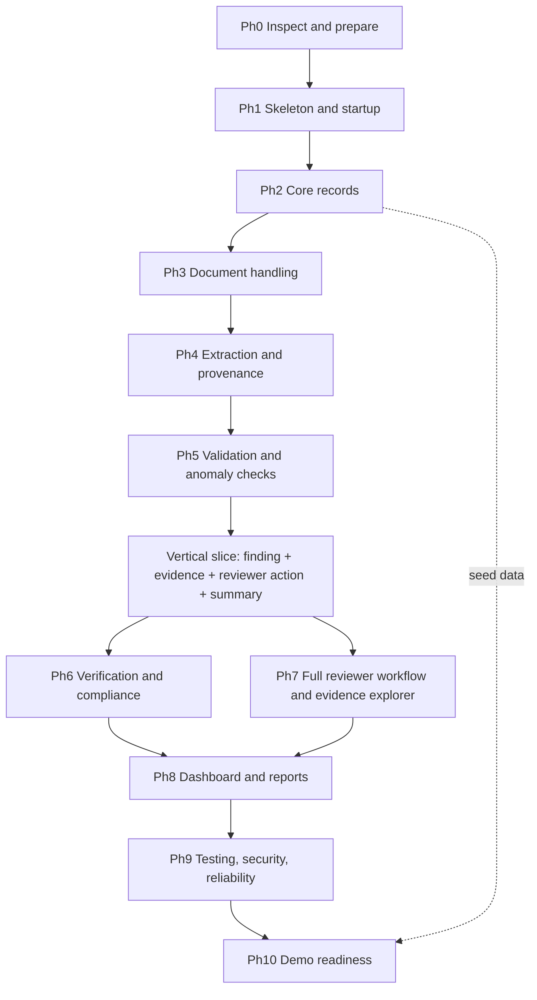

# VerityAI — Implementation Plan (3–4 Day Prototype)

> **Status of this document: stack-agnostic draft.**
> At the time of writing, none of the five source-of-truth documents were present in the repository (`docs/ARCHITECTURE.md`, `docs/TECH_STACK.md`, `docs/UI_UX_DESIGN.md`, `docs/AI_PIPELINE.md`, `docs/DATA_MODEL_AND_API.md`). See **Section 0** below.
> Because of that, this plan deliberately **does not name** any framework, database, OCR engine, model, file name, command or endpoint. Wherever a stack-specific detail is needed, you will see a placeholder in the form `‹FROM TECH_STACK.md›`, `‹FROM DATA_MODEL_AND_API.md›`, etc. Fill these in (or have the coding agent fill them in) as soon as the source documents exist. Nothing in this plan should override those documents; if they disagree with this plan, the documents win and the disagreement goes into Section 0.3.

---

## 0. Missing Source Documents and Conflicts

### 0.1 Document presence check

| Required document | Found at time of writing? | Consequence |
|---|---|---|
| `docs/ARCHITECTURE.md` | ❌ Not found | Component names, folder layout and data flow are placeholders. |
| `docs/TECH_STACK.md` | ❌ Not found | Runtimes, frameworks, OCR/AI libraries and commands are placeholders. |
| `docs/UI_UX_DESIGN.md` | ❌ Not found | Screen names and layouts are generic ("application list", "evidence view"). |
| `docs/AI_PIPELINE.md` | ❌ Not found | Field list, OCR fallback, anomaly-detection method are placeholders. |
| `docs/DATA_MODEL_AND_API.md` | ❌ Not found | Entities, status enums, endpoints, reviewer actions are placeholders. |

### 0.2 What this means for you (beginner)

1. **Do Phase 0 first.** If the documents exist somewhere else (another folder, another branch, your local machine), copy them into `docs/` before anything else. This plan then becomes much more precise.
2. **If they truly do not exist**, the very first task (Task 0.1) is to have the coding agent *draft* them for your review. Do not start coding until you have reviewed and accepted at least `TECH_STACK.md` and `DATA_MODEL_AND_API.md`. That is a decision you make; this plan does not make it for you.
3. Until then, the plan's *structure, ordering, acceptance criteria, testing approach, honesty rules and demo strategy* are still valid because they do not depend on a specific stack.

### 0.3 Conflicts and Decisions Needed

No contradictions between documents could be detected (there are no documents to compare). Open decisions that **must** be settled from the source documents before coding:

| # | Decision needed | Where it should be answered | Status |
|---|---|---|---|
| D1 | Backend/frontend frameworks, language runtimes, package managers | `TECH_STACK.md` | ⬜ Open |
| D2 | Database engine and migration approach | `TECH_STACK.md`, `DATA_MODEL_AND_API.md` | ⬜ Open |
| D3 | Supported upload file types and size limit | `AI_PIPELINE.md` / `DATA_MODEL_AND_API.md` | ⬜ Open |
| D4 | OCR / text-extraction approach and fallback order | `AI_PIPELINE.md` | ⬜ Open |
| D5 | Whether any AI model is used, and whether it runs locally (no paid service may be mandatory) | `AI_PIPELINE.md`, `TECH_STACK.md` | ⬜ Open |
| D6 | List of extracted fields per document type | `AI_PIPELINE.md` | ⬜ Open |
| D7 | Finding severities/statuses and exact reviewer actions (accept / dismiss / request further review — confirm names) | `DATA_MODEL_AND_API.md` | ⬜ Open |
| D8 | How "authorized reviewer" is enforced (roles, login, or demo-only role switch) | `ARCHITECTURE.md`, `DATA_MODEL_AND_API.md` | ⬜ Open |
| D9 | How simulated verification is represented and labeled | `AI_PIPELINE.md`, `DATA_MODEL_AND_API.md` | ⬜ Open |
| D10 | Report format (on-screen, PDF, HTML, etc.) | `UI_UX_DESIGN.md`, `DATA_MODEL_AND_API.md` | ⬜ Open |
| D11 | Compliance rule configuration format and categories | `ARCHITECTURE.md`, `DATA_MODEL_AND_API.md` | ⬜ Open |

---

## A. Executive Summary

**Goal.** Deliver a working, demonstrable prototype of VerityAI — a *decision-support* tool that helps a human reviewer assess an institution's application and its supporting documents — within **3–4 days**, with an AI coding agent doing most of the typing and you directing, testing and verifying.

**Strategy.**
1. **Vertical slice first.** Get one seeded application → one synthetic document → processed → one validation finding with evidence → one reviewer action → updated summary working end to end *before* building breadth (target: end of Day 1 / early Day 2).
2. **Deterministic first, AI second.** Required-field, date/expiry, format, duplicate and cross-document checks are plain rules. OCR/AI is used only for turning documents into text/fields and (optionally, P1/P2) for anomaly hints.
3. **Honest labeling everywhere.** Extracted ≠ verified. Validation failure ≠ suspected anomaly ≠ confirmed fraud. Verification "not attempted" / "unavailable" / "failed" / "simulated" / "verified by source" are all distinct states.
4. **Human in the loop.** The system never issues a final adverse decision. Findings are *indicators with evidence*; the reviewer decides.
5. **Reserve time.** Roughly 25–30% of the schedule is reserved for integration, testing, bug-fixing and demo rehearsal.

**Expected result (prototype, not production).** A runnable app using only synthetic data, with a reproducible demo scenario, a small evaluation run that is recorded honestly, and clear documentation of known limitations.

**Key trade-offs.**
| Trade-off | Decision |
|---|---|
| Breadth vs reliability | Fewer features that work reliably beat many half-built ones. |
| Real AI vs predictable demo | Deterministic rules carry the demo; AI features are P1/P2 and must degrade gracefully. |
| Real verification vs honesty | No external/authorized source is assumed. Verification is **simulated and labeled as such** unless a real authorized source actually responds. |
| Security depth | Prototype-level safeguards only (upload validation, input validation, role check, no secrets in git). **Not** enterprise-grade. |

**Three-day fallback.** If only 3 days are available, merge Day 3 and Day 4 as described in Section D.5 and cut per Section J.

---

## B. Prerequisites and Repository Inspection

### B.1 Files to check before coding

- [ ] `docs/ARCHITECTURE.md`
- [ ] `docs/TECH_STACK.md`
- [ ] `docs/UI_UX_DESIGN.md`
- [ ] `docs/AI_PIPELINE.md`
- [ ] `docs/DATA_MODEL_AND_API.md`
- [ ] `README.md` (if any)
- [ ] `.gitignore` (must exclude secrets, uploaded files, local databases, virtual environments / dependency folders, and build output — exact entries depend on the stack)
- [ ] An example environment file (e.g. `.env.example` — name `‹FROM TECH_STACK.md›`)
- [ ] `docs/PROJECT_STATUS.md` (does not need to exist yet; create it after the first milestone per Section G)

### B.2 Tools and versions (placeholders)

| Item | Required version | Check command | Actual (fill in) |
|---|---|---|---|
| Language runtime(s) | `‹FROM TECH_STACK.md›` | `‹…›` | |
| Package manager(s) | `‹FROM TECH_STACK.md›` | `‹…›` | |
| Database | `‹FROM TECH_STACK.md›` | `‹…›` | |
| OCR / PDF tooling and any system-level dependencies | `‹FROM TECH_STACK.md›` / `AI_PIPELINE.md` | `‹…›` | |
| Git | any recent | `git --version` | |
| Test runner(s) | `‹FROM TECH_STACK.md›` | `‹…›` | |

### B.3 Environment variables

- [ ] Every variable the app needs is listed (name, purpose, example value, required/optional) in the example env file and in the README.
- [ ] The real env file is **git-ignored**.
- [ ] No optional AI service key is required for the app to start or for the P0 demo.

### B.4 Preflight checklist (tick all before Phase 1)

- [ ] I understand the repository layout (agent has summarized it back to me in plain language).
- [ ] All five planning documents are present (or their absence is recorded in Section 0).
- [ ] Required runtimes and package managers are installed and versions recorded.
- [ ] Environment variables are documented; the example file exists.
- [ ] `git status` shows no secrets, no uploaded documents, no database files staged.
- [ ] I know the exact commands to start, test and (if applicable) migrate the app, and they are written in the README: `‹FROM TECH_STACK.md›`.
- [ ] A fresh git branch/tag exists as a restore point (e.g. `checkpoint-0`).

---

## C. Build Order and Dependencies

### C.1 Recommended sequence and why

| Order | Stage | Why it comes here |
|---|---|---|
| 1 | Inspect & prepare (Ph. 0) | Everything depends on knowing the stack and having a working environment. |
| 2 | Skeleton & startup (Ph. 1) | Proves frontend, backend and database can talk before any features are added. |
| 3 | Core records (Ph. 2) | Applications/institutions are the parent of documents and findings. |
| 4 | Document handling (Ph. 3) | Nothing can be extracted without stored documents. |
| 5 | Extraction & provenance (Ph. 4) | Validation needs extracted fields. |
| 6 | Validation & checks (Ph. 5) | Produces findings — the heart of the product. |
| 7 | **Minimal reviewer action + summary** (first half of Ph. 7 & 8) | Completes the vertical slice early. |
| 8 | Verification & compliance (Ph. 6) | Builds on fields + findings model. |
| 9 | Full reviewer workflow & evidence explorer (Ph. 7) | Needs findings and evidence to display. |
| 10 | Dashboard & reports (Ph. 8) | Reads persisted data from everything above. |
| 11 | Testing, security, reliability (Ph. 9) | Starts early (critical-path tests per phase), formalized here. |
| 12 | Demo readiness (Ph. 10) | Last, but rehearsal time is reserved in advance. |

### C.2 Dependency diagram



### C.3 Earliest vertical slice

The vertical slice (Section F) needs only Phases 0–5 plus a *minimal* version of the reviewer action and the application summary. It is the first thing to finish; **nothing in Phases 6, 8-extras, or any P1/P2 item starts until it passes.**

---

## D. Four-Day Schedule

Times assume roughly 8–10 working hours per day with an AI coding agent. Adjust hours, not priorities.

### D.1 Day 1 — Foundation and the first slice

**Main objective:** Running app + database + seeded application + document upload + stored file. Start extraction.

| Priority | Tasks |
|---|---|
| P0 | Phase 0 (inspect, env, run commands); Phase 1 (skeleton, health check); Phase 2 (core records + seed data); Phase 3 (upload, validation, storage); start Phase 4 (text extraction for the simplest supported type). |
| P1 | Basic README start-up instructions; set up the test runner with one passing test. |

**Deliverables:** App starts from documented commands; seeded application visible in the UI; a synthetic document can be uploaded and shows in the application's document list; at least one passing automated test.

**Checkpoint tests:**
- [ ] Health check responds.
- [ ] Restart the app → seeded and created records are still there.
- [ ] Upload valid, empty, oversized and unsupported files → correct accept/reject behavior.

**Done for today =** all checkpoint tests pass and work is committed with a tag (e.g. `day1-done`).

**If you miss the target:** Cut Phase 4 start (move to Day 2 morning). Do **not** cut persistence or upload safety. Spend the first 30 minutes of Day 2 on whatever is still failing.

### D.2 Day 2 — Extraction, validation, and the complete vertical slice

**Main objective:** Pass the vertical slice (Section F).

| Priority | Tasks |
|---|---|
| P0 | Finish Phase 4 (extraction + provenance + OCR fallback behavior); Phase 5 core rules (required fields, expiry, format); minimal evidence display; minimal reviewer action; minimal application summary. |
| P1 | Cross-document consistency and duplicate detection (start); processing-status indicators in the UI. |

**Deliverables:** One complete journey works end to end on synthetic data.

**Checkpoint tests:**
- [ ] Vertical-slice acceptance criteria (Section F) all ticked.
- [ ] Unreadable document yields a "could not extract / unable to evaluate" state, not a crash and not a fake result.
- [ ] Automated tests for each validation rule (pass, fail, unable-to-evaluate).

**Done for today =** vertical slice passes from a clean start; `day2-done` tag; `docs/PROJECT_STATUS.md` created.

**If you miss the target:** Stop adding rules. Reduce to the smallest set that demonstrates one required-field finding and one expiry finding with evidence. Finish the slice first; everything else slides to Day 3.

### D.3 Day 3 — Breadth: consistency, duplicates, verification, compliance, review workflow

**Main objective:** Complete the P0 feature set and the honest verification/compliance behavior.

| Priority | Tasks |
|---|---|
| P0 | Cross-document consistency; duplicate detection; verification workflow with **clearly labeled simulation** and explicit unavailable/not-attempted states; configurable compliance checklist; full reviewer actions with audit trail; dashboard/summary with real counts. |
| P1 | Evidence explorer polish; report generation from persisted data; retry for failed processing. |
| P2 | AI-assisted anomaly hints (only if deterministic checks are rock solid). |

**Deliverables:** Every workflow step in the project context (items 1–11) works at least at a basic level on synthetic data.

**Checkpoint tests:**
- [ ] Integration/regression checklist (Section H) run once, failures logged.
- [ ] Unavailable verification source produces "unavailable", never success/failure.
- [ ] Reviewer action appears in the audit trail with who/when/what.

**Done for today =** P0 list complete or explicitly moved to "Known limitations"; `day3-done` tag.

**If you miss the target:** Apply the cut list (Section J) *now*, starting with P2 and optional integrations. Feature freeze moves up to the start of Day 4.

### D.4 Day 4 — Report, hardening, evaluation, demo

**Main objective:** Stability, evidence-based evaluation, and a rehearsed demo.

| Priority | Tasks |
|---|---|
| P0 | **Feature freeze at the start of the day.** Report consistency; Phase 9 tests and security checks; critical bug fixes; demo dataset locked; clean-start rehearsal (at least twice); README + known limitations. |
| P1 | Evaluation run (Section K) with results recorded exactly as measured; UI clarity fixes. |
| P2 | Nothing new. Cosmetic fixes only if all P0 is done. |

**Deliverables:** Demo script, locked synthetic dataset, evaluation record, final README, final tag (e.g. `demo-ready`).

**Checkpoint tests:**
- [ ] Fresh clone → follow README only → app runs and demo path works.
- [ ] Definition of Done (Section L) reviewed line by line.

**Done for today =** demo rehearsed twice from a clean start without improvisation.

**If you miss the target:** Do not add anything. Fix only demo-blocking defects; remove any feature that cannot be made reliable and list it as a known limitation.

### D.5 If only 3 days are available

1. Merge Day 3 and Day 4: **cut first** — P2 AI anomaly hints, evidence-explorer polish, charts/analytics, optional report formats.
2. Keep: vertical slice, deterministic validation, cross-document consistency, honest verification labels (simulation only), reviewer actions + audit trail, basic report, tests, demo rehearsal.
3. Run the evaluation (Section K) only on the smallest dataset (e.g. fewer cases) and state that clearly.

---

## E. Detailed Phase-by-Phase Implementation

> **How to read each phase.** Items in `‹…›` come from the source documents. "Agent must inspect" means the coding agent reads the repository and documents and proposes the concrete filenames/commands to you *before* editing. Do not accept invented names that contradict the documents.

---

### Phase 0 — Inspect and prepare  (P0)

**Goal:** Know exactly what exists, what is missing, and how to run/test it.
**Dependencies:** None.

**Tasks (in order):**
1. Task 0.1 — Ask the agent to list the repository tree and report which of the five documents exist. If any are missing, record it in Section 0 and stop to decide (copy them in, or have the agent draft them for your review).
2. Task 0.2 — Agent summarizes the architecture, stack, data model and AI pipeline *in plain language* (max ~1 page) so you can confirm understanding.
3. Task 0.3 — Check runtime and package-manager versions against `TECH_STACK.md` (Section B.2).
4. Task 0.4 — Create/verify the example env file, `.gitignore`, and README "how to run / test" section.
5. Task 0.5 — Create restore point: commit and tag `checkpoint-0`.

**Expected files/components:** `‹FROM ARCHITECTURE.md / TECH_STACK.md›`. Agent must inspect.

**Acceptance criteria:**
- [ ] All five docs present or absences recorded.
- [ ] Versions recorded in Section B.2.
- [ ] Env variables documented; secrets ignored by git.
- [ ] Start and test commands written down.

**Commands/tests:** `git status`, version check commands for each tool, and the documented start/test commands `‹FROM TECH_STACK.md›`.

**Failure modes and recovery:**
| Failure | Recovery |
|---|---|
| Docs missing | Section 0.2 — copy them or draft them first. |
| Wrong runtime version | Install the documented version; if impossible, ask the agent for the minimal documented-compatible alternative and **ask before changing the stack**. |
| Dependency install fails | Copy the exact error to the agent; try one fix at a time; do not delete lock files without asking. |

**Checkpoint:** Preflight checklist (B.4) fully ticked.

---

### Phase 1 — Skeleton and startup  (P0)

**Goal:** Frontend, backend and database start together; a health check proves it.
**Dependencies:** Phase 0.

**Tasks:**
1. Task 1.1 — Create the agreed project structure `‹FROM ARCHITECTURE.md›`.
2. Task 1.2 — Backend minimal startup with a health endpoint/check.
3. Task 1.3 — Database connection + migration/initialization mechanism `‹FROM TECH_STACK.md›`.
4. Task 1.4 — Frontend minimal page that calls the backend health check and shows the result.
5. Task 1.5 — One trivial automated test (e.g. health check) to prove the test runner works.
6. Task 1.6 — Commit; tag `checkpoint-1`.

**Expected files/components:** backend entry point, database config, frontend entry page, test config — names `‹FROM ARCHITECTURE.md›`.

**Acceptance criteria:**
- [ ] One documented command (or short set) starts everything.
- [ ] Health check shows backend **and** database status.
- [ ] Frontend displays the health result.
- [ ] The trivial test passes.

**Commands/tests:** documented start/test commands; open the app in a browser; call the health endpoint `‹FROM DATA_MODEL_AND_API.md›`.

**Failure modes and recovery:**
| Failure | Recovery |
|---|---|
| Port already in use | Stop the other process or change the port via env variable. |
| Frontend cannot reach backend (cross-origin/URL issues) | Check configured backend URL env variable; ask agent to print the exact request/response error. |
| Migration errors | Reset the **local dev** database only (never any real data), re-run migrations. |

**Checkpoint:** Fresh terminal → start app → health is green → test passes.

---

### Phase 2 — Core records  (P0)

**Goal:** Create/view institutions and applications, persisted in the database, with seed data.
**Dependencies:** Phase 1.

**Tasks:**
1. Task 2.1 — Implement institution and application entities exactly as in `DATA_MODEL_AND_API.md` (fields, statuses).
2. Task 2.2 — Create/read endpoints (and update/delete only if documented).
3. Task 2.3 — Input validation and clear error responses for bad input.
4. Task 2.4 — Seed script producing **synthetic** institutions/applications (no real names, IDs or documents). Make it idempotent (safe to run twice).
5. Task 2.5 — List view and detail view in the UI per `UI_UX_DESIGN.md`.
6. Task 2.6 — Tests: create, retrieve, not-found, invalid input, persistence after restart.

**Expected files/components:** models/schema, API routes, seed script, list/detail UI — `‹FROM ARCHITECTURE.md›`.

**Acceptance criteria:**
- [ ] Seeded applications appear in the list.
- [ ] A new application can be created in the UI and appears after refresh **and** after restart.
- [ ] Invalid input shows a readable error, not a crash.
- [ ] Seed script can be re-run without duplicates.

**Failure modes and recovery:**
| Failure | Recovery |
|---|---|
| Frontend/backend field-name mismatch | Compare against `DATA_MODEL_AND_API.md`; fix the side that deviates from the document. |
| Seed duplicates | Make seed idempotent (check-before-insert) or reset local DB. |

**Checkpoint:** Create → restart → still there; tests pass; tag `checkpoint-2`.

---

### Phase 3 — Document handling  (P0)

**Goal:** Safe upload, storage and listing of documents attached to the correct application.
**Dependencies:** Phase 2.

**Tasks:**
1. Task 3.1 — Upload endpoint accepting **only** file types in the documents `‹FROM AI_PIPELINE.md / DATA_MODEL_AND_API.md›`.
2. Task 3.2 — Enforce size limit and reject empty files; validate type by content/signature where feasible, not just by file extension.
3. Task 3.3 — Store files outside any publicly served folder, under generated (non-user-controlled) names; never use the original filename as a path.
4. Task 3.4 — Persist document metadata (application link, original name, type, size, checksum, upload time, processing status).
5. Task 3.5 — Upload and list UI on the application detail page; show clear errors.
6. Task 3.6 — Tests: valid, empty, oversized, unsupported, wrong-application association.
7. Task 3.7 — Prepare 3–5 synthetic sample documents (see Phase 10 for the full dataset) — enough to test with now.

**Acceptance criteria:**
- [ ] Valid file accepted, appears under the right application only.
- [ ] Empty/oversized/unsupported files rejected with clear messages; nothing stored.
- [ ] Path-traversal-style filenames cannot escape the storage folder.
- [ ] Uploaded files and database files are git-ignored.

**Failure modes and recovery:**
| Failure | Recovery |
|---|---|
| Large files hang the server | Confirm limit enforced before processing; lower the limit if the docs allow. |
| Storage folder missing/permissions | Create on startup; log a clear error. |

**Checkpoint:** Upload suite passes; tag `checkpoint-3`.

---

### Phase 4 — Extraction and provenance  (P0)

**Goal:** Turn documents into text and candidate fields, always recording where each value came from.
**Dependencies:** Phase 3.

**Tasks:**
1. Task 4.1 — Direct text extraction for digital documents.
2. Task 4.2 — OCR fallback for image-only/scanned documents as specified `‹FROM AI_PIPELINE.md›`. If OCR tooling is unavailable, the document must end in an explicit "text not extracted" status.
3. Task 4.3 — Field extraction per `AI_PIPELINE.md` (start with 2–3 fields that the vertical slice needs, e.g. an identifier, a name, an expiry date — final list `‹FROM AI_PIPELINE.md›`). Prefer deterministic patterns first; use a model only if the pipeline document says so and only with a local/free option as the baseline.
4. Task 4.4 — Store each extracted field with: source document, page (if available), raw extracted value, normalized value (if any), confidence (if available), processing status.
5. Task 4.5 — Processing statuses visible in the UI (e.g. pending / processing / completed / partial / failed — exact enum `‹FROM DATA_MODEL_AND_API.md›`).
6. Task 4.6 — Retry for failed processing (P1).
7. Task 4.7 — Tests: digital document, scanned document, corrupted file, partially readable document.

**Honesty rule:** Extracted values are labeled **"extracted (unverified)"** everywhere in data and UI. No code path may set a "verified" state from extraction alone.

**Acceptance criteria:**
- [ ] Each extracted field links back to its document (and page when available).
- [ ] Corrupted/unreadable files end in a clear failed/partial status; the app keeps running.
- [ ] No field appears as "verified" after extraction.
- [ ] Processing does not block the UI indefinitely (status updates or progress indicator).

**Failure modes and recovery:**
| Failure | Recovery |
|---|---|
| OCR engine not installed / system dependency missing | Record in Known Limitations; fall back to "text not extracted"; use digital-text samples for the demo. |
| Poor OCR quality | Use clearer synthetic samples; never hand-edit extracted results to look better. |
| Slow processing | Process in the background if the architecture supports it; otherwise limit sample size/pages. |

**Checkpoint:** Sample documents produce fields with provenance; failure cases handled; tag `checkpoint-4`.

---

### Phase 5 — Validation and anomaly checks  (P0 for deterministic; P2 for AI-assisted)

**Goal:** Produce evidence-linked findings from deterministic rules.
**Dependencies:** Phase 4.

**Tasks (in order — stop and test after each):**
1. Task 5.1 — Finding model per `DATA_MODEL_AND_API.md`: rule identifier, category, severity, outcome, explanation, evidence references (document, page, field values), timestamps.
2. Task 5.2 — **Required-field check.** Outcomes: pass / fail / unable-to-evaluate.
3. Task 5.3 — **Expiry/date check** (expired, expiring soon if specified, impossible dates). Outcomes as above.
4. Task 5.4 — **Format checks** for identifier-like fields (patterns defined in `AI_PIPELINE.md`).
5. Task 5.5 — **Cross-document consistency** (e.g. the same entity name/identifier across documents) using normalization and an explicit similarity rule; outcomes: consistent / inconsistent / unable-to-evaluate.
6. Task 5.6 — **Duplicate detection** (same file checksum; optionally same key fields across applications).
7. Task 5.7 — Category separation in data and UI: **validation failure** vs **suspected anomaly**. Wording must say "indicator" / "needs review", never "fraud confirmed".
8. Task 5.8 — (P2) AI-assisted anomaly hints, only if `AI_PIPELINE.md` includes them, clearly labeled AI-generated, advisory only, non-blocking, and never the sole basis for any status change.
9. Task 5.9 — Tests for every rule: pass, fail, unable-to-evaluate (missing data), and a borderline case.

**Acceptance criteria:**
- [ ] Every finding names its rule and links to evidence the reviewer can open.
- [ ] Missing/unreadable evidence → "unable to evaluate", never pass or fail.
- [ ] Deterministic rules have automated tests and give identical results on repeat runs.
- [ ] Any AI-derived item is visibly labeled as such and optional.

**Failure modes and recovery:**
| Failure | Recovery |
|---|---|
| Too many false inconsistencies (name formatting) | Add normalization (case, punctuation, common suffixes); document the rule; do not just loosen it blindly. |
| Rule outputs differ between runs | Remove nondeterminism (ordering, time-dependent logic — inject "today" into date checks for tests). |

**Checkpoint:** Rule tests pass; findings display with evidence; tag `checkpoint-5`.

---

### Phase 6 — Verification and compliance  (P0 basic / P1 extended)

**Goal:** Honest verification statuses and a configurable compliance checklist.
**Dependencies:** Phases 4–5 (vertical slice should already pass).

**Tasks:**
1. Task 6.1 — Verification workflow as described in `AI_PIPELINE.md`. Define and use **distinct** statuses: *not attempted*, *unavailable*, *failed (source responded negatively)*, *simulated – matched*, *simulated – not matched*, *verified by authorized source* (the last one only if a real authorized source responded — otherwise this status is never produced in the prototype). Final enum `‹FROM DATA_MODEL_AND_API.md›`.
2. Task 6.2 — Simulated verifier: reads from a **local synthetic registry file** you create; every result carries a visible **"SIMULATED"** label in the data, API, UI and report.
3. Task 6.3 — Source unavailable (timeout, missing registry): result is "unavailable", findings say "could not verify", and the application is **not** marked failed because of it.
4. Task 6.4 — Compliance rules stored in a configuration (file or table per `‹FROM ARCHITECTURE.md›`), grouped by category-based checklists; each rule maps to required documents/fields and uses deterministic checks.
5. Task 6.5 — Compliance status per application: met / not met / unable to evaluate / needs reviewer attention, with rule-level detail.
6. Task 6.6 — Tests: simulated match, simulated mismatch, unavailable, not attempted; compliance with complete data, missing data, and a changed rule configuration.

**Acceptance criteria:**
- [ ] No UI or report text implies real verification for simulated results.
- [ ] Unavailable source never yields a fabricated success or failure.
- [ ] Compliance rules can be changed through configuration without code changes to the rule engine.
- [ ] No external credentials or services required.

**Failure modes and recovery:**
| Failure | Recovery |
|---|---|
| Temptation to hardcode "verified" for the demo | Not allowed. Use the labeled simulated registry. |
| Compliance config format errors | Validate config on load; show a clear error message. |

**Checkpoint:** Each verification status reachable in tests; labels visible; tag `checkpoint-6`.

---

### Phase 7 — Reviewer workflow and evidence explorer  (P0 core / P1 polish)

**Goal:** A human can inspect findings with evidence and act; everything is audited.
**Dependencies:** Phase 5 (minimal version for the slice), Phase 6 (full).

**Tasks:**
1. Task 7.1 — Findings list for an application with severity, category, status, and source status.
2. Task 7.2 — Finding detail/evidence view: rule, explanation, evidence (document, page, extracted value), and verification status.
3. Task 7.3 — Reviewer actions exactly as in `DATA_MODEL_AND_API.md` (expected: accept, dismiss, request further review — confirm). Require a reason/comment where the document says so.
4. Task 7.4 — Authorization: only an authorized reviewer role can act `‹per ARCHITECTURE.md›`. For the prototype this may be a simple role mechanism; state clearly what it is and is not.
5. Task 7.5 — Audit trail records: who, what, when, previous state, new state, comment. Also record meaningful status changes (processing completed, verification attempted, report generated).
6. Task 7.6 — Warnings do not automatically become adverse final decisions: application "decision" status is changed only by an explicit reviewer action.
7. Task 7.7 — Tests: action allowed, action rejected for unauthorized role, audit entry created, state transitions valid/invalid.

**Acceptance criteria:**
- [ ] Each action updates finding state and the application summary.
- [ ] Each action creates an audit entry that cannot be edited through the UI.
- [ ] Unauthorized action returns a clear error and is not recorded as performed.
- [ ] No automatic final rejection anywhere in code.

**Failure modes and recovery:**
| Failure | Recovery |
|---|---|
| Summary not updating | Check that summary is computed from persisted findings, not cached UI state. |
| Invalid state transitions | Add explicit transition table in tests. |

**Checkpoint:** Act on a finding → audit entry visible → summary updated; tag `checkpoint-7`.

---

### Phase 8 — Dashboard and reports  (P0 summary / P1 report / P2 charts)

**Goal:** Honest summaries and a report built only from persisted data.
**Dependencies:** Phases 5–7.

**Tasks:**
1. Task 8.1 — Application summary: document statuses, finding counts by category/severity/review status, verification status counts, compliance status.
2. Task 8.2 — Dashboard list across applications (counts, statuses). Avoid single "fraud score" or "risk score" numbers unless `AI_PIPELINE.md` defines one and its meaning is explained in the UI; if used, show its components.
3. Task 8.3 — Report generation in the format selected in D10, populated from the database at generation time; include findings, evidence references, verification labels (incl. SIMULATED), compliance results, reviewer actions, and a limitations note.
4. Task 8.4 — Report-vs-UI consistency test: counts and statuses in the report equal those on screen.
5. Task 8.5 — (P2) charts/analytics.

**Acceptance criteria:**
- [ ] Summary numbers equal the underlying records (verified by test).
- [ ] Report content agrees with the application page.
- [ ] Report clearly states it is decision support and that simulated checks are not real verification.

**Failure modes and recovery:**
| Failure | Recovery |
|---|---|
| Report generation fails for some formats | Fall back to the simplest documented format; log as limitation. |
| Counts disagree | Single shared query/function for counts; reuse in UI and report. |

**Checkpoint:** Generate a report after review actions → matches UI; tag `checkpoint-8`.

---

### Phase 9 — Testing, security, and reliability  (P0)

**Goal:** Critical paths tested; common failures handled; honest about limits.
**Dependencies:** All feature phases (start earlier in parallel).

**Tasks:**
1. Task 9.1 — Run the full automated test suite; fix failures before anything else.
2. Task 9.2 — API validation tests (missing fields, wrong types, unknown IDs).
3. Task 9.3 — File-handling tests (Phase 3 cases, plus duplicate upload).
4. Task 9.4 — Authorization-boundary tests (unauthorized reviewer action, access to another application's data if multi-tenant is in scope).
5. Task 9.5 — Failure-state tests: database unavailable, storage unavailable, OCR unavailable, verification source unavailable.
6. Task 9.6 — Security hygiene review: no secrets in git history (`git log -p` search for key patterns / use a secret-scanning tool if available), upload folder not publicly served, error messages don't leak internal paths or stack traces, dependencies from trusted registries only.
7. Task 9.7 — Run the Integration and Regression Checklist (Section H) completely.
8. Task 9.8 — Performance: **measure only** using the method in Section K; do not claim numbers you did not record.

**Acceptance criteria:**
- [ ] All automated tests pass or each failure is documented with a reason.
- [ ] No critical (data-loss, crash, mislabeling) bug open.
- [ ] Security hygiene checklist ticked; limitations documented (this is **not** a security audit).

**Failure modes and recovery:** See Section I.

**Checkpoint:** Test report saved (counts of passed/failed from the actual run); tag `checkpoint-9`.

---

### Phase 10 — Demo readiness  (P0)

**Goal:** A predictable demo anyone can follow.
**Dependencies:** Phase 9 (but rehearsal slots are reserved from Day 4 morning).

**Tasks:**
1. Task 10.1 — Build a locked **synthetic** dataset: at least (a) one "clean" application, (b) one with a missing required field, (c) one with an expired document, (d) one with cross-document inconsistency, (e) one duplicate document, (f) one with an unreadable/scanned file, (g) one where verification is unavailable. Keep expected outcomes in a small table (this is also the ground truth for Section K).
2. Task 10.2 — One command (or short documented sequence) to reset to the demo state `‹FROM TECH_STACK.md›`.
3. Task 10.3 — Write a 5–7 minute demo script following the workflow: open application → upload → process → findings → evidence → verification (labeled simulated) → compliance → reviewer action → report → audit trail.
4. Task 10.4 — A first-time evaluator test: ask a friend to follow the screens without your help; note where they get confused; fix the top 2–3 issues only.
5. Task 10.5 — Finish README: setup, start, test, demo reset, known limitations.
6. Task 10.6 — Rehearse twice from a clean start (fresh clone or reset). Prepare a **backup** (screen recording or screenshots) in case live demo fails — made from the real app, not mocked.

**Acceptance criteria:**
- [ ] Reset → demo path works with no manual database edits.
- [ ] The demo makes clear: problem, workflow, evidence-backed findings, labeled simulation, human-review controls.
- [ ] Known limitations stated honestly in README and demo.

**Checkpoint:** Two clean rehearsals; tag `demo-ready`.

---

## F. End-to-End Vertical Slice

**Journey (smallest complete path):**
1. Open a **seeded** application in the UI.
2. Upload (or select) one supported synthetic document with a known defect (e.g. missing required field or expired date).
3. Processing runs; status moves from pending → completed (or an explicit partial/failed state).
4. At least one deterministic validation finding is produced.
5. Open the finding → see evidence (document, page if available, extracted value, rule explanation) labeled as extracted/unverified.
6. A reviewer takes one action (e.g. accept / dismiss / request further review — exact names from the data model).
7. The application summary updates (finding counts/status), and an audit entry exists.

**Acceptance criteria (all must be true):**
- [ ] Starting from a clean start using documented commands, the seeded application is visible.
- [ ] Upload succeeds only for supported types and attaches to the correct application.
- [ ] Processing status changes are visible and persisted.
- [ ] Finding names its rule, severity/category, and explanation.
- [ ] Evidence view shows the source document and extracted value; label says extracted/unverified.
- [ ] Reviewer action is recorded in the database, shown in the UI, and appears in the audit trail with actor and timestamp.
- [ ] Summary reflects the action after a page refresh **and** after an app restart.
- [ ] An automated test (API-level at minimum) covers this path.
- [ ] No step uses an unavailable external service or paid API.

**Rule:** Do not start Phase 6, report formats, charts, or AI anomaly hints until this passes.

---

## G. Coding-Agent Execution Protocol

### G.1 Rules for every task

The agent must:
1. **Inspect** the repository and relevant documents before editing.
2. **State** the task and the acceptance criteria it is implementing.
3. Make a **small, focused** change.
4. **Avoid unrelated refactoring** or reformatting.
5. **Run** the relevant tests/checks.
6. **Report**: files changed, commands run, test results (actual output summary), known issues.
7. **Update `docs/PROJECT_STATUS.md`** after meaningful milestones (create it after the first milestone if missing — this is the one document the agent may create during implementation, and only when you ask for it).
8. **Never claim** a feature works without testing it; say "not tested" when untested.
9. **Preserve** existing working functionality (run the existing tests before and after).
10. **Ask first** before any major architecture, dependency, schema or API-contract change.

### G.2 Your routine per task (beginner-friendly)

1. Commit current working state (`git commit`) **before** each task.
2. Paste the task prompt (G.3).
3. Read the agent's report; run the check yourself (see the page, run the tests).
4. If it works → commit with a clear message. If not → `git restore`/`git reset` to the last commit and retry with a smaller task.
5. If the same error appears three times, stop and paste the **full** error + the relevant file list into a fresh session using the template.

### G.3 Reusable task-prompt template (copy into a fresh agent session)

```text
You are helping me build VerityAI, a decision-support PROTOTYPE (not production) for
reviewers assessing institutional applications and supporting documents. It uses
synthetic data only. I am a beginner, so explain what you change in plain language.

CONTEXT (read before editing):
- docs/ARCHITECTURE.md, docs/TECH_STACK.md, docs/UI_UX_DESIGN.md,
  docs/AI_PIPELINE.md, docs/DATA_MODEL_AND_API.md  = source of truth.
- docs/IMPLEMENTATION_PLAN.md = the plan and phases.
- docs/PROJECT_STATUS.md (if it exists) = current progress.
If any of these are missing, tell me before doing anything else.

NON-NEGOTIABLE PRINCIPLES:
- Do not change the architecture, tech stack, data model or API contracts without asking me first.
- Extracted information is NOT verified information. Label it accordingly.
- Validation failure != suspected anomaly != confirmed fraud. Never state or imply fraud is proven.
- Simulated verification must always be labeled SIMULATED. "Unavailable" or "not attempted"
  is never reported as success or failure.
- A human reviewer makes consequential decisions; no automatic final rejection.
- Findings must link to evidence and to the rule that produced them.
- No secrets or real personal/institutional data in the repository.
- No paid or external service may be required.

TASK:
Phase: <e.g. Phase 3 — Document handling>
Task: <e.g. Task 3.2 — enforce size limit and reject empty files>
Acceptance criteria:
- <criterion 1>
- <criterion 2>
Files likely involved (inspect first; correct me if wrong): <paths or "unknown">

PROCESS:
1. Inspect the repo and relevant docs. Summarize in a few lines what you found.
2. Restate the task and acceptance criteria.
3. Make a small, focused change only. No unrelated refactoring.
4. Run the relevant tests and the existing test suite; add tests for new behavior.
5. Report: files changed, commands run, actual test results, anything not tested, known issues.
6. Never say something works unless you ran it. Say "not tested" otherwise.
7. If you need a new dependency or a major change, STOP and ask me first.
8. After a meaningful milestone, update docs/PROJECT_STATUS.md if I have asked you to.
```

---

## H. Integration and Regression Checklist

Run after each phase (quick version = items marked ⚡) and fully before the demo.

| # | Check | Pass? |
|---|---|---|
| 1 | ⚡ App starts using documented commands; health check shows backend and database OK | ☐ |
| 2 | ⚡ Create application via UI → appears in list and detail; API returns the same data | ☐ |
| 3 | Invalid application input shows a clear error; nothing is stored | ☐ |
| 4 | ⚡ Upload valid document → appears under the correct application only | ☐ |
| 5 | Empty, oversized, unsupported uploads rejected with clear message; nothing stored | ☐ |
| 6 | ⚡ Processing status changes pending → processing → completed/partial/failed and persists | ☐ |
| 7 | Failed processing can be retried (if implemented) without duplicating records | ☐ |
| 8 | Extracted fields show source document/page/value/confidence and are labeled unverified | ☐ |
| 9 | ⚡ Validation findings appear with rule, severity/category, explanation | ☐ |
| 10 | ⚡ Each finding's evidence link opens the right document/field | ☐ |
| 11 | Insufficient evidence → "unable to evaluate" (not pass/fail) | ☐ |
| 12 | Cross-document inconsistency and duplicate detection give the expected result on the demo dataset | ☐ |
| 13 | Verification: each status (not attempted, unavailable, failed, simulated, verified) renders distinct, correct labels; SIMULATED visible | ☐ |
| 14 | Compliance checklist results match configuration; changing config changes results | ☐ |
| 15 | ⚡ Reviewer action updates finding, application summary, and audit trail | ☐ |
| 16 | Unauthorized reviewer action is rejected and not recorded as done | ☐ |
| 17 | ⚡ Dashboard counts equal database counts | ☐ |
| 18 | Report counts/statuses/labels equal the UI | ☐ |
| 19 | Error handling: stop database / remove storage / disable OCR / make source unavailable → graceful messages, no crash | ☐ |
| 20 | ⚡ Restart the app → all records, files, findings, audit entries still present | ☐ |
| 21 | Reset-to-demo command restores the dataset and the demo path works | ☐ |
| 22 | Full automated test suite passes | ☐ |
| 23 | `git status` clean of secrets, uploads, local databases | ☐ |

---

## I. Risk Register and Recovery Plan

| Risk | Likelihood | Impact | Early warning sign | Prevention | Recovery action | Priority |
|---|---|---|---|---|---|---|
| Dependency installation failures | Medium | High | Install errors in Phase 0/1 | Verify versions first; pin versions; commit lock files | Fix one error at a time; ask agent for the documented-compatible fix; ask before swapping packages | P0 |
| AI coding agent modifies unrelated files | High | High | Large diffs for small tasks | Small tasks; commit before each task; review `git diff` | `git restore` the unrelated files; re-prompt with "touch only these files" | P0 |
| OCR or PDF parsing failures | High | Medium | Empty/garbled text on samples | Test samples early; provide digital-text samples; explicit failed/partial status | Use cleaner synthetic samples; fall back to "text not extracted"; document limitation | P0 |
| Database migration issues | Medium | High | Migration errors, schema/model mismatch | Small migrations; follow `DATA_MODEL_AND_API.md` exactly | Reset local dev DB; re-run migrations and seed; never alter models silently | P0 |
| Frontend/backend contract mismatch | High | High | Missing fields, 400/422 errors, blank UI | Single source: `DATA_MODEL_AND_API.md`; API-level tests per endpoint | Compare actual vs documented payloads; fix the side that deviates | P0 |
| Insufficient time for integration | High | High | Day 2 slice not passing by end of Day 2 | Vertical slice first; reserve Day 4 | Apply cut list (Section J); freeze features early | P0 |
| Unreliable model output | Medium | Medium | Inconsistent results on repeat | Deterministic rules for P0; AI optional and labeled advisory | Disable AI feature; keep deterministic path; list as limitation | P1 |
| Slow processing | Medium | Medium | Uploads feel stuck | Limit file size/pages; show progress status | Reduce sample size; background processing if supported; document | P1 |
| Missing environment variables | Medium | Medium | Startup errors | Example env file; startup validation with clear messages | Compare against example file; add missing variables | P0 |
| Broken demo data | Medium | High | Demo outcomes differ from expected table | Locked dataset + expected-results table + reset command | Re-run reset; fix seed; re-rehearse | P0 |
| Scope creep | High | High | New feature ideas after Day 2 | Feature freeze rule; priority labels | Move idea to "future work" list | P0 |
| Secrets/real data committed | Low | High | Env or document files in `git status` | `.gitignore`; synthetic data only | Remove from history before sharing the repo; rotate any exposed secret | P0 |
| Simulated results mistaken for real | Medium | High | UI/report text without SIMULATED label | Labels in data model, UI and report; tests | Fix labels immediately; this is a release blocker | P0 |
| Tired/stuck beginner | High | Medium | Same error three times | Small tasks; checkpoints; fresh-session template | Take a break; restore last tag; ask for help with full error text | P1 |

---

## J. Feature Freeze and Cut List

### J.1 Freeze rule

- **Soft freeze:** end of Day 3 (or start of Day 4). Only P0 completion and bug fixes after this.
- **Hard freeze:** after the first Day 4 rehearsal. Only fixes for demo-blocking defects.
- Any new idea goes to a "future work" list, not into the code.

### J.2 Ranked cut list (cut from the top first)

1. P2 polish and decorative UI/animations.
2. Optional external integrations (do not build any that need credentials or paid services).
3. Advanced/AI-assisted anomaly detection.
4. Non-essential charts and analytics.
5. Extra report formats (keep one).
6. Extra document types beyond those needed for the demo dataset.
7. Retry/bulk-processing conveniences.
8. Evidence-explorer extras (keep: finding → evidence → source document).

### J.3 Never cut

- Security safeguards for uploads and input validation.
- Evidence traceability (findings link to rules and evidence).
- Honest status labeling (extracted vs verified; SIMULATED; unavailable).
- Reviewer control and audit trail.
- Critical-path tests.
- The working vertical slice and reproducible demo.

---

## K. Benchmark and Evaluation Plan

> **Important:** A small synthetic dataset supports a *prototype evaluation only*. It does **not** support claims about production-level accuracy, fraud-detection capability, or performance on real documents. Record only what you actually measure; leave unmeasured cells empty.

### K.1 Test data

- Reuse the locked synthetic demo dataset (Task 10.1) and extend it to a small labeled set (for example 15–30 documents across the defect types). The size is your choice; **state the size you actually used**.
- For every document keep a **ground-truth sheet**: correct field values, which required fields are missing, expiry status, which documents are intentionally inconsistent/duplicate, expected verification outcome.
- Create ground truth **before** running the system.

### K.2 Metrics

| Metric | What it measures | How to calculate | Test data needed | How to record | Limitations |
|---|---|---|---|---|---|
| Field extraction accuracy | Whether extracted values equal ground truth | (fields exactly correct ÷ fields in ground truth) per field and overall; also report fields missed and fields wrong separately | Documents with known field values, including digital and scanned samples | Spreadsheet/CSV: doc, field, expected, extracted, correct?; summary table | Synthetic formatting is cleaner than real documents; depends on OCR quality; small sample |
| Required-field validation correctness | Whether missing-field findings match reality | Compare produced findings vs expected: true positives, false positives, false negatives (counts) | Documents with and without required fields | Confusion counts per rule | Only covers the rules you implemented; depends on extraction quality |
| Cross-document inconsistency detection | Whether inconsistent pairs are flagged and consistent pairs are not | TP/FP/FN/TN counts on labeled document sets; report precision/recall only if counts are large enough to be meaningful, otherwise report raw counts | Sets with intentional name/ID/date mismatches and matched controls | Counts + list of misses and false alarms with reason | Small sample; synthetic mismatches are easier than real ones |
| Duplicate detection | Whether duplicates are found and distinct files are not | TP/FP/FN/TN counts | Exact duplicate files, near-duplicates (if supported), distinct files | Counts per duplicate type | Checksum matches only exact duplicates; near-duplicate behavior depends on your implementation |
| Verification workflow outcomes | Whether each status is produced under the right condition | For each scenario (match, mismatch, unavailable, not attempted) check actual status == expected; report pass/fail per scenario | Synthetic registry with known entries; scenario where registry is absent | Table: scenario, expected, actual | Tests the workflow logic only — **not** real-world source verification (none is performed) |
| Processing time | How long processing takes on this machine | Measure wall-clock time from upload/process trigger to completed status for each document; report median and range with the hardware description | Same labeled set, run several times | Table: doc, size/pages, seconds; machine specs | Depends on the machine and OCR settings; not a throughput guarantee |
| Error rate | How often processing/requests fail | (documents ending failed ÷ documents processed); also count unhandled server errors | Include some intentionally corrupted files separately from valid ones and report both | Counts and percentages with denominators | Intentional bad files inflate the rate; report the two groups separately |

### K.3 Procedure

1. Freeze the code version (git tag) and dataset version.
2. Start from the reset state.
3. Run all documents through the system; save raw outputs (exports/logs).
4. Compare outputs with ground truth using a simple script or spreadsheet.
5. Write results into an evaluation record (a section in the README or `PROJECT_STATUS.md` — do not create additional documents unless you decide to). Include: date, code tag, dataset size, machine, results, and the limitations from the table above.
6. Do not tune rules on the test set and then report that same set as unbiased; if you tune, say so.

---

## L. Definition of Done (Prototype)

**Installation and startup**
- [ ] A fresh clone can be set up and started using only the README.
- [ ] Health check passes; no errors on startup.

**Core workflow**
- [ ] Create/open application → upload → process → findings → evidence → verification → compliance → reviewer action → report works on the demo dataset.

**Data persistence**
- [ ] Records, files, findings, reviewer actions and audit entries persist across restart.

**Document processing**
- [ ] Only supported file types are accepted; invalid files are rejected safely.
- [ ] Text extraction works with the planned fallback; failures are explicit.
- [ ] Extracted fields carry provenance and are labeled unverified.

**Validation and evidence**
- [ ] Required-field, expiry/date, format, consistency and duplicate checks implemented and tested.
- [ ] Every finding links to rule and evidence; "unable to evaluate" used where needed.
- [ ] Validation failures, suspected anomalies and confirmed outcomes are never conflated; no claim of proven fraud.

**Human review**
- [ ] Authorized reviewer can act; unauthorized actions are rejected.
- [ ] No automatic final adverse decisions.

**Audit trail**
- [ ] Reviewer actions and meaningful status changes are recorded with actor and time.

**Dashboard and reporting**
- [ ] Summary and report derive from persisted data and agree with each other.
- [ ] Simulated verification is labeled everywhere.

**Security and failure handling**
- [ ] No secrets or real data in the repository; uploads outside public paths.
- [ ] Failure states (database, storage, OCR, verification source) handled gracefully.
- [ ] Documented as prototype-level safeguards, not production security.

**Tests**
- [ ] Automated tests cover critical paths and pass (or documented exceptions).
- [ ] Manual integration checklist (Section H) completed.

**Demo and documentation**
- [ ] Reproducible demo with reset command, script and backup recording; rehearsed twice from a clean start.
- [ ] README includes setup, run, test, demo, and **Known Limitations** (e.g. synthetic data only; simulated verification; small-sample evaluation; no production hardening; extraction accuracy depends on document quality).

**Prototype vs production:** Meeting this checklist means the *prototype is demo-ready*. It does **not** mean production readiness, regulatory approval, enterprise security, scalability, or validated accuracy on real documents.

---

## M. Final Implementation Checklist (Follow in Order)

1. ☐ Confirm all five source documents exist in `docs/` (copy them in or draft and review them first). Resolve Section 0.3 decisions.
2. ☐ Run the preflight checklist (B.4); tag `checkpoint-0`.
3. ☐ Phase 1: app + database + health check + one test; tag `checkpoint-1`.
4. ☐ Phase 2: institutions/applications + seed data + persistence; tag `checkpoint-2`.
5. ☐ Phase 3: safe upload + storage + metadata; tag `checkpoint-3`.
6. ☐ Phase 4: extraction + OCR fallback + provenance; tag `checkpoint-4`.
7. ☐ Phase 5: deterministic validation rules with evidence; tag `checkpoint-5`.
8. ☐ **Vertical slice (Section F) passes** — create `docs/PROJECT_STATUS.md`; tag `day2-done`.
9. ☐ Cross-document consistency + duplicates.
10. ☐ Phase 6: labeled simulated verification + compliance checklist; tag `checkpoint-6`.
11. ☐ Phase 7: full reviewer actions + audit trail; tag `checkpoint-7`.
12. ☐ Phase 8: summary/dashboard + report from persisted data; tag `checkpoint-8`.
13. ☐ **Soft feature freeze.** Apply the cut list if behind.
14. ☐ Phase 9: tests, failure states, security hygiene, integration checklist (H); tag `checkpoint-9`.
15. ☐ Evaluation run (K) with honest recording.
16. ☐ Phase 10: lock dataset, demo script, README + limitations, backup recording.
17. ☐ Rehearse twice from a clean start; tag `demo-ready`.
18. ☐ Review the Definition of Done (L) line by line.