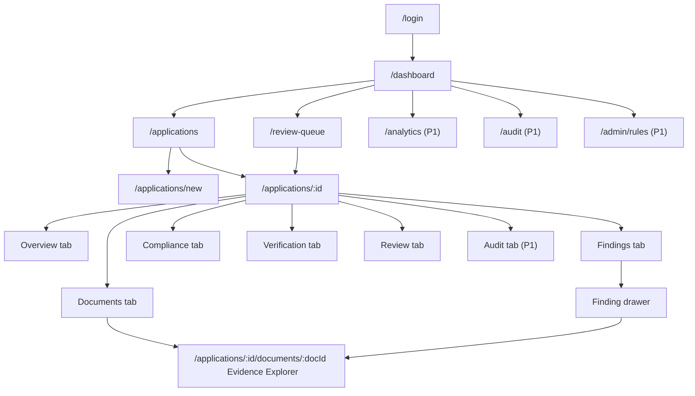
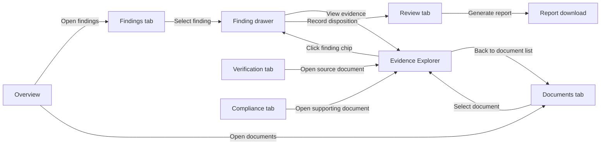
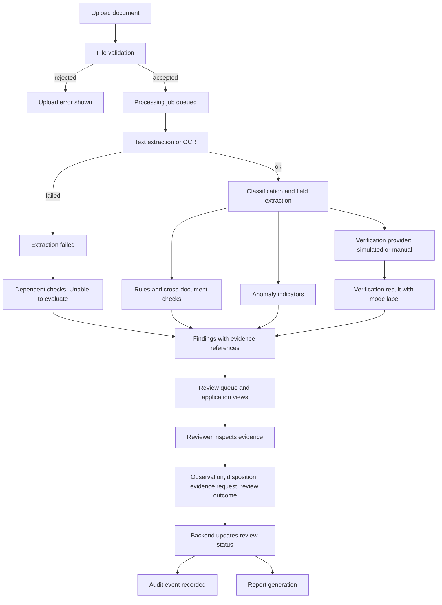
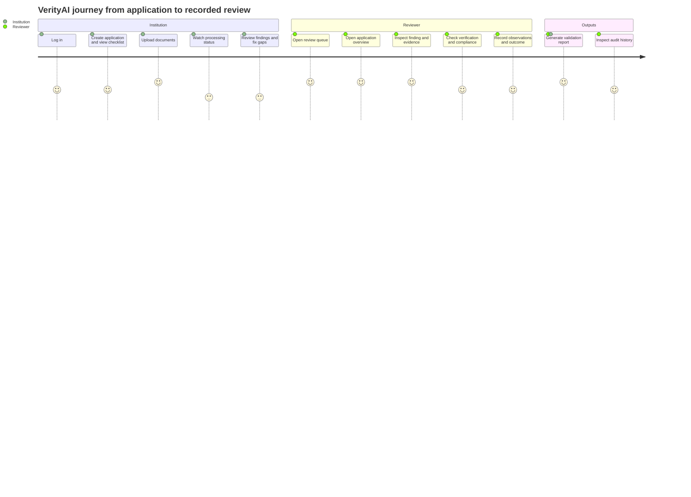

# VerityAI — UI/UX Design Specification

**Document:** `docs/UI_UX_DESIGN.md` (third project document)
**Companion documents:** `docs/ARCHITECTURE.md` (primary architectural reference), `docs/TECH_STACK.md` (technology decisions)
**Project:** VerityAI — Problem Statement SIH26261 (AICTE, Ministry of Education, Government of India)
**Status:** Implementation-ready; provisional wherever it depends on `ARCHITECTURE.md` (see Section 24)

---

## 1. Document Purpose

This document specifies the user interface and user experience of the VerityAI prototype so that an AI coding agent can implement it without inventing major design decisions.

Rules for the implementing agent:

- Every value in Section 9 (design tokens) is a decision. Do not substitute colours, spacing, or fonts.
- Every status family in Section 14 is a separate visual vocabulary. Never merge them.
- The UI **displays** results computed by the backend. It never computes, infers, or upgrades an authoritative validation, verification, compliance, or workflow result.
- If a feature or endpoint is not implemented, show the honest "unavailable" state defined in Section 20. Never show a fabricated success.
- Priorities (P0/P1/P2) in Section 21 govern build order. Finish the whole P0 workflow before touching P1.

This document contains no source code, no component code, and no API schemas (those belong in the separate data-model/API specification).

**Technology basis (from `TECH_STACK.md`):** React + Vite + TypeScript (strict), Tailwind CSS, shadcn/ui, lucide-react, Recharts, React Router, TanStack Query with a typed `fetch` wrapper, React Hook Form + Zod. Document pages are shown as backend-rendered page images (PyMuPDF) with overlays. Processing is asynchronous with polling. Authentication is an HttpOnly cookie session; the backend enforces all authorization.

---

## 2. Product Overview

VerityAI helps authorized AICTE officials review institutional approval applications (for example Extension of Approval) by processing supporting documents, extracting fields, running configurable validation and compliance checks, handling issuer verification (real, simulated, or manual), and presenting **evidence-linked findings** for human review.

What the UI must communicate at all times:

- **Decision support, not decisions.** No screen implies an automatic approval, rejection, or fraud determination. Reviewer actions are recorded observations and workflow outcomes, not statutory approvals.
- **Extraction is not authentication.** Showing extracted text never implies the document is genuine.
- **Anomaly is not fraud.** Anomalies are called "indicators requiring review".
- **Unable to evaluate is not failed.**
- **Simulated is not real.**
- **Synthetic data is not genuine AICTE data.**

Prototype constraint: three to four days of work by a beginner with an AI coding agent. The design therefore favours one coherent end-to-end workflow over many partial screens.

---

## 3. Design Goals

1. **Clarity** — a reviewer understands in seconds what the application's state is and what needs attention.
2. **Trust** — honest labels, visible provenance, no overstated certainty.
3. **Traceability** — every finding links to a rule, a document, a page, and (where possible) a highlighted region.
4. **Efficient review** — minimal clicks from queue → application → finding → evidence → recorded action.
5. **Consistency** — one shell, one table pattern, one badge system, one panel pattern.
6. **Operational honesty** — empty, loading, error, and unavailable states are designed, not afterthoughts.
7. **Accessibility** — keyboard operable, contrast-compliant, status never colour-only.
8. **Restraint** — enterprise look: navy and teal, white panels, quiet borders, no decorative gradients or glassmorphism, no generic AI imagery.
9. **Feasibility** — reuse shadcn/ui components and a small set of shared compositions.

---

## 4. Target Users and Personas

Personas are illustrative and use fictional names.

| Persona | Role | Context | Needs | Pain points to design against |
|---|---|---|---|---|
| **Meera (Institution Officer)** | `institution_user` | Prepares and submits an extension application for her institute | Know which documents are missing/invalid; understand how to fix them; see processing progress; download a report | Not knowing why an upload was "rejected"; ambiguous statuses |
| **Arjun (Scrutiny Reviewer)** | `reviewer` | Reviews many applications daily | Prioritised queue; quick diagnosis of why a document is flagged; side-by-side comparison of conflicting values; record observations; request clarification | Searching entire documents manually; AI warnings presented as verdicts |
| **Dr. Rao (System Administrator)** | `admin` | Oversees users, rules, and system health | See processing activity and failures; view audit trail; review illustrative rules; user and institution oversight | Opaque failures; unclear who changed what |

### 4.1 Role capability matrix (UI behaviour; backend enforces)

| Capability | Institution user | Reviewer | Admin |
|---|---|---|---|
| View own institution's applications | Yes | — | — |
| View all/assigned applications | No | Yes | Yes |
| Create application, upload documents | Yes (own, while editable) | No | Yes (support use) |
| View findings, compliance, verification | Yes (own; reviewer-only notes hidden) | Yes | Yes |
| Record observations, finding dispositions, review outcome | No | Yes | Yes |
| Request additional evidence | No | Yes | Yes |
| Trigger manual verification task | No | Yes | Yes |
| Re-process a document | Yes (own, failed/low-confidence) | Yes | Yes |
| Dashboard / analytics | Own-application summary only | Yes | Yes |
| Global audit trail | No (own application timeline only) | Application-scoped | Yes |
| Rules (view) | No | Yes (read-only) | Yes |
| Users, institutions management | No | No | P2 |

Frontend behaviour: items a role cannot use are **not shown**; however the UI must also gracefully handle `403`/`404` responses (Section 20) because hiding is never the control.

---

## 5. Core User Journeys

### 5.1 Institution journey (create → upload → fix → report)

1. Log in → lands on **Dashboard** (own summary).
2. **New Application**: pick category, enter institution details, see illustrative checklist preview → save as Draft.
3. Open application → **Documents** tab → upload files (drag and drop).
4. Watch per-file stages: *Uploaded → Processing → Extracted* (upload completion ≠ processing success).
5. Review **Findings** and **Compliance** tabs: missing documents, expired documents, mismatches, unable-to-evaluate items with plain-language next steps.
6. Re-upload or re-process where permitted, then submit (if the workflow includes explicit submission).
7. Download the **validation report**.

### 5.2 Reviewer journey (queue → investigate → record)

1. Log in → **Dashboard** or **Review Queue**.
2. Open the highest-priority application.
3. Skim **Overview** (summaries across the six status families).
4. Open **Findings**, select a finding → **Finding Detail Panel** (what/rule/document/observed/expected/location/why/status/actions).
5. Click **View evidence** → **Evidence Explorer** opens at the right page with the region highlighted.
6. Check **Verification** (clearly labelled real/simulated/manual).
7. Record an observation, set a finding disposition, optionally **Request additional evidence**.
8. Record the **review outcome** (not an approval/rejection).
9. Generate the **report**; check the **audit** timeline.

### 5.3 Administrator journey

Log in → Dashboard (system view, failed jobs) → Applications / Audit Trail → Validation Rules (read-only list of illustrative rules, P1) → Users and Roles (deferred, shown as unavailable if included).

---

## 6. Information Architecture

Primary entities and how the UI organises them:

```
Institution
 └── Application (category, status families)
      ├── Documents (each: processing job, extraction, fields, page images)
      │    └── Extracted Fields (value, normalized value, page, region, confidence?, method)
      ├── Findings (rule, status, severity, evidence references)
      ├── Compliance Checklist (requirements → evaluation status → supporting documents)
      ├── Verification Results (mode: real | simulated | manual)
      ├── Reviewer Actions (observations, dispositions, outcomes, requests)
      └── Audit Events
```

The **Application** is the central workspace. Everything else is reached from it, either through a tab or the Evidence Explorer. Global pages (Dashboard, Review Queue, Analytics, Audit Trail) are cross-application views that always link back to an application.

**Organising principle:** one application page with tabs; one evidence explorer per document; one global queue.

---

## 7. Navigation and Route Hierarchy

### 7.1 Decision: one URL space, role-scoped data

To save implementation time, institution users and reviewers use the **same routes**. The backend scopes data by role; the sidebar labels and visible items differ.

| Route | Page | Roles | Priority |
|---|---|---|---|
| `/login` | Login | Public | P0 |
| `/dashboard` | Dashboard (role-specific content) | All | P0 |
| `/applications` | Application list (labelled "My Applications" for institution users) | All | P0 |
| `/applications/new` | Application creation | Institution, Admin | P0 |
| `/applications/:id` | Redirects to `/applications/:id/overview` | All | P0 |
| `/applications/:id/overview` | Application detail — Overview tab | All | P0 |
| `/applications/:id/documents` | Documents tab (upload + list) | All | P0 |
| `/applications/:id/findings` | Findings tab | All | P0 |
| `/applications/:id/compliance` | Compliance tab | All | P0 |
| `/applications/:id/verification` | Verification tab | All | P0 |
| `/applications/:id/review` | Review tab (observations, actions) | Reviewer, Admin (institution: read-only response view) | P0 |
| `/applications/:id/audit` | Application audit timeline | All (scoped) | P1 |
| `/applications/:id/documents/:docId` | Document results + Evidence Explorer | All | P0 |
| `/review-queue` | Review queue | Reviewer, Admin | P0 (simplified) |
| `/analytics` | Analytics and exports | Reviewer, Admin | P1 |
| `/audit` | Global audit trail | Admin (Reviewer scoped) | P1 |
| `/admin/rules` | Validation rules (read-only) | Admin, Reviewer | P1 |
| `/admin/users` | Users and roles | Admin | P2 (unavailable page) |
| `/admin/institutions` | Institutions | Admin | P2 (unavailable page) |
| `/settings` | Profile and system information | All | P1 |
| `/403`, `/404` | Error pages | All | P0 |

Finding detail is a **side panel/drawer** (URL query `?finding=<id>`), not a route, so deep links work without deeper nesting. Evidence Explorer deep link: `.../documents/:docId?page=2&field=<id>&finding=<id>`.

### 7.2 Navigation per role (sidebar)

| Institution user | Reviewer | Administrator |
|---|---|---|
| Dashboard | Dashboard | Dashboard |
| My Applications | Applications | Applications |
| New Application | Review Queue | Review Queue |
| Settings (Profile) | Analytics (P1) | Analytics (P1) |
| | Audit Trail (P1) | Audit Trail (P1) |
| | Validation Rules (P1, read-only) | Validation Rules (P1) |
| | Settings | Users and Roles (P2, "Not available in prototype") |
| | | Institutions (P2, "Not available in prototype") |
| | | Settings |

Items not built yet are **not rendered** (P0 build) except Admin P2 items, which may render disabled with a "Not available in this prototype" tooltip so the product shape is visible without false functionality.

Global "Documents", "Compliance", and "Document Verification" pages are **not** top-level routes: they are tabs inside the application (this keeps navigation shallow and every document tied to an application).

### 7.3 Breadcrumb pattern

`Applications › AICTE-EOA-0007 › Findings`; document level: `Applications › AICTE-EOA-0007 › Documents › Affiliation Certificate`. Shown under the page title on application and document pages only. Last crumb is plain text (not a link). Truncate middle crumbs on small screens to an ellipsis menu.

### 7.4 List/detail/tab/modal relationship

- **Lists** (applications, queue): row click → application detail.
- **Detail** (application): tabs for facets; one tab visible at a time; tab state in the URL.
- **Evidence Explorer**: full-width workspace (a page), reached from documents list, extracted field, or finding.
- **Drawers**: finding detail, field detail (secondary info while staying in context).
- **Modals**: only for decisions or short input (confirm review outcome, request evidence, record observation, upload retry). No modal opens another modal.

### 7.5 Diagram — page hierarchy



### 7.6 Diagram — application detail and document-review navigation



---

## 8. Visual Design Direction

**Character:** a sober, institutional, evidence-oriented interface. Navy sidebar, white work surfaces, light grey page background, teal for primary actions and links, strongly legible status badges. Information density is moderate (14 px base text) because reviewers work with tables and fields.

**Do:**

- Use whitespace and thin borders to group, not heavy shadows.
- Use icons paired with text labels in badges.
- Use monospaced text for identifiers (application ID, rule ID, hashes).
- Use subtle banners for context (synthetic data, simulated results, illustrative rules).

**Do not:** use gradients (except none at all in P0), large hero illustrations, glassmorphism, bouncing/looping animations, "AI sparkle" iconography, robot imagery, neon colours, emoji in UI chrome, or decorative charts.

**Government-appropriate tone:** neutral, factual language. Prefer "Requires review", "Indicator requiring review", "Unable to evaluate". Avoid "Fraud", "Fake", "Rejected by AI", "Approved by AI".

### 8.1 Mandatory context banners

| Banner | Trigger | Wording (use exactly) | Style |
|---|---|---|---|
| Synthetic data | Backend marks data as synthetic (`is_synthetic`) or environment = demo | "Demonstration environment — all institutions and documents are synthetic and are not genuine AICTE records." | Amber strip under the top bar (dismissible per session, reappears on reload) |
| Simulated verification | Any verification with `mode = simulated` | "Simulated verification — no issuing authority was contacted. This is not an official confirmation." | Violet inline banner above the result |
| Illustrative rules | Rule/checklist with `is_illustrative = true` | "Illustrative prototype rule — not an official AICTE requirement." | Small outline badge on each rule/requirement + one banner on the Compliance tab |
| Decision support | Review tab, reports, dashboard footer | "VerityAI provides decision support. Statutory scrutiny, inspection, and final decisions remain with authorized officials." | Neutral muted note |

---

## 9. Design Tokens

Tokens are defined once in the Tailwind theme (CSS variables for colours so shadcn/ui picks them up). Do not use raw hex values in components.

### 9.1 Colour palette

**Brand and neutrals**

| Token | Hex | Use |
|---|---|---|
| `--navy-900` | `#0B2545` | Sidebar background, primary headings accent |
| `--navy-800` | `#13315C` | Sidebar hover/active background |
| `--navy-700` | `#1D4476` | Sidebar active indicator, secondary dark surfaces |
| `--teal-700` | `#0F766E` | Primary action buttons, links (contrast on white ≈ 5.5:1) |
| `--teal-800` | `#0B5F59` | Primary button hover |
| `--teal-50` | `#E6F4F2` | Subtle teal background (selected row, info highlight) |
| `--bg-page` | `#F4F6F8` | Page background |
| `--bg-surface` | `#FFFFFF` | Cards, tables, panels |
| `--bg-muted` | `#EEF1F5` | Table header, disabled fields, code chips |
| `--border` | `#D9DFE7` | Standard borders and dividers |
| `--border-strong` | `#B8C2CF` | Input borders, emphasised dividers |
| `--text-primary` | `#1B2430` | Body and headings (contrast ≈ 15:1) |
| `--text-secondary` | `#4A5565` | Secondary text (≈ 7.6:1 on white) |
| `--text-muted` | `#5B6675` | Captions, placeholders-with-context (≈ 5.9:1; never smaller than 12 px) |
| `--text-inverse` | `#FFFFFF` | Text on navy/teal |
| `--text-sidebar` | `#C9D4E3` | Sidebar item text (≥ 7:1 on navy-900) |

**Semantic status colours** (foreground / background / border)

| Meaning | Foreground | Background | Border | Typical use |
|---|---|---|---|---|
| Success | `#166534` | `#E7F5EC` | `#9BD3B1` | Passed, Satisfied, Completed |
| Warning | `#8A4B00` | `#FFF3D6` | `#EBC46A` | Needs review, Low confidence, Partial |
| Error | `#B42318` | `#FDECEA` | `#F2A29B` | Failed finding, Deficiency, Processing failed |
| Informational | `#1D4ED8` | `#E8EFFE` | `#A9BFF5` | Processing, In review, notices |
| Pending | `#475467` | `#EEF1F5` | `#C5CEDA` | Pending, Not started, Not reviewed |
| Unable to evaluate | `#4A3F8F` | `#EFEDFA` | `#BDB5E8` | Could not perform check (distinct from failure) |
| Simulated | `#6D28D9` | `#F3EBFE` | `#C7A8F5` | Any simulated verification (dashed border) |
| Disabled | `#8A94A3` | `#F1F3F5` | `#D9DFE7` | Disabled controls |

All foreground/background pairs above meet WCAG AA (≥ 4.5:1) for normal text. The implementing agent must verify with a contrast checker and adjust the foreground darker (never the background lighter) if a pair fails.

**Focus and selection**

| Token | Value | Use |
|---|---|---|
| `--focus-ring` | `#2563EB` | 2 px ring, 2 px offset, on all interactive elements (contrast ≥ 3:1 against both white and navy) |
| `--selection-bg` | `#DCE8FF` | Selected table row, active list item |
| `--highlight-evidence` | `#FFD54A` at 40% fill with `#B88700` 2 px outline | Evidence region highlights on page images |
| `--highlight-conflict` | `#F2A29B` at 35% fill with `#B42318` 2 px outline | Conflicting-value regions |

### 9.2 Typography

- **Font family:** Inter (self-hosted or Google Fonts), fallback stack: `system-ui, -apple-system, "Segoe UI", Roboto, "Helvetica Neue", Arial, sans-serif`. **Mono:** `"JetBrains Mono", ui-monospace, "SF Mono", Menlo, Consolas, monospace` for identifiers.
- Weights used: 400 (body), 500 (labels, table headers, buttons), 600 (headings, emphasis). No 700+.

| Role | Size / line-height | Weight |
|---|---|---|
| Page title (h1) | 24 px / 32 px | 600 |
| Section title (h2) | 18 px / 28 px | 600 |
| Card title (h3) | 16 px / 24 px | 600 |
| Body (default) | 14 px / 20 px | 400 |
| Body large (intro text) | 16 px / 24 px | 400 |
| Label / table header | 12 px / 16 px uppercase-free, letter-spacing 0.02em | 500 |
| Caption / helper | 12 px / 16 px | 400 |
| KPI number | 30 px / 36 px | 600 |
| Identifier (mono) | 13 px / 20 px | 500 |

Minimum text size 12 px. Do not use text-transform uppercase for long labels.

### 9.3 Spacing, layout, and shape

- **Spacing scale (4 px base):** 4, 8, 12, 16, 20, 24, 32, 40, 48, 64. Use only these (Tailwind `1, 2, 3, 4, 5, 6, 8, 10, 12, 16`).
- **Page margins (content area padding):** 24 px desktop, 16 px tablet/mobile.
- **Card padding:** 16 px (compact) or 24 px (default); card header gap 12 px.
- **Gaps:** between cards 16 px; between form fields 16 px; between label and input 6 px (use 8 px).
- **Sidebar width:** 248 px expanded, 64 px collapsed (icon rail).
- **Top bar height:** 56 px.
- **Content max width:** 1440 px, centred; evidence explorer uses full width.
- **Table row height:** 48 px default, 40 px in compact density; header 40 px.
- **Input/button height:** 40 px default, 32 px small, 44 px touch/mobile primary.
- **Radii:** 4 px (badges, chips), 6 px (inputs, buttons), 8 px (cards, panels), 12 px (modals), full for avatars.
- **Borders:** 1 px `--border`; inputs `--border-strong`.
- **Shadows:** `sm`: `0 1px 2px rgba(11,37,69,0.06)` (cards); `md`: `0 4px 12px rgba(11,37,69,0.10)` (dropdowns, popovers); `lg`: `0 12px 32px rgba(11,37,69,0.16)` (modals, drawers). No coloured glows.
- **Icon sizes (lucide-react):** 16 px inline/badges, 20 px buttons and nav, 24 px empty-state accents (max 48 px for empty-state illustration icons). Stroke width 1.75.
- **Z-index layers:** content 0, sticky headers 10, drawers 30, modals 40, toasts 50.

### 9.4 Motion

150–200 ms ease-out for hover, drawer slide, dialog fade. Skeleton shimmer allowed. All animation disabled under `prefers-reduced-motion` (replace with instant state change).

### 9.5 Breakpoints (Tailwind defaults)

`sm` 640, `md` 768, `lg` 1024, `xl` 1280, `2xl` 1536. Design tiers: **desktop** ≥ 1024, **tablet** 768–1023, **mobile** < 768.

---

## 10. Application Shell

```
┌───────────────────────────────────────────────────────────────────┐
│ [Synthetic-data banner – amber, 32 px, when applicable]           │
├──────────┬────────────────────────────────────────────────────────┤
│          │ Top bar (56 px): [≡ collapse] Breadcrumb…  [Search?] [🔔 P2] [User menu] │
│ Sidebar  ├────────────────────────────────────────────────────────┤
│ 248 px   │ Page header: Title · status badges · primary action(s) │
│ navy-900 │ ───────────────────────────────────────────────────── │
│          │ Content area (page background, 24 px padding)          │
│          │                                                        │
└──────────┴────────────────────────────────────────────────────────┘
```

**Sidebar:** VerityAI wordmark at top (text logo, shield-check icon; no custom artwork required). Nav items: icon (20 px) + label, 40 px height, 8 px radius; active item has `navy-800` background plus a 3 px left indicator in `teal` lighter tint (`#5EEAD4`) and white text. Role label under the wordmark ("Reviewer", "Institution user", "Administrator"). Footer: environment tag ("Demo") and version.

**Top bar:** left — collapse button (tablet/desktop) or hamburger (mobile) and breadcrumb; right — user menu (name, role, institution, "Sign out"). A global search is **P2**; do not render a non-functional search box.

**Page header pattern:** H1 (24 px), one-line description (secondary text), status badges row, and right-aligned page actions (max one primary button + up to two secondary).

**Footer note:** the decision-support disclaimer in muted 12 px text on dashboard and report pages.

---

## 11. Screen-by-Screen Specifications

Format per screen: Purpose · Role · Layout · Components · Information · Actions · Navigation · Data dependencies · States · Permissions · Acceptance. "Data dependencies" are conceptual; exact schemas live in the API specification.

### Screen 1 — Login (P0)

| Aspect | Specification |
|---|---|
| Purpose | Authenticate the user and route to the dashboard. |
| Target role | All. |
| Layout | Split screen ≥ 1024 px: left 40% navy panel with wordmark, one-sentence description ("AI-assisted application validation and compliance support for authorized reviewers"), SIH26261/AICTE attribution line, and the decision-support note; right 60% white with centred 400 px card. Below 1024 px: single column, navy header strip with wordmark, form card below. |
| Main components | Username/email field, password field with show/hide toggle, "Sign in" button, error alert area, demo-accounts panel. |
| Displayed information | Product name, short description, environment tag ("Demonstration environment — synthetic data"). |
| Primary action | Sign in. |
| Secondary actions | Show/hide password; "Use demo account" chips (only when the backend reports demo mode). |
| Navigation | On success → `/dashboard` (or the originally requested route). Already authenticated → redirect to `/dashboard`. No "forgot password" in P0 (shown as muted text "Contact your administrator"). |
| Data dependencies | Login endpoint; session/current-user endpoint; demo-mode flag. |
| Validation errors | Inline under the field: "Enter your username or email", "Enter your password". Validate on submit, then on change. Zod schema, UX-only. |
| Loading | Button shows spinner and "Signing in…", fields disabled; prevent double submit. |
| Authentication errors | Alert above form: "The username or password is incorrect." (identical message for unknown user and wrong password). Lockout/throttle: "Too many attempts. Try again in a few minutes." Network failure: "Unable to reach the server. Check your connection and try again." |
| Test-account access | In demo mode only, a collapsible panel "Demonstration accounts" listing **role names and usernames** (one per role) and a button that fills the username field. **Passwords are never displayed in the UI or stored in the frontend bundle**; the panel says "Passwords are provided to evaluators separately" (or the backend demo-mode endpoint returns them only when explicitly enabled by environment configuration, never committed). This document contains no credentials. |
| Credential safety | `autocomplete` attributes set (`username`, `current-password`); no credentials in URLs or logs; password not retained after failure. |
| Permissions | Public. |
| Acceptance | Invalid input shows specific messages; wrong credentials show the generic error; success redirects by role; loading state prevents double submit; no credentials appear anywhere in the page source. |

### Screen 2 — Dashboard (P0 simplified, P1 enriched)

| Aspect | Specification |
|---|---|
| Purpose | Operational overview and entry point to work. |
| Target role | Reviewer and Admin (full), Institution user (own-application summary). |
| Layout | Page header ("Overview"); row 1: 4–6 KPI cards (grid 3 columns on desktop, 2 on tablet, 1 on mobile); row 2: two columns — "Application status distribution" (left, 2/3 width) and "Pending actions" (right, 1/3); row 3: "Prioritised review queue" table (top 5) and "Recent activity" list. |
| KPI cards (reviewer/admin) | Total applications · Awaiting review · Applications with deficiencies · Documents processed · Documents requiring manual verification · Unresolved findings. Each card: label, value, small caption defining the metric (for example "Findings not yet dispositioned"), and clicks through to the corresponding pre-filtered list. |
| KPI cards (institution) | My applications · Documents processed · Open findings needing my action · Applications awaiting reviewer. |
| Status distribution | Horizontal stacked bar or simple bar chart (Recharts) by application **processing** status and, as a second toggle, by **human-review** status. Legend with counts. Bars have text labels, not colour only. |
| Pending actions | List of actionable items derived by the backend (for example "3 documents failed processing", "2 applications awaiting review", "1 verification pending manual action"), each linking to a pre-filtered view. |
| Recent activity | Last 10 audit-derived events (actor, action, application, relative time). Link "View audit trail" (P1). |
| Prioritised queue | Same component as Review Queue, 5 rows, link "Open full queue". |
| Filters | Date range selector (default: all time; P1 adds last 7/30 days) applied to all widgets consistently. |
| Primary actions | "New application" (institution), "Open review queue" (reviewer). |
| Navigation | Cards and rows deep-link to filtered lists/applications. |
| Data dependencies | Statistics endpoint(s) computing every number from live records; recent audit events; queue endpoint. **No frontend arithmetic on authoritative counts.** |
| Loading | Skeleton cards (value area shimmer), skeleton chart box, skeleton rows. |
| Empty state | "No applications yet." + explanation + (institution: "Create your first application" button; reviewer: "Applications will appear here once institutions submit them."). KPI cards display `0`, not hidden; charts replaced with the empty-state message. No fabricated demo numbers. |
| Error state | Per-widget error panel ("Couldn't load this section. Retry") so one failure doesn't blank the page. |
| Demo context | Synthetic banner (Section 8.1) appears in the shell. |
| Permissions | Backend scopes numbers by role. |
| Acceptance | Every number equals the backend value; clicking a KPI opens a list filtered consistently with the number; empty database shows zeros and a helpful empty state; widget errors are isolated. |

### Screen 3 — Application List (P0)

| Aspect | Specification |
|---|---|
| Purpose | Find and open applications. |
| Target role | All (scoped). |
| Layout | Page header + "New application" button (institution/admin). Filter bar (search, status filters), then data table with pagination footer. |
| Columns | Application ID (mono, link) · Institution · Category · Submitted date (or "Draft") · Processing status · Review status · Open findings (count with severity hint) · Last updated. Row actions: "Open". |
| Search | Single text input: matches application ID and institution name; debounced 300 ms; clears with an "×". |
| Filters | Processing status (multi-select), Review status (multi-select), Category (select). P1: date range, "has unresolved findings", institution (reviewer/admin). Active filters show as removable chips; "Clear all". |
| Sorting | Click column headers: ID, Institution, Submitted, Last updated, Open findings. Default: Last updated descending. Sort state indicated by arrow icon and `aria-sort`. |
| Pagination | Server-side, 20 rows per page default (10/20/50 selector); shows "Showing 21–40 of 83". State in URL query parameters. |
| Navigation | Row click or ID link → `/applications/:id/overview`. |
| Data dependencies | Paginated, filterable, sortable application list endpoint; filter option lists. |
| Loading | 8 skeleton rows preserving column layout; filters stay interactive. |
| Empty state | No data: "No applications yet" (+ create button when permitted). Filtered to zero: "No applications match your filters" + "Clear filters". |
| Error state | Inline error alert above table with "Retry"; table keeps previous data if available (stale indicator). |
| Mobile | Table becomes stacked cards: ID + institution title, two status badges, findings count, chevron. |
| Permissions | Backend scopes rows. |
| Acceptance | Search, filter, sort, and pagination persist in URL and survive reload; counts match backend; all three empty/error variants are reachable. |

### Screen 4 — Application Creation (P0)

| Aspect | Specification |
|---|---|
| Purpose | Create a draft application and preview the document checklist. |
| Target role | Institution user, Admin. |
| Layout | Two-column on desktop: left form (max 720 px) in sections; right sticky "Checklist preview" card. Single column on tablet/mobile with the preview collapsed under the form in an accordion. |
| Form sections | **1. Category** — select (categories from backend, e.g. illustrative "Extension of Approval", "Change in Programme/Intake" — labels from configuration). **2. Institution details** — institution (pre-filled and locked for institution users; select for admins), institution identifier, contact person, email, phone. **3. Application details** — academic year, programme(s)/intake fields as defined by the category configuration. **4. Declaration (P1)**. |
| Checklist preview | Lists document types required for the selected category from the backend configuration, each with an "Illustrative" badge when applicable, and the banner "Illustrative prototype requirements — not official AICTE requirements." Updates when category changes. |
| Validation | Zod, on blur and submit: required fields, email format, phone format, numeric ranges for intake. Messages in plain language ("Enter a valid email address"). Backend validation errors are mapped onto fields; unmapped errors show in a form-level alert. |
| Primary action | "Save and continue to documents" (creates Draft → navigates to Documents tab). |
| Secondary | "Save draft" (stay), "Cancel" (confirm dialog if the form is dirty: "Discard this draft?"). |
| Loading | Category-dependent sections show skeletons while category configuration loads; submit button spinner. |
| Empty | No categories configured: form disabled, message "No application categories are configured. Contact an administrator." |
| Error | Network/5xx: alert "We couldn't save your application. Your entries are kept — try again." |
| Data dependencies | Category and checklist configuration; institution list (admin) or own institution; create-application endpoint. |
| Permissions | Reviewers don't see "New application"; direct navigation shows `/403`. |
| Acceptance | Checklist preview changes with category; invalid input blocked with specific messages; success creates a persisted draft and lands on its Documents tab. |

### Screen 5 — Application Detail (P0)

| Aspect | Specification |
|---|---|
| Purpose | Central workspace for one application — quick review and detailed investigation. |
| Target role | All. |
| Layout | **Header:** breadcrumb; title = Application ID (mono) + institution name; badges row showing the **six status families** (processing, validation, verification, compliance, review; extraction is per document); page actions on the right (Generate report; reviewer: Record review outcome). **Tab bar** (sticky under header): Overview · Documents (count) · Findings (open count) · Compliance · Verification · Review · Audit (P1). Tab badges show counts from the backend. |
| Overview tab | Row 1: **Summary card** (category, institution identifier, academic year, submission date, created by, last updated). Row 2: **Status summary grid** — one tile per family with label, current value badge, and a one-line explanation (for example Validation: "Needs review — 3 findings"). Row 3: **Document checklist** (table: required document type, status — Provided/Missing/Expired/Unable to process, linked file name, last processed) and **Findings summary** (counts by status: Failed, Needs review, Unable to evaluate, Passed, with link). Row 4: **Verification summary** (counts by mode and status; simulated clearly labelled) and **Compliance summary**. Row 5: **Latest reviewer activity** and **Recent audit events** (3–5 items). |
| Primary actions | Reviewer: "Open findings", "Record review outcome". Institution: "Upload documents". All: "Generate report". |
| Secondary | Re-process failed document, copy application ID. |
| Navigation | Tiles and counts link to the relevant tab with filters pre-applied. |
| Data dependencies | Application summary; status rollups per family; document checklist; findings counts; verification summary; compliance summary; recent events. |
| Loading | Header renders as soon as the application loads; each tab/tile has its own skeleton. |
| Empty | Draft with no documents: overview shows checklist with all items "Missing" and call-to-action "Upload documents". No findings yet: "No validation has run yet." |
| Error | 404: "Application not found or you don't have access" page. Partial section errors handled per tile with Retry. |
| Permissions | Institution users cannot see reviewer-only internal notes; review tab for institutions shows only observations flagged "visible to institution" and clarification requests. |
| Acceptance | Shows real data; the six status families are visually separate; deep links open the correct tab; a processing application visibly updates (polling) without reload. |

### Screen 6 — Document Upload (P0, inside Documents tab)

| Aspect | Specification |
|---|---|
| Purpose | Upload documents and track processing. |
| Target role | Institution user, Admin (reviewers do not upload). |
| Layout | Top: **drop zone** (dashed border, 160 px high; "Drag files here or Browse files") with a requirements strip below: "PDF, PNG, JPG/JPEG • up to {limit} MB per file • up to {n} pages (limits read from configuration)". Optional document-type selector per file ("Auto-detect" default; manual override allowed). Below: **document list** table. |
| Multi-upload | Supported: multiple files queued; each shows its own row. |
| Upload row lifecycle | `Uploading (progress bar, %)` → `Uploaded` → `Processing (stage: Extracting text / OCR / Classifying / Extracting fields / Validating)` → `Processed` or `Processed with warnings` or `Processing failed`. **Two separate indicators:** upload state (transfer) and processing state. A completed upload shows "Uploaded — processing" and never a green "Done" until processing completes. |
| Invalid files | Client pre-check (type/size) for speed; **backend validation is authoritative**. Rejected row (red): reason in plain language — "Not a supported file type", "File exceeds the size limit", "File appears damaged or is not a valid PDF", "Password-protected PDFs are not supported". Row actions: "Remove". |
| Duplicates | If backend reports the same file hash: warning row (amber) "This file is identical to '{name}' already uploaded to this application" with actions "Keep both" / "Discard new". Duplicate across other applications: "Identical content was found in another application — flagged for reviewer attention" (shown to reviewers; institution users see a neutral note). |
| Retry | Failed upload: "Retry upload". Processing failed: "Re-process" (creates a new job; history retained). Network drop mid-upload: row shows "Upload interrupted" + Retry. |
| Document table columns | File name · Document type (with classification confidence if the backend provides it) · Uploaded (time, by) · Upload status · Processing status · Extraction status · Findings (count) · Actions (View, Re-process, Remove (draft only)). |
| Navigation | "View" → Evidence Explorer for that document. |
| Data dependencies | Upload endpoint with progress events; documents list; per-document job status (polling every 2 s while any job is active, backing off to 5 s, stopping when idle). |
| Loading | Skeleton rows; in-progress rows show indeterminate/determinate progress. |
| Empty | "No documents uploaded yet" listing the required document types from the checklist with an "Upload" prompt. |
| Error | Per-row errors; global alert if the list cannot be loaded. |
| Permissions | Upload controls hidden when the application is not editable (status-dependent, determined by the backend `can_upload` flag). |
| Acceptance | Drag-and-drop and picker both work; invalid file shows a specific reason; duplicate warning appears; upload completion and processing completion are visibly different; re-process works; status updates automatically. |

### Screen 7 — Document Processing Results (P0, top of Evidence Explorer "Fields" tab)

| Aspect | Specification |
|---|---|
| Purpose | Show what was extracted from a document and how reliable the extraction is. |
| Target role | All. |
| Layout | Part of the Evidence Explorer right panel ("Extracted fields" tab) plus a summary header strip above the viewer. |
| Header strip | Document name, type (with override action for reviewers), page count, **extraction status badge**, extraction method per page (Digital text / OCR), mean OCR confidence **only if provided**, processing duration. |
| Fields table | Field label · Extracted value · Normalized value (shown when different, small) · Page · Method · Confidence (only if provided; otherwise a dash with tooltip "Not available for digital-text extraction") · Status (Found, Missing, Low confidence, Edited by reviewer). Clicking a row selects the field and highlights its region. |
| Missing fields | Listed under "Expected but not found" with the field label and the reason ("not found in text" or "unable to read page 2"). |
| Warnings | Alert list: "Low OCR confidence on page 2", "Page 3 appears blank", "Text could not be extracted — manual review required". |
| OCR failure | Large inline notice replaces the fields table: "Text could not be extracted from this document. Checks that depend on it were marked *Unable to evaluate* and not as failed." Actions: "Re-process", "Mark for manual review". |
| Primary action | Re-process (when failed or low confidence). |
| Secondary | Reviewer: correct field value (**P1**; correction recorded as a reviewer action with original preserved), "Mark for manual review". |
| Confidence rule | Never display invented, rounded-up, or default confidence. Display exactly what the backend returns, as a percentage with the label "OCR confidence"; below the backend threshold show "Low confidence" warning badge. |
| Data dependencies | Document, pages, extraction summary, fields with provenance (page, region, method, confidence), warnings. |
| States | Loading: skeleton table. Extraction pending: "Waiting to be processed". Empty: "No fields extracted". Error: retry panel. |
| Acceptance | Fields link to page/region; missing fields are listed; no confidence is displayed unless supplied; OCR failure never reads as a validation failure. |

### Screen 8 — Document Viewer and Evidence Explorer (P0 simplified, P1 enhanced) — see also Section 12

| Aspect | Specification |
|---|---|
| Purpose | Let a reviewer inspect a document, its extracted values, related findings, and verification in one place and understand why something was flagged. |
| Target role | All (reviewer-only controls hidden from institution users). |
| Layout (desktop ≥ 1280) | Three panes: **Left rail (240 px, collapsible):** document list for the application + page thumbnails. **Centre viewer (flexible):** page image with overlays and a toolbar. **Right panel (400 px, resizable P1):** tabs *Fields · Findings · Verification · Notes*. |
| Layout (tablet) | Two panes: viewer + right panel as a bottom-sheet/side drawer toggled by a button; left rail becomes a dropdown. |
| Layout (mobile) | Single pane; segmented control switches *Document / Fields / Findings / Verification / Notes*. |
| Viewer toolbar | Page navigation (prev/next, "Page 2 of 5"), zoom (fit width, 100%, +/−), "Show highlights" toggle, "Download original" (authorised, audited). P1: rotate, text-layer toggle. |
| Highlighting | If a field/finding has region coordinates, draw an overlay box (evidence colour) on the page image and auto-scroll/zoom to it; conflicting regions use the conflict colour; multiple regions on one page are numbered. If only a page reference is available, jump to the page and show the banner "Region highlighting isn't available for this item. Showing page {n}." plus the extracted text snippet in the panel. |
| Unsupported preview | If the page image cannot be rendered: "Preview unavailable for this document." with a "Download original" action (if permitted) and the extracted text, if any. |
| Interaction | Selecting a field or finding syncs the viewer; clicking a highlight selects the related field/finding in the panel. URL query keeps `page`, `field`, `finding`. |
| Data dependencies | Document metadata; page images (authenticated endpoint, never public URLs); fields with regions; findings referencing this document; verification results; notes. |
| Loading | Page image skeleton with spinner; right panel skeleton. |
| Error | Page image failed: "Couldn't load page {n}" + Retry. |
| Permissions | Original download requires permission and writes an audit event; institution users cannot see reviewer-internal notes. |
| Acceptance | Selecting a finding shows its rule, observed/expected values and jumps to the evidence page; region highlighting works where coordinates exist and degrades to a page reference with explanation where not; preview failure shows a meaningful state. |

### Screen 9 — Validation Findings (P0)

| Aspect | Specification |
|---|---|
| Purpose | Review all findings for an application in a structured, filterable list. |
| Target role | All (institution users see "What to do" wording prominent; reviewers see rule detail and disposition controls). |
| Layout | Summary strip with five count chips (Failed · Needs review · Unable to evaluate · Passed · Not applicable) that act as filters. Filter bar below. Findings table with the **Finding Detail Panel** opening as a right drawer (480 px). |
| Table columns | ID (mono, e.g. `F-0012`) · Type (Missing document, Expiry, Mismatch, Duplicate, Format, Compliance, Anomaly indicator, Verification) · Severity (High/Medium/Low/Info) · Title · Document / page · Rule ID (mono) · Status · Reviewer disposition · Recommended next step (truncated). |
| Grouping | Default grouping toggle "Group by: None / Document / Type". |
| Filters | Result status (multi), severity, type, document, disposition (P1). Passed and Not-applicable findings are **hidden by default** behind the chips to reduce noise but remain one click away. |
| Sorting | Default: status priority (Failed, Needs review, Unable to evaluate, Passed) then severity. |
| Row actions | "View details" (opens drawer), "View evidence" (opens Evidence Explorer). Reviewer: quick disposition menu. |
| Wording rules | Failed ≠ fraudulent. Anomaly rows are labelled "Indicator requiring review". Unable-to-evaluate rows say why: "Could not be checked because page 2 text could not be read." |
| Data dependencies | Findings with rule, status, severity, evidence references, field values, recommended next step, disposition. |
| Loading / Empty / Error | Skeleton rows / "No findings. Validation has not been run yet." or "All checks passed" (only when the backend reports completed validation with zero non-passing findings) / retry alert. |
| Acceptance | Findings equal the backend's; the five statuses are visually and textually distinct; filtering and chips work; drawer shows the full evidence anatomy; no warning is styled as failure. |

### Screen 10 — Issuing-Authority Verification (P0, Verification tab)

| Aspect | Specification |
|---|---|
| Purpose | Show verification outcomes per document or certificate, honestly distinguishing real, simulated, and manual verification. |
| Target role | All view; reviewer/admin act. |
| Layout | Summary strip with counts by outcome. Then one **verification card** per verifiable document (list on mobile). |
| Card contents | Document/certificate name and identifier (as extracted) · Verification method (Official API, Official portal, QR validation, Digital signature, Manual check, Simulation) · Source name (e.g. "Simulation fixture — synthetic issuer registry" for simulated) · Timestamp (if available) · **Result badge** · Evidence returned by the source (key/value list; shown only when permitted and available) · Manual state (assigned reviewer, note) · Actions. |
| Result badges | See Section 14.D. A **mode label** ("OFFICIAL SOURCE", "SIMULATED", "MANUAL CHECK") is always shown as a prefix chip distinct from the result. |
| Rules | A simulated result never uses the success colour; it uses violet with dashed border and the banner from Section 8.1; the word "Verified" is never shown on a simulated result — use "Simulated match" / "Simulated mismatch". Only `mode = real` and `status = verified` may read "Verified by issuing authority". In the prototype, no real provider is connected: the tab states "No official verification source is connected in this prototype." |
| Actions | Reviewer: "Request verification" (runs the configured provider: simulation or creates a manual task), "Record manual verification outcome" (modal with outcome, source/reference note, optional evidence file P1), "Retry" when source unavailable, "Escalate for manual review". |
| QR codes | If QR content was decoded (P2), display as "QR content decoded — not verified" with no authenticity implication. |
| Data dependencies | Verification results per document with mode, status, provider, timestamp, returned evidence, manual task state. |
| States | Loading skeleton cards; empty "Verification has not been requested for any document" with button; error with Retry; source unavailable shows grey "Source unavailable" with retry. |
| Permissions | Institution users see results read-only, without internal notes. |
| Acceptance | Every card shows its mode label; a simulated result cannot visually resemble a real verified result; pending/unavailable/manual states each have a unique label and icon. |

### Screen 11 — Compliance Checklist (P0, Compliance tab)

| Aspect | Specification |
|---|---|
| Purpose | Show configured requirements for the application category and how each was evaluated. |
| Target role | All. |
| Layout | Banner "Illustrative prototype rules — not official AICTE requirements" (when applicable). Overall compliance rollup card (see Section 14.E) with text such as "No gaps identified on 9 of 12 checked requirements; 2 could not be evaluated." Requirement table grouped by section. |
| Columns | Requirement ID (mono) · Description · Evidence required · Evidence available (documents/fields provided, count) · Status badge · Explanation · Supporting documents (links to Evidence Explorer) · Reviewer note indicator. |
| Row expansion | Expands inline to show explanation, linked findings, supporting documents, reviewer notes (reviewer can add a note in P0). |
| Filters | Status, "Needs attention" shortcut. |
| Data dependencies | Compliance checks per requirement with status, explanation, rule ID, `is_illustrative`, evidence links, notes. |
| States | Loading skeleton; empty "No compliance checks have been run" (+ "Run checks" for reviewers/admin if the backend exposes it); error with Retry. |
| Rules | The rollup never reads simply "Compliant"; items not evaluated prevent an unqualified positive label. |
| Acceptance | Illustrative badges appear; unable-to-evaluate rows are separate from deficiencies; supporting-document links open the correct evidence. |

### Screen 12 — Review Queue (P0 simplified)

| Aspect | Specification |
|---|---|
| Purpose | A prioritised work list of applications that need reviewer attention. |
| Target role | Reviewer, Admin. |
| Layout | Same table pattern as Application List with queue-specific columns and a quick-filter segmented control: **All needing action · Assigned to me (if assignment is implemented) · Waiting for institution · Failed processing**. |
| Columns | Priority (High/Medium/Low badge, computed by the **backend** from documented rules, tooltip explains why) · Application · Institution · Unresolved findings (count by severity) · Verification pending (count) · Waiting since (age, "5 days") · Review status · Assigned reviewer (only if supported; else column omitted) · Action ("Review"). |
| Sorting | Default: priority, then waiting time descending. Sortable by waiting time, findings count. |
| Filters | Priority, review status, category, institution. |
| Navigation | "Review" / row click → application Overview tab (or Findings tab when unresolved findings exist). |
| States | Loading skeleton rows; empty "Queue is clear. No applications need review." (not shown if filters hide results — then "No matches"); error with Retry. |
| Acceptance | Queue rows come from the backend; priority and age are not computed in the browser; navigation reaches the application in one click. |

### Screen 13 — Analytics and Reports (P1; P0 reduced to report download)

| Aspect | Specification |
|---|---|
| Purpose | Operational metrics and downloadable reports. |
| Target role | Reviewer, Admin. |
| Layout | Filter bar (date range, category, institution) · KPI row (reuse dashboard definitions) · chart grid (2 columns): Application processing status; Finding categories (bar); Document-processing duration (median and p95 per stage, from recorded timings); Review workload (open items by review status or reviewer if assignment exists); Verification outcomes (split by mode); Processing trends (applications/documents per day). Export section: CSV exports (applications, findings, processing statistics). |
| Chart rules | Recharts; each chart has a title, a one-line definition, an accessible data table alternative ("View as table" toggle), axis labels, and direct labels or legends with text. Colours come from status tokens and must not be the only differentiator (add patterns or labels). Charts only render with real backend data. |
| Empty | "Not enough data to show this chart yet." per chart, never placeholder values. |
| Duration metrics | Displayed with the sample size ("n = 42 documents") and labelled as measured on the current environment; no claims of improvement over manual processing. |
| Reports | Application-level "Generate validation report" lives in the application header (P0) — a button that requests the PDF, shows "Generating report…", then downloads; failure shows toast "Report could not be generated. Try again." with Retry; reports include the decision-support disclaimer, simulation/synthetic labels, findings with evidence references, and the report ID. |
| P0 fallback | If PDF generation is not ready, provide a print-friendly "Report preview" page (same content) and CSV download. |
| States | Loading skeleton cards and chart placeholders; error per widget. |
| Acceptance | Every chart matches backend data; empty state displayed for empty data; export errors are communicated; report download works from the application page. |

### Screen 14 — Audit Trail (P1; application-level timeline P1, global page P1)

| Aspect | Specification |
|---|---|
| Purpose | Show who did what and when. |
| Target role | Admin (global), Reviewer (scoped to applications they can access), Institution (own application timeline, limited). |
| Layout | Filter bar (date range, actor, action type, application) + table (global) or vertical timeline (application tab). |
| Columns | Timestamp (local time with UTC tooltip) · Actor (name + role) · Action (human-readable, e.g. "Uploaded document", "Recorded observation") · Application (link) · Document (link, if any) · Status change (`In review → Clarification requested` chips, if relevant) · Details (expandable, short text). |
| Sensitive data | Do not render document contents, passwords, tokens, IP addresses (admin-only P2), or full free-text notes in lists; show note excerpts ≤ 120 characters and open the application's Review tab for the full text if permitted. |
| States | Loading skeleton; empty "No audit events recorded for this selection."; error with Retry. |
| Acceptance | Events appear for login, upload, processing, review actions, verification requests, and report generation (as supported); the list is read-only and cannot be edited or deleted from the UI. |

### Screen 15 — Settings and Administration (P1/P2)

| Aspect | Specification |
|---|---|
| Purpose | Minimum useful settings and honest representation of deferred features. |
| Target role | All (Profile), Admin (others). |
| P1 pages | **Profile** (name, role, institution, "Sign out", change password only if the backend supports it); **Validation Rules** (read-only table: rule ID, name, description, applicable categories, severity, `Illustrative` badge); **System information** (version, environment, synthetic-data flag, OCR engine status from the health check, active verification provider and mode, processing worker status). |
| P2 pages | Users and Roles; Institutions; rule editing; processing preferences. If rendered at all, show a standard "Not available in this prototype" panel explaining the planned capability. |
| Acceptance | No settings control appears that does not persist or act; deferred items are clearly marked; system information reflects live backend values. |

---

## 12. Evidence Explorer Design

The Evidence Explorer is the product's differentiator. Its guiding question: **"Why was this flagged, and where is the proof?"**

### 12.1 Interaction model

1. Entry points: document row → Explorer; field row → Explorer with the field selected; finding → Explorer with the finding's primary evidence selected.
2. Selecting any item (field, finding, verification) sets the **active evidence set**: one or more (document, page, region) references.
3. The viewer jumps to the first reference, draws highlights, and shows chips for other references ("Also on page 2 of Application Form") that navigate when clicked.
4. The right panel shows the item's details; it never requires the reviewer to scan the document.

### 12.2 Comparison of conflicting values

For mismatch findings the Findings tab of the right panel renders a **two-column comparison card**:

| | Source A | Source B |
|---|---|---|
| Label | "Application form" | "Affiliation certificate" |
| Field | Expiry date | Expiry date |
| Value | `31 March 2027` (normalized `2027-03-31`) | `31 March 2026` (normalized `2026-03-31`) |
| Location | Page 1, field "Valid until" | Page 2, stamp area |
| Action | "Show on page" | "Show on page" |

(The values above are illustrative.) A "Show both" action opens a split view when the sources are on different documents (desktop: two viewers side by side; P1). In P0, switching between sources via the action buttons is sufficient.

### 12.3 Right panel tabs

| Tab | Contents |
|---|---|
| Fields | Fields extracted from the current document (Screen 7), grouped by page, selected field highlighted. |
| Findings | Findings that reference this document, ordered by severity; selecting one expands the Finding Detail Panel inline. |
| Verification | Verification result(s) for this document with the mode label. |
| Notes | Reviewer observations about this document (visible to reviewers/admins; institution users see only "Shared with institution" notes); "Add observation" form. |

### 12.4 Highlight fidelity levels

| Level | Condition | Behaviour |
|---|---|---|
| A — Region | Region coordinates stored (digital PDF text blocks or OCR word boxes) | Draw overlay at normalized coordinates; auto-scroll and zoom. |
| B — Page | Only page known | Jump to page; banner explaining no region highlight; show extracted text snippet with the matched value emphasised. |
| C — Document | No location (e.g. missing-document finding) | Show explanation "This finding concerns a document that was not provided" and link to the checklist. |

Region coordinates are stored normalized (0–1) relative to page dimensions by the backend so zoom does not break overlays.

### 12.5 What the reviewer must never have to do

Search the document manually, guess which rule was applied, infer whether a value came from OCR or digital text, or interpret an unexplained colour.

---

## 13. Validation Findings Design

### 13.1 Finding Detail Panel (reusable)

Used as a right drawer in the Findings tab and inline in the Evidence Explorer. **Fixed section order:**

1. **Header** — Finding ID, severity badge, result-status badge, title, preliminary/verified marker.
2. **What was checked** — plain-language one or two sentences.
3. **Rule applied** — Rule ID (mono), rule name, description, `Illustrative` badge if applicable.
4. **Document or record examined** — name(s) with links.
5. **Observed value** and 6. **Expected value** — side-by-side (comparison card) with normalized forms in small text.
7. **Where to find the evidence** — page, region, field label; "View evidence" button; if only a page is known, say so.
8. **Why this matters** — one-sentence impact, neutral tone.
9. **Result nature** — "Preliminary automated result" vs "Confirmed by reviewer" vs "Verified by issuing authority" (only the last when a real source confirmed).
10. **Recommended next step** — what the user can do (institution: "Upload a current certificate"; reviewer: "Inspect the original certificate and resolve the discrepancy").
11. **Reviewer controls** (reviewer/admin) — disposition selector and observation field (Section 16.5).
12. **History** — dispositions and notes with timestamps.

Illustrative content for the panel (do not hard-code):

> **Application and certificate expiry dates do not match** · Status: Needs review · Severity: Medium
> Rule `VAL-EXP-002` (Illustrative): the expiry date entered in the application must match the expiry date extracted from the supporting certificate.
> Observed (certificate): 31 March 2026 · Expected (application): 31 March 2027
> Evidence: Certificate page 2 and the application field "Valid until".
> Recommended action: Inspect the original certificate and resolve the discrepancy.

The panel never says "forged", "fake", or "fraudulent".

### 13.2 Result-status semantics in the UI

| Status | Label | Meaning shown to the user |
|---|---|---|
| `passed` | Passed | The check was performed and the condition was satisfied. |
| `failed` | Failed | The check was performed and the condition was not satisfied. |
| `needs_review` | Needs review | The result is ambiguous or low-confidence; a human must decide. |
| `not_applicable` | Not applicable | The rule does not apply to this application or document. |
| `unable_to_evaluate` | Unable to evaluate | The check could not be performed (missing or unreadable input); no conclusion is drawn. |

### 13.3 Severity

Severity is separate from status: **High**, **Medium**, **Low**, **Info**, each with a text label and icon (high: `alert-octagon`, medium: `alert-triangle`, low: `info`, info: `circle`), never colour alone. Anomaly indicators default to Low/Medium, never High unless the backend says so.

---

## 14. Status System

Six independent status families. Each has its own badge component sharing one structure: **icon (16 px) + text label + semantic colours**, 24 px height, 4 px radius, 12 px/500 text. Each badge has an accessible name of the form "Validation status: Needs review". The **backend supplies every status value**; the frontend only maps value → label/colour/icon and never derives or transitions a status. If an unknown value arrives, render a neutral grey badge with the raw value and log a console warning.

> Value names below follow `TECH_STACK.md` §6.2 where defined. Application-level values not specified there are proposed and must be reconciled with `ARCHITECTURE.md`.

### 14.A Application processing status (authoritative: backend application workflow)

| Value | Label | Meaning | Colour / icon | Shown |
|---|---|---|---|---|
| `draft` | Draft | Created, not yet submitted | Pending / `file-pen` | Lists, header |
| `submitted` | Submitted | Submitted; awaiting or starting processing | Info / `send` | Lists, header |
| `processing` | Processing | At least one document is being processed | Info / `loader` (spinner, static under reduced motion) | Lists, header |
| `completed` | Processing completed | All documents processed (some may have warnings) | Success / `check-circle` | Lists, header |
| `failed` | Processing failed | One or more documents failed processing | Error / `x-circle` | Lists, header; links to failed documents |

*"Processing completed" says nothing about the application's merit.*

### 14.B Document extraction status (authoritative: processing pipeline)

| Value | Label | Meaning | Colour / icon |
|---|---|---|---|
| `not_started` | Pending | Uploaded; not yet processed | Pending / `clock` |
| `processing` (job) | Processing | Extraction in progress, stage shown | Info / `loader` |
| `text_extracted` | Extracted (digital text) | Text read directly from the PDF | Success / `file-text` |
| `ocr_extracted` | Extracted (OCR) | Text produced by OCR | Success / `scan-text` |
| `low_confidence` | Partially extracted | Extracted, but low confidence or missing expected fields | Warning / `alert-triangle` |
| `extraction_failed` | Extraction failed | Text could not be extracted | Error / `x-circle` |

"Extracted" never implies authentic. The badge tooltip says "Extraction status does not indicate authenticity."

### 14.C Validation status (authoritative: rules engine; per finding, rolled up per document/application)

Per-finding values: `passed`, `failed`, `needs_review`, `not_applicable`, `unable_to_evaluate` (Section 13.2). Roll-up labels shown in headers: **Passed** (all applicable checks passed), **Findings detected** (any failed), **Needs review** (no failures but some needs-review), **Unable to evaluate** (some checks could not run and none failed), **Not run**.

| Value | Colour / icon |
|---|---|
| Passed | Success / `check-circle` |
| Failed / Findings detected | Error / `x-circle` |
| Needs review | Warning / `eye` |
| Unable to evaluate | Unable-to-evaluate (indigo) / `help-circle` |
| Not applicable | Pending (grey) / `minus-circle` |
| Not run | Pending / `clock` |

### 14.D Issuer verification status (authoritative: verification provider result)

Always rendered as **two elements**: a **mode chip** and a **result badge**.

| Mode chip | Style |
|---|---|
| OFFICIAL SOURCE (`real`) | Navy outline chip with `shield-check` |
| SIMULATED (`simulated`) | Violet fill, dashed border, `flask-conical` |
| MANUAL CHECK (`manual`) | Slate outline chip with `user-check` |

| Result | Label | Colour / icon | Notes |
|---|---|---|---|
| `verified` + real | Verified by issuing authority | Success / `badge-check` | Only possible with a real provider; none exists in the prototype |
| `verified` + simulated | Simulated match | Violet / `flask-conical` | Never success colour; never the word "Verified" |
| `mismatch_reported` + real | Mismatch reported by source | Error / `alert-octagon` | Still a prompt for human review |
| `mismatch_reported` + simulated | Simulated mismatch | Violet / `flask-conical` | Banner shown |
| `pending` | Verification pending | Pending / `clock` | |
| `source_unavailable` | Source unavailable | Grey / `cloud-off` | Offers Retry |
| `manual_review_required` | Manual review required | Warning / `user-search` | Offers record-outcome action |
| `not_requested` | Not requested | Pending / `minus-circle` | |
| `not_supported` | Not supported | Disabled / `ban` | Provider cannot verify this document type |

### 14.E Compliance status

Per requirement: **Satisfied** (`passed`, Success), **Deficiency identified** (`failed`, Error), **Needs review** (Warning), **Not applicable** (grey), **Unable to evaluate** (indigo).

Application roll-up (`TECH_STACK.md` values): `not_assessed` → "Not assessed" (grey); `compliant_on_checked_items` → "No gaps on checked items" (success, always with the count of unchecked items); `gaps_identified` → "Gaps identified" (error); `incomplete_assessment` → "Incomplete assessment" (indigo). The roll-up never reads "Compliant".

### 14.F Human-review status (authoritative: reviewer workflow in the backend)

| Value | Label | Meaning | Colour / icon |
|---|---|---|---|
| `awaiting_review` | Not reviewed | No reviewer has started | Pending / `circle-dashed` |
| `in_review` | In review | A reviewer is working on it | Info / `user-search` |
| `returned_for_clarification` | Additional evidence requested | Waiting on the institution | Warning / `message-square-warning` |
| `accepted` | Reviewed | Reviewer recorded a completed review outcome (not a statutory approval) | Success-outline / `clipboard-check` |
| `flagged` | Flagged for escalation | Reviewer recorded concerns requiring further action | Error-outline / `flag` |
| *(optional)* `resolved` | Resolved | Issues closed after clarification | Success / `check-circle` |

The review outcomes are **workflow records**, described in all UI text as "review outcome" and never as "approved" or "rejected".

### 14.G Layout rule

On the application header, show **five** badges in fixed order with their family names as small captions: *Processing · Validation · Verification · Compliance · Review*. Extraction appears per document (lists, explorer). Tables show only the statuses relevant to that table, always labelled by column header.

---

## 15. Reusable UI Components

All built from shadcn/ui primitives plus a small set of project components in `frontend/src/components/`. Keep this list short.

| Component | Purpose / behaviour |
|---|---|
| `AppShell` | Sidebar, top bar, banner slot, outlet. |
| `PageHeader` | Title, description, badges, actions, breadcrumb. |
| `StatusBadge` (one variant per family) | Icon + label + `aria-label`; reads colours from tokens; unknown-value fallback. |
| `VerificationModeChip` | Real / Simulated / Manual. |
| `SeverityBadge` | Severity with icon. |
| `KpiCard` | Label, value, caption, link; skeleton variant. |
| `DataTable` | Sortable headers, server pagination, row selection highlight, skeleton, empty and error slots, responsive card mode. |
| `FilterBar` | Search + selects + chips + clear all; URL-synced. |
| `Tabs` | Route-synced tabs with count badges. |
| `Drawer` | Right-side panel with focus trap, Esc to close. |
| `ConfirmDialog` | Title, consequence text, confirm/cancel; destructive variant. |
| `FileDropzone` and `UploadRow` | Drag-and-drop, progress, row states. |
| `FindingDetailPanel` | Section order in 13.1. |
| `ComparisonCard` | Two-source value comparison. |
| `DocumentViewer` | Page image, overlays, toolbar, fidelity banners. |
| `FieldList` | Extracted-field table with selection. |
| `EmptyState` | Icon (24–48 px), title, explanation, optional action. |
| `ErrorState` | Message, optional technical detail disclosure, Retry. |
| `ContextBanner` | Synthetic, simulated, illustrative, decision-support banners. |
| `Timeline` | Audit and reviewer-activity entries. |
| `ChartCard` | Title, definition, chart, "View as table", empty/error states. |
| `Toast` | Transient confirmations and errors. |

Avoid creating one-off variants of these; extend them.

---

## 16. Interaction and Feedback Patterns

### 16.1 Buttons

Variants: **Primary** (teal fill, white text, one per view), **Secondary** (white, border-strong, text-primary), **Ghost** (text only, toolbar use), **Destructive** (error colour, only inside confirm dialogs or discard actions), **Link**. Sizes 32/40/44 px. States: default, hover (darken 1 step), focus ring, active, loading (spinner replaces icon, label retained, width fixed, disabled), disabled (tokens in 9.1; tooltip explains why when non-obvious). Never use a button whose label implies a completed operation before it completes (use "Generate report", then "Generating report…").

### 16.2 Forms

Labels above inputs, always visible (no placeholder-as-label). Required fields marked "(required)" in text. Helper text 12 px beneath. Errors appear beneath the field in error colour with an icon and are linked via `aria-describedby`; on submit failure focus moves to the first invalid field and a summary alert lists errors for long forms. Unsaved-changes warning on navigation away from a dirty form.

### 16.3 Tables

Sticky header, 48 px rows, zebra none (hover tint `--bg-muted`), selected row `--selection-bg`. Numeric columns right-aligned. Truncate long text with ellipsis and tooltip (full text also available in the drawer). Row click opens details; interactive cells (links, menus) stop propagation. Mobile: card layout.

### 16.4 Filters and search

Debounced search (300 ms); filters apply immediately; results count announced via a polite live region; filter state in URL; "Clear all" resets to defaults. No hidden default filters without a visible chip (except the documented Passed/Not-applicable hiding on Findings, shown as a visible note "Hiding 12 passed checks — show").

### 16.5 Review actions (reviewer/admin; backend decides what is allowed)

| Action | Behaviour |
|---|---|
| **Record observation** | Modal or inline form: text (required, ≥ 3 characters, ≤ 2000), scope (application / document / finding), visibility ("Internal" or "Shared with institution"). Save → toast "Observation recorded" and timeline entry. Cancel discards (confirm if text typed). |
| **Mark finding as reviewed** | Disposition selector in the Finding Detail Panel: *Confirmed — needs action*, *Resolved / no action needed*, *Needs clarification from institution*, *Cannot be determined*. Optional note (required for "no action needed"). Save records a reviewer action and audit event; it **does not change the automated result status** (the original rule result remains visible alongside the disposition). |
| **Request additional evidence** | Modal: select findings/documents concerned (pre-filled), message to institution (required), due date (optional, P1). Confirm → application review status becomes "Additional evidence requested" **only if the backend returns it**; UI shows the status returned. |
| **Record review outcome** | Header action opens a confirm dialog: choose outcome (*Review completed — no outstanding issues noted*, *Flagged for escalation*, *Clarification requested*), required summary note, and the text "This records your review outcome in VerityAI. It is not a statutory approval or rejection." Confirm button label: "Record outcome". The UI warns if unresolved findings remain ("4 findings have no disposition") but does not block unless the backend does. |
| **Reopen review** | Confirm dialog; recorded in the audit trail. |
| **Generate report** | See 16.8. |

All review actions: disabled with an explanatory tooltip when the role or application state does not permit them (from backend capability flags); every success is reflected by re-fetching server state, not by optimistic status changes. Observations and dispositions may be optimistic only for the list entry itself and must roll back on error.

### 16.6 Save, cancel, retry

- **Save:** button enters loading; on success toast "Saved" (or specific wording), form resets dirty state; on failure inline error plus toast, entries preserved.
- **Cancel:** closes without saving; confirm only if there are unsaved changes.
- **Retry:** available wherever a request or job can fail; retry re-issues the same operation; button text "Retry" with a leading refresh icon; after three consecutive failures the message adds "If the problem continues, contact your administrator."

### 16.7 Dialogs, drawers, toasts

- **Modal:** max width 480 (confirm) / 640 (forms); focus trapped; initial focus on first field or the safe (Cancel) button for destructive confirms; Esc closes unless a request is in flight.
- **Drawer:** 480 px wide (finding) with overlay on tablet/mobile (full width on mobile); non-modal on desktop (does not block the page behind, page remains scrollable).
- **Toasts:** bottom-right, 5 s for success/info, persist until dismissed for errors, stack max 3, `role="status"` (errors `role="alert"`); never the only record of a result.
- **Confirm dialogs** are required for: discarding drafts, removing documents, re-processing (if results would be replaced), recording review outcome, reopening review. They are *not* used for trivial reversible actions.

### 16.8 Report generation

Click "Generate report" → button loading ("Generating report…") → on success automatic download and toast "Report ready — downloaded {filename}" (with a link to download again) → on failure toast "Report could not be generated" with Retry. The report page/PDF includes the decision-support disclaimer, simulation and synthetic labels, status families, findings with rule IDs and evidence references, reviewer actions, report ID and generation timestamp. Generation is recorded in the audit trail.

### 16.9 Document previews

Thumbnails (page images at low resolution) in the left rail; clicking jumps to the page. Previews always come from authenticated backend endpoints; failure shows the "Preview unavailable" state.

### 16.10 Progress and polling

Active processing: poll every 2 s (back off to 5 s after 30 s; stop when no active jobs; pause when the tab is hidden). Show the current stage text and elapsed time. On completion, a polite live announcement ("Processing completed for {file}") and a status badge update.

---

## 17. Data and API Integration Requirements

Conceptual only; exact schemas belong in the API specification. The frontend talks to the backend only through the typed API client and TanStack Query hooks. All numeric aggregates, statuses, priorities, and findings are **supplied by the backend**.

| Screen | Backend data required | User actions → API (conceptual) | Permission requirement |
|---|---|---|---|
| Login | Current-user/session; demo-mode flag | Log in; log out | Public |
| Dashboard | Aggregate statistics; status distribution; pending actions; recent activity; top queue items | Navigate with filters | Authenticated; scoped by role |
| Application list | Paged/filtered/sorted applications with status families and open finding counts | Search, filter, sort, page | Authenticated; row scope by role |
| Application creation | Categories; checklist configuration; institutions | Create draft; save | Institution/Admin |
| Application detail | Application summary; status rollups; document checklist; counts; recent events | Generate report; re-process | Object-level access |
| Document upload | Document list; job statuses | Upload file (with progress); retry; re-process; remove | Institution/Admin; editable state |
| Processing results | Document metadata, pages, extraction summary, fields with provenance, warnings | Re-process; (P1) correct field | Object-level access |
| Evidence Explorer | Page images; fields with regions; findings; verification; notes | Select evidence; add note; download original | Download audited |
| Findings | Findings with rule, status, severity, evidence refs, values, recommended step, dispositions | Filter; set disposition; add observation | Reviewer/Admin for write |
| Verification | Verification results with mode/status/provider/timestamp/evidence; manual tasks | Request verification; record manual outcome; retry | Reviewer/Admin for write |
| Compliance | Compliance checks with status, explanation, rule flags, supporting documents | Add note; (optional) run checks | Reviewer/Admin for write |
| Review queue | Queue rows with backend-computed priority/age | Filter; sort; open | Reviewer/Admin |
| Analytics | Aggregates, durations, trends; export endpoints | Filter; export CSV; generate report | Reviewer/Admin |
| Audit trail | Events (filterable) | Filter; read | Admin/Reviewer scoped |
| Settings | Rules list; system info; profile | Read; sign out | Admin/Reviewer/All |

### Integration rules

1. **No frontend authority.** The UI never recomputes pass/fail, priority, verification outcome, compliance, or status transitions. It may format dates, sort a small already-fetched list, and filter client-side only for presentation of a fully fetched page.
2. **Backend capability flags** (for example `can_upload`, `can_record_review`, `can_request_evidence`) drive enabling/disabling of actions; absent flags default to disabled.
3. **Unimplemented endpoints** (404/501) render the "Not available in this prototype" state; they are never mocked with fake success.
4. **No hardcoded numbers.** Synthetic demonstration data is loaded through the backend seed process into the real database.
5. **Error mapping:** 401 → redirect to `/login` with "Your session has expired"; 403 → `/403` or inline "You don't have permission"; 404 → not-found state; 409 → conflict message with Refresh; 422 → field-level messages; 5xx/network → retryable error state.
6. **Enum alignment:** status and enum values are shared via the generated OpenAPI types (P1) or a single `status` mapping module reflecting backend enums.
7. **Dates and times:** UTC from the API, displayed in the user's local time in the format `21 Oct 2026, 14:35`; tooltips show full ISO UTC; relative times ("5 days") for ages only.
8. **Identifiers** are displayed exactly as returned (monospace), never reformatted.

---

## 18. Accessibility

Target: WCAG 2.1 AA for P0 screens.

- **Keyboard:** all functionality operable by keyboard; logical tab order; skip link "Skip to main content" as the first focusable element; tabs use arrow-key navigation; tables with row-click also expose a focusable link in the row; drawer/modals close with Esc; viewer supports arrow keys for page changes and `+`/`-` for zoom when focused.
- **Focus:** visible 2 px `--focus-ring` with 2 px offset on every interactive element, never removed; focus returns to the trigger when a dialog or drawer closes; opening a drawer moves focus to its heading.
- **Contrast:** text ≥ 4.5:1, large text and UI components ≥ 3:1; status foreground/background pairs verified; evidence highlight outlines ≥ 3:1 against the page image (use 2 px outline plus fill, because fill alone may not contrast).
- **Forms:** programmatic labels; required state exposed via `aria-required`; error messages linked via `aria-describedby`; error summary focusable; autocomplete attributes where applicable; no placeholder-only labels.
- **Errors:** specific, constructive, and next-step oriented ("The file is larger than 10 MB. Choose a smaller file." — limit read from configuration).
- **Status:** every status is text + icon; badges have accessible names including the family ("Verification status: Simulated match"); spinners have text alternatives; progress bars expose `role="progressbar"` with values; live regions announce processing completion and filter result counts.
- **Headings:** one `h1` per page, ordered `h2`/`h3`; tab panels labelled; landmarks (`header`, `nav`, `main`, `aside`).
- **Tables:** real `table` markup with `th scope`, captions or `aria-label`, `aria-sort` on sortable headers; card-mode tables on mobile keep label/value pairs readable by screen readers.
- **Dialogs:** `role="dialog"` with `aria-labelledby`/`aria-describedby`, focus trap, background inert.
- **Charts:** each chart has a text summary and a "View as table" alternative; no information by colour alone (labels, patterns, legends with text).
- **Document viewer:** page images have alt text ("Page 2 of {document name}"); extracted text is available as selectable text in the Fields tab as the non-visual equivalent; highlights are also described in the panel ("Highlighted: Valid until, page 2").
- **Motion:** respect `prefers-reduced-motion` (no slide/fade/shimmer, spinners become static icons with text).
- **Zoom/reflow:** usable at 200% zoom and 320 px width without horizontal page scroll (tables scroll within their container or switch to cards).
- **Touch:** targets ≥ 44 × 44 px on mobile primary controls.
- **Testing:** include an automated accessibility check (axe-based) in the P1 Playwright/Vitest suite and a manual keyboard walkthrough of the P0 journey before the demo.

---

## 19. Responsive Design

Primary target: desktop browser ≥ 1280 px. Tablet and mobile remain **usable**, not identical.

| Aspect | Desktop (≥ 1024) | Tablet (768–1023) | Mobile (< 768) |
|---|---|---|---|
| Sidebar | Expanded 248 px; user can collapse to 64 px rail (preference remembered) | Collapsed 64 px rail by default; expands as overlay on tap | Hidden; hamburger opens full-height drawer navigation |
| Top bar | Breadcrumb + user menu | Breadcrumb truncated | Page title + hamburger + user avatar |
| Content padding | 24 px | 16–24 px | 16 px |
| KPI grid | 3 columns (up to 6 cards over two rows) | 2 columns | 1 column (compact horizontally scrollable strip is **not** used) |
| Tables | Full columns | Hide low-priority columns (Last updated, Category), keep status and actions | Card list: title line, two key badges, counts, chevron; filters collapse into a "Filters" button opening a sheet |
| Application tabs | Horizontal tab bar | Horizontal, scrollable | Horizontally scrollable tab bar with fade edge, or select menu if > 5 tabs |
| Forms | Two columns where useful (form + preview) | Single column, preview in accordion | Single column, full-width inputs, 44 px controls |
| Finding drawer | 480 px side drawer, non-modal | Overlay drawer 480 px | Full-screen sheet with back button |
| Evidence Explorer | Three panes | Viewer + toggled right panel (bottom/side sheet); left rail as dropdown | Single pane with segmented control *Document / Fields / Findings / Verification / Notes*; pinch/zoom and page prev/next buttons |
| Charts | Grid of 2 columns | 1–2 columns | 1 column, reduced height (≥ 220 px), legends below, "View as table" prominent |
| Dialogs | Centred modal | Centred modal | Full-width bottom sheet |
| Banners | Single line | Wrap | Wrap, compact |

Do not hide critical information on mobile (status, findings count, action buttons); reduce density instead. Horizontal scrolling of the page body is not acceptable; only designated containers (wide tables, comparison cards) scroll.

---

## 20. Empty, Loading, Error, and Retry States

### 20.1 Loading

| Situation | Pattern |
|---|---|
| Initial page load | Shell renders immediately; content area shows skeletons matching the final layout (no layout jump) |
| Table/list | 6–8 skeleton rows |
| KPI card / chart | Skeleton value / chart placeholder block |
| Button action | Inline spinner, button disabled |
| Long operation (processing, report) | Progress text + elapsed time; never a silent spinner longer than 3 s |
| Background refetch | Subtle "Updating…" indicator in the header; keep existing data visible |

### 20.2 Empty states (icon 24–48 px, title, one-sentence explanation, optional action)

| Context | Title / message / action |
|---|---|
| No applications | "No applications yet" — "Applications will appear here once they are created." — [New application] (permitted roles) |
| No search/filter matches | "No results match your filters" — [Clear filters] |
| No documents | "No documents uploaded" — "Upload the required documents to start validation." — [Upload documents] |
| No findings (validation not run) | "Validation hasn't run yet" — "Findings appear after documents are processed." |
| No findings (validation complete) | "No issues found by automated checks" — plus the note "Automated checks are preliminary; this is not a statement of regulatory compliance." |
| No verification requested | "Verification hasn't been requested" — [Request verification] (reviewer) |
| Queue clear | "The review queue is clear" |
| No audit events | "No audit events for this selection" |
| No chart data | "Not enough data to show this chart yet" |
| Feature deferred | "Not available in this prototype" — one-line description of planned capability; no action button |

### 20.3 Error states

| Error | Behaviour |
|---|---|
| Network/5xx | Inline `ErrorState`: "We couldn't load {thing}." + Retry; section-scoped; technical detail disclosure (request ID) for support |
| 401 | Redirect to login, message "Your session has expired. Sign in again." |
| 403 | "You don't have permission to view this." + link back to dashboard |
| 404 | "We couldn't find that {application/document}, or you don't have access to it." |
| Validation (422) | Field-level messages |
| Upload rejected | Row-level reason (Screen 6) |
| OCR/processing failure | Document-level notice with "Re-process" and "Mark for manual review"; dependent checks show *Unable to evaluate* |
| Preview failure | "Couldn't load page {n}" + Retry; or "Preview unavailable" + download |
| Stale conflict (409) | "This item changed since you opened it." + Refresh |
| Report failure | Toast with Retry |

Never show raw stack traces or server paths. Always include request ID text when the backend provides it.

### 20.4 Retry rules

Retry is idempotent where possible; repeated retry attempts are visible (attempt count after 2); retry buttons are disabled while a retry is in flight; processing retries create a new job record (history retained).

---

## 21. P0, P1, and P2 Priorities

Aligned to `TECH_STACK.md` §23. Build order within P0 is the numbered order below, so a demonstrable path exists after item 8.

### P0 — Essential (the end-to-end workflow)

1. App shell, role-aware sidebar, breadcrumbs, context banners, status badge system, shared `DataTable`, `EmptyState`, `ErrorState`.
2. Login (with demo-mode accounts panel) and session handling, `/403`, `/404`.
3. Application list with search, status filters, sort, pagination.
4. Application creation with category selection and checklist preview.
5. Application detail: header with status badges; Overview tab; Documents tab with upload (drag-and-drop, progress, processing status, invalid/duplicate feedback, retry/re-process).
6. Evidence Explorer (simplified): page viewer from page images, page navigation and zoom, Fields tab, Findings tab, region highlight where coordinates exist, page-reference fallback.
7. Findings tab with five-status filtering and the Finding Detail Panel.
8. Compliance tab and Verification tab (simulated + manual states, honest labelling).
9. Review tab: record observation, finding disposition, request additional evidence, record review outcome.
10. Review queue (simplified list using the application list component with queue columns).
11. Dashboard (KPI cards, status distribution, pending actions, recent activity, top queue items) from real data.
12. Report: "Generate validation report" (PDF, or print-friendly HTML + CSV fallback).

### P1 — Important

- Analytics page with charts (processing duration, finding categories, verification outcomes, trends) and CSV exports.
- Global audit trail page and application audit tab with filters.
- Validation Rules read-only page; Settings/system information page.
- Side-by-side comparison view for conflicting values across documents; field correction by reviewers; resizable panes; rotate/text-layer toggle.
- Advanced filters (date range, institution, "has unresolved findings"), saved filter views.
- Login throttling messaging polish; keyboard shortcuts in the Explorer (`[`/`]` for previous/next finding).
- Automated accessibility checks and Playwright demo-path test.

### P2 — Deferred

- Users and Roles management; Institutions management; rule editing UI; processing preferences.
- Global search; notifications; in-app messaging with institutions beyond clarification requests.
- Real issuer verification UI states beyond the provider interface (the labels are designed, the connection is not).
- QR-code decoding display; digital-signature validation display.
- Dark mode; internationalisation; elaborate animations; advanced forensic visualisations; multi-reviewer collaboration/locking.

**Scope guard:** if time runs short, drop in this order: Dashboard charts → Review queue as separate page (keep a filter on the list) → Verification tab polish (keep labels) → Report PDF (fall back to HTML/CSV). Never drop: upload, processing status, findings with evidence, review recording, honest labelling.

---

## 22. Frontend Implementation Guidance

Instructions for the AI coding agent. No code is provided here.

1. **Structure:** `frontend/src/` with `routes/` (page components per route), `features/<domain>/` (applications, documents, findings, verification, compliance, review, analytics, audit), `components/ui/` (shadcn), `components/` (project components from Section 15), `api/` (typed client and TanStack Query hooks per resource), `lib/` (status mapping, formatting, permissions helpers).
2. **Single source for presentation mappings:** one module maps each backend status value → label, tooltip, icon, token class. All badges consume it. This module must be the only place that knows labels and colours.
3. **Tokens:** configure Tailwind theme and CSS variables with Section 9 values; forbid hard-coded hex values in components. Use the spacing scale only.
4. **Routing:** React Router with a layout route for the shell, a role guard wrapper (UX only; handles 401/403 from the API), tab routes nested under `/applications/:id/*`, URL query for filters, pagination, selected finding/field/page.
5. **Data fetching:** every list and detail via TanStack Query; query keys include filters; mutations invalidate relevant queries; polling uses `refetchInterval` conditional on active jobs and visibility; a single API wrapper attaches the CSRF header, parses errors into a common shape, and redirects on 401.
6. **Forms:** React Hook Form + Zod; map backend field errors; never treat client validation as authoritative.
7. **State:** server state in TanStack Query; local UI state in components; avoid global state libraries.
8. **Evidence viewer:** render page images in a container with an absolutely positioned overlay layer using normalized coordinates converted at render time; keep the viewer component independent of the data source so it can be reused for the comparison view.
9. **Charts:** Recharts wrapped in `ChartCard`; chart colour arrays come from tokens; add a table alternative.
10. **Honesty guardrails (code review checklist for the agent):**
    - No literal numbers for metrics in the source.
    - No `Verified` text on any path where mode ≠ real.
    - No place where `failed` is derived from `unable_to_evaluate` or vice versa.
    - No text containing "fraud", "forged", "fake" in UI copy.
    - Every simulated or synthetic or illustrative marker present per Section 8.1.
11. **Copy:** keep UI strings centralised (a `copy` module) so wording rules (Section 8, 13) are consistent.
12. **Performance:** lazy-load the Analytics route and Recharts; page images loaded on demand with thumbnails lazily; avoid rendering all pages at full resolution.
13. **Build order:** follow Section 21 order; after each P0 item, run the app and click through the new path.
14. **Testing:** a few Vitest component tests for `StatusBadge` mappings (every enum value renders a label and icon), `FindingDetailPanel` sections, and the verification mode chip; one Playwright test for the journey login → upload → findings → evidence → record outcome → report (P1).
15. **Demo data:** synthetic data is created by the backend seed script (including defective documents that trigger each finding status, a simulated verification mismatch, and a low-quality scan) so the demo exercises every state honestly.

---

## 23. UI Acceptance Criteria

### Navigation and roles

- AC-01: An unauthenticated visit to any protected route redirects to `/login`; after login the user returns to the requested route.
- AC-02: Sidebar items differ by role as defined in Section 7.2; items not built are not displayed as functional.
- AC-03: Directly requesting a route or resource the role may not access shows the 403/404 state (backend-enforced), not a blank page.
- AC-04: A reviewer can navigate from the Dashboard to an application via a KPI link, the queue, or the list; every primary P0 path works with no dead links.

### Data honesty

- AC-05: Dashboard numbers equal backend values; an empty database shows zeros and an empty state with no fabricated figures.
- AC-06: The application detail page displays real persisted application data and updates while processing is active, without a manual reload.
- AC-07: No button reports success unless the backend confirmed the operation.
- AC-08: When the backend returns no confidence value, no confidence is displayed.

### Workflow

- AC-09: An institution user can create an application, see the checklist preview, and land on its Documents tab.
- AC-10: Uploading a valid PDF/image shows progress, then "Uploaded — processing", then a final processing status; upload completion and processing completion are visibly distinct.
- AC-11: Invalid file type, oversize file, corrupt file, and duplicate file each show a specific message.
- AC-12: A failed or low-confidence document can be re-processed; the new status appears.
- AC-13: The Findings tab shows the actual backend findings with the five statuses visually and textually distinct; filtering by status works; Passed items are discoverable.
- AC-14: A reviewer can open any finding and see what was checked, rule ID, document, observed and expected values, evidence location, impact, result nature, and recommended action.
- AC-15: "View evidence" opens the Evidence Explorer on the referenced page; the region is highlighted when coordinates exist; otherwise a page reference and explanation are shown.
- AC-16: The Evidence Explorer shows a selected document page, or a meaningful "Preview unavailable" state with download option.
- AC-17: Simulated verification always shows the violet SIMULATED mode chip, the simulation banner, and never the word "Verified"; source unavailable, pending, manual review required, and mismatch each have distinct labels and icons.
- AC-18: Where OCR/text extraction failed, dependent checks display "Unable to evaluate", not "Failed".
- AC-19: A reviewer can record an observation, set a finding disposition, request additional evidence, and record a review outcome; each appears in the Review tab and the audit timeline, and the review-status badge changes only as returned by the backend.
- AC-20: Review-outcome wording never states approval or rejection; the decision-support note is visible on the Review tab.
- AC-21: A validation report can be generated and downloaded from the application page; failure shows a retryable error.

### Status system

- AC-22: The six status families are shown with distinct badge treatments; no single label merges them; each badge has text and icon and an accessible name.
- AC-23: Unknown status values render a neutral fallback without crashing.

### States

- AC-24: Every list and panel has visible loading, empty, and error states; errors offer Retry; deferred features show "Not available in this prototype".
- AC-25: Synthetic-data and illustrative-rule markers are visible wherever required by Section 8.1.

### Accessibility and responsiveness

- AC-26: The entire P0 journey is completable with the keyboard only; focus indicators are visible; dialogs trap and restore focus.
- AC-27: All status colour pairs meet contrast requirements; no status relies on colour alone.
- AC-28: The UI is usable at 1280, 1024, 768, and 390 px widths: no horizontal page scroll, tables adapt, Evidence Explorer remains operable via segmented panes on mobile.
- AC-29: `prefers-reduced-motion` disables non-essential animation.

---

## 24. Assumptions and Deferred Decisions

**Documents.** `docs/ARCHITECTURE.md` was **not available** in this environment. `docs/TECH_STACK.md` content was taken from the previous deliverable of this project. Where this document depends on unseen architectural decisions, assumptions are listed below and must be verified.

| # | Assumption | Risk if wrong |
|---|---|---|
| U1 | The backend exposes capability flags (such as `can_upload`, `can_record_review`) or an equivalent permission mechanism per application. | Frontend would need to infer permissions from role only; weaker UX but still safe because the backend enforces. |
| U2 | Page images are rendered by the backend and served through authenticated endpoints; fields carry normalized region coordinates (0–1) where available. | Without regions, highlighting falls back to Level B/C (already specified). |
| U3 | Application-level processing statuses are `draft`, `submitted`, `processing`, `completed`, `failed`. | Labels and mapping module need update. |
| U4 | Human-review values follow `TECH_STACK.md` (`awaiting_review`, `in_review`, `returned_for_clarification`, `accepted`, `flagged`) with an optional `resolved`. | Rename in the status mapping module only. |
| U5 | A reviewer disposition on a finding is stored separately from the automated rule result. | If not supported, hide the disposition control and keep observations only. |
| U6 | Priority and age in the review queue are computed by the backend. | If absent, show queue sorted by waiting time without a priority column; do not compute priority in the browser. |
| U7 | Reviewer assignment may not be implemented; the "Assigned to me" filter and assignee column appear only if supported. | None. |
| U8 | Application submission is an explicit action that moves `draft` → `submitted`. | If submission is implicit on first upload, remove the "Submit" step and the Draft badge becomes brief. |
| U9 | Institution users can re-upload and re-process while the application is in an editable state determined by the backend. | If never editable after submission, upload controls are hidden after submission. |
| U10 | Category names and checklists come from backend configuration; the examples in this document are illustrative. | None. |
| U11 | The demo has synthetic data and a simulated verification provider only; no real provider exists. | None; the UI already states this. |
| U12 | The report is a PDF produced by the backend (ReportLab); a print-friendly HTML view is the fallback. | None. |

**Deferred design decisions**

- Dark theme and high-contrast theme.
- Localisation (Hindi and other languages) of UI strings; the centralised `copy` module is designed to make this feasible later.
- Detailed notification and messaging design between institutions and reviewers.
- Multi-reviewer collaboration, locking, and assignment workflows.
- Final visual identity (logo, illustration), subject to any official branding guidance; the prototype uses a plain text wordmark and makes no use of government emblems without authorization.
- Admin configuration UIs (users, institutions, rule editing).
- Real-verification UI details (evidence payload fields, signature details), which depend on the actual authorized source.

**Diagram — relationship between processing, findings, and reviewer actions**



**Diagram — user journey from creation to final review**



---

*End of `docs/UI_UX_DESIGN.md`.*