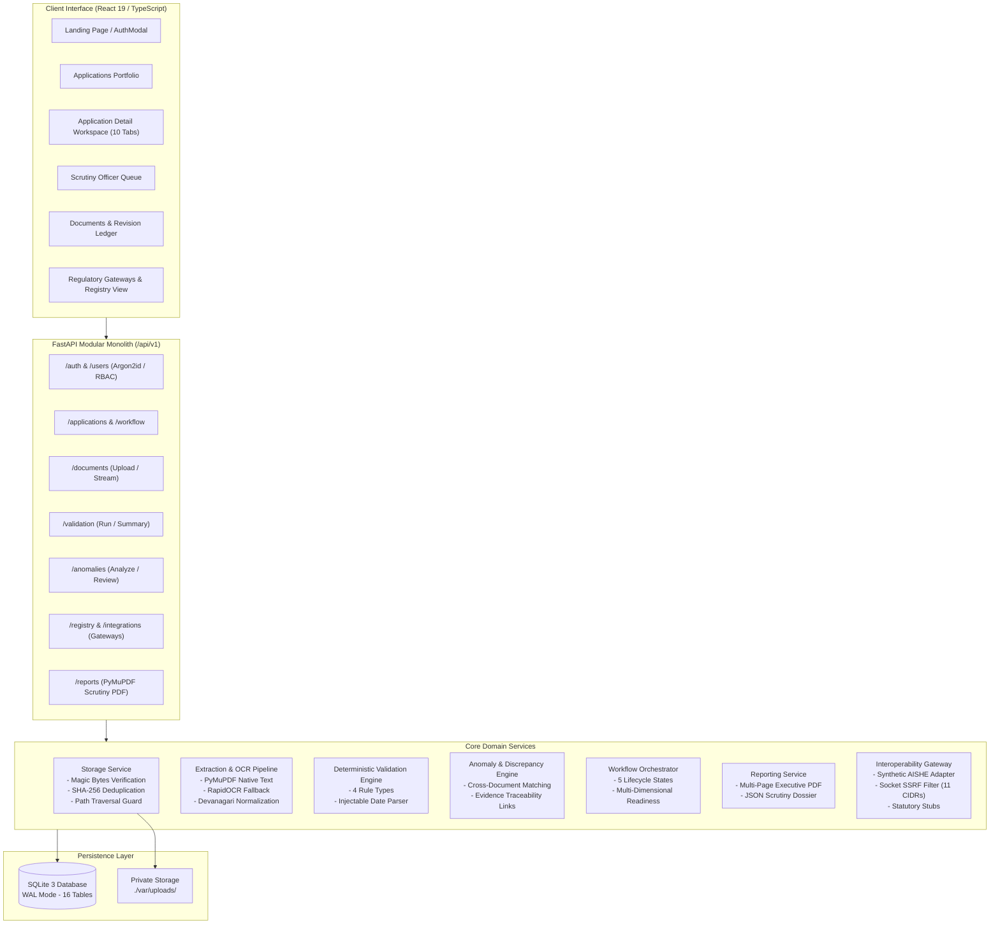

# Current Architecture Assessment: VerityAI Baseline

**Document ID:** ARCH-ASSESS-001  
**Project:** VerityAI / EntityLocker (SIH 2026, Smart Automation Track)  
**Evaluation Target:** Current Codebase Baseline (Commit `83f8c46` + Extended Phases 1–20)  
**Date of Audit:** 2026-10-24  
**Audit Standard:** Non-Destructive Inspection & Empirical Execution Verification  

---

## 1. Architectural Overview & Discovered Technologies

VerityAI is a **modular monolith** web application designed to support scrutiny officers in reviewing institutional approval filings. Inspection of the codebase establishes the following verified technical stack:

- **Backend:** Python 3.12 running **FastAPI** (`0.115.0`) on Starlette (`0.41.2`) and Uvicorn (`0.32.0`).
- **Database & ORM:** **SQLite 3** operating in Write-Ahead Logging (`WAL`) mode with `SQLAlchemy 2.0.36` declarative models and **Alembic** (`1.13.0`) migration tracking.
- **Document Extraction & Processing:** **PyMuPDF (`fitz`)** (`1.24.0`) for native digital PDF parsing and vector report generation; **RapidOCR** (`1.3.8`) on ONNX Runtime for CPU-based raster OCR fallback; Pillow (`10.4.0`) for image hygiene.
- **Security & RBAC:** **Argon2id** password hashing (`argon2-cffi 23.1.0`), **PyJWT** (`2.8.0`) with `HttpOnly` `SameSite=Lax` session cookies, strict custom CSRF headers (`X-Requested-With`), and socket-level DNS/IP egress filtering (`ipaddress`).
- **Frontend:** **React 19.3.1**, **TypeScript ~6.0.3**, **Vite 8.3.4**, Tailwind CSS 4.3.3, `@tanstack/react-query 5.104.5`, and Lucide React icons.

---

## 2. Verified End-to-End Workflow Diagram

---

## 3. Component-by-Component Empirical Analysis

### 3.1 Document Ingestion & Storage Subsystem
- **Source Paths:** `backend/app/services/storage.py`, `backend/app/api/v1/endpoints/documents.py`.
- **Database Model:** `Document` in `backend/app/models/document.py`.
- **Empirical Evidence:** 15 automated tests passing in `tests/test_documents.py`.
- **Verified Capabilities:**
  - Enforces strict content magic-byte verification (rejects files whose byte signatures do not match `%PDF-`, PNG `\x89PNG`, or JPEG `\xFF\xD8\xFF`).
  - Limits file size to 20MB (HTTP 413 `PayloadTooLargeException`).
  - Calculates SHA-256 hashes upon upload for duplicate detection.
  - Generates safe UUID-based storage keys outside public web roots; blocks path traversal attacks (`test_path_traversal_prevention`).
- **Known Limitations:**
  - Files are stored on local filesystem (`./var/uploads`); cloud object storage (S3/GCS/Azure Blob) is not configured.
  - Multi-part chunked upload for slow network connections is not implemented.

### 3.2 Text Extraction & Multilingual Processing
- **Source Paths:** `backend/app/services/extraction.py`, `backend/app/services/multilingual.py`.
- **Database Model:** `DocumentPage` in `backend/app/models/document_page.py`, `ProcessingRun` in `backend/app/models/processing_run.py`.
- **Empirical Evidence:** 13 tests passing in `tests/test_extraction.py`, 7 tests passing in `tests/test_multilingual.py`.
- **Verified Capabilities:**
  - Native digital PDF text extraction via PyMuPDF.
  - RapidOCR fallback triggered whenever digital characters on a page are $< 50$.
  - Devanagari numeral normalization (`०-९` $\to$ `0-9`) enables regex parsers to process bilingual Hindi/English approval certificates.
  - Unicode NFKC normalization and de-hyphenation across line breaks.
  - 30-page extraction cap safeguard against denial-of-service / resource exhaustion.
- **Known Limitations:**
  - Text is extracted linearly; tabular structures (e.g., Land Survey schedules, Faculty Cadre lists) lose table cell coordinates.
  - Local CPU-bound inference creates processing bottlenecks for multi-page scanned filings.

### 3.3 Deterministic Compliance Validation Engine
- **Source Paths:** `backend/app/services/validation.py`, `backend/app/models/validation.py`.
- **Database Models:** `ValidationRule`, `ValidationRun`, `RuleResult`.
- **Empirical Evidence:** 19 automated tests passing in `tests/test_validation.py`.
- **Verified Capabilities:**
  - Executes 4 deterministic rule types: `REQUIRED_DOCUMENT`, `REQUIRED_FIELD`, `EXPIRY_CHECK`, and `FIELD_EQUALS_APPLICATION`.
  - Date parser handles ISO 8601, DD/MM/YYYY, and textual month strings with explicit ambiguity flagging (`AMBIGUOUS`).
  - Rules snapshot into `ValidationRun` at execution time for historical auditability.
  - Clean separation: zero LLM or stochastic hallucination in compliance rules.
- **Known Limitations:**
  - Shipped with only 6 illustrative demonstration rules (`RULE-DOC-ACCRED`, `RULE-DOC-LAND`, `RULE-FLD-CERTNO`, `RULE-EXP-ACCRED`, `RULE-CMP-NAME`, `RULE-CMP-INTAKE`).
  - All rules apply exclusively to category `EOA_ILLUSTRATIVE`. Official AICTE APH clauses (cadre ratio 1:2:6, FSR 1:20, land acreage by municipality, built-up areas) are not yet codified.

### 3.4 Cross-Document Anomaly & Discrepancy Engine
- **Source Paths:** `backend/app/services/anomaly.py`, `backend/app/models/finding.py`.
- **Database Models:** `ExtractedField`, `Finding`, `FindingEvidence`.
- **Empirical Evidence:** 6 automated tests passing in `tests/test_anomalies.py`.
- **Verified Capabilities:**
  - Scans document text streams for candidate regex fields (`certificate_number`, `expiry_date`, `issue_date`, `approved_intake`, `institution_name`).
  - Executes cross-document pairwise checks:
    - `ANM-XDOC-NAME`: Flagging divergent institution names between filings.
    - `ANM-XDOC-INTAKE`: Flagging conflicting student capacity declarations.
    - `ANM-DATE-SANITY`: Flagging chronological date inversions (`issue_date > expiry_date`).
    - `ANM-DUPLICATE-FILE`: Flagging byte-for-byte SHA-256 collisions across applications.
    - `ANM-EXTRACTION-QUALITY`: Flagging degraded or unusable OCR text.
  - Creates granular `FindingEvidence` records pointing to exact source document ID and page number.
  - Carries forward reviewer adjudication status across re-evaluation runs.
- **Known Limitations:**
  - Candidate field discovery uses regular expressions; certificates with non-standard phrasing or varied layouts can be missed.
  - Does not evaluate layout manipulation or PDF incremental update tampering.

### 3.5 Reviewer Decision Support & Executive Reporting
- **Source Paths:** `backend/app/services/reporting.py`, `frontend/src/components/applications/ApplicationDetailWorkspace.tsx`.
- **Database Model:** `ScrutinyReport` in `backend/app/models/report.py`.
- **Empirical Evidence:** 5 automated tests passing in `tests/test_reports.py`.
- **Verified Capabilities:**
  - PyMuPDF generates multi-page vector PDF scrutiny dossiers with institutional header banners, status summary boxes, document checklists, rule results, and reviewer signatures.
  - Reviewer workspace provides 10 specialized tabs for triage, document preview, rule adjudication, anomaly resolution, and report generation.
  - Human-in-the-loop: The system strictly prohibits automated approvals or adverse rejections.
- **Known Limitations:**
  - PDF generation executes synchronously on the request thread.

### 3.6 Regulatory Gateways & SSRF Defenses
- **Source Paths:** `backend/app/services/integration.py`, `backend/app/services/registry.py`.
- **Database Models:** `ExternalPortalConfig`, `ExternalPortalSyncLog`, `RegistryRecord`, `RegistryVerificationRun`.
- **Empirical Evidence:** 6 tests passing in `tests/test_integration.py`, 9 tests passing in `tests/test_registry.py`.
- **Verified Capabilities:**
  - Three-tier gateway architecture:
    - Category A: Local Synthetic Regulatory Gateway (`LOCAL_SYNTHETIC_REGULATORY_GATEWAY`).
    - Category B: Configurable External REST Gateway (`CONFIGURABLE_REST_PORTAL`).
    - Category C: Official AICTE Production Stub (`OFFICIAL_AICTE_PORTAL_STUB`).
  - Strict outbound SSRF defense validates destination URLs, resolves hostnames via DNS, and blocks private/loopback/cloud-metadata CIDR blocks (`169.254.0.0/16`, `127.0.0.0/8`, `10.0.0.0/8`, `172.16.0.0/12`, `192.168.0.0/16`).
  - Masks authorization headers and secrets in sync logs.
  - Stubs honestly report `UNCONFIGURED` rather than fabricating external verification data.
- **Known Limitations:**
  - Live official AICTE and state board endpoints are not connected due to missing ministry credentials and government intranet access.

---

## 4. Empirical Test & Verification Results

| Target Suite | Test File / Command | Scope & Capabilities Verified | Result | Execution Time |
|---|---|---|---|---|
| **Backend Unit & Integration Suite** | `pytest backend/tests -q` | All 14 test modules (Auth, Ingestion, OCR, Validation, Anomalies, Gateways, Reporting, Versioning, Multilingual) | **121 passed, 11 warnings** | 15.66s |
| **Operational Workflow Verifier** | `python scripts/verify_e2e.py` | 12 operational capability workflows against live app | **12/12 workflows verified (100% health)** | 6.82s |
| **Frontend Production Build** | `npm run build` (in `frontend/`) | TypeScript compilation (`tsc -b`) and Vite production bundle | **Built successfully (0 errors)** | 352ms |

---

## 5. Architectural Strengths vs. Key Technical Gaps

### Strengths to Preserve
1. **Explainable Deterministic Core:** Compliance checks and anomaly flags cite exact rule codes, expected values, observed values, and document page numbers.
2. **Honest System Boundaries:** Clear separation between synthetic demonstration fixtures and statutory production endpoints; zero fake verification claims.
3. **Defense-in-Depth Security:** Strong password hashing (Argon2id), CSRF defense, strict security headers (`X-Content-Type-Options: nosniff`, `X-Frame-Options: DENY`), and socket-level SSRF filters.
4. **Append-Only Auditing:** Comprehensive event recording across all administrative and scrutiny actions.

### Confirmed Technical Gaps
1. **Regulatory Scope Gap:** The rule catalogue contains only 6 illustrative rules for 1 category; needs expansion to AICTE APH standards (cadre ratios, land contiguity, built-up area schedules).
2. **Document Checklist Gap:** Checklists are static; conditional document checklists based on institution category and application type do not exist.
3. **Table Extraction Gap:** OCR extracts linear text; tabular schedules (land survey numbers, faculty rosters) cannot be parsed into structured database records.
4. **Digital Signature Verification Gap:** PDF PKCS#7 / CMS digital signatures (`/ByteRange`) are not cryptographically validated against authorized Root CAs.
5. **Asynchronous Execution Gap:** Multi-page OCR and PDF generation run synchronously within HTTP request handlers.
