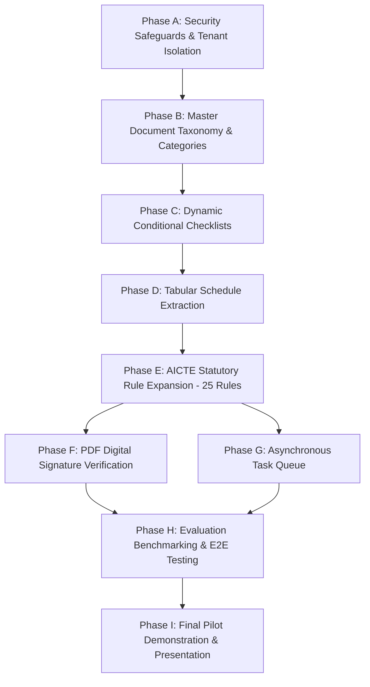

# Implementation Roadmap & Phase Sequencing

**Document ID:** ROADMAP-001  
**Project:** VerityAI / EntityLocker  
**Planning Authority:** Senior Engineering & Architecture Review Board  
**Target Milestone:** Production-Ready Pilot for SIH 2026 Scrutiny Demonstration  
**Last Updated:** 2026-10-24  

---

## 1. Roadmap Phasing Strategy & Principles

The implementation sequence follows strict dependency ordering:
1. **Security & Honest Disclosure First:** Eliminate cross-institution data access risks and establish clear status disclaimers on all evaluation UI cards before adding new features.
2. **Preserve Working Code:** Build upon the existing 121 passing backend tests, storage engine, extraction pipeline, and React 19 workspace without rewriting working modules.
3. **Incremental Vertical Slices:** Implement one capability end-to-end (Model $\to$ API $\to$ Engine $\to$ UI $\to$ Test) before beginning the next.
4. **Offline Primacy:** Ensure all newly added capabilities execute locally without paid cloud API dependencies.

---

## 2. Dependency-Aware Phase Sequence

---

## 3. Detailed Phase Specifications

### Phase A: Security Safeguards & Tenant Authorization (P0 — Immediate)
- **Objective:** Eliminate IDOR data leakage on document streaming and add regulatory disclaimer badges to UI.
- **Scope & Gaps Addressed:** `RSK-001`, `RSK-005`, `GAP-005`, `SEC-VULN-001`.
- **Dependencies:** None.
- **Affected Files:**
  - `backend/app/api/v1/endpoints/documents.py` (Route `GET /{document_id}/file`).
  - `frontend/src/components/compliance/ValidationComplianceView.tsx`.
  - `backend/app/services/reporting.py`.
- **Implementation Changes:**
  - Inject ownership verification ensuring `doc.application.institution_id == current_user.institution_id` for `INSTITUTION_USER`.
  - Add visual banner on UI validation cards stating: *"EVALUATED AGAINST ILLUSTRATIVE PROTOTYPE RULES — NOT AN OFFICIAL AICTE DETERMINATION"*.
- **Regression Risks:** None (valid user downloads unaffected).
- **Verification Criteria:** New test in `test_security_hardening.py` asserting HTTP 403 on foreign document requests; manual UI inspection confirming disclaimer banner.

### Phase B: Document Master Taxonomy & Application Categories (P1)
- **Objective:** Expand document catalogue from 2 to 25 distinct AICTE filing types and establish multi-category support.
- **Scope & Gaps Addressed:** `GAP-002`, `REQ-0001`–`REQ-0004`, `REQ-0047`–`REQ-0050`.
- **Dependencies:** Completion of Phase A.
- **Affected Files:**
  - `backend/app/models/category.py`, `backend/app/schemas/category.py`.
  - `backend/app/db/seed.py`.
  - `backend/app/models/document.py` (`declared_type`, `effective_type`).
- **Implementation Changes:**
  - Seed 4 core AICTE categories: `NEW_INSTITUTION`, `EOA_TECHNICAL`, `STANDALONE_PGDM`, `UNIVERSITY_TECHNICAL`.
  - Register 25 document types defined in `DOCUMENT_MASTER_CATALOG.csv` (Deeds, Building Plans, Fire NOCs, Affidavits 1–13, Formats 1–4, Certificates 1–3).
- **Regression Risks:** Low (preserve `EOA_ILLUSTRATIVE` for backward compatibility).
- **Verification Criteria:** `pytest backend/tests/test_applications.py` passing with multi-category creation tests.

### Phase C: Dynamic Conditional Document Checklists (P1)
- **Objective:** Enable checklists to adapt dynamically based on institution category, location (urban/rural), and application type.
- **Scope & Gaps Addressed:** `GAP-002`, `GAP-003`, `REQ-0017`.
- **Dependencies:** Completion of Phase B.
- **Affected Files:**
  - `backend/app/services/workflow.py` (`get_application_readiness`).
  - `backend/app/schemas/workflow.py`.
  - `frontend/src/components/applications/ApplicationDetailWorkspace.tsx`.
- **Implementation Changes:**
  - Implement checklist evaluator in `workflow.py` that computes required documents using conditional rules (e.g. building plans required for New Institution or Intake Increase, but optional for simple EoA).
  - Update `ApplicationReadinessResponse` to reflect dynamic missing types.
- **Regression Risks:** Medium (readiness score logic must preserve existing demo state).
- **Verification Criteria:** Unit tests in `test_workflow.py` testing conditional checklist resolution.

### Phase D: Tabular Schedule & Multi-Column Document Extraction (P1)
- **Objective:** Parse structured multi-column schedules (Land survey numbers, Certificate 2 room carpet areas).
- **Scope & Gaps Addressed:** `GAP-003`, `GAP-004`, `REQ-0008`, `REQ-0051`.
- **Dependencies:** Completion of Phase C.
- **Affected Files:**
  - `backend/app/services/extraction.py`.
  - `backend/app/models/document_page.py`.
- **Implementation Changes:**
  - Integrate PyMuPDF `page.find_tables()` to detect and extract tabular cell matrices.
  - Serialize schedules into structured JSON matching `DOCUMENT_FIELD_SCHEMAS.json`.
- **Regression Risks:** Low (linear text extraction preserved as primary stream).
- **Verification Criteria:** New test in `test_extraction.py` parsing multi-column room carpet area table.

### Phase E: AICTE Statutory Rule Expansion (25 Core Rules) (P1)
- **Objective:** Codify official AICTE APH regulations in the deterministic validation engine.
- **Scope & Gaps Addressed:** `GAP-001`, `REQ-0008`–`REQ-0060`.
- **Dependencies:** Completion of Phase D.
- **Affected Files:**
  - `backend/app/services/validation.py`.
  - `backend/app/services/anomaly.py`.
- **Implementation Changes:**
  - Add 20+ statutory rules:
    - `RULE-CADRE-RATIO`: Cadre distribution 1:2:6 (Prof:Assoc:Asst).
    - `RULE-FSR-UG`: Faculty student ratio 1:20 for UG Engineering.
    - `RULE-AREA-CLASSROOM`: Minimum $66\ m^2$ (division 60) / $33\ m^2$ (division 30).
    - `RULE-AREA-ADMIN`: Minimum $750\ m^2$ administrative area.
    - `RULE-AREA-AMENITIES`: Minimum $500\ m^2$ amenities area.
    - `RULE-EWS-MULTIPLIER`: $1.25\times$ intake multiplier verification.
    - `RULE-TFW-QUOTA`: $5\%$ supernumerary ceiling check.
    - `RULE-COMMITTEE-RAGGING`, `RULE-COMMITTEE-IC`, `RULE-COMMITTEE-SCST`: Mandatory committees.
- **Regression Risks:** Medium (existing illustrative rules preserved).
- **Verification Criteria:** Comprehensive suite in `test_validation.py` asserting formula evaluations.

### Phase F: Cryptographic Digital Signature (DSC) Validation (P2)
- **Objective:** Verify PDF digital signatures (`/ByteRange`, PKCS#7/CMS) against Indian CCA root certificates.
- **Scope & Gaps Addressed:** `GAP-004`, `RSK-002`, `REQ-0005`.
- **Dependencies:** Completion of Phase E.
- **Affected Files:**
  - `backend/app/services/extraction.py`.
  - `backend/app/models/document.py` (`signature_status`, `signer_details`).
  - `frontend/src/components/documents/DocumentsView.tsx`.
- **Implementation Changes:**
  - Parse PDF signature dictionary using PyMuPDF / `cryptography`.
  - Display signature status (Valid DSC, Unsigned, Tampered) on document preview.
- **Regression Risks:** Low (unsigned documents processed with status `UNSIGNED`).
- **Verification Criteria:** Unit test verifying validly signed and tampered test PDF fixtures.

### Phase G: Asynchronous Task Queue & Concurrency Hardening (P2)
- **Objective:** Move heavy OCR and PDF generation to background workers to eliminate worker starvation.
- **Scope & Gaps Addressed:** `GAP-006`, `RSK-003`.
- **Dependencies:** Completion of Phase E.
- **Affected Files:**
  - `backend/app/api/v1/endpoints/documents.py`.
  - `backend/app/services/extraction.py`.
- **Implementation Changes:**
  - Move document extraction to FastAPI background tasks; client polls document status.
- **Regression Risks:** Medium (frontend requires asynchronous polling updates).
- **Verification Criteria:** Upload of 30-page scan returns HTTP 202 immediately.

### Phase H: Evaluation Benchmarking & Automated E2E Testing (P2)
- **Objective:** Execute quantitative benchmarks across partitions A, B, and C; add Playwright automated browser tests.
- **Scope & Gaps Addressed:** `GAP-007`.
- **Dependencies:** Completion of Phases A–G.
- **Affected Files:** `scripts/evaluate_benchmarks.py`, `frontend/e2e/`.
- **Verification Criteria:** Automated benchmark report generated with CER, WER, precision, and recall metrics.

### Phase I: Final Pilot Demonstration & Presentation Package (P3)
- **Objective:** Final polish of demonstration script, slide deck, and presentation assets for SIH 2026.
- **Dependencies:** Completion of all prior phases.
- **Affected Files:** `docs/submission/`, `docs/DEMO_SCRIPT.md`.
- **Verification Criteria:** Zero regressions; 100% pre-flight readiness score.
