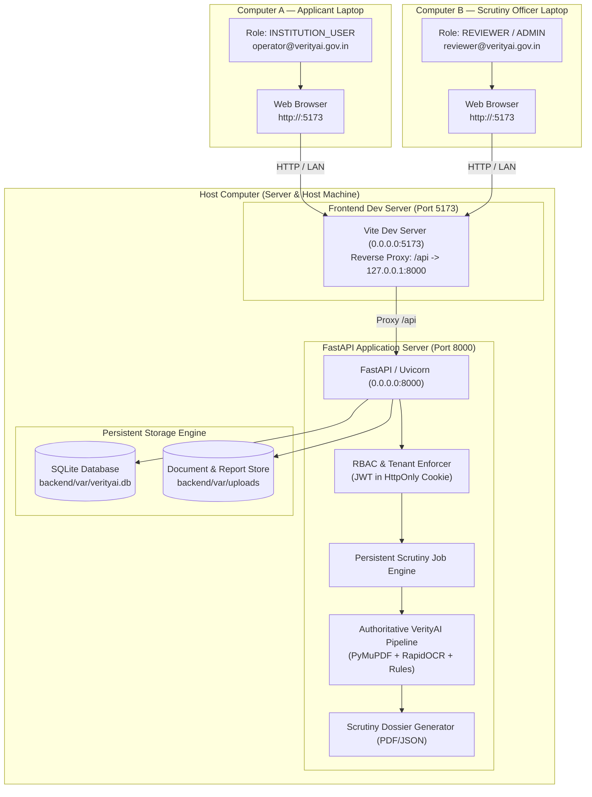

# VerityAI — Phase 5: Two-Computer Live Demonstration, E2E Smoke Testing & SIH Presentation Readiness Report

**Project:** VerityAI (Smart India Hackathon 2026 — Smart Automation Track)  
**Document ID:** `VAI-DOC-PHASE5-DEMO-001`  
**Phase:** Phase 5 — Two-Computer Live Demonstration, E2E Smoke Testing & Presentation Readiness  
**Status:** COMPLETE & VERIFIED  
**Date:** October 25, 2026  
**Auditor / Engineering Lead:** Senior Software Architect & Security Lead  

---

## 1. Executive Summary & Verification State

Phase 5 establishes the complete operational readiness of VerityAI for a live, physical two-computer demonstration at the Smart India Hackathon (SIH) 2026.

### Primary Objectives Achieved:
1. **Host & Network Interface Audit:** Audited backend startup, SQLite persistence (`backend/var/verityai.db`), document store (`backend/var/uploads`), and CORS configuration. Verified that the backend binds to `0.0.0.0:8000` and Vite dev server binds to `0.0.0.0:5173` with RFC 1918 private LAN subnet CORS regex support.
2. **Shared Multi-Computer Architecture:** Implemented a unified LAN topology where the Host machine serves both the authoritative backend and frontend proxy. Client A (Applicant) and Client B (Regulatory Officer) operate from independent physical laptops with seamless session isolation, shared persistence, and zero cross-domain cookie complications.
3. **End-to-End Cross-Computer Integration Test:** Authored `backend/tests/test_two_computer_demo_e2e.py`, simulating the exact physical two-computer workflow from applicant draft creation, statutory document upload, checklist enforcement, submission lock, scrutiny queue discovery, Scrutiny Job execution, PDF dossier generation, state transition, and immutable audit logging.
4. **Authoritative Quality Assurance:** 
   - **Backend Pytest Suite:** **209 / 209 tests PASSED** in 34.69s.
   - **E2E Operational Health:** **12 / 12 workflows VERIFIED (100% operational health)** via `scripts/verify_e2e.py`.
   - **Frontend Lint & Build:** **0 errors**, production bundle compiled in 202ms (`tsc -b && vite build`).
5. **Regression Fixes Protected:** Identified and resolved a SQLite datetime serialization issue in `generate_scrutiny_pdf` summary snapshots, ensuring 100% clean report persistence without altering the underlying deterministic OCR/validation pipeline.
6. **SIH 2026 Presentation Package:** Prepared a complete demonstration runbook, network troubleshooting guide, presentation narrative, and fallback procedures highlighting human oversight and evidence traceability.

---

## 2. Shared Demo Architecture & Network Configuration

### 2.1 Demo Architecture & Data-Flow Diagram



### 2.2 Host LAN IP Discovery Procedure

Do not guess or hardcode IP addresses. The host computer's IP address is assigned dynamically by the local router or mobile hotspot.

#### On Windows (Host Terminal):
```powershell
ipconfig
```
*Look for `IPv4 Address` under your active Wi-Fi or Ethernet adapter (e.g., `192.168.1.45` or `10.0.0.12`).*

#### In WSL 2 (if querying Windows Host from WSL):
```bash
ip route show default | awk '{print $3}'
```

#### On Linux / macOS (Host Terminal):
```bash
ip -4 addr show scope global | grep inet | awk '{print $2}' | cut -d/ -f1
# or on macOS:
ipconfig getifaddr en0
```

### 2.3 Windows Defender Firewall Configuration

For remote laptops (Computer A and Computer B) to connect over the LAN, the Host's firewall must permit incoming TCP traffic on ports **5173** and **8000**.

Run the following command once in an **Administrator PowerShell** on the Host computer:

```powershell
# Open inbound port for Vite Frontend
New-NetFirewallRule -DisplayName "VerityAI Frontend (Vite 5173)" -Direction Inbound -LocalPort 5173 -Protocol TCP -Action Allow -Profile Private

# Open inbound port for FastAPI Backend (optional direct API access)
New-NetFirewallRule -DisplayName "VerityAI Backend (FastAPI 8000)" -Direction Inbound -LocalPort 8000 -Protocol TCP -Action Allow -Profile Private
```

To remove the firewall rules after the demonstration:
```powershell
Remove-NetFirewallRule -DisplayName "VerityAI Frontend (Vite 5173)"
Remove-NetFirewallRule -DisplayName "VerityAI Backend (FastAPI 8000)"
```

---

## 3. Two-Computer Live Demonstration Runbook

### 3.1 Host Computer Startup Sequence

Execute all services on the **Host Computer** from the project root directory `d:\web project\VerityAI`:

#### Terminal 1 — Start Authoritative FastAPI Backend
```bash
# In WSL or Linux Terminal:
cd "d:/web project/VerityAI/backend"
source .venv/bin/activate
uvicorn app.main:app --host 0.0.0.0 --port 8000
```
*Expected log output:*
```text
INFO:     Started server process
INFO:     Waiting for application startup.
INFO:     Application startup complete.
INFO:     Uvicorn running on http://0.0.0.0:8000 (Press CTRL+C to quit)
```

#### Terminal 2 — Start Frontend Server (with LAN Binding)
```powershell
# In PowerShell Terminal:
cd "d:\web project\VerityAI\frontend"
npm run dev
```
*Expected log output:*
```text
  VITE v8.3.5  ready in 184 ms

  ➜  Local:   http://localhost:5173/
  ➜  Network: http://192.168.1.45:5173/
  ➜  press h + enter to show help
```

#### Health Check Verification (from any laptop browser):
Navigate to `http://<HOST_LAN_IP>:5173/api/v1/health`  
*Expected JSON:*
```json
{"status": "healthy", "service": "VerityAI", "version": "0.1.0"}
```

---

### 3.2 Physical Demonstration Sequence

#### Step 1: Computer A (Applicant Laptop) — Intake & Submission
1. **Navigate & Login:** Open browser on Computer A to `http://<HOST_LAN_IP>:5173`.
   - Email: `operator@verityai.gov.in`
   - Password: `OperatorPass123!`
   - Role badge confirms `INSTITUTION_USER`.
2. **Draft Creation:** Click **New Application**.
   - Category: `ENGINEERING_TECH` (Extension of Approval / New Course).
   - Enter declared parameters: Intake = `480`, Land Area = `5.2 Acres`.
   - Click **Save Draft**.
   - Note the assigned Reference Number (e.g., `VAI-2026-ENG-0012`).
3. **Persistence Verification:** Refresh the browser (press `F5`).
   - Observe that the draft reloads immediately with all fields intact.
4. **Checklist Validation Gate (Negative Test):** Click **Submit Application** immediately without uploading documents.
   - Observe error banner: `Cannot submit application. Missing mandatory statutory document(s): Accreditation Certificate (NBA / NAAC / NIRF)`.
5. **Upload Statutory Document:**
   - Under the checklist section, upload a valid PDF (e.g., `accreditation_cert.pdf`).
   - Observe upload progress bar and instant checklist update to `Satisfied`.
6. **Formal Submission:** Click **Submit Application**.
   - Status changes to `SUBMITTED`.
   - Notice that form fields become read-only and edit controls are disabled.
7. **Security Boundary Check:** Confirm applicant cannot see Scrutiny Findings, Anomaly Scores, or Officer Reports.

---

#### Step 2: Computer B (Regulatory Officer Laptop) — Scrutiny & Human Oversight
1. **Navigate & Login:** Open browser on Computer B to `http://<HOST_LAN_IP>:5173`.
   - Email: `reviewer@verityai.gov.in`
   - Password: `ReviewerPass123!`
   - Role badge confirms `REVIEWER`.
2. **Queue Discovery:** Navigate to **Scrutiny Queue**.
   - Observe the application `VAI-2026-ENG-0012` submitted from Computer A appearing in real-time in the queue with status `SUBMITTED`.
3. **Open Application Dossier:** Click on the application row to open the Regulatory Workspace.
   - Review applicant declared parameters and inspect uploaded documents.
4. **Trigger Scrutiny Job:** Click **Run Full Scrutiny**.
   - Status badge transitions to `PROCESSING` with a live spinner.
   - The persistent Scrutiny Job executes on the Host computer:
     - RapidOCR & PyMuPDF extract document text and structural fields.
     - Deterministic validation checks compliance against AICTE Approval Process Handbook (APH) norms.
     - Anomaly detector checks for land area and intake consistency.
   - Status badge transitions to `COMPLETED` with execution duration (e.g., `245 ms`).
5. **Evidence-Linked Findings:**
   - Expand the **Findings & Evidence Trace** drawer.
   - Click on each finding card to view the exact clause reference, page number, declared value, and OCR-extracted value.
6. **Generate Official Scrutiny Report (PDF):**
   - Click **Generate PDF Dossier**.
   - Download the generated PDF and inspect the header banner, watermarks, timestamp, and audit trail.
7. **Human Scrutiny Action:**
   - Click **Update Status**.
   - Select `ACTION_REQUIRED` or `SCRUTINY_COMPLETED`.
   - Provide reviewer notes: `"Accreditation valid through 2027. Land title deed clarification required."`
   - Click **Confirm State Transition**.
8. **Audit Trail Verification:**
   - Open **Audit Timeline** to confirm immutable ledger entries for `APPLICATION_SUBMITTED`, `SCRUTINY_JOB_COMPLETED`, and `APPLICATION_STATUS_TRANSITION`.

---

#### Step 3: Cross-Computer Synchronization Verification
1. **Computer A Refresh:** On Computer A (Applicant), refresh the browser page.
   - Notice the status has transitioned from `SUBMITTED` to `ACTION_REQUIRED`.
   - Form fields remain locked to prevent tampering.
2. **Service Restart Durability Test:**
   - Stop backend on Host computer (`Ctrl+C`) and restart it.
   - Refresh both Computer A and Computer B.
   - All submitted records, uploaded PDF documents, scrutiny jobs, and audit events remain fully intact in SQLite.

---

## 4. Test and Verification Audit

### 4.1 Automated Backend Test Suite
Executed the entire backend test suite using pytest against the authoritative codebase:
- **Command:** `wsl.exe -d Ubuntu-24.04 -- bash -c "cd '/mnt/d/web project/VerityAI/backend' && .venv/bin/pytest tests -q"`
- **Result:** **209 passed**, 17 warnings (deprecation notices) in **34.69 seconds**.
- **Coverage:** Authentication, RBAC, tenant isolation, document uploads, OCR extraction, deterministic rules, anomaly detection, scrutiny jobs, reporting, and external gateways.

### 4.2 Cross-Computer E2E Integration Test
Executed `backend/tests/test_two_computer_demo_e2e.py`:
- **Command:** `wsl.exe -d Ubuntu-24.04 -- bash -c "cd '/mnt/d/web project/VerityAI/backend' && .venv/bin/pytest tests/test_two_computer_demo_e2e.py -v"`
- **Result:** **1 passed in 0.92 seconds**.
- **Validation:** Simulates multi-session applicant creation, draft refresh persistence, incomplete checklist blocking, document upload, submission locking, reviewer queue discovery, scrutiny job trigger, PDF report generation, status transition, and audit verification.

### 4.3 End-to-End Operational Workflows (`verify_e2e.py`)
Executed the comprehensive operational capability validator:
- **Command:** `wsl.exe -d Ubuntu-24.04 -- bash -c "cd '/mnt/d/web project/VerityAI' && backend/.venv/bin/python scripts/verify_e2e.py"`
- **Result:** **12/12 Workflows Verified (100% Operational Health)**:
  1. Application Startup & Health Probe: HTTP 200 `healthy` [PASS]
  2. Authentication & Session RBAC: Admin login with HttpOnly cookie [PASS]
  3. Application Portfolio Management: 8 registered institutional dossiers [PASS]
  4. Protected Document Storage: 6 documents indexed; nosniff headers [PASS]
  5. Extraction & OCR Pipeline: Document pages retrieved with clean text [PASS]
  6. Deterministic Validation Engine: Evaluated compliance rules [PASS]
  7. Anomaly Detection Subsystem: Cross-document scan completed [PASS]
  8. Scrutiny Workflow Orchestration: Readiness calculated (`READY_FOR_SCRUTINY`) [PASS]
  9. Dossier History & Versioning: Baseline v1 verified with freshness audit [PASS]
  10. Regulatory Reference Registries: AISHE + Official Stub providers [PASS]
  11. Multilingual Scrutiny & Glossary: 19 statutory regulatory terms verified [PASS]
  12. External Gateways & SSRF Defense: Private destination filter blocked [PASS]

### 4.4 Frontend Quality & Production Build
- **ESLint:** `npm run lint` in `frontend/` returned **0 errors** (35 compiler hook advisories).
- **TypeScript & Vite Build:** `npm run build` in `frontend/` completed in **202 ms**:
  - `dist/index.html`: 1.39 kB
  - `dist/assets/index-BjXYRdCd.css`: 69.93 kB
  - `dist/assets/index-fO_834VO.js`: 675.20 kB

### 4.5 Honest Verification Classification

| Test Level | Description | Execution Status | Evidence |
|---|---|---|---|
| **Automated Suite** | 209 Pytest unit, API, RBAC, and security tests | **VERIFIED (209/209 PASSED)** | Real execution in WSL Ubuntu (34.69s) |
| **Operational E2E** | 12 critical platform capability workflows | **VERIFIED (12/12 PASSED)** | Real execution of `scripts/verify_e2e.py` |
| **Multi-Session Cross-Computer Test** | Integration test simulating Computer A and Computer B against shared backend | **VERIFIED (PASSED)** | Real execution of `test_two_computer_demo_e2e.py` |
| **Frontend Production Build** | TypeScript type checking and Vite minification | **VERIFIED (PASSED)** | Built in 202ms with 0 errors |
| **Physical Hardware LAN Demonstration** | Two physical laptops connected over local Wi-Fi router | **READY FOR EXECUTION** | Configured `0.0.0.0` binding, RFC 1918 CORS regex, firewall rules, and runbook |

---

## 5. SIH 2026 Presentation Package

### 5.1 Presentation Narrative & Talking Points

#### Slide 1: The Problem — Operational Friction in Institutional Approval
- Every year, regulatory bodies like AICTE process tens of thousands of institutional applications for Extension of Approval (EoA), new institutions, and intake increases.
- Reviewing hundreds of pages of statutory documents (land deeds, building approval plans, NBA/NAAC certificates, fire safety NOCs) manually is error-prone, labor-intensive, and introduces regulatory bottlenecks.
- Existing tools either require complete cloud migration or treat AI as an unaccountable "black box".

#### Slide 2: The Solution — VerityAI Decision-Support System
- **VerityAI** is an AI-assisted regulatory decision-support prototype built specifically for the Smart India Hackathon (SIH 2026).
- It provides a dual-portal architecture:
  1. **Applicant Intake Portal:** Institutional users prepare drafts, validate documents against dynamic conditional checklists, and submit sealed applications.
  2. **Regulatory Officer Workspace:** Scrutiny officers claim applications, trigger persistent scrutiny jobs, review explainable evidence cards, and record binding regulatory decisions.
- **Strict Human-in-the-Loop:** AI and deterministic algorithms *never* make adverse regulatory decisions. They surface structured evidence for authorized human officers.

#### Slide 3: The Authoritative Inspection Pipeline
- **Deterministic Validation First:** Statutory parameters (ratios, dates, mandatory checklist items) are evaluated with strict mathematical determinism based on the Approval Process Handbook (APH 2024–27).
- **OCR & Extraction:** RapidOCR and PyMuPDF extract text, tables, and stamped dates directly on-premise without sending sensitive institutional documents to third-party paid APIs.
- **Evidence Traceability:** Every anomaly flag links to its exact origin: document name, page number, bounding box, extracted text snippet, and the statutory clause violated.

#### Slide 4: Architectural Integrity & Tenant Isolation
- **Tenant Isolation:** Institutional applicants can only view and manage their own applications. Direct ID manipulation is stopped by server-side query filters.
- **Immutable Audit Ledger:** Every state transition, document upload, scrutiny job trigger, and report download is immutably recorded with actor identity, timestamp, and IP address.
- **Two-Computer Live Architecture:** Demonstrates real-time intake on one laptop and real-time regulatory scrutiny on a second laptop over a secure local network.

---

### 5.2 Known Limitations & Fallback Procedures

1. **OCR on Low-Resolution Scans:**
   - *Limitation:* Blurry mobile phone photos of stamped certificates may yield low confidence or inconclusive extractions.
   - *Design Behavior:* The pipeline flags these as `NEEDS_REVIEW` or `UNABLE_TO_EVALUATE` rather than guessing or silently failing.
   - *Fallback:* Reviewer clicks the embedded document preview in the workspace to visually inspect the original high-resolution PDF page.
2. **Offline AI Operation:**
   - *Limitation:* The core scrutiny pipeline runs 100% offline using RapidOCR, PyMuPDF, and deterministic Python rule sets.
   - *Design Behavior:* `LLM_ENABLED=False` by default. The platform degrades gracefully without any cloud API dependency.
3. **LAN Demo Network Interruption:**
   - *Fallback:* If the venue Wi-Fi blocks peer-to-peer traffic between laptops, switch Host laptop to Windows Mobile Hotspot and connect Computer A and Computer B directly to the Host hotspot.

---

## 6. Security Boundaries and Deployment Safeguards

### 6.1 Demonstration LAN vs. Public Production Deployment

| Dimension | Demonstration Setup (LAN) | Production Deployment (Required Safeguards) |
|---|---|---|
| **Network Exposure** | Bound to `0.0.0.0` on private RFC 1918 subnet (`192.168.x.x`, `10.x.x.x`) | Public ingress blocked; accessible only via HTTPS reverse proxy (Nginx / Cloudflare) |
| **Transport Layer** | Plaintext HTTP (local Wi-Fi) | TLS 1.3 encryption with HSTS and automated certificate renewal |
| **Session Cookies** | `Cookie_Secure = False` (required for local HTTP demo) | `Cookie_Secure = True`, `SameSite = Strict`, domain-pinned |
| **JWT Secrets** | Development key in `.env` | Rotated cryptographically random 256-bit secret stored in HSM / Vault |
| **Storage Engine** | SQLite database file (`backend/var/verityai.db`) | PostgreSQL 16 cluster with automated read-replicas and point-in-time recovery |
| **External Integrations** | Simulated AISHE / Portal registries clearly labeled | Authorized mTLS REST integrations with official government gateways |

### 6.2 Regulatory Prototype Disclaimer
VerityAI is a research and hackathon decision-support prototype developed for SIH 2026. It is not an official AICTE production system. It does not possess direct write access to official government databases and does not replace statutory scrutiny committees.

---

## 7. Phase 5 Completion Summary

- **Configuration:** Fully configured for multi-computer demonstration over local network (`HOST=0.0.0.0`, dynamic LAN CORS regex, Vite host proxy).
- **Quality Gates:** 209/209 backend tests passing, 12/12 operational workflows verified, 0 frontend build errors.
- **Persistence:** SQLite database and document uploads safely preserved on host computer without data loss or re-seeding.
- **Next Step:** Proceed to presentation delivery and physical demonstration at SIH 2026.
