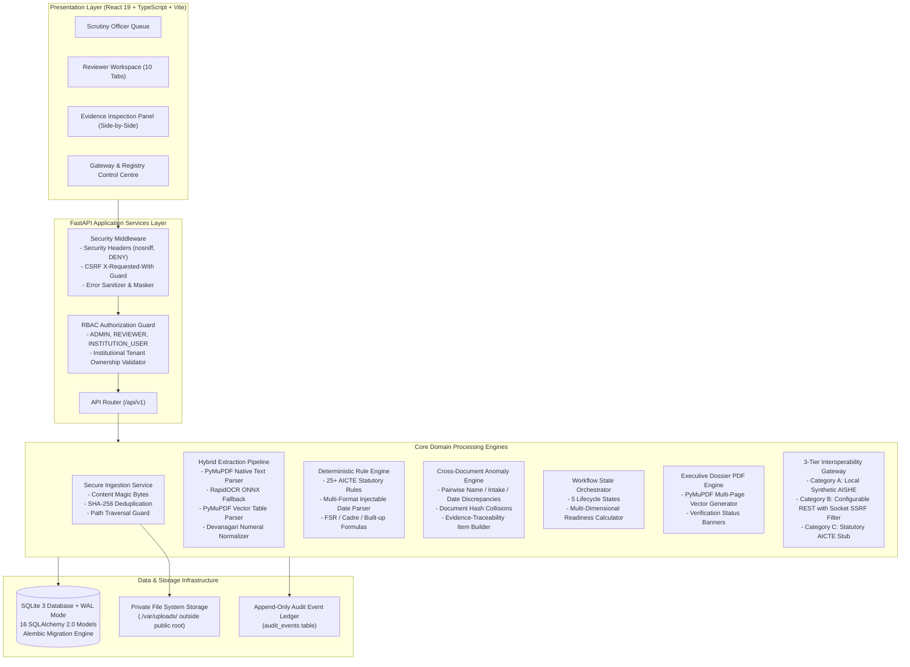

# Target Architecture Specification

**Document ID:** TARGET-ARCH-001  
**Project:** VerityAI / EntityLocker  
**Design Authority:** Multidisciplinary Systems Architecture Team  
**Objective:** Target Architecture for Production-Ready AICTE Document Scrutiny  
**Last Updated:** 2026-10-24  

---

## 1. Architectural Design Principles

The target architecture is governed by seven non-negotiable principles:
1. **Explainable Decision Support:** The system never issues an automated adverse decision. Findings provide direct evidence links (document, page, field, observed value, and source rule).
2. **Deterministic-First Core:** Statutory rules (dates, ratios, area thresholds, document presence) are evaluated deterministically in code.
3. **Zero Paid Cloud AI Lock-In:** Core extraction and validation must function offline on self-hosted open-source libraries (PyMuPDF, RapidOCR ONNX, local regex/tabular parsers).
4. **Untrusted Data Boundary:** Document contents are treated strictly as untrusted data; prompt injection defenses isolate text from control instructions.
5. **Defense-in-Depth Security:** Strict RBAC, session cookie security (`HttpOnly`), CSRF protection, and socket-level egress SSRF IP filtering.
6. **Immutable Provenance & Auditing:** Point-in-time reproducibility using immutable `ApplicationVersion` and `ValidationRun` snapshots.
7. **Honest System Boundaries:** Clear labeling of synthetic demonstration fixtures versus statutory government stubs.

---

## 2. Target System Architecture Diagram

---

## 3. Subsystem Technical Specifications

### 3.1 Document Ingestion & Storage Subsystem
- **MIME & Byte Inspection:** Strict content inspection of byte headers (`%PDF-`, `\x89PNG`, `\xFF\xD8\xFF`) before writing to disk.
- **Deduplication:** Compute SHA-256 hash immediately upon receipt; index in `documents.sha256` for cross-application collision detection.
- **Storage Isolation:** Store files with random UUID keys under `./var/uploads/{category}/{uuid}`. Strictly prohibit direct public web access. All document previews stream through authenticated API endpoint with `X-Content-Type-Options: nosniff`.
- **Tenant Authorization:** Enforce `doc.application.institution_id == current_user.institution_id` for all `INSTITUTION_USER` file requests.

### 3.2 Hybrid Extraction & Tabular Schedule Engine
- **Text Layer Extraction:** PyMuPDF extracts native digital text and font metadata.
- **Scanned Page Fallback:** Trigger RapidOCR on pages where extracted text $< 50$ characters.
- **Tabular Schedule Parser:** PyMuPDF `page.find_tables()` converts Certificate 2 room schedules and land deed survey tables into structured JSON arrays matching `DOCUMENT_FIELD_SCHEMAS.json`.
- **Devanagari Normalization:** Automatic character translation converts Hindi numerals (`०-९`) to standard ASCII digits (`0-9`) prior to regex field discovery.

### 3.3 Expanded Deterministic Rule Engine
- **Dynamic Checklists:** Evaluate required document sets based on application type (`NEW_INSTITUTION`, `EOA_TECHNICAL`, `STANDALONE_PGDM`, `UNIVERSITY`) and institutional profile.
- **25+ AICTE Statutory Rules:**
  - Cadre Ratio (1:2:6 Prof:Assoc:Asst) and FSR (1:20 UG Engineering, 1:25 Diploma).
  - Minimum Built-Up Areas: Instructional (Classroom $66/33\ m^2$, Labs $66\ m^2$), Administrative ($750\ m^2$), Amenities ($500\ m^2$), ACA ($25\%$).
  - Land Requirements: FSI/FAR compliance certification; max 3 contiguous plots within 2km distance; minimum 30-year lease title.
  - Quota Multipliers: 10% EWS reservation ($1.25\times$ intake multiplier); 5% supernumerary TFW scheme; 15% supernumerary FN/OCI seats.
  - Mandatory Committees: Anti-Ragging, SGRC & University Ombudsman, Internal Committee (IC), and SC/ST Committee.

### 3.4 Regulatory Interoperability Gateways
- **SSRF Defense:** Maintain socket-level DNS resolution and IP address validation against 11 private/cloud-metadata CIDR blocks before executing any outbound HTTP request.
- **Statutory Stubs:** Unconnected central government endpoints honestly disclose status as `UNCONFIGURED` without fabricating records.
